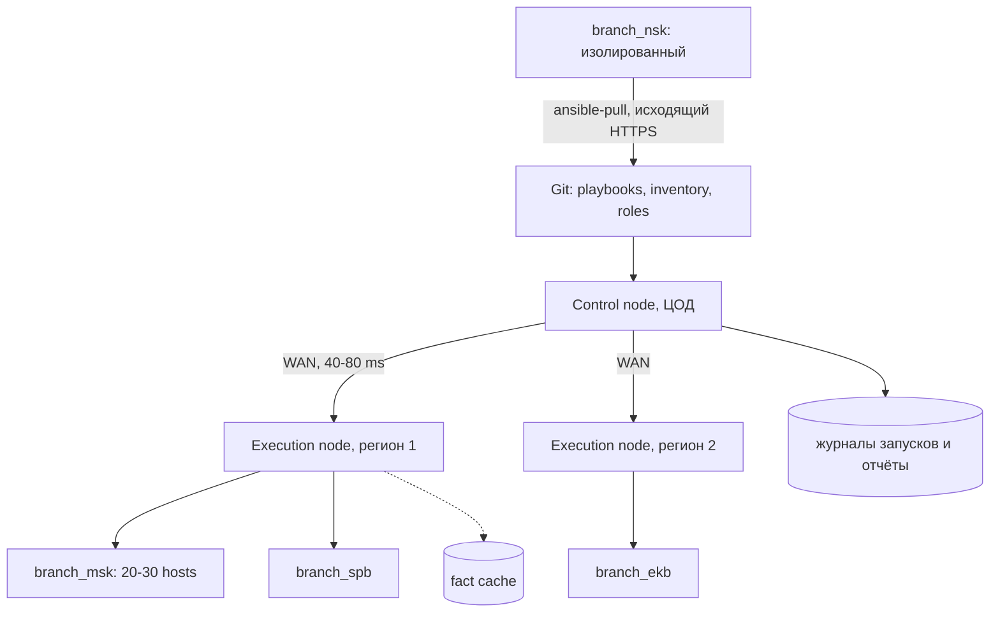

# Распределённые филиалы

Филиальная сеть превращает обычный playbook в распределённую операцию: между control node и managed node находятся WAN-каналы с задержкой, потерями и обрывами. Для 200–1000 хостов на 10–50 площадках это означает, что надёжность запуска определяется не только кодом роли, но и моделью исполнения, таймаутами и расписанием.

## 1. Зачем это нужно

В одном ЦОД повторный запуск playbook стоит минуты. В филиальной сети тот же запуск идёт часами, часть хостов недоступна, а промежуточное состояние после обрыва канала нужно уметь продолжить, а не начинать заново. Если control node один и находится в ЦОД, каждый ночной прогон зависит от доступности всех каналов одновременно.

Типичная картина: 10–50 площадок по 20–30 хостов, задержка 20–80 мс, единичные потери пакетов и несколько обрывов в месяц. Один playbook на 600 хостов через такой канал идёт не минуты, а часы, и всё это время часть хостов уже изменена, а часть ещё ждёт своей очереди. Если в этот момент пропадает канал до площадки, playbook останавливается в середине партии, и состояние парка становится неоднородным.

Практические цели:

1. Ограничить blast radius одной площадкой или одной партией хостов.
2. Пережить обрыв WAN без ручного восстановления состояния.
3. Иметь проверяемый след: кто, когда и с какой версией кода менял хост.

Отдельная сложность — люди. Ночное окно в филиале длится два-три часа, дежурный инженер не должен вручную перезапускать playbook после каждого обрыва. Поэтому устойчивость к сбоям закладывается в конфигурацию и расписание, а не в героизм оператора.

## 2. Ключевые понятия

| Понятие | Назначение | Пример |
|---|---|---|
| Control node | узел, с которого запускается `ansible-playbook` | `ans-ctl01.dc.example.local` |
| Execution node | дополнительный control node ближе к филиалам | `ans-exec-msk` |
| `ansible-pull` | запуск playbook на самом хосте из Git | таймер в филиале без входящего SSH |
| `serial` | число хостов в одной партии | `serial: "10%"` |
| `throttle` | предел одновременных воркеров на play/блок | `throttle: 5` |
| `forks` | параллелизм control node | `forks = 25` |
| Fact cache | кэш фактов между запусками | `jsonfile` |
| Canary | первая партия для проверки | один филиал |
| Maintenance window | согласованное окно изменений | `01:00-04:00` |
| WAN-профиль | ожидаемые задержка и потери площадки | `latency_ms: 45` |
| Offline-снимок | сохранённый inventory и факты | `ansible-inventory --list` |
| Unreachable | хост не ответил по SSH | `UNREACHABLE!` |

## 3. Схема



На схеме два пути исполнения: push через региональный execution node и pull внутри изолированного филиала. Журналы и кэш фактов остаются на стороне автоматизации, а не на рабочих станциях инженеров.

## 4. Модели исполнения

| Критерий | Центральный control node | Региональный execution node | `ansible-pull` |
|---|---|---|---|
| Где выполняется логика | ЦОД | регион | каждый managed node |
| Зависимость от WAN | постоянная | только при запуске и доставке кода | только исходящий Git |
| Секреты | на одном узле | на нескольких узлах | на всех хостах, худший вариант |
| Аудит | единый журнал | журналы по регионам | локальные журналы, сбор отдельно |
| Требования | ресурсы под `forks` | ВМ в регионе, Git, vault | Python, Git, таймер на хосте |
| Когда выбирать | до 200 хостов, стабильные каналы | 500+ хостов, слабые каналы | изолированные площадки, air-gapped |

Гибридная схема практична: центральный control node запускает оркестрацию, региональные execution nodes выполняют массовые ночные прогоны, а `ansible-pull` остаётся для площадок, куда входящий SSH запрещён. Смешивать модели в одном playbook не стоит: у них разные источники секретов и разный аудит.

Региональный execution node — это не второй control node «на всякий случай», а отдельная trust boundary. На нём лежат расшифрованные vault-секреты, ключи и кэш фактов, поэтому узел требует того же харденинга, что и центральный. Если регион скомпрометирован, злоумышленник получает доступ ко всем площадкам этого региона, но не к остальным. Синхронизацию кода и коллекций делайте через Git и `requirements.yml` с точными версиями, а не копированием каталогов.

`ansible-pull` удобен там, где входящие подключения запрещены, но переносит секреты на каждый managed node. Для такого филиала выдавайте отдельный read-only deploy key на репозиторий, ограничивайте содержимое репозитория и не храните в нём vault-пароль. Хост с `ansible-pull` должен уметь сам сообщить о результате: локальный журнал, метрика или отчёт в SIEM, иначе провал останется незамеченным до следующего аудита.

## 5. Иерархия inventory, расписания и кэши

Группы филиалов задают не только состав, но и политику запуска. Минимальный набор переменных площадки:

```yaml
# inventories/prod/group_vars/branch_msk.yml
branch_code: msk
branch_wan_latency_ms: 45
branch_maintenance_window: "01:00-04:00"
branch_canary: true
```

`branch_canary: true` отмечает площадку, которую можно менять первой. Полная иерархия групп описана в разделе [Inventory и группы](../fundamentals/05-inventory.md); здесь важно, что паттерн `branch_*` всегда означает «все филиалы», а не «все хосты».

Расписание ночного прогона на control node:

```bash
0 2 * * * cd /opt/ansible && flock -n /var/lock/nightly.lock \
  ansible-playbook -i inventories/prod/ site.yml --limit 'branch_*' \
  >> /var/log/ansible/nightly.log 2>&1
```

`flock` не даёт двум запускам пересечься, если предыдущий завис на медленном канале. В AWX ту же роль выполняет schedule с конкурентностью job template, равной единице.

Факты кэшируются между запусками, чтобы не собирать их повторно через медленный WAN:

```ini
fact_caching = jsonfile
fact_caching_connection = ./.cache/facts
fact_caching_timeout = 43200
```

Кэш ускоряет прогон, но хранит устаревшие данные. После ручных изменений на хосте используйте `--flush-cache` или `ansible.builtin.meta: clear_facts`. Для площадки, которая недоступна, снимите offline-снимок inventory заранее:

```bash
ansible-inventory -i inventories/prod/ --list --output /var/backups/inventory-$(date +%F).json
```

## 6. Пошаговая реализация

1. Опишите филиалы группами `branch_<code>` и задайте `branch_code`, окно и WAN-профиль.
2. Настройте `ansible.cfg` под задержки WAN: таймауты, повторы SSH, `pipelining`, кэш фактов.
3. Проверьте доступность canary-филиала отдельным play без изменений.
4. Прогоните `--check --diff` на одном филиале и разберите diff.
5. Примените на одном хосте, затем на филиале, затем на 10% парка.
6. Поставьте расписание и убедитесь, что журналы попадают в SIEM.

Конфигурация control node для филиальной сети:

```ini
[defaults]
inventory = ./inventories/prod/
forks = 25
timeout = 45
gathering = smart
host_key_checking = True
retry_files_enabled = False
fact_caching = jsonfile
fact_caching_connection = ./.cache/facts
fact_caching_timeout = 43200
stdout_callback = default

[ssh_connection]
pipelining = True
ssh_args = -C -o ControlMaster=auto -o ControlPersist=120s -o ConnectTimeout=15 -o ServerAliveInterval=30 -o ServerAliveCountMax=3
retries = 2
```

`retries = 2` повторяет SSH-подключение при кратком обрыве, `ControlPersist` переиспользует соединение для нескольких задач, `timeout = 45` отсекает зависшие сессии. Значения `forks` и `timeout` подбираются на пилоте: слишком большой `forks` на канале 10 Мбит/с даёт больше таймаутов, чем параллелизма. Остальные параметры разобраны в разделе [Конфигурация ansible.cfg](../fundamentals/04-config.md).

## 7. Полный пример

```yaml
---
- name: Preflight branch connectivity
  hosts: branches
  gather_facts: false
  serial: "20%"
  max_fail_percentage: 20

  tasks:
    - name: Wait for SSH before the change window
      ansible.builtin.wait_for_connection:
        delay: 2
        timeout: 60
        connect_timeout: 15

- name: Apply baseline to branches
  hosts: branches
  become: true
  gather_facts: true
  serial: "10%"
  max_fail_percentage: 10
  throttle: 5

  vars:
    baseline_packages:
      - chrony
      - rsyslog

  tasks:
    - name: Require maintenance window confirmation
      ansible.builtin.assert:
        that:
          - maintenance_window_confirmed | default(false) | bool
        fail_msg: >-
          Run with -e maintenance_window_confirmed=true
          inside the approved window for {{ branch_code }}
        quiet: true

    - name: Apply baseline packages
      block:
        - name: Ensure baseline packages are present
          ansible.builtin.package:
            name: "{{ baseline_packages }}"
            state: present

        - name: Record branch identity in MOTD
          ansible.builtin.copy:
            content: |
              Managed by Ansible. Branch: {{ branch_code }}.
              Host: {{ inventory_hostname }}. Window: {{ branch_maintenance_window }}.
            dest: /etc/motd
            owner: root
            group: root
            mode: "0644"

      rescue:
        - name: Report branch failure without hiding it
          ansible.builtin.debug:
            msg: >-
              Baseline failed on {{ inventory_hostname }} ({{ branch_code }}).
              Host stays in its previous state; inspect the task output.

    - name: Verify package manager metadata
      ansible.builtin.command:
        argv:
          - /usr/bin/dnf
          - -q
          - makecache
      register: dnf_metadata
      changed_when: false
      when: ansible_facts['os_family'] == 'RedHat'
```

`serial: "10%"` при 600 хостах даёт партии по 60 машин, а `throttle: 5` сглаживает пик одновременных подключений. `max_fail_percentage: 10` останавливает раскатку, если сбоев больше десятой части партии. Проверка окна через `assert` не заменяет change management, но не даёт запустить playbook «случайно днём».

Обратите внимание на порядок play: сначала отдельный preflight без `become` и без изменений, затем применяющий play. Если площадка недоступна, вы узнаёте об этом до начала изменений и не тратите окно. Внутри применяющего play стоит `block` с `rescue`: он не откатывает изменения, но фиксирует площадку и позволяет остальным партиям продолжить работу. `max_fail_percentage` при этом остаётся низким, иначе одна проблемная площадка остановит весь ночной прогон.

`throttle` ограничивает число воркеров, одновременно выполняющих одну задачу, а не число хостов в партии. Если play содержит длинную задачу ожидания, она занимает слот. Для филиальной сети это обычно плюс: канал всё равно не выдержит десятки одновременных передач файлов.

## 8. Проверка результата

```bash
ansible-inventory -i inventories/prod/ --graph
ansible -i inventories/prod/ 'branch_*' --list-hosts
ansible-playbook -i inventories/prod/ site.yml --check --diff --limit branch_msk
ansible-playbook -i inventories/prod/ site.yml --limit msk-app01 \
  -e maintenance_window_confirmed=true
```

После прогона:

```bash
ansible -i inventories/prod/ branch_msk -m ansible.builtin.command \
  -a 'cat /etc/motd' --one-line
tail -n 50 /var/log/ansible/nightly.log
```

Ожидаемый результат: `changed=0` при повторном запуске, в MOTD указан код филиала, в журнале видны партии и хосты. Если хост попал в чужую партию, разбирайтесь с inventory до следующего запуска.

## 9. Безопасность и blast radius

| Риск | Последствие | Мера |
|---|---|---|
| Паттерн `all` вместо `branch_*` | изменения во всех филиалах сразу | `--list-hosts`, `--limit`, canary |
| Два запуска одновременно | гонка конфигураций на одном хосте | `flock`, конкурентность 1 в AWX |
| Обрыв WAN в середине партии | часть хостов изменена, часть нет | идемпотентные задачи, повторный прогон |
| Устаревший fact cache | решения по неверным фактам | `--flush-cache` после ручных изменений |
| Секреты на execution node | расширение периметра компрометации | vault, отдельные учётки, минимальные права |
| `ansible-pull` из общего репозитория | компрометация всех площадок | подпись коммитов, read-only deploy key, ревью |
| Журнал с выводом задач | раскрытие топологии | права `0640`, `no_log` для секретов |

Откат для филиальной раскатки — это не одна команда, а процедура: вернуть предыдущий коммит роли, прогнать `--check --diff` на canary-филиале, применить с `serial: 1`, проверить доступность и только затем расширять партию. Для конфигурационных файлов держите копию до изменения (`backup: true` у `ansible.builtin.copy` и `ansible.builtin.template`) и помните, что она лежит на самом хосте и не заменяет резервное копирование.

## 10. Комплаенс-маппинг

| Требование | Как закрывается |
|---|---|
| CIS Control 4 (Secure Configuration) | единый baseline, идемпотентные прогоны |
| CIS Control 6 (Access Control) | отдельные сервисные учётки, vault |
| ISO/IEC 27001:2022 A.8.32 | окна изменений, canary, журнал запусков |
| NIST CSF 2.0 PR.PS, PR.IR | управляемые изменения и устойчивость к обрывам |
| Аудит | `log_path`, AWX jobs, Git-история |

## 11. Типичные ошибки и troubleshooting

| Симптом | Причина | Проверка | Решение |
|---|---|---|---|
| `UNREACHABLE` на части филиала | обрыв WAN или неверный `ansible_host` | `ansible -m ping --limit` | проверить канал, повторить партию |
| Задачи падают по таймауту | малый `timeout`, большой `forks` | `-vvv`, время задачи | поднять `timeout`, снизить `forks` |
| Повторный запуск всё меняет | задача не идемпотентна | второй прогон | заменить `command` на модуль |
| Факты не соответствуют хосту | устаревший кэш | `ansible -m setup` | `--flush-cache`, сократить `fact_caching_timeout` |
| Два прогона пересеклись | нет блокировки | `ps`, журнал | `flock`, конкурентность 1 |
| `ansible-pull` ничего не делает | репозиторий не изменился при `-o` | `--checkout`, лог | убрать `-o` или сделать коммит |
| Playbook задел лишний филиал | широкий паттерн | `--list-hosts` | сузить `--limit` |

## 12. Чек-лист

- [ ] Филиалы описаны группами `branch_<code>` с окном и WAN-профилем.
- [ ] `host_key_checking = True`, `timeout` и `retries` проверены на пилоте.
- [ ] Для массовых изменений задан `serial` и `max_fail_percentage`.
- [ ] Первым меняется canary-филиал, затем 10%, затем остальные.
- [ ] Запуски защищены от параллельного выполнения.
- [ ] Кэш фактов сбрасывается после ручных изменений.
- [ ] Журналы хранятся с ограниченными правами и уходят в SIEM.
- [ ] Для изолированных площадок описан `ansible-pull` и его обновление.

## 13. Источники

- [Rolling updates and delegation](https://docs.ansible.com/ansible/latest/playbook_guide/playbooks_delegation.html)
- [ansible-pull CLI](https://docs.ansible.com/ansible/latest/cli/ansible-pull.html)
- [Ansible configuration settings](https://docs.ansible.com/ansible/latest/reference_appendices/config.html)
- [Fact caching](https://docs.ansible.com/ansible/latest/playbook_guide/playbooks_vars_facts.html)
- [How to build your inventory](https://docs.ansible.com/ansible/latest/inventory_guide/intro_inventory.html)

## 14. Связанные страницы

- [Inventory и группы](../fundamentals/05-inventory.md)
- [Конфигурация ansible.cfg](../fundamentals/04-config.md)
- [Базовая сеть хоста](25-network-basics.md)
- [Масштабирование и производительность](30-scaling.md)
- [AAP, AWX, Semaphore](../quality/53-aap-awx.md)
- [Диагностика и troubleshooting](../ops/60-troubleshooting.md)
