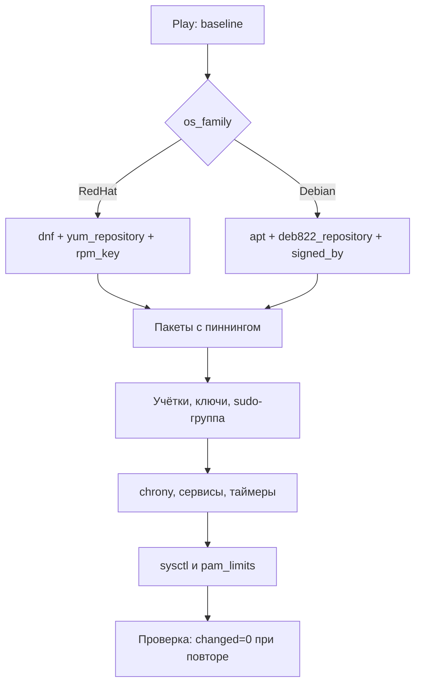

# Управление Linux

Базовая эксплуатация Linux в Ansible сводится к пяти состояниям: пакеты, учётные записи, сервисы, время и лимиты ядра. Если они описаны декларативно и одинаково для RHEL, Ubuntu и Debian, филиальный парк перестаёт быть набором уникальных хостов.

## 1. Зачем это нужно

Ручное администрирование плохо масштабируется: на 600 хостах обязательно найдутся разные версии пакетов, забытые ключи, выключенный NTP и сервис, который «включили, но не добавили в автозапуск». Ansible превращает эти расхождения в проверяемые задачи с предсказуемым результатом.

Есть и вторая причина — доказуемость. Для аудита нужно показать не «мы настроили», а конкретный playbook, версию роли и журнал запуска, который подтверждает состояние каждого хоста. Декларативные задачи дают такую связку.

Третья причина — воспроизводимость после аварии. Если хост переустановлен из шаблона, baseline возвращает его в известное состояние за один прогон. Это работает только тогда, когда все параметры площадки находятся в inventory и `group_vars`, а не в голове администратора.

## 2. Ключевые понятия

| Понятие | Назначение | Пример |
|---|---|---|
| Repository | источник пакетов | внутреннее зеркало `repo.example.local` |
| GPG-ключ | подпись пакетов и метаданных | `rpm_key`, `signed_by` |
| Пиннинг (pinning) | фиксация версии пакета | `nginx-1.24.*` |
| `state: present` | «пакет установлен», без обновления | `ansible.builtin.dnf` |
| `state: latest` | обновление до последней версии | только осознанно |
| Service unit | управляемый сервис systemd | `chronyd`, `sshd` |
| Timer | замена cron на systemd | `report.timer` |
| `password_lock` | блокировка пароля при входе по ключу | `ansible.builtin.user` |
| `authorized_key` | управление SSH-ключами | `exclusive: true` |
| `sysctl` | параметры ядра | `net.ipv4.conf.all.rp_filter` |
| `pam_limits` | лимиты ресурсов | `nofile` |
| `validate` | проверка конфига до записи | `sshd -t -f %s` |

## 3. Схема



Схема показывает, что различия дистрибутивов локализованы в двух ветках: источник пакетов и имя сервиса. Всё остальное — учётки, время, лимиты — описывается одинаково.

## 4. Различия дистрибутивов

| Аспект | RHEL / Rocky / AlmaLinux | Ubuntu | Debian |
|---|---|---|---|
| Пакеты | `dnf` | `apt` | `apt` |
| Формат репозитория | `.repo` в `/etc/yum.repos.d` | deb822 `.sources` | `.list` или deb822 |
| Ключ репозитория | `rpm_key`, `gpgkey` | keyring + `signed_by` | keyring + `signed_by` |
| SSH-сервис | `sshd` | `ssh` | `ssh` |
| Синхронизация времени | `chronyd` | `chrony` | `chrony` |
| Мандатный доступ | SELinux | AppArmor | AppArmor |
| Административная группа | `wheel` | `sudo` | `sudo` |
| Python для Ansible | 3.9 на RHEL 8, 3.9+ на RHEL 9 | 3.12 | 3.11 |

На RHEL 8 ansible-core 2.17 уже не поддерживает Python 3.6: задайте `ansible_python_interpreter: /usr/bin/python3.9` в `group_vars` этой группы. На Ubuntu и Debian интерпретатор определяется автоматически.

Различия в путях к keyring тоже важны. В Ubuntu 22.04 и 24.04 ключи принято хранить в `/etc/apt/keyrings` и подключать через `signed-by`, а старый `apt-key` считается устаревшим. В Debian 12 допустим тот же подход. Для RHEL-семейства ключ импортируется в RPM-базу и одновременно указывается в `.repo`: одной проверки `gpgcheck` недостаточно, если метаданные репозитория не подписаны.

Отдельно про модульность RHEL: версия пакета может задаваться stream-ом (`nginx:1.20`), и пиннинг без включённого stream даст ошибку установки. Проверьте `dnf module list nginx` до того, как фиксировать версию в переменной.

## 5. Пошаговая реализация

1. Зафиксируйте внутренние зеркала и их GPG-ключи; внешние репозитории отключите.
2. Опишите базовый набор пакетов и версии, которые нельзя обновлять произвольно.
3. Создайте сервисные группы и учётки, разложите SSH-ключи.
4. Настройте chrony на внутренние NTP-серверы.
5. Замените пользовательский cron на systemd timers там, где нужен журнал и `Persistent=true`.
6. Примените `sysctl` и `pam_limits` и проверьте, что они переживают перезагрузку.

Порядок важен: репозитории и пакеты идут первыми, потому что от них зависят остальные задачи. Учётки создаются до блокировки паролей и до раскладки ключей, иначе есть риск остаться без входа. Сетевые `sysctl` применяются последними, после проверки, что хост доступен и маршрутизация не изменилась.

## 6. Репозитории и пакеты

RHEL-семейство:

```yaml
- name: Import internal repository GPG key
  ansible.builtin.rpm_key:
    key: https://repo.example.local/keys/RPM-GPG-KEY-internal
    state: present

- name: Configure internal DNF repository
  ansible.builtin.yum_repository:
    name: internal-baseos
    description: Internal BaseOS mirror
    baseurl: https://repo.example.local/rhel/9/baseos/x86_64/
    enabled: true
    gpgcheck: true
    repo_gpgcheck: true
    gpgkey: https://repo.example.local/keys/RPM-GPG-KEY-internal
    state: present
```

Ubuntu (для Debian 12 замените suite на `bookworm` и URI зеркала):

```yaml
- name: Download internal APT signing key
  ansible.builtin.get_url:
    url: https://repo.example.local/keys/internal-archive-keyring.asc
    dest: /etc/apt/keyrings/internal-archive-keyring.asc
    owner: root
    group: root
    mode: "0644"

- name: Configure internal APT repository
  ansible.builtin.deb822_repository:
    name: internal
    types: [deb]
    uris: https://repo.example.local/ubuntu
    suites: [noble]
    components: [main]
    signed_by: /etc/apt/keyrings/internal-archive-keyring.asc
    state: present
```

Перед первым запуском сверьте отпечаток ключа с документацией репозитория. `repo_gpgcheck: true` проверяет подпись метаданных, а не только пакетов, и для внутреннего зеркала это обязательная настройка.

Пиннинг версий:

```yaml
- name: Install pinned nginx on RHEL family
  ansible.builtin.dnf:
    name: "nginx-{{ nginx_rhel_version }}"
    state: present
    allow_downgrade: false
  when: ansible_facts['os_family'] == 'RedHat'

- name: Install pinned nginx on Debian family
  ansible.builtin.apt:
    name: "nginx={{ nginx_apt_version }}"
    state: present
    allow_downgrade: false
    update_cache: true
    cache_valid_time: 3600
  when: ansible_facts['os_family'] == 'Debian'
```

Значения переменных берутся с самого хоста: `dnf list --showduplicates nginx` для RHEL-семейства и `apt-cache policy nginx` для Debian-семейства. В APT версия указывается полностью, включая суффикс обновления безопасности, поэтому фиксировать её в Git нужно после проверки на тестовом хосте. Если точная сборка не важна, а важно не обновлять пакет стихийно, установите текущую версию и удерживайте её через `ansible.builtin.dpkg_selections` с `selection: hold`.

`state: present` не обновляет уже установленный пакет, поэтому версия меняется только при изменении переменной. Не используйте `state: latest` для всего базового набора: это превращает ночной прогон в неконтролируемое обновление.

## 7. Учётные записи и ключи

```yaml
- name: Ensure operations group exists
  ansible.builtin.group:
    name: ops
    state: present

- name: Ensure deploy user exists without a password
  ansible.builtin.user:
    name: deploy
    group: ops
    groups: "{{ 'wheel' if ansible_facts['os_family'] == 'RedHat' else 'sudo' }}"
    append: true
    shell: /bin/bash
    create_home: true
    password_lock: true
    state: present

- name: Install authorized keys for deploy user
  ansible.posix.authorized_key:
    user: deploy
    key: "{{ lookup('ansible.builtin.file', 'files/keys/deploy_ed25519.pub') }}"
    exclusive: true
    state: present
```

`password_lock: true` оставляет вход только по ключу. `exclusive: true` удаляет все ключи, которых нет в файле, поэтому в нём должен быть и аварийный ключ дежурной смены, иначе можно потерять доступ. Для sudo-правил используйте `community.general.sudoers` с `validate: "visudo -cf %s"`; синтаксис и стратегия SSH подробно разобраны в разделе [SSH, PAM, sudo, MFA](../security/36-auth-ssh-pam.md).

Сервисные учётки не должны иметь интерактивную оболочку и домашний каталог, если они не нужны. Для приложений используйте `system: true`, `shell: /usr/sbin/nologin` и `create_home: false`. Для людей — именные учётки с ключами и без пароля. Общая учётка `deploy` на все случаи жизни ломает аудит: в журналах не будет видно, кто именно выполнял действие.

## 8. Время, сервисы, cron и таймеры

```yaml
- name: Configure chrony with internal NTP servers
  ansible.builtin.copy:
    content: |
      # {{ ansible_managed }}
      pool {{ ntp_pool }} iburst
      driftfile /var/lib/chrony/chrony.drift
      makestep 1.0 3
      rtcsync
    dest: /etc/chrony.conf
    owner: root
    group: root
    mode: "0644"
  notify: Restart chrony

- name: Schedule nightly report with cron
  ansible.builtin.cron:
    name: nightly-report
    user: deploy
    minute: "30"
    hour: "3"
    job: "/usr/local/bin/report.sh >> /var/log/report.log 2>&1"
    cron_file: report
    state: present
```

`cron_file` создаёт файл в `/etc/cron.d` и не зависит от crontab пользователя. Для задач, которым нужны журнал systemd и догон после выключения хоста, используйте timer:

```yaml
- name: Deploy report timer unit
  ansible.builtin.copy:
    content: |
      [Unit]
      Description=Nightly report
      [Timer]
      OnCalendar=*-*-* 03:30:00
      Persistent=true
      [Install]
      WantedBy=timers.target
    dest: /etc/systemd/system/report.timer
    owner: root
    group: root
    mode: "0644"

- name: Enable and start report timer
  ansible.builtin.systemd_service:
    name: report.timer
    enabled: true
    state: started
    daemon_reload: true
```

У chrony нет безопасного режима «только проверить синтаксис», поэтому `validate` здесь не применяется: конфигурация проверяется запуском и последующей командой `chronyc sources`. Не заменяйте файл целиком, если дистрибутив добавляет собственные директивы, — в таком случае используйте `ansible.builtin.template` с полным контролем содержимого.

Выбор между cron и timer — не религиозный. Cron проще и привычнее, timer даёт `Persistent=true` (догон пропущенного запуска после выключения), журнал в journald и управление через `systemctl`. Для отчётов и обслуживания берите timer, для простых периодических команд допустим cron. Главное — не держать одну и ту же задачу в обоих механизмах: двойной запуск ломает идемпотентность внешних скриптов.

## 9. Полный пример

Playbook ниже собирает всё перечисленное в один baseline. Он рассчитан на то, что внутреннее зеркало уже доступно, а ключ APT скачан заранее или лежит на хосте; если ключа нет, добавьте задачу `ansible.builtin.get_url` из раздела выше. На RHEL 9 пример предполагает включённый stream `nginx:1.20`; проверьте `dnf module list nginx` до запуска. Запускайте playbook сначала на одном хосте, затем на canary-филиале.

```yaml
---
- name: Linux baseline for branch nodes
  hosts: branches
  become: true
  gather_facts: true
  serial: "10%"
  max_fail_percentage: 10

  vars:
    ntp_pool: ntp.example.local
    nginx_rhel_version: "1.20.*"
    apt_repo_uri: "{{ 'https://repo.example.local/ubuntu' if ansible_facts['distribution'] == 'Ubuntu' else 'https://repo.example.local/debian' }}"
    apt_suite: "{{ 'noble' if ansible_facts['distribution'] == 'Ubuntu' else 'bookworm' }}"
    chrony_service: "{{ 'chronyd' if ansible_facts['os_family'] == 'RedHat' else 'chrony' }}"
    ssh_service: "{{ 'sshd' if ansible_facts['os_family'] == 'RedHat' else 'ssh' }}"

  tasks:
    - name: Configure internal repository on RHEL family
      block:
        - name: Import internal repository GPG key
          ansible.builtin.rpm_key:
            key: https://repo.example.local/keys/RPM-GPG-KEY-internal
            state: present

        - name: Configure internal DNF repository
          ansible.builtin.yum_repository:
            name: internal-baseos
            description: Internal BaseOS mirror
            baseurl: https://repo.example.local/rhel/9/baseos/x86_64/
            gpgcheck: true
            repo_gpgcheck: true
            gpgkey: https://repo.example.local/keys/RPM-GPG-KEY-internal
            state: present
      when: ansible_facts['os_family'] == 'RedHat'

    - name: Configure internal repository on Debian family
      ansible.builtin.deb822_repository:
        name: internal
        types: [deb]
        uris: "{{ apt_repo_uri }}"
        suites: ["{{ apt_suite }}"]
        components: [main]
        signed_by: /etc/apt/keyrings/internal-archive-keyring.asc
        state: present
      when: ansible_facts['os_family'] == 'Debian'

    - name: Ensure common packages are present
      ansible.builtin.package:
        name:
          - chrony
          - rsyslog
        state: present

    - name: Install pinned nginx on RHEL family
      ansible.builtin.dnf:
        name: "nginx-{{ nginx_rhel_version }}"
        state: present
        allow_downgrade: false
      when: ansible_facts['os_family'] == 'RedHat'

    - name: Install nginx on Debian family
      ansible.builtin.apt:
        name: nginx
        state: present
        allow_downgrade: false
        update_cache: true
        cache_valid_time: 3600
      when: ansible_facts['os_family'] == 'Debian'

    - name: Hold nginx version on Debian family
      ansible.builtin.dpkg_selections:
        name: nginx
        selection: hold
      when: ansible_facts['os_family'] == 'Debian'

    - name: Ensure operations group exists
      ansible.builtin.group:
        name: ops
        state: present

    - name: Ensure deploy user exists without a password
      ansible.builtin.user:
        name: deploy
        group: ops
        groups: "{{ 'wheel' if ansible_facts['os_family'] == 'RedHat' else 'sudo' }}"
        append: true
        shell: /bin/bash
        create_home: true
        password_lock: true
        state: present

    - name: Install authorized keys for deploy user
      ansible.posix.authorized_key:
        user: deploy
        key: "{{ lookup('ansible.builtin.file', 'files/keys/deploy_ed25519.pub') }}"
        exclusive: true
        state: present

    - name: Configure chrony with internal NTP servers
      ansible.builtin.copy:
        content: |
          # {{ ansible_managed }}
          pool {{ ntp_pool }} iburst
          driftfile /var/lib/chrony/chrony.drift
          makestep 1.0 3
          rtcsync
        dest: /etc/chrony.conf
        owner: root
        group: root
        mode: "0644"
      notify: Restart chrony

    - name: Schedule weekly report cleanup with cron
      ansible.builtin.cron:
        name: report-cleanup
        user: deploy
        weekday: "0"
        minute: "15"
        hour: "5"
        job: "find /var/lib/report -type f -mtime +30 -delete"
        cron_file: report-cleanup
        state: present

    - name: Deploy report service unit
      ansible.builtin.copy:
        content: |
          [Unit]
          Description=Nightly report
          [Service]
          Type=oneshot
          User=deploy
          ExecStart=/usr/local/bin/report.sh
        dest: /etc/systemd/system/report.service
        owner: root
        group: root
        mode: "0644"

    - name: Deploy report timer unit
      ansible.builtin.copy:
        content: |
          [Unit]
          Description=Nightly report timer
          [Timer]
          OnCalendar=*-*-* 03:30:00
          Persistent=true
          [Install]
          WantedBy=timers.target
        dest: /etc/systemd/system/report.timer
        owner: root
        group: root
        mode: "0644"

    - name: Enable and start report timer
      ansible.builtin.systemd_service:
        name: report.timer
        enabled: true
        state: started
        daemon_reload: true

    - name: Ensure core services are enabled
      ansible.builtin.systemd_service:
        name: "{{ item }}"
        enabled: true
        state: started
      loop:
        - "{{ chrony_service }}"
        - "{{ ssh_service }}"
        - rsyslog

    - name: Apply network sysctl baseline
      ansible.posix.sysctl:
        name: "{{ item.name }}"
        value: "{{ item.value }}"
        state: present
        sysctl_file: /etc/sysctl.d/60-baseline.conf
        reload: true
      loop:
        - { name: net.ipv4.conf.all.rp_filter, value: "1" }
        - { name: net.ipv4.conf.all.accept_redirects, value: "0" }
        - { name: net.ipv4.conf.all.send_redirects, value: "0" }

    - name: Set file descriptor limits
      community.general.pam_limits:
        domain: "*"
        limit_type: soft
        limit_item: nofile
        value: "65536"

  handlers:
    - name: Restart chrony
      ansible.builtin.systemd_service:
        name: "{{ chrony_service }}"
        state: restarted
```

`rp_filter: 1` может сломать хост с асимметричной маршрутизацией, а `send_redirects: 0` допустим только для конечного хоста, не для маршрутизатора. Проверяйте такие параметры на пилотной группе, а не на всём парке.

Обратите внимание, что baseline не перезагружает хосты. Изменения, которым нужна перезагрузка (например, смена `kernel.*` параметров или обновление ядра), выносятся в отдельный playbook с окном и подтверждением. Смешивать установку пакетов и перезагрузку в одном прогоне опасно: сбой посреди окна оставит филиал без части хостов.

## 10. Проверка результата

```bash
ansible-playbook -i inventories/prod/ os-baseline.yml --check --diff --limit msk-app01
ansible-playbook -i inventories/prod/ os-baseline.yml --limit msk-app01
ansible-playbook -i inventories/prod/ os-baseline.yml --limit msk-app01
```

Второй и третий запуски должны дать `changed=0`. Дополнительно:

```bash
ansible -i inventories/prod/ msk-app01 -m ansible.builtin.command \
  -a 'chronyc sources' --one-line
ansible -i inventories/prod/ msk-app01 -m ansible.builtin.command \
  -a 'systemctl list-timers --all' --one-line
```

Для проверки пиннинга используйте `rpm -q nginx` или `dpkg-query -W nginx` и сравните версию с переменной. Если версия отличается, задача `dnf` или `apt` вернёт `changed`, а не молча оставит пакет.

Проверка `changed=0` важна, но недостаточна. Она показывает, что Ansible не видит расхождений в управляемых объектах, и ничего не говорит о том, что сервис действительно работает. Добавьте отдельные read-only проверки: `systemctl is-active`, `chronyc tracking`, `sshd -T`. Их результаты удобно складывать в отчёт о состоянии, а не полагаться на зелёный вывод play recap.

## 11. Безопасность и blast radius

Baseline затрагивает вход, время и сетевые параметры ядра — три области, в которых ошибка стоит доступа к хосту. Поэтому `serial` и `max_fail_percentage` здесь не формальность, а условие безопасной раскатки. Первый прогон делайте на хосте, к которому есть консольный доступ через гипервизор, а не только SSH.

| Риск | Последствие | Мера |
|---|---|---|
| `exclusive: true` без аварийного ключа | потеря доступа к хосту | включить break-glass ключ, проверить вторую сессию |
| Внешний репозиторий без GPG | подмена пакетов | внутреннее зеркало, `gpgcheck`, `repo_gpgcheck` |
| `state: latest` на всём парке | неконтролируемые обновления | пиннинг и отдельный процесс патчинга |
| Замена `/etc/chrony.conf` целиком | потеря дистрибутивных настроек | шаблон и ревью diff |
| `sysctl` без проверки | потеря сети или маршрутизации | canary, `serial`, консоль |
| `password_lock` без ключей | блокировка входа | сначала ключи, потом блокировка |

Откат: держите предыдущую версию переменных и роли в Git, запускайте с `serial: 1`, а для конфигурационных файлов используйте `backup: true`. Для пакетов откат версии — отдельное решение: `dnf downgrade` или `apt install package=version` выполняется вручную после оценки зависимостей.

## 12. Комплаенс-маппинг

| Требование | Как закрывается |
|---|---|
| CIS Benchmark 1.x (пакеты, обновления) | пиннинг, внутренние репозитории |
| CIS Benchmark 5.x (доступ) | сервисные учётки, ключи, `password_lock` |
| ISO/IEC 27001:2022 A.8.9 | декларативная конфигурация и версионирование |
| NIST CSF 2.0 PR.PS | управление конфигурацией хостов |
| Аудит | журнал запусков, отчёты `--check --diff` |

## 13. Типичные ошибки и troubleshooting

Большинство ошибок baseline связаны не с синтаксисом playbook, а с расхождением ожиданий и реального состояния хоста: другой репозиторий, другой stream, другое имя сервиса. Начинайте диагностику с фактов (`ansible -m setup`) и локальных команд на хосте, а не с повторного запуска playbook с `-vvv`.

| Симптом | Причина | Проверка | Решение |
|---|---|---|---|
| `No package matching` | нет репозитория или версии | `dnf repolist`, `apt-cache policy` | проверить baseurl и GPG-ключ |
| `GPG check FAILED` | неверный ключ или метаданные | `rpm -q gpg-pubkey`, `apt-key list` | импортировать правильный ключ |
| Задача `apt` всегда `changed` | не указан `cache_valid_time` | повторный прогон | добавить `cache_valid_time` |
| `Failed to lock apt` | параллельный процесс | `pgrep -a apt` | `serial`, дождаться завершения |
| Сервис не найден | разное имя в дистрибутиве | `systemctl list-unit-files` | переменная `ssh_service` |
| `chronyc` не видит источников | NTP заблокирован firewall | `chronyc sources`, `ss -lunp` | открыть UDP/123 до NTP-серверов |
| Пользователь без пароля не входит | нет ключа или `password_lock` | `passwd -S deploy` | установить ключ, проверить `sshd_config` |
| RHEL 8: `No module named dnf` | неверный Python | `ansible -m setup` | `ansible_python_interpreter: /usr/bin/python3.9` |

## 14. Чек-лист

- [ ] Репозитории внутренние, GPG-проверка включена.
- [ ] Версии критичных пакетов закреплены переменными.
- [ ] Учётки созданы до блокировки паролей.
- [ ] В `authorized_key` есть аварийный ключ.
- [ ] chrony настроен на внутренние NTP-серверы.
- [ ] Таймеры и cron не дублируют друг друга.
- [ ] `sysctl` проверен на пилотной группе.
- [ ] Повторный запуск даёт `changed=0`.

## 15. Источники

- [ansible.builtin.dnf](https://docs.ansible.com/ansible/latest/collections/ansible/builtin/dnf_module.html)
- [ansible.builtin.apt](https://docs.ansible.com/ansible/latest/collections/ansible/builtin/apt_module.html)
- [ansible.builtin.deb822_repository](https://docs.ansible.com/ansible/latest/collections/ansible/builtin/deb822_repository_module.html)
- [ansible.builtin.user](https://docs.ansible.com/ansible/latest/collections/ansible/builtin/user_module.html)
- [ansible.builtin.systemd_service](https://docs.ansible.com/ansible/latest/collections/ansible/builtin/systemd_service_module.html)

## 16. Связанные страницы

- [Модули и FQCN](../fundamentals/09-modules.md)
- [Конфигурация и дрейф](22-config-drift.md)
- [SSH, PAM, sudo, MFA](../security/36-auth-ssh-pam.md)
- [Файлы, ACL, SELinux/AppArmor](23-files-acl-selinux.md)
- [Харденинг Linux](../security/35-linux-hardening.md)
