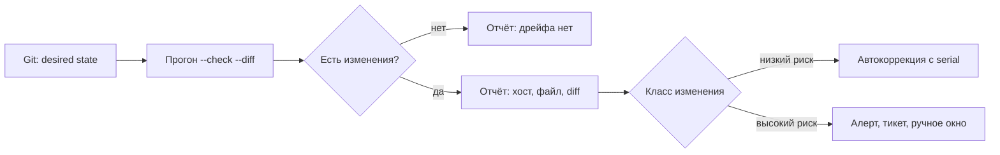

# Конфигурация и дрейф

Дрейф (drift) — это расхождение между описанным в Git желаемым состоянием и тем, что реально работает на хосте. Дрейф появляется после ручных правок «на минутку», неудачных обновлений и восстановления из старой резервной копии. Задача автоматизации — обнаружить его раньше, чем это сделает инцидент.

## 1. Зачем это нужно

Playbook, который применяется раз в квартал, не гарантирует соответствие. Между запусками кто-то меняет `sshd_config`, отключает SELinux, добавляет правило firewall или ставит пакет из стороннего репозитория. Если это не видно, аудит превращается в поиск иголки в стоге хостов.

Источники дрейфа почти всегда одни и те же: ручная правка во время инцидента, обновление, которое перезаписало конфигурацию, восстановление из резервной копии недельной давности и забытый эксперимент на одном хосте. Чем дольше расхождение живёт, тем выше шанс, что на него уже завязались другие изменения, и тем дороже вернуть эталон.

Регулярный аудит даёт три результата:

1. Список хостов и файлов, которые отличаются от baseline.
2. Доказательство того, что остальные хосты соответствуют эталону.
3. Основание для тикета или автоматической коррекции — в зависимости от риска изменения.

## 2. Ключевые понятия

| Понятие | Назначение | Пример |
|---|---|---|
| Desired state | описанное эталонное состояние | роль `baseline` в Git |
| Drift | фактическое расхождение | изменённый `sshd_config` |
| Check mode | прогон без записи изменений | `--check` |
| `--diff` | показ разницы содержимого | diff для шаблона |
| `check_mode: true` | принудительный dry-run задачи | аудит внутри playbook |
| `check_mode: false` | выполнение задачи даже при `--check` | запись отчёта |
| Drift report | артефакт аудита | `reports/drift-summary.md` |
| Exception | согласованное исключение | legacy-хост до даты |
| Remediation | автоматическое исправление | повторный прогон роли |
| Alerting | сигнал без изменения хоста | тикет в Service Desk |
| Config validation | проверка синтаксиса до записи | `sshd -t -f %s` |

## 3. Схема



На схеме важно разделение: аудит всегда безопасен и не меняет хосты, а решение о коррекции принимается отдельно и зависит от того, что именно изменилось.

## 4. Пошаговая реализация

1. Определите каталог управляемых файлов и их шаблоны — это эталон аудита.
2. Запустите аудит в `--check --diff` и сохраните отчёт как артефакт.
3. Разделите находки на классы: низкий риск (motd, sysctl), средний (chrony, пакеты), высокий (SSH, сеть, firewall).
4. Для низкого риска включите автокоррекцию с `serial`, для высокого — только алертинг.
5. Заведите файл исключений с обязательным сроком действия и владельцем.
6. Поставьте аудит в расписание и отправляйте отчёт в SIEM или тикет-систему.

## 5. Как работает аудит

Ключевой приём — совместить `--check` и задачи, которые всё равно должны выполняться. Аудит запускается как обычный playbook с флагом `--check`: задачи `ansible.builtin.template` не пишут файлы, но возвращают `changed` и diff, если содержимое отличается. Задачи записи отчёта помечены `check_mode: false`, иначе отчёт не появится.

Внутри `ansible.builtin.template` при check mode всё равно рендерит шаблон во временный файл и сравнивает его с целевым по контрольной сумме. Поэтому `register` содержит не только `changed`, но и `diff`, если запуск был с `--diff`. Разница может быть большой: для отчёта лучше сохранять имя файла и факт расхождения, а полный diff складывать отдельно, с ограниченным доступом.

Второй приём — `check_mode: true` на уровне задачи. Он защищает от случайного запуска аудита без `--check`: даже если оператор забыл флаг, шаблоны не будут записаны. Это не заменяет `--check`, но снижает цену ошибки.

## 6. Полный пример

```yaml
---
- name: Audit configuration drift
  hosts: branches
  become: true
  gather_facts: true
  serial: "25%"

  vars_files:
    - vars/drift_exceptions.yml

  vars:
    drift_report_dir: "{{ playbook_dir }}/reports/drift"
    drift_catalog:
      - name: sshd_baseline
        src: templates/sshd_baseline.conf.j2
        dest: /etc/ssh/sshd_config.d/60-baseline.conf
        validate: "sshd -t -f %s"
      - name: chrony
        src: templates/chrony.conf.j2
        dest: /etc/chrony.conf
      - name: sysctl_baseline
        src: templates/60-sysctl.conf.j2
        dest: /etc/sysctl.d/60-baseline.conf

  tasks:
    - name: Fail on expired drift exceptions
      ansible.builtin.assert:
        that:
          - item.expires >= ansible_facts['date_time']['date']
        fail_msg: >-
          Exception for {{ item.host }} / {{ item.check }}
          expired on {{ item.expires }}
      loop: "{{ drift_exceptions }}"
      run_once: true

    - name: Render managed configuration in check mode
      ansible.builtin.template:
        src: "{{ item.src }}"
        dest: "{{ item.dest }}"
        owner: root
        group: root
        mode: "0644"
        validate: "{{ item.validate | default(omit) }}"
      loop: "{{ drift_catalog }}"
      register: drift_templates
      check_mode: true

    - name: Find world-writable files under /etc
      ansible.builtin.command:
        argv:
          - /usr/bin/find
          - /etc
          - -xdev
          - -type
          - f
          - -perm
          - /0002
      register: drift_world_writable
      changed_when: false
      check_mode: false

    - name: Collect active exceptions for this host
      ansible.builtin.set_fact:
        drift_exception_checks: >-
          {{ drift_exceptions
             | selectattr('host', 'in', [inventory_hostname, 'all'])
             | map(attribute='check') | list }}

    - name: Build drift findings
      ansible.builtin.set_fact:
        drift_findings: >-
          {{ ((drift_templates.results | selectattr('changed')
               | map(attribute='item.name') | list)
              | difference(drift_exception_checks))
             + (['world_writable_etc'] if drift_world_writable.stdout_lines | length > 0 else []) }}

    - name: Ensure local report directory exists
      ansible.builtin.file:
        path: "{{ drift_report_dir }}"
        state: directory
        mode: "0750"
      delegate_to: localhost
      run_once: true
      become: false
      check_mode: false

    - name: Write per-host drift record
      ansible.builtin.copy:
        content: "{{ drift_record | to_nice_json }}\n"
        dest: "{{ drift_report_dir }}/{{ inventory_hostname }}.json"
        mode: "0640"
      vars:
        drift_record:
          host: "{{ inventory_hostname }}"
          branch: "{{ branch_code | default('unknown') }}"
          checked_at: "{{ ansible_facts['date_time']['iso8601'] }}"
          findings: "{{ drift_findings }}"
          exceptions: "{{ drift_exception_checks }}"
      delegate_to: localhost
      become: false
      check_mode: false

- name: Render drift summary
  hosts: localhost
  gather_facts: true
  check_mode: false

  vars:
    drift_report_dir: "{{ playbook_dir }}/reports/drift"

  tasks:
    - name: Find drift records
      ansible.builtin.find:
        paths: "{{ drift_report_dir }}"
        patterns: "*.json"
      register: drift_files

    - name: Read drift records
      ansible.builtin.slurp:
        src: "{{ item.path }}"
      loop: "{{ drift_files.files }}"
      register: drift_records

    - name: Render Markdown summary
      ansible.builtin.template:
        src: templates/drift-summary.md.j2
        dest: "{{ playbook_dir }}/reports/drift-summary.md"
        mode: "0640"
```

`serial: "25%"` ограничивает одновременную нагрузку на WAN, хотя аудит и не меняет хосты: сбор фактов и рендеринг шаблонов тоже стоят трафика. `check_mode: false` у задач отчёта — единственное место, где dry-run сознательно обходится, и только на control node.

`templates/drift-summary.md.j2`:

```jinja2
# Отчёт о дрейфе конфигурации

Дата: {{ ansible_facts['date_time']['date'] }}
Записей: {{ drift_records.results | length }}

| Хост | Филиал | Дрейф | Исключения |
|---|---|---|---|


| {{ data.host }} | {{ data.branch }} | {{ data.findings | join(', ') if data.findings else 'нет' }} | {{ data.exceptions | join(', ') if data.exceptions else 'нет' }} |

```

Файл `vars/drift_exceptions.yml`:

```yaml
---
drift_exceptions:
  - host: msk-legacy01
    check: sshd_baseline
    reason: "CHG-1421, legacy application migration"
    expires: "2027-03-31"
```

Исключение без срока действия — это постоянное отключение контроля. Поэтому просроченное исключение валит аудит через `assert`, а не тихо скрывает находку.

## 7. Ограничения check mode

Check mode — не магия, а предсказание. У него есть границы, которые нужно знать до того, как доверять отчёту:

| Ограничение | Что происходит | Обход |
|---|---|---|
| Модуль не поддерживает check mode | задача пропускается или даёт неверный `changed` | проверить `ansible-doc`, тестировать на canary |
| `command`/`shell` без `creates` | пропускаются, изменений не видно | read-only команды с `check_mode: false` |
| Файлы вне управления | дрейф не обнаруживается | инвентаризация файлов, AIDE |
| Устаревшие факты | шаблон сравнивается с неверными данными | `--flush-cache`, `gather_facts: true` |
| Handler не выполняется | сервис не перезапущен в реальности | отдельная проверка `systemctl is-active` |
| `--diff` показывает секреты | утечка в лог CI | `no_log`, ограничение доступа к артефактам |
| Динамические данные | время, IP, сертификаты меняются | исключить из шаблона или учитывать в тесте |

Проверка `check_mode` не доказывает, что сервис работает: она показывает только, что файл отличается. Для полноты добавляйте read-only задачи, которые снимают фактическое состояние (`systemctl show`, `sshd -T`), и складывайте их в тот же отчёт.

Отдельное ограничение — пакеты. `ansible.builtin.dnf` и `ansible.builtin.apt` в check mode сообщают, что установили бы, но не показывают, что версия на хосте отличается от закреплённой, если имя пакета совпадает. Для версий нужна отдельная задача: `command` с `rpm -q` или `dpkg-query`, `changed_when: false` и сравнение с переменной. Без неё отчёт будет зелёным при фактически другом билде пакета.

## 8. Ремедиация, алертинг и исключения

Не всякий дрейф надо исправлять автоматически. Ошибка в шаблоне SSH при автокоррекции закроет доступ ко всем хостам сразу. Практичное разделение:

| Класс | Примеры | Действие |
|---|---|---|
| Низкий риск | motd, sysctl, пакеты | автоматическая коррекция с `serial` |
| Средний риск | chrony, rsyslog, лимиты | алерт и коррекция в окне |
| Высокий риск | SSH, сеть, firewall, SELinux | только алерт и ручное изменение |
| Исключение | legacy-приложение | отчёт, срок, владелец |

Валидация конфигурации до записи обязательна: `validate` у шаблона не даст записать сломанный `sshd_config`, а `netplan generate` или `nginx -t` ловят ошибки, которые не видны в diff. Для файлов без штатного валидатора используйте `ansible.builtin.assert` по ключевым параметрам и проверку сервиса после применения.

Расписание аудита зависит от темпа изменений. Для парка 200–1000 хостов достаточно ежедневного прогона в ночное окно и еженедельной сводки для владельцев сервисов. Ежечасный аудит на всех хостах создаёт нагрузку на WAN и шум в тикетах, не добавляя безопасности. Исключение — период после крупного изменения: там аудит полезно запускать чаще, пока состояние не стабилизируется.

## 9. Проверка результата

```bash
ansible-playbook -i inventories/prod/ drift-audit.yml --check --diff --limit branch_msk
cat reports/drift-summary.md
ansible-playbook -i inventories/prod/ drift-audit.yml --limit msk-app01 --check
```

Первый запуск должен создать `reports/drift/*.json` и сводку. Повторный запуск без изменений на хостах даёт пустой список находок. Если отчёт пуст, а дрейф очевиден, проверьте, что шаблон действительно управляет этим файлом и что факты не устарели.

## 10. Безопасность и blast radius

| Риск | Последствие | Мера |
|---|---|---|
| Аудит запущен без `--check` | задачи без `check_mode` меняют хосты | `check_mode: true` на задачах аудита |
| Отчёт содержит diff с секретами | утечка в CI-артефакты | `no_log`, ограничение доступа, чистка |
| Исключение без срока | контроль отключён навсегда | `expires` и `assert` |
| Автокоррекция SSH | потеря доступа | только алертинг, canary |
| Отчёт перезаписан | потеря истории | имя файла с датой, хранение в Git или S3 |
| Ложные срабатывания | усталость от алертов | точные шаблоны, тесты на canary |

Rollback для аудита не нужен: он ничего не меняет. Rollback для ремедиации — это предыдущий коммит роли и повторный прогон с `serial: 1`; для файлов держите `backup: true` и копию вне хоста.

## 11. Комплаенс-маппинг

| Требование | Как закрывается |
|---|---|
| CIS Control 4 | регулярное сравнение с эталоном |
| CIS Control 16 (Account Monitoring) | аудит изменений конфигурации |
| ISO/IEC 27001:2022 A.8.9 | управление конфигурацией |
| NIST CSF 2.0 DE.CM | непрерывный контроль состояния |
| Аудит | отчёты с датой, хостом и diff |

## 12. Типичные ошибки и troubleshooting

| Симптом | Причина | Проверка | Решение |
|---|---|---|---|
| Отчёт не создаётся | нет `check_mode: false` | вывод задачи | добавить `check_mode: false` |
| Все хосты «изменены» | шаблон зависит от времени или IP | diff | убрать динамику из шаблона |
| Дрейф не находится | файл не управляется шаблоном | `stat`, `template` | добавить в каталог |
| `validate` падает в check mode | валидатор требует полный конфиг | stderr задачи | упростить фрагмент или валидировать после записи |
| Просроченное исключение | забыли продлить | `assert` | продлить с новым CHG или убрать |
| Отчёт пустой при `--limit` | старые JSON не удалены | `ls reports/drift` | чистить каталог перед прогоном |

## 13. Чек-лист

- [ ] Каталог управляемых файлов и шаблонов зафиксирован.
- [ ] Аудит запускается с `--check --diff` и не меняет хосты.
- [ ] Запись отчёта имеет `check_mode: false` и ограниченные права.
- [ ] Исключения имеют владельца, причину и срок.
- [ ] Просроченные исключения валят аудит.
- [ ] Для высокого риска настроен алертинг, а не автокоррекция.
- [ ] Конфигурации проходят `validate` до записи.
- [ ] Отчёт уходит в SIEM или тикет-систему по расписанию.

## 14. Источники

- [Validating tasks: check mode and diff mode](https://docs.ansible.com/ansible/latest/playbook_guide/playbooks_checkmode.html)
- [ansible.builtin.template](https://docs.ansible.com/ansible/latest/collections/ansible/builtin/template_module.html)
- [ansible.builtin.assert](https://docs.ansible.com/ansible/latest/collections/ansible/builtin/assert_module.html)
- [ansible.builtin.copy](https://docs.ansible.com/ansible/latest/collections/ansible/builtin/copy_module.html)

## 15. Связанные страницы

- [Безопасная разработка playbook](../secure-dev/13-safe-code.md)
- [Управление Linux](21-os-management.md)
- [Распределённые филиалы](20-branch-fleet.md)
- [Логирование и мониторинг](../security/42-logging-monitoring.md)
- [Комплаенс и доказательства](../security/44-compliance.md)
- [Диагностика и troubleshooting](../ops/60-troubleshooting.md)
