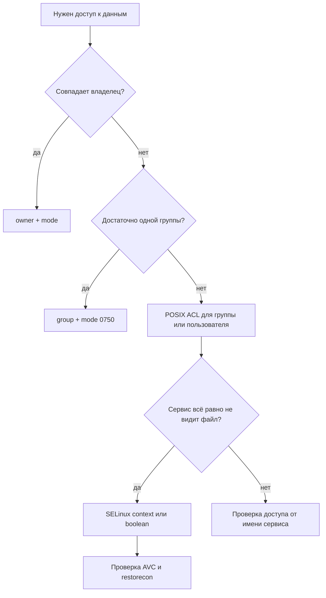

# Файлы, ACL, SELinux/AppArmor

Права доступа в Linux складываются из трёх уровней: классические владелец/группа/остальные, POSIX ACL и мандатный доступ SELinux или AppArmor. Ansible управляет всеми тремя, но цена ошибки здесь выше обычной: неверный `chmod -R` или контекст SELinux ломает сервис быстрее, чем неправильный пакет.

## 1. Зачем это нужно

Файловая система — самая частая точка, где безопасность расходится с удобством. Просьба «дайте доступ» обычно решается через `chmod 777`, потому что это быстро. В филиальном парке такое решение тиражируется на сотни хостов и превращается в находку аудита с высоким риском.

Правильный порядок другой: сначала определить, кому и зачем нужен доступ, затем выбрать минимальный механизм — группу, ACL, контекст SELinux или boolean. Ansible фиксирует это решение в коде, а не в истории чата.

Отдельная проблема — унаследованные права. Каталог, созданный десять лет назад с `0777`, продолжает жить и после харденинга, потому что файлы внутри никто не пересматривал. Аудит прав должен быть регулярным, а не однократным: в отчёт попадают не только управляемые Ansible каталоги, но и данные, которые создают приложения.

## 2. Ключевые понятия

| Понятие | Назначение | Пример |
|---|---|---|
| Mode | права владельца, группы, остальных | `0640`, `2770` |
| Owner/group | владелец и группа файла | `svc-reporting:apache` |
| Umask | маска прав при создании файлов | `0027` |
| POSIX ACL | дополнительные права для пользователей и групп | `audit:r-x` |
| Mask | предельные права для ACL-записей | `getfacl` |
| Default ACL | ACL, наследуемый каталогом | `default:group:audit:r-x` |
| SELinux | мандатный доступ в RHEL-семействе | `httpd_sys_content_t` |
| Context | метка SELinux у файла | `system_u:object_r:httpd_sys_content_t:s0` |
| Boolean | переключатель политики SELinux | `httpd_can_network_connect` |
| AppArmor | профили приложений в Ubuntu/Debian | `/usr/sbin/named` |
| `restorecon` | восстановление контекста по политике | `restorecon -Rv /var/www` |
| AVC denial | отказ SELinux в аудите | `ausearch -m AVC` |

## 3. Схема



Схема отражает порядок диагностики: сначала обычные права, затем ACL, затем мандатный доступ. Перескакивать через уровни бессмысленно — `chmod 777` не поможет, если SELinux запрещает чтение.

## 4. Пошаговая реализация

1. Создайте сервисную группу и пользователя, не давая им лишних прав.
2. Задайте каталоги с `mode` `0750` или `2770`, если нужен setgid.
3. Для аудиторов и смежных команд добавьте ACL, а не расширяйте группу-владельца.
4. На RHEL задайте контекст файлам и проверьте boolean, если сервису нужен сетевой доступ.
5. На Ubuntu и Debian проверьте, что AppArmor включён и профиль сервиса в режиме enforce.
6. Прогоните проверку от имени сервиса и разберите отказы в аудите.

## 5. Права и владельцы

```yaml
- name: Ensure application directories exist with strict modes
  ansible.builtin.file:
    path: "{{ item.path }}"
    state: directory
    owner: "{{ app_user }}"
    group: "{{ app_group }}"
    mode: "{{ item.mode }}"
  loop:
    - { path: "{{ app_root }}", mode: "0750" }
    - { path: "{{ app_root }}/reports", mode: "2770" }
```

`2770` включает setgid: новые файлы внутри наследуют группу каталога, а не основную группу создателя. Это снимает половину проблем с доступом в командной работе. `recurse: true` применяйте только к каталогу, который действительно полностью принадлежит сервису: рекурсивная смена владельца на `/var` или `/etc` — типичный способ сломать систему.

Umask сервиса важен не меньше режима каталога. Если приложение создаёт файлы с `umask 000`, они получат `0666` и `0777` независимо от того, что вы задали для каталога. Для systemd-юнита задайте `UMask=0027` в секции `[Service]` и проверьте фактический режим новых файлов после первого запуска.

Для проверки фактических прав используйте `ansible.builtin.stat` и `assert`, а не только `changed`:

```yaml
- name: Read application directory metadata
  ansible.builtin.stat:
    path: "{{ app_root }}/reports"
  register: app_reports_stat

- name: Require strict permissions on published reports
  ansible.builtin.assert:
    that:
      - app_reports_stat.stat.mode[-3:] == '770'
      - app_reports_stat.stat.pw_name == app_user
      - app_reports_stat.stat.gr_name == app_group
    fail_msg: "Unexpected owner or mode on {{ app_root }}/reports"
```

Проверка сравнивает последние три разряда режима и не зависит от того, как `stat` показывает setgid. Владелец и группа проверяются отдельно: режим `2770` бесполезен, если каталог принадлежит `root:root` и сервис не входит в группу.

## 6. POSIX ACL

ACL нужен, когда доступ должен получить пользователь или группа, которых нельзя сделать владельцем или основной группой. Модуль `ansible.posix.acl` работает через `setfacl` и требует файловой системы с поддержкой ACL.

```yaml
- name: Grant audit group read access to published reports
  ansible.posix.acl:
    path: "{{ app_root }}/reports"
    entity: audit
    etype: group
    permissions: r-x
    recursive: true
    state: present

- name: Inherit audit read access for new report files
  ansible.posix.acl:
    path: "{{ app_root }}/reports"
    entity: audit
    etype: group
    permissions: r-x
    default: true
    state: present
```

Первая задача применяет ACL к существующим файлам и каталогам, вторая задаёт default ACL для новых. Параметр `state` по умолчанию равен `query`, поэтому всегда указывайте `present` или `absent` явно: иначе задача только прочитает ACL и не изменит его. Символьная запись `entry` считается устаревшей, используйте `entity`, `etype` и `permissions`.

ACL не отменяет обычные права: маска ACL ограничивает максимум для всех записей, кроме владельца и `other`. Если после добавления ACL доступ не появился, проверьте `getfacl` и маску.

## 7. SELinux

На RHEL, Rocky и AlmaLinux мандатный доступ включён по умолчанию. Контекст файла важнее прав: файл с `0644` и типом `user_home_t` не будет прочитан веб-сервером.

```yaml
- name: Ensure SELinux is enforcing
  ansible.posix.selinux:
    policy: targeted
    state: enforcing
  when: ansible_facts.get('selinux', {}).get('status', 'disabled') == 'enabled'

- name: Set SELinux type on published reports
  ansible.builtin.file:
    path: "{{ app_root }}/reports"
    state: directory
    recurse: true
    setype: httpd_sys_content_t
  when: ansible_facts.get('selinux', {}).get('status', 'disabled') == 'enabled'

- name: Allow httpd to reach the reporting backend
  ansible.posix.seboolean:
    name: httpd_can_network_connect
    state: true
    persistent: true
  when: ansible_facts.get('selinux', {}).get('status', 'disabled') == 'enabled'
```

`ansible.posix.selinux` меняет режим только на включённой системе. Переход из `disabled` требует перезагрузки и правки загрузчика, поэтому в playbook его не делают: это отдельная процедура с консолью. `persistent: true` у boolean сохраняет значение после перезагрузки; без него изменение живёт до ребута.

`ansible.builtin.file` с `setype` выставляет контекст напрямую. Если политика изменилась, контекст нужно привести к эталону командой `restorecon -Rv`, иначе файлы останутся с прежней меткой. Для нестандартных каталогов сначала добавляют правило `semanage fcontext`, а затем применяют `restorecon`.

Режим SELinux тоже управляется, но осторожно. Перевод из `permissive` в `enforcing` на работающем сервисе может сразу закрыть ему доступ, который раньше только логировался. Сначала разберите накопленные AVC, затем включайте enforcing на canary-хосте, и только потом на парке.

## 8. AppArmor

В Ubuntu и Debian мандатный доступ реализован через AppArmor. Профили привязаны к путям исполняемых файлов и работают в режимах `enforce` и `complain`. Ansible проверяет состояние и не должен молча переводить профили в `complain`: это отключает защиту.

```bash
sudo aa-status --enabled
sudo aa-status
sudo aa-enforce /etc/apparmor.d/usr.sbin.apache2
sudo apparmor_parser -r /etc/apparmor.d/usr.sbin.apache2
```

После изменения локального профиля его перезагружают через `apparmor_parser -r`. Отказы видны в `journalctl -k` и `dmesg`; утилита `aa-logprof` помогает разобрать их, но её предложения нужно проверять, а не принимать вслепую. В отличие от SELinux, AppArmor не требует перемаркировки файлов, зато профиль должен покрывать все пути, к которым обращается сервис.

Практическая разница для автоматизации: SELinux управляется декларативно через типы файлов и booleans, а AppArmor — через содержимое профилей. Поэтому в роли для Ubuntu и Debian профили раскладываются шаблоном с последующей перезагрузкой, а в RHEL-роли достаточно `setype` и `seboolean`. Смешивать оба механизма на одном хосте не нужно.

## 9. Полный пример

```yaml
---
- name: Application data permissions and MAC policy
  hosts: branches
  become: true
  gather_facts: true
  serial: "10%"
  max_fail_percentage: 10

  vars:
    app_root: /var/www/reporting
    app_user: svc-reporting
    app_group: svc-reporting
    audit_group: audit

  tasks:
    - name: Ensure application group exists
      ansible.builtin.group:
        name: "{{ app_group }}"
        system: true
        state: present

    - name: Ensure audit group exists
      ansible.builtin.group:
        name: "{{ audit_group }}"
        state: present

    - name: Ensure application user exists
      ansible.builtin.user:
        name: "{{ app_user }}"
        group: "{{ app_group }}"
        system: true
        shell: /usr/sbin/nologin
        create_home: false
        state: present

    - name: Ensure application directories exist with strict modes
      ansible.builtin.file:
        path: "{{ item.path }}"
        state: directory
        owner: "{{ app_user }}"
        group: "{{ app_group }}"
        mode: "{{ item.mode }}"
      loop:
        - { path: "{{ app_root }}", mode: "0750" }
        - { path: "{{ app_root }}/reports", mode: "2770" }

    - name: Deploy application configuration
      ansible.builtin.copy:
        content: |
          # {{ ansible_managed }}
          output_dir={{ app_root }}/reports
          retention_days=30
        dest: "{{ app_root }}/app.conf"
        owner: root
        group: "{{ app_group }}"
        mode: "0640"
        validate: "/usr/bin/grep -q '^output_dir=' %s"

    - name: Grant audit group read access to published reports
      ansible.posix.acl:
        path: "{{ app_root }}/reports"
        entity: "{{ audit_group }}"
        etype: group
        permissions: r-x
        recursive: true
        state: present

    - name: Inherit audit read access for new report files
      ansible.posix.acl:
        path: "{{ app_root }}/reports"
        entity: "{{ audit_group }}"
        etype: group
        permissions: r-x
        default: true
        state: present

    - name: Apply SELinux settings on enabled systems
      when: ansible_facts.get('selinux', {}).get('status', 'disabled') == 'enabled'
      block:
        - name: Ensure SELinux is enforcing
          ansible.posix.selinux:
            policy: targeted
            state: enforcing

        - name: Set SELinux type on published reports
          ansible.builtin.file:
            path: "{{ app_root }}/reports"
            state: directory
            recurse: true
            setype: httpd_sys_content_t

        - name: Allow httpd to reach the reporting backend
          ansible.posix.seboolean:
            name: httpd_can_network_connect
            state: true
            persistent: true

    - name: Check AppArmor status on Debian family
      ansible.builtin.command:
        argv:
          - /usr/sbin/aa-status
          - --enabled
      register: apparmor_enabled
      changed_when: false
      failed_when: apparmor_enabled.rc not in [0, 1]
      when: ansible_facts['os_family'] == 'Debian'

    - name: Require AppArmor to be enabled on Debian family
      ansible.builtin.assert:
        that:
          - apparmor_enabled.rc == 0
        fail_msg: "AppArmor is not enabled on {{ inventory_hostname }}"
      when: ansible_facts['os_family'] == 'Debian'
```

`serial: "10%"` и `max_fail_percentage` ограничивают последствия ошибки в контексте или ACL. Если задача падает на части хостов, остальные не получают ту же ошибку, а вы успеваете посмотреть `ausearch` и `getfacl` на первом.

## 10. Диагностика отказов

| Симптом | Проверка | Что искать |
|---|---|---|
| `Permission denied` при чтении | `namei -l /path/to/file` | отсутствие `x` на каталоге в цепочке |
| Сервис не видит файл при верных правах | `ls -Z`, `getenforce` | неверный тип SELinux |
| Отказ только у одного пользователя | `getfacl /path` | маска ACL или отсутствие записи |
| Новые файлы теряют доступ | `getfacl -d /path` | нет default ACL |
| Apache отдаёт 403 | `ausearch -m AVC -ts recent` | запрет `httpd_t` на чтение |
| Приложение не запускается после обновления | `journalctl -k`, `aa-status` | профиль AppArmor в enforce |
| `chmod` не помогает | `sestatus`, `aa-status` | мандатный доступ перекрывает DAC |

Разбор SELinux начинайте с `ausearch -m AVC -ts recent` и `sealert -a /var/log/audit/audit.log`, если пакет `setroubleshoot` установлен. Для AppArmor — с `journalctl -k | grep -i apparmor` и `aa-status`. Не отключайте мандатный доступ как способ диагностики: это меняет состояние хоста и требует отдельного решения.

## 11. Проверка результата

```bash
ansible-playbook -i inventories/prod/ files-acl.yml --check --diff --limit msk-app01
ansible-playbook -i inventories/prod/ files-acl.yml --limit msk-app01
getfacl /var/www/reporting/reports
ls -lZ /var/www/reporting/reports
sudo -u svc-reporting test -r /var/www/reporting/app.conf && echo ok
```

Повторный запуск должен дать `changed=0`. Проверка от имени сервисного пользователя важнее вывода `ls`: она воспроизводит реальный доступ, включая ACL и контекст.

## 12. Безопасность и blast radius

| Действие | Риск | Мера |
|---|---|---|
| `chmod -R 777` | полный доступ для всех, находка аудита | ACL или группа, запрет в ревью |
| `chown -R` на системный каталог | потеря доступа и работоспособности | только явный путь, `--check --diff` |
| `recurse: true` с `setype` | смена контекста у чужих файлов | узкий каталог, canary |
| `setenforce 0` для диагностики | отключение защиты | разбор AVC, а не отключение |
| AppArmor в `complain` | профиль не блокирует | `enforce`, проверка логов |
| ACL с широкой маской | доступ шире задуманного | `getfacl`, ревью маски |
| Симлинк в управляемом пути | изменение чужого файла | `follow: false` где уместно |

Перед рекурсивными изменениями снимите снимок ACL и прав: `getfacl -R /path > /root/acl-backup.txt`. Откат — `setfacl --restore=/root/acl-backup.txt` и `restorecon -Rv /path`. Для конфигурационных файлов используйте `backup: true`. Если хост потерял доступ к сервису, у вас остаётся консоль гипервизора — проверьте, что она есть, до запуска.

## 13. Комплаенс-маппинг

| Требование | Как закрывается |
|---|---|
| CIS Benchmark 6.1 (права файлов) | явные `mode` и `owner`, запрет `777` |
| CIS Benchmark 1.6 (MAC) | SELinux enforcing, AppArmor enforce |
| ISO/IEC 27001:2022 A.8.3 | управление доступом к данным |
| NIST CSF 2.0 PR.DS | защита данных и минимальные привилегии |
| Аудит | `getfacl`, `ls -Z`, отчёты `--check` |

## 14. Типичные ошибки и troubleshooting

| Симптом | Причина | Проверка | Решение |
|---|---|---|---|
| ACL не применяется | `state` не указан | `getfacl` | `state: present` |
| `setfacl: Operation not supported` | ФС без ACL | `mount` | включить ACL или сменить ФС |
| Задача SELinux падает | система в `disabled` | `sestatus` | включить SELinux отдельной процедурой |
| Контекст сбрасывается после обновления | политика перемаркировала файлы | `ls -Z` | `restorecon`, правило fcontext |
| `aa-status` возвращает 1 | AppArmor выключен | `systemctl status apparmor` | включить и перезагрузить |
| Сервис не стартует после ACL | маска закрыла доступ | `getfacl`, `namei -l` | скорректировать маску |
| Файлы создаются с `0666` | umask сервиса | `umask` в unit | задать `UMask=` в unit |

## 15. Чек-лист

- [ ] Для каждого каталога задан минимальный `mode`.
- [ ] `777` отсутствует в ролях и запрещён на ревью.
- [ ] ACL используется вместо расширения группы-владельца.
- [ ] Default ACL задан для каталогов с новыми файлами.
- [ ] SELinux контекст соответствует роли сервиса.
- [ ] Boolean включён только там, где нужен.
- [ ] AppArmor в режиме enforce на Ubuntu и Debian.
- [ ] Перед рекурсивными изменениями снят бэкап ACL.

## 16. Источники

- [ansible.builtin.file](https://docs.ansible.com/ansible/latest/collections/ansible/builtin/file_module.html)
- [ansible.posix.acl](https://docs.ansible.com/ansible/latest/collections/ansible/posix/acl_module.html)
- [ansible.posix.selinux](https://docs.ansible.com/ansible/latest/collections/ansible/posix/selinux_module.html)
- [ansible.posix.seboolean](https://docs.ansible.com/ansible/latest/collections/ansible/posix/seboolean_module.html)
- [AppArmor project wiki](https://gitlab.com/apparmor/apparmor/-/wikis/home)

## 17. Связанные страницы

- [Управление Linux](21-os-management.md)
- [Конфигурация и дрейф](22-config-drift.md)
- [Харденинг Linux](../security/35-linux-hardening.md)
- [SSH, PAM, sudo, MFA](../security/36-auth-ssh-pam.md)
- [Диагностика и troubleshooting](../ops/60-troubleshooting.md)
