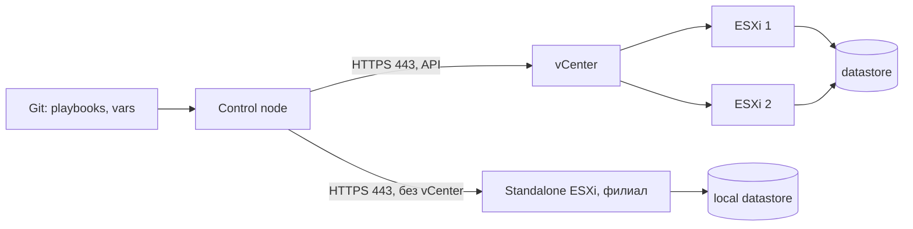

# VMware ESXi и vCenter

Все ВМ филиальной сети живут на собственных хостах ESXi, поэтому Ansible управляет виртуальной инфраструктурой через API vCenter или отдельного хоста. Это единственный раздел, где playbook может удалить или пересоздать сервер целиком, а не изменить файл.

## 1. Зачем это нужно

Ручное развёртывание ВМ плохо воспроизводится: другие CPU, память, сети, datastore, отсутствие тегов и снапшоты, оставленные «на неделю». Через API эти параметры описываются декларативно и проверяются до создания.

Вторая причина — дисциплина доступа. Автоматизация не должна работать под `administrator@vsphere.local`. Отдельная сервисная учётка с минимальными правами и журналом действий в vCenter снижает цену компрометации control node.

При парке в сотни ВМ ручные операции становятся источником незаметного дрейфа: шаблон обновили, но не все ВМ пересоздали; снапшот забыли удалить; тег не поставили, и ВМ выпала из отчёта. Ansible закрывает это только при условии, что параметры ВМ описаны в переменных, а не вводятся в мастере vSphere Client.

## 2. Ключевые понятия

| Понятие | Назначение | Пример |
|---|---|---|
| vCenter | единая точка управления хостами и ВМ | `vcsa01.example.local` |
| Standalone ESXi | хост без vCenter | `esx-msk-01.example.local` |
| Datacenter | логическая единица инвентаря | `DC-BRANCH` |
| Cluster | группа хостов с HA/DRS | `CL-BRANCH` |
| Folder | каталог ВМ внутри datacenter | `/DC-BRANCH/vm/reporting` |
| Template | эталонная ВМ для клонирования | `tpl-rocky9-base` |
| Snapshot | точка возврата состояния ВМ | `pre-patch-2026-11-11` |
| Delta disk | слой изменений после снапшота | растёт на datastore |
| Tag/category | метка для политик и отчётов | `Branch: msk` |
| Datastore | хранилище ВМ | `DS-BRANCH-01` |
| Guest customization | настройка ОС при клонировании | IP, hostname, DNS |
| Service account | учётка API | `svc-ansible@vsphere.local` |

## 3. Схема



Модули `community.vmware` выполняются на control node (`delegate_to: localhost`) и обращаются к API по HTTPS. Управляемые ВМ при этом не нуждаются в SSH: сетевой путь нужен от control node до vCenter, а не до гостевой ОС.

## 4. vCenter и standalone ESXi

| Возможность | vCenter | Standalone ESXi |
|---|---|---|
| Единый инвентарь | да | только один хост |
| Клонирование из шаблона | да | ограниченно |
| Теги и категории | да | нет |
| Права и роли | централизованно | локальные пользователи |
| Снапшоты | да | да, при платной лицензии |
| Настройки хоста | через кластер или хост | через хост |
| Типовой endpoint | `vcsa01.example.local` | `esx-msk-01.example.local` |

Для standalone ESXi в модулях указывают `hostname` самого хоста, `datacenter` по умолчанию `ha-datacenter`, а `cluster` и `folder` не задают. Бесплатная лицензия ESXi не даёт API-доступа на запись, поэтому часть задач завершится ошибкой прав.

Прямое подключение к хосту удобно в филиале, где нет vCenter, но оно плохо масштабируется: учётные данные и права приходится вести отдельно на каждом хосте, а единого журнала действий нет. Если в филиале больше двух хостов, vCenter окупается управляемостью и аудитом. Если хост один и меняется редко, допустимо подключаться напрямую, но с отдельной учёткой и ограничением по IP.

## 5. Пошаговая реализация

1. Создайте сервисную учётку в SSO и роль с минимальными правами на нужный datacenter или folder.
2. Положите пароль в vault или внешнее хранилище; в playbook не должно быть открытых строк.
3. Проверьте связь чтением данных datastore, а не созданием ВМ.
4. Опишите шаблон, cluster, datastore, сеть и параметры hardware в переменных.
5. Клонируйте ВМ, дождитесь IP, назначьте тег.
6. Настройте на хостах syslog и NTP, затем снимите резервную копию конфигурации ESXi.

## 6. Полный пример

```yaml
---
- name: Provision branch reporting VM
  hosts: localhost
  gather_facts: false
  connection: local

  vars:
    vcenter_hostname: vcsa01.example.local
    vcenter_username: svc-ansible@vsphere.local
    vm_datacenter: DC-BRANCH
    vm_folder: /DC-BRANCH/vm/reporting
    vm_name: br-msk-report01
    vm_template: tpl-rocky9-base
    vm_cluster: CL-BRANCH
    vm_datastore: DS-BRANCH-01
    vm_network: VLAN-120-REPORTING
    vm_ip: 10.20.120.31
    vm_netmask: 255.255.255.0
    vm_gateway: 10.20.120.1

  tasks:
    - name: Read datastore capacity
      community.vmware.vmware_datastore_info:
        hostname: "{{ vcenter_hostname }}"
        username: "{{ vcenter_username }}"
        datacenter: "{{ vm_datacenter }}"
        name: "{{ vm_datastore }}"
        validate_certs: true
      register: datastore_info
      delegate_to: localhost

    - name: Require at least 200 GB free on the target datastore
      ansible.builtin.assert:
        that:
          - (datastore_info.datastores | map(attribute='freeSpace') | first | default(0)) > 200 * 1024 * 1024 * 1024
        fail_msg: "Not enough free space on {{ vm_datastore }}"

    - name: Clone reporting VM from template
      community.vmware.vmware_guest:
        hostname: "{{ vcenter_hostname }}"
        username: "{{ vcenter_username }}"
        datacenter: "{{ vm_datacenter }}"
        folder: "{{ vm_folder }}"
        name: "{{ vm_name }}"
        template: "{{ vm_template }}"
        cluster: "{{ vm_cluster }}"
        datastore: "{{ vm_datastore }}"
        state: poweredon
        hardware:
          memory_mb: 4096
          num_cpus: 2
        networks:
          - name: "{{ vm_network }}"
            type: static
            ip: "{{ vm_ip }}"
            netmask: "{{ vm_netmask }}"
            gateway: "{{ vm_gateway }}"
            dns_servers:
              - 192.0.2.10
              - 192.0.2.11
        customization:
          hostname: "{{ vm_name }}"
          domain: example.local
          dns_servers:
            - 192.0.2.10
        wait_for_ip_address: true
        validate_certs: true
      delegate_to: localhost

    - name: Ensure branch tag exists
      community.vmware.vmware_tag:
        hostname: "{{ vcenter_hostname }}"
        username: "{{ vcenter_username }}"
        category_name: Branch
        tag_name: msk
        tag_description: Moscow branch
        state: present
      delegate_to: localhost

    - name: Assign branch tag to the VM
      community.vmware.vmware_tag_manager:
        hostname: "{{ vcenter_hostname }}"
        username: "{{ vcenter_username }}"
        tag_names:
          - "Branch:msk"
        object_name: "{{ vm_name }}"
        object_type: VirtualMachine
        state: add
      delegate_to: localhost
```

Пароль не указан в задаче намеренно: модули `community.vmware` берут его из переменной окружения `VMWARE_PASSWORD`, которую выставляют из vault или CI-секрета. Так строка не попадает ни в Git, ни в вывод задач. Категория `Branch` должна существовать заранее: `vmware_tag` управляет тегом внутри категории, но не создаёт саму категорию.

Проверка свободного места до клонирования — дешёвая страховка. Заполненный datastore останавливает не только создание ВМ, но и снапшоты, и консолидацию дисков, что приводит к аварии на соседних ВМ.

Снапшот перед изменением:

```yaml
- name: Create pre-change snapshot with guest quiescing
  community.vmware.vmware_guest_snapshot:
    hostname: "{{ vcenter_hostname }}"
    username: "{{ vcenter_username }}"
    datacenter: "{{ vm_datacenter }}"
    folder: "{{ vm_folder }}"
    name: "{{ vm_name }}"
    snapshot_name: "pre-patch-2026-11-11"
    description: "Before monthly patch cycle, CHG-1421"
    state: present
    memory_dump: false
    quiesce: true
    validate_certs: true
  delegate_to: localhost
```

`quiesce: true` требует установленных VMware Tools и включённой ВМ; без Tools задача завершится ошибкой. `memory_dump: false` экономит место, но состояние памяти не сохраняется. В новых версиях коллекции модуль помечен deprecated, документация предлагает `vmware.vmware.vm_snapshot`; проверьте `ansible-doc` перед обновлением коллекции.

Настройки хостов:

```yaml
- name: Configure ESXi host logging and NTP
  hosts: localhost
  gather_facts: false
  connection: local

  vars:
    vcenter_hostname: vcsa01.example.local
    vcenter_username: svc-ansible@vsphere.local
    esxi_hostname: esx-msk-01.example.local

  tasks:
    - name: Set syslog target and log level
      community.vmware.vmware_host_config_manager:
        hostname: "{{ vcenter_hostname }}"
        username: "{{ vcenter_username }}"
        esxi_hostname: "{{ esxi_hostname }}"
        options:
          'Syslog.global.logHost': 'ssl://syslog.example.local:6514'
          'Config.HostAgent.log.level': 'info'
        validate_certs: true
      delegate_to: localhost

    - name: Set NTP servers on the host
      community.vmware.vmware_host_ntp:
        hostname: "{{ vcenter_hostname }}"
        username: "{{ vcenter_username }}"
        esxi_hostname: "{{ esxi_hostname }}"
        ntp_servers:
          - 192.0.2.10
          - 192.0.2.11
        state: present
        validate_certs: true
      delegate_to: localhost
```

`vmware_host_config_manager` принимает словарь `options` с расширенными настройками ESXi; неверный ключ приводит к ошибке, а не к молчаливому пропуску. После изменения NTP проверьте на хосте `ntpq -p` или статус синхронизации в vSphere Client: сама задача не гарантирует, что время сошлось.

## 7. Снапшот — не резервная копия

| Свойство | Снапшот | Резервная копия |
|---|---|---|
| Где хранится | тот же datastore | отдельное хранилище |
| Защита от отказа СХД | нет | да |
| Защита от удаления ВМ | нет | да |
| Восстановление файла | через гостевую ОС | да, если есть file-level |
| Влияние на производительность | растёт delta disk | вне ВМ |
| Срок хранения | часы или дни | по политике RTO/RPO |
| Консистентность | по требованию, с quiesce | по расписанию |

Снапшот фиксирует состояние на уровне ВМ и создаёт delta disk. Чем дольше он живёт, тем больше слой изменений, тем выше риск заполнить datastore и тем дольше консолидация. Снапшот не переживёт потерю СХД, не поможет восстановить отдельный файл и не заменяет резервное копирование по [плану DR](29-backup-dr.md). Держите снапшоты не дольше согласованного окна и удаляйте их автоматически, а не «когда-нибудь».

Цепочка снапшотов опаснее одиночного: каждый следующий слой ссылается на предыдущий, а удаление среднего запускает консолидацию, которая может занять часы и на время замедлить ВМ. Если для отката нужно несколько точек, лучше сделать резервную копию, чем строить дерево снапшотов. Перед `revert` убедитесь, что данные, которые будут потеряны, не нужны, и что ВМ не является единственной копией сервиса.

## 8. Резервное копирование конфигурации ESXi

Конфигурацию хоста можно сохранить встроенной командой через ESXi Shell:

```bash
vim-cmd hostsvc/firmware/sync_config
vim-cmd hostsvc/firmware/backup_config
```

Команда возвращает URL вида `https://<host>/downloads/<bundle>.tgz`. Скачайте бандл, проверьте контрольную сумму и храните вне хоста. Для этого временно включают SSH, что само по себе расширяет поверхность атаки: делайте это в окне, с ограничением по источнику и с последующим выключением SSH. Восстановление конфигурации требует перезагрузки хоста и выполняется по официальной процедуре VMware, а не «на всякий случай» в рабочее время.

## 9. Least privilege для API

| Практика | Почему |
|---|---|
| Отдельная учётка `svc-ansible` | действия отличимы от администратора |
| Роль только на нужный datacenter/folder | компрометация не даёт весь vSphere |
| Нет входа в vSphere Client | учётка только для API |
| Пароль в vault, ротация | нет открытых секретов в Git |
| `validate_certs: true` | защита от подмены vCenter |
| Ограничение по IP | API доступен только с execution nodes |
| Аудит событий vCenter | видно, что и когда меняла автоматизация |

Права выдавайте по задачам: чтение инвентаря, клонирование, управление снапшотами, изменение расширенных настроек хоста, назначение тегов. Не давайте роль администратора «чтобы работало»: если прав не хватает, модуль вернёт понятную ошибку, и вы добавите конкретную привилегию, а не всю роль целиком.

## 10. Проверка результата

```bash
ansible-playbook -i inventories/prod/ vm-provision.yml --check --diff
ansible-playbook -i inventories/prod/ vm-provision.yml
```

Модули VMware поддерживают check mode частично: клонирование и снапшоты могут не иметь полноценного предсказания. Проверяйте `ansible-doc community.vmware.vmware_guest` для своей версии коллекции и всегда тестируйте на отдельном folder. После создания ВМ убедитесь, что она в нужном cluster и datastore, получила IP и тег, а снапшот виден в цепочке.

## 11. Безопасность и blast radius

| Действие | Риск | Мера |
|---|---|---|
| `state: absent` для ВМ | удаление сервера с дисками | отдельный playbook, ручное подтверждение |
| Клонирование в чужой cluster | ВМ не на той площадке | переменные inventory, assert |
| Снапшот без срока | заполнение datastore | автоудаление, мониторинг |
| `revert` снапшота | потеря текущего состояния диска | только с подтверждением и бэкапом |
| `validate_certs: false` | MITM к vCenter | внутренний CA на control node |
| Административная учётка API | полный контроль над vSphere | least privilege, отдельная роль |
| Изменение настроек хоста | потеря сети/логирования | canary-хост, консоль, откат значений |

Откат для клонирования — удаление созданной ВМ после проверки, что это именно она (имя, folder, UUID). Для снапшота — `state: revert` с пониманием, что текущие изменения диска будут потеряны. Для настроек хоста зафиксируйте прежние значения в тикете и верните их тем же модулем.

## 12. Комплаенс-маппинг

| Требование | Как закрывается |
|---|---|
| CIS VMware Benchmark | настройки хостов, NTP, syslog |
| ISO/IEC 27001:2022 A.8.13 | резервное копирование и проверка |
| NIST CSF 2.0 PR.PS | управляемая конфигурация виртуализации |
| Аудит | события vCenter, Git-история playbook |
| Least privilege | отдельная роль и учётка API |

## 13. Типичные ошибки и troubleshooting

| Симптом | Причина | Проверка | Решение |
|---|---|---|---|
| `Invalid credentials` | неверный SSO-логин или пароль | `VMWARE_PASSWORD` | проверить учётку и домен SSO |
| `Permission denied` | роли не хватает привилегии | события vCenter | добавить конкретную привилегию |
| `SSL certificate verify failed` | нет внутреннего CA | `openssl s_client` | установить CA на control node |
| ВМ создана не там | неверный folder или cluster | свойства ВМ | assert по переменным, отдельный folder |
| `wait_for_ip_address` истёк | нет VMware Tools или сети | консоль ВМ | установить Tools, проверить VLAN |
| Снапшот не создаётся | нет Tools при `quiesce` | события задачи | `quiesce: false` или установить Tools |
| `No space left on device` | datastore заполнен | `vmware_datastore_info` | очистка, перенос, расширение |
| Тег не назначается | категория не создана | vSphere Client | создать категорию заранее |

## 14. Чек-лист

- [ ] Для автоматизации отдельная учётка с минимальной ролью.
- [ ] Пароль хранится в vault или CI-секрете, не в playbook.
- [ ] `validate_certs: true` и внутренний CA установлены.
- [ ] Перед клонированием проверено свободное место.
- [ ] Имя, folder, cluster и datastore заданы переменными.
- [ ] Снапшоты имеют срок и удаляются автоматически.
- [ ] NTP и syslog хостов настроены и проверены.
- [ ] Конфигурация ESXi сохранена вне хоста.

## 15. Источники

- [community.vmware.vmware_guest](https://docs.ansible.com/ansible/latest/collections/community/vmware/vmware_guest_module.html)
- [community.vmware.vmware_guest_snapshot](https://docs.ansible.com/ansible/latest/collections/community/vmware/vmware_guest_snapshot_module.html)
- [community.vmware.vmware_host_config_manager](https://docs.ansible.com/ansible/latest/collections/community/vmware/vmware_host_config_manager_module.html)
- [community.vmware.vmware_tag_manager](https://docs.ansible.com/ansible/latest/collections/community/vmware/vmware_tag_manager_module.html)
- [community.vmware.vmware_datastore_info](https://docs.ansible.com/ansible/latest/collections/community/vmware/vmware_datastore_info_module.html)

## 16. Связанные страницы

- [Архитектура и компоненты](../fundamentals/02-architecture.md)
- [Резервное копирование и DR](29-backup-dr.md)
- [Масштабирование и производительность](30-scaling.md)
- [Харденинг ESXi/vCenter](../security/40-vmware-hardening.md)
- [Распределённые филиалы](20-branch-fleet.md)
