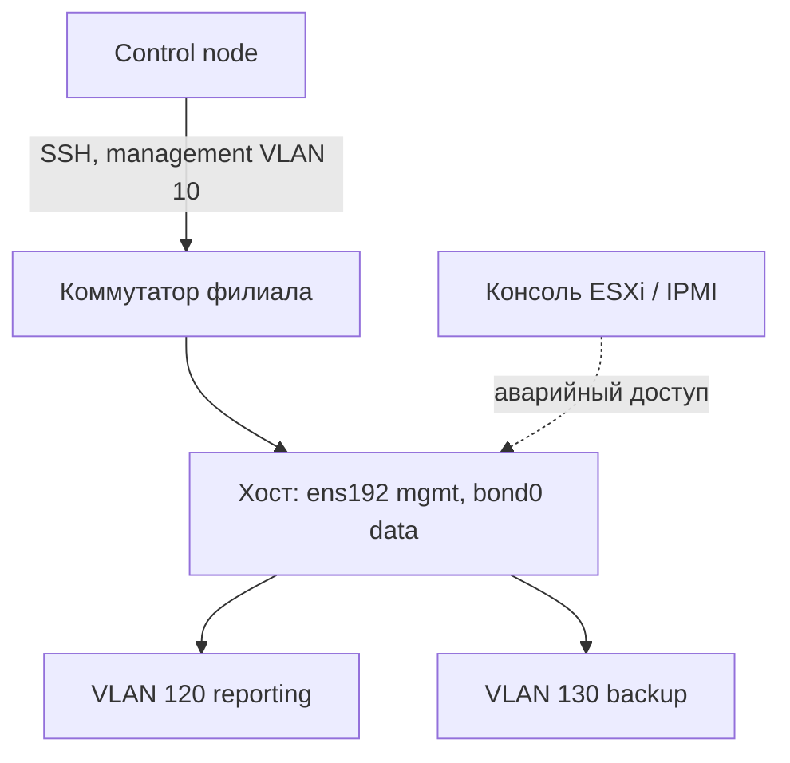

# Базовая сеть хоста

Сеть хоста — единственный слой, ошибка в котором отключает сам инструмент управления. Playbook меняет адрес, маршрут или VLAN, SSH-сессия обрывается, и вернуть хост можно только через консоль гипервизора. Поэтому сетевые изменения делают с защитой от самоблокировки, а не «как обычный конфиг».

## 1. Зачем это нужно

В филиале хост обычно подключён к management VLAN и к одному-двум data VLAN. Management-интерфейс должен оставаться неизменным, пока вы не готовы к процедуре с консолью. Data-интерфейсы можно менять автоматически, если они не несут SSH-трафик.

Виртуальная машина получает сеть через виртуальный коммутатор ESXi, поэтому «портом» для неё является группа портов или distributed port group. Ошибка в VLAN на стороне гипервизора выглядит как ошибка в гостевой ОС: адрес есть, а трафик не идёт. Прежде чем менять netplan или nmcli, проверьте, что нужный VLAN действительно разрешён на порту и в группе портов.

Вторая задача — привести имена соединений, адреса, DNS и NTP к единому шаблону. Разные имена интерфейсов и «ручные» правки через `ip addr add` исчезают после перезагрузки и создают дрейф, который не видно в отчётах.

## 2. Ключевые понятия

| Понятие | Назначение | Пример |
|---|---|---|
| Interface | сетевой интерфейс | `ens192`, `ens224` |
| Connection profile | профиль NetworkManager | `bond0`, `vlan120` |
| Bond | объединение интерфейсов | `active-backup` |
| VLAN | тегированный сегмент | `bond0.120` |
| Default route | маршрут по умолчанию | `via 192.0.2.1` |
| DNS | резолверы и search-домены | `192.0.2.10` |
| MTU | размер кадра | `1500`, `9000` |
| Netplan | конфигурация сети в Ubuntu | `/etc/netplan/*.yaml` |
| NetworkManager | менеджер соединений в RHEL | `nmcli` |
| Out-of-band | доступ вне основной сети | консоль ESXi, IPMI |
| Rollback timer | автоматический откат по таймеру | 5 минут |
| Dual control | изменение вдвоём | инженер и наблюдатель |

## 3. Схема



На схеме management-интерфейс отделён от data-bond. Изменения в VLAN 120 и 130 не затрагивают путь, по которому идёт SSH, а консоль гипервизора остаётся независимым каналом восстановления.

## 4. Пошаговая реализация

1. Зафиксируйте в inventory management-адрес, интерфейс и шлюз; не вычисляйте их из данных VLAN.
2. Убедитесь, что у вас есть консольный доступ через ESXi или IPMI.
3. Сделайте копию текущей конфигурации сети и проверьте, что она восстанавливается вручную.
4. Опишите изменение отдельно для management и для data: только data можно менять без окна.
5. Проверьте конфигурацию до применения: `netplan generate` или `nmcli connection show`.
6. Примените на одном хосте с `serial: 1`, проверьте адрес, маршрут и DNS, затем отмените таймер отката.

## 5. nmcli для RHEL

Модуль `community.general.nmcli` управляет профилями NetworkManager; в ansible-core встроенного `ansible.builtin.nmcli` нет. Для RHEL, Rocky и AlmaLinux это основной способ настройки.

```yaml
---
- name: Configure data bond and VLAN on RHEL family
  hosts: branch_rhel
  become: true
  gather_facts: true
  serial: 1

  tasks:
    - name: Create bond0 with a static address
      community.general.nmcli:
        conn_name: bond0
        ifname: bond0
        type: bond
        mode: active-backup
        miimon: 100
        ip4: 10.20.0.31/24
        autoconnect: true
        state: present

    - name: Attach first interface to bond0
      community.general.nmcli:
        conn_name: bond0-slave-ens224
        ifname: ens224
        type: bond-slave
        master: bond0
        state: present

    - name: Attach second interface to bond0
      community.general.nmcli:
        conn_name: bond0-slave-ens225
        ifname: ens225
        type: bond-slave
        master: bond0
        state: present

    - name: Create VLAN 120 on top of bond0
      community.general.nmcli:
        conn_name: vlan120
        ifname: bond0.120
        type: vlan
        vlanid: 120
        vlandev: bond0
        ip4: 10.120.0.31/24
        autoconnect: true
        state: present

    - name: Activate bond and VLAN connections
      community.general.nmcli:
        conn_name: "{{ item }}"
        state: up
      loop:
        - bond0
        - vlan120
```

`master` связывает slave с контроллером, `type: bond-slave` задаёт тип соединения. Режим `active-backup` не требует настройки агрегации на коммутаторе, поэтому подходит для филиалов с разными вендорами. `state: up` появился в `community.general` 9.5.0; в более старой версии активируйте соединение через `nmcli connection up` отдельной задачей.

Режим `802.3ad` (LACP) даёт больше полосы, но требует согласованной настройки на коммутаторе: неверная конфигурация порта приводит к тому, что bond не поднимается вообще. В филиале, где сетью занимается подрядчик, начинайте с `active-backup` и переходите на LACP только после письменного подтверждения схемы. Имя bond-интерфейса должно совпадать с тем, что ожидает switch-конфигурация, иначе после перезагрузки хост останется без связи.

## 6. Netplan для Ubuntu

В Ubuntu 22.04 и 24.04 сеть описывается YAML-файлами в `/etc/netplan`. Файл раскладывается `ansible.builtin.copy` или `ansible.builtin.template`, а проверка выполняется командой `netplan generate`.

```yaml
- name: Deploy data bond and VLAN configuration
  ansible.builtin.copy:
    content: |
      # {{ ansible_managed }}
      network:
        version: 2
        renderer: networkd
        ethernets:
          ens224:
            dhcp4: false
          ens225:
            dhcp4: false
        bonds:
          bond0:
            interfaces: [ens224, ens225]
            parameters:
              mode: active-backup
              mii-monitor-interval: 100
            addresses: [10.20.0.31/24]
        vlans:
          bond0.120:
            id: 120
            link: bond0
            addresses: [10.120.0.31/24]
    dest: /etc/netplan/60-ansible-data.yaml
    owner: root
    group: root
    mode: "0600"
```

Версия `version: 2` и `renderer: networkd` соответствуют серверной Ubuntu. Если на хосте используется NetworkManager, укажите его в `renderer`, иначе netplan создаст конфигурацию, которую никто не применит. VLAN здесь не получает маршрут по умолчанию: два default route на одном хосте дают непредсказуемую маршрутизацию и риск потерять management-путь.

Netplan чувствителен к отступам и именам ключей: ошибка в одном пробеле делает файл невалидным, и `netplan apply` завершится ошибкой уже после того, как файл записан на хост. Поэтому проверка `netplan generate` обязательна, а файл должен иметь права `0600`: в нём могут оказаться адреса и параметры, не предназначенные для чтения всем.

## 7. Полный пример

```yaml
---
- name: Configure a data bond on Ubuntu with rollback timer
  hosts: branch_ubuntu
  become: true
  gather_facts: true
  serial: 1
  any_errors_fatal: true

  vars:
    netplan_file: /etc/netplan/60-ansible-data.yaml
    netplan_backup: /root/netplan-rollback.yaml
    mgmt_interface: ens192
    mgmt_address: 192.0.2.31
    bond_interfaces:
      - ens224
      - ens225
    bond_address: 10.20.0.31/24
    vlan_id: 120
    vlan_address: 10.120.0.31/24

  tasks:
    - name: Refuse to include the management interface in the bond
      ansible.builtin.assert:
        that:
          - mgmt_interface not in bond_interfaces
        fail_msg: "{{ mgmt_interface }} carries SSH and must not be a bond member"

    - name: Check whether the managed netplan file exists
      ansible.builtin.stat:
        path: "{{ netplan_file }}"
      register: netplan_stat

    - name: Save the current netplan file for rollback
      ansible.builtin.copy:
        src: "{{ netplan_file }}"
        dest: "{{ netplan_backup }}"
        remote_src: true
        owner: root
        group: root
        mode: "0600"
      when: netplan_stat.stat.exists

    - name: Deploy the rollback script
      ansible.builtin.copy:
        content: |
          #!/bin/sh
          set -eu
          if [ -f "{{ netplan_backup }}" ]; then
            cp "{{ netplan_backup }}" "{{ netplan_file }}"
          else
            rm -f "{{ netplan_file }}"
          fi
          /usr/sbin/netplan apply
        dest: /usr/local/sbin/netplan-rollback.sh
        owner: root
        group: root
        mode: "0700"

    - name: Deploy data bond and VLAN configuration
      ansible.builtin.copy:
        content: |
          # {{ ansible_managed }}
          network:
            version: 2
            renderer: networkd
            ethernets:
              {{ bond_interfaces[0] }}:
                dhcp4: false
              {{ bond_interfaces[1] }}:
                dhcp4: false
            bonds:
              bond0:
                interfaces: [{{ bond_interfaces | join(', ') }}]
                parameters:
                  mode: active-backup
                  mii-monitor-interval: 100
                addresses: [{{ bond_address }}]
            vlans:
              bond0.{{ vlan_id }}:
                id: {{ vlan_id }}
                link: bond0
                addresses: [{{ vlan_address }}]
        dest: "{{ netplan_file }}"
        owner: root
        group: root
        mode: "0600"
        backup: true
      register: netplan_config

    - name: Validate the candidate configuration
      ansible.builtin.command:
        argv:
          - /usr/sbin/netplan
          - generate
      changed_when: false

    - name: Schedule automatic rollback in five minutes
      ansible.builtin.command:
        argv:
          - /usr/bin/systemd-run
          - --unit=netplan-rollback
          - --on-active=300
          - --collect
          - /usr/local/sbin/netplan-rollback.sh
      when:
        - netplan_config.changed
        - not ansible_check_mode

    - name: Apply netplan configuration
      ansible.builtin.command:
        argv:
          - /usr/sbin/netplan
          - apply
      when:
        - netplan_config.changed
        - not ansible_check_mode

    - name: Wait for the host to answer over SSH
      ansible.builtin.wait_for_connection:
        delay: 5
        timeout: 120
      when: not ansible_check_mode

    - name: Read interface addresses
      ansible.builtin.command:
        argv:
          - /usr/sbin/ip
          - -brief
          - address
          - show
      register: ip_brief
      changed_when: false
      when: not ansible_check_mode

    - name: Read the default route
      ansible.builtin.command:
        argv:
          - /usr/sbin/ip
          - route
          - show
          - default
      register: default_route
      changed_when: false
      when: not ansible_check_mode

    - name: Require management address and default route to survive
      ansible.builtin.assert:
        that:
          - mgmt_address in ip_brief.stdout
          - "'default' in default_route.stdout"
        fail_msg: >-
          Management path changed on {{ inventory_hostname }}.
          Keep the console open and let the rollback timer fire.
      when: not ansible_check_mode

    - name: Cancel the rollback timer after successful verification
      ansible.builtin.command:
        argv:
          - /usr/bin/systemctl
          - stop
          - netplan-rollback.timer
      changed_when: false
      when:
        - netplan_config.changed
        - not ansible_check_mode
```

`netplan generate` проверяет синтаксис и семантику до применения: если файл некорректен, задача падает, а работающая сетевая конфигурация не меняется. `validate` у `ansible.builtin.copy` здесь не используется, потому что `netplan generate` не принимает путь к отдельному файлу — он читает каталог `/etc/netplan`.

Таймер `systemd-run --on-active=300` — страховка: если проверка не прошла или инженер потерял сессию, через пять минут скрипт вернёт предыдущий файл и применит его. Отмена таймера — намеренно не идемпотентное действие оператора, поэтому задача помечена `changed_when: false` и выполняется только при реальном изменении конфигурации. Если хост всё же потерял управление, откат произойдёт без вашего участия, а консоль ESXi останется последним рубежом.

## 8. Маршруты, DNS и NTP

Маршрут по умолчанию должен быть один и принадлежать management-интерфейсу. Дополнительные маршруты к центральным сервисам добавляйте явно и с метрикой, а не вторым default route. Проверка после изменения: `ip route get 192.0.2.10` показывает, через какой интерфейс уйдёт трафик к DNS-серверу.

DNS настраивается в профиле соединения или в netplan, а не правкой `/etc/resolv.conf`: файл перезаписывается systemd-resolved или NetworkManager. Для филиала задайте два внутренних резолвера и search-домен; внешние DNS не используйте, иначе имена внутренних сервисов перестанут разрешаться.

NTP на хосте настраивается через chrony, как описано в разделе [Управление Linux](21-os-management.md). Сетевой аспект: UDP/123 должен быть разрешён от хоста до внутренних NTP-серверов, а время должно совпадать с vCenter и syslog, иначе корреляция событий и TLS-проверки будут давать странные ошибки.

## 9. VPN и SD-WAN

На хосте обычно остаётся только исходящий маршрут в overlay-сеть, а туннель поднимает SD-WAN-клиент или маршрутизатор филиала. Ansible не должен управлять ключами VPN в открытом виде: секреты хранятся в vault, а конфигурация туннеля — в роли сетевого оборудования, а не в playbook приложения.

Практические грабли: MTU overlay меньше 1500, из-за чего SSH поднимается, но большие пакеты зависают; асимметричная маршрутизация ломает `rp_filter`; management-адрес находится за туннелем, который зависит от самого хоста. Проверяйте MTU согласованно с сетевой командой и не размещайте management-доступ внутрь туннеля, который настраивается этим же хостом.

Если SD-WAN-контроллер выдаёт маршруты автоматически, не дублируйте их статическими записями в netplan: конфликт маршрутов приведёт к тому, что трафик уйдёт в обход политики. Зафиксируйте в роли только то, чем действительно управляет Ansible: адреса, VLAN, bond и DNS. Всё, что относится к overlay, оставьте сетевой команде и опишите в документации филиала.

## 10. Проверка результата

```bash
ansible-playbook -i inventories/prod/ net-bond.yml --check --diff --limit msk-app01
ansible-playbook -i inventories/prod/ net-bond.yml --limit msk-app01
ip -brief address show
ip route show default
nmcli connection show
```

Для Ubuntu дополнительно `netplan get` и `resolvectl status`; для RHEL — `nmcli device status`. Повторный запуск должен дать `changed=0`. Проверка с контрольной машины: `ssh` на management-адрес и `ping` шлюза data-VLAN.

## 11. Безопасность и blast radius

| Риск | Последствие | Мера |
|---|---|---|
| Изменение management-интерфейса | потеря SSH ко всем хостам партии | отдельный playbook, консоль, таймер |
| Второй default route | трафик уходит не туда | только один default route |
| Ошибка в имени интерфейса | хост без сети после ребута | `ip link`, проверка до apply |
| `netplan apply` без проверки | синтаксическая ошибка применена | `netplan generate` |
| Одновременный запуск на парке | массовая потеря доступа | `serial: 1`, `any_errors_fatal` |
| Правка `/etc/resolv.conf` | DNS откатывается сам | профиль соединения |
| VPN-ключи в playbook | компрометация канала | vault, отдельная роль |

Перед изменением management-сети требуется ручное подтверждение и наблюдатель с консолью. Автоматический откат по таймеру обязателен, но он не заменяет out-of-band доступ: таймер может не сработать, если хост не загрузился. После успешного изменения таймер отменяется, а старая конфигурация сохраняется до следующего окна.

## 12. Комплаенс-маппинг

| Требование | Как закрывается |
|---|---|
| CIS Control 12 (Network Infrastructure) | документированные профили и VLAN |
| CIS Control 4 | конфигурация из Git, а не вручную |
| ISO/IEC 27001:2022 A.8.20 | управление сетями и сегментацией |
| NIST CSF 2.0 PR.IR | устойчивость управления и восстановление |
| Аудит | журнал запусков, diff конфигурации |

## 13. Типичные ошибки и troubleshooting

| Симптом | Причина | Проверка | Решение |
|---|---|---|---|
| SSH не поднимается после apply | изменён management-путь | консоль, `ip a` | дождаться таймера, восстановить файл |
| `netplan generate` падает | ошибка YAML или имени интерфейса | stderr задачи | исправить отступы, `ip link` |
| Адрес есть, шлюза нет | нет default route | `ip route` | добавить маршрут в management-профиль |
| Bond не поднимается | slave не привязан к master | `nmcli device status` | указать `master`, активировать |
| VLAN не проходит | нет trunk на порту | `nmcli`, коммутатор | согласовать native/trunk VLAN |
| DNS не работает | правка `/etc/resolv.conf` | `resolvectl status` | настроить в профиле |
| Большие пакеты зависают | MTU overlay | `ping -M do -s 1400` | согласовать MTU с сетью |
| Два default route | VLAN получил gateway | `ip route` | убрать лишний маршрут |

## 14. Чек-лист

- [ ] Management-интерфейс и адрес зафиксированы в inventory.
- [ ] Есть консольный доступ вне основной сети.
- [ ] Изменение проверено `netplan generate` или `nmcli`.
- [ ] Таймер отката запланирован до применения.
- [ ] `serial: 1` и `any_errors_fatal` включены.
- [ ] Default route остался один.
- [ ] DNS настроен в профиле, а не в `/etc/resolv.conf`.
- [ ] После проверки таймер отменён, старая конфигурация сохранена.

## 15. Источники

- [community.general.nmcli](https://docs.ansible.com/ansible/latest/collections/community/general/nmcli_module.html)
- [Netplan documentation](https://netplan.readthedocs.io/en/stable/)
- [Netplan examples](https://netplan.readthedocs.io/en/stable/examples/)
- [systemd-run](https://www.freedesktop.org/software/systemd/man/latest/systemd-run.html)
- [ansible.builtin.wait_for_connection](https://docs.ansible.com/ansible/latest/collections/ansible/builtin/wait_for_connection_module.html)

## 16. Связанные страницы

- [Доступ и привилегии](../secure-dev/12-access.md)
- [Распределённые филиалы](20-branch-fleet.md)
- [Сетевые устройства](26-network-devices.md)
- [Межсетевой экран](../security/37-firewall.md)
- [Управление Linux](21-os-management.md)
