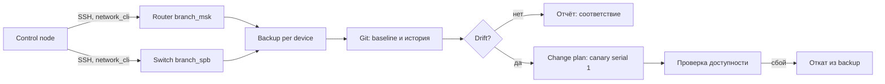

# Сетевые устройства

Коммутаторы и маршрутизаторы филиалов — это периметр, через который проходит вся остальная автоматизация. Ansible управляет ими не через агент и не через Python на устройстве, а через постоянное SSH-соединение и текстовые команды. Такая модель даёт быстрый выигрыш в виде резервных копий и инвентаризации, но требует дисциплины при изменениях: ошибка в ACL или AAA отрезает филиал от сети управления.

## 1. Зачем это нужно

Сетевое оборудование почти всегда настраивается вручную и живёт дольше серверов. Конфигурации дрейфуют, резервные копии делают «когда вспомнят», а проверка соответствия baseline держится на глазах инженера. Ansible закрывает три задачи без установки агентов:

1. **Регулярный бэкап** работающей конфигурации (`running-config`) с хранением в Git и контрольной суммой.
2. **Сравнение с baseline** и отчёт о расхождениях до того, как они станут инцидентом.
3. **Массовые изменения** по одному устройству за проход, с артефактом отката и проверкой доступности после применения.

Начинать нужно с первых двух задач: они только читают состояние и почти не создают риска. Изменения конфигурации — отдельный процесс с окном работ, консольным доступом и планом отката.

## 2. Ключевые понятия

| Понятие | Назначение | Пример |
|---|---|---|
| `ansible.netcommon.network_cli` | connection plugin для SSH-сессий к сетевым ОС | `connection: ansible.netcommon.network_cli` |
| `ansible_network_os` | идентификатор сетевой платформы | `cisco.ios.ios`, `arista.eos.eos` |
| Vendor collection | набор terminal- и cliconf-плагинов и модулей вендора | `cisco.ios`, `arista.eos` |
| `ansible.netcommon.cli_config` | выгрузка и применение строк конфигурации | `backup: true` |
| `ansible.netcommon.cli_command` | выполнение произвольной команды без изменения конфигурации | `show running-config` |
| `running-config` | действующая конфигурация устройства | сохраняется в `startup-config` отдельно |
| Baseline | эталонная конфигурация, с которой сравнивают устройство | файл в Git на каждый филиал |
| AAA | аутентификация, авторизация и учёт (TACACS+ или RADIUS) | централизованный сервер |
| `serial` | число устройств, обрабатываемых одновременно | `serial: 1` для изменений |
| `ansible_command_timeout` | таймаут ожидания ответа устройства, секунды | `60` для медленного WAN |

`network_cli` держит одно постоянное соединение на устройство и использует terminal-плагин вендорской коллекции, который отключает постраничный вывод и распознаёт приглашение. Поэтому `gather_facts` для таких хостов не нужен и обычно отключён.

## 3. Схема



На схеме важны две границы: между control node и устройством (SSH-доступ и AAA-учётка) и между чтением и изменением (backup и baseline не меняют устройство). Изменение всегда идёт через отдельный запуск с одним устройством в партии.

## 4. Пошаговая реализация

### Шаг 1. Зафиксируйте коллекции

```yaml
---
collections:
  - name: ansible.netcommon
    version: ">=6.1.0,<7.0.0"
  - name: cisco.ios
    version: ">=8.0.0,<9.0.0"
  - name: arista.eos
    version: ">=9.0.0,<10.0.0"
```

Точные версии сверьте с `ansible-galaxy collection list` в своём окружении и замените диапазоны на проверенные патчи перед продакшеном. Вендорская коллекция нужна не только ради модулей: она поставляет terminal-плагин, без которого `network_cli` не распознает приглашение устройства.

### Шаг 2. Опишите устройства в inventory

```yaml
all:
  children:
    network:
      vars:
        ansible_user: svc-ansible-net
        ansible_ssh_private_key_file: ~/.ssh/ansible_net_ed25519
        ansible_command_timeout: 60
        ansible_connect_timeout: 30
      children:
        network_ios:
          vars:
            ansible_network_os: cisco.ios.ios
            aaa_show_command: "show running-config | include aaa"
            aaa_required_pattern: "aaa accounting"
            config_save_command: "write memory"
          hosts:
            msk-rtr01:
              ansible_host: 192.0.2.1
        network_eos:
          vars:
            ansible_network_os: arista.eos.eos
            aaa_show_command: "show running-config | include aaa"
            aaa_required_pattern: "aaa accounting"
            config_save_command: "write memory"
          hosts:
            spb-sw01:
              ansible_host: 192.0.2.2
        network_canary:
          hosts:
            msk-rtr01:
        network_rollback:
          hosts:
            msk-rtr01:
```

Команды проверки вынесены в переменные, потому что синтаксис `show` различается между платформами. Значения выше приведены для IOS-подобного синтаксиса; для другой платформы их заменяют по документации вендора. Пароли здесь не хранятся: устройство аутентифицирует ключ или сервисную учётку через AAA. Группы `network_canary` и `network_rollback` содержат те же хосты и служат для запуска опасных play по одному устройству: членство в группе меняется отдельным коммитом и проходит ревью.

### Шаг 3. Снимайте бэкап до любых изменений

Запускайте playbook из раздела 5 по расписанию, например раз в сутки из CI или AWX. Каждый файл получает имя, производное от хоста и отметки времени; рядом сохраняется контрольная сумма SHA-256. Это даёт доказуемый артефакт: видно, когда снята копия и совпадает ли она с тем, что было применено.

### Шаг 4. Храните baseline отдельно от бэкапов

Baseline — это не последняя копия, а согласованное эталонное состояние: AAA, NTP, syslog, SNMP, пароли типа 8/9, отключённые неиспользуемые порты и сервисы. Файл baseline лежит в Git и проходит ревью. Сравнение выполняйте офлайн, на control node: сначала снимите копию, затем сравните её с эталоном и только после этого решайте, что считать дрейфом, а что — одобренным изменением.

### Шаг 5. Проведите изменение на одном устройстве

Порядок для любого изменения конфигурации:

1. Согласуйте окно работ и получите доступ к консоли или out-of-band порту.
2. Снимите `prechange`-копию и сохраните её вне Git-ветки изменений.
3. Покажите инженеру точные строки, которые будут отправлены (задача `debug` с шаблоном).
4. Примените на одном устройстве (`serial: 1`), проверьте управляемость и только затем расширяйте партию.
5. Сохраните конфигурацию в `startup-config` отдельной задачей.

Check mode у сетевых модулей поддерживается неравномерно, поэтому не полагайтесь на `--check` как на единственную защиту. Надёжнее собрать текущую конфигурацию, сравнить её с намерением локально и приложить diff к change request.

### Шаг 6. Подготовьте откат заранее

Откат — это не команда «на всякий случай», а проверенный сценарий. Для аддитивных изменений (добавили строку ACL, включили NTP) достаточно повторно применить `prechange`-копию: `cli_config` добавит отсутствующие строки. Для изменений, которые что-то удаляют или заменяют, нужны явные отрицающие команды (`no ...`), написанные под конкретную платформу и проверенные в лаборатории. Полную замену конфигурации выполняйте средствами вендорской коллекции или с консоли, а не «на глаз» через merge.

## 5. Полный запускаемый пример

```yaml
---
- name: Back up network configurations and verify AAA
  hosts: network
  gather_facts: false
  connection: ansible.netcommon.network_cli
  serial: 5
  max_fail_percentage: 0

  vars:
    backup_root: "{{ playbook_dir }}/backups/network"

  tasks:
    - name: Ensure a local backup directory per device
      ansible.builtin.file:
        path: "{{ backup_root }}/{{ inventory_hostname }}"
        state: directory
        mode: "0750"
      delegate_to: localhost

    - name: Back up the running configuration
      ansible.netcommon.cli_config:
        backup: true
        backup_options:
          dir_path: "{{ backup_root }}/{{ inventory_hostname }}"
      register: config_backup

    - name: Read the AAA configuration fragment
      ansible.netcommon.cli_command:
        command: "{{ aaa_show_command }}"
      register: aaa_state
      changed_when: false

    - name: Require central AAA and accounting
      ansible.builtin.assert:
        that:
          - aaa_state.stdout is search(aaa_required_pattern)
        fail_msg: >-
          Central AAA is not configured on {{ inventory_hostname }}:
          expected '{{ aaa_required_pattern }}' in '{{ aaa_show_command }}'
        success_msg: "AAA baseline confirmed on {{ inventory_hostname }}"

    - name: Record the backup checksum locally
      ansible.builtin.stat:
        path: "{{ config_backup.backup_path }}"
        checksum_algorithm: sha256
      delegate_to: localhost
      register: backup_stat

    - name: Store the checksum next to the backup
      ansible.builtin.copy:
        content: "{{ backup_stat.stat.checksum }}  {{ inventory_hostname }}\n"
        dest: "{{ backup_root }}/{{ inventory_hostname }}/SHA256SUMS"
        mode: "0640"
      delegate_to: localhost
```

Playbook только читает устройство и раскладывает артефакты на control node. Для изменения конфигурации используйте отдельный play с `serial: 1`:

```yaml
---
- name: Apply approved management ACL on a single device
  hosts: network_canary
  gather_facts: false
  connection: ansible.netcommon.network_cli
  serial: 1
  max_fail_percentage: 0
  any_errors_fatal: true

  vars:
    backup_root: "{{ playbook_dir }}/backups/network"
    change_template: "templates/management_acl.j2"

  tasks:
    - name: Capture the pre-change configuration
      ansible.netcommon.cli_config:
        backup: true
        backup_options:
          dir_path: "{{ backup_root }}/prechange"
      register: prechange

    - name: Show the intended configuration lines
      ansible.builtin.debug:
        msg: "{{ lookup('ansible.builtin.template', change_template) }}"

    - name: Apply the configuration lines
      ansible.netcommon.cli_config:
        config: "{{ lookup('ansible.builtin.template', change_template) }}"
      register: change_result

    - name: Confirm the management plane is still reachable
      ansible.builtin.wait_for:
        host: "{{ ansible_host }}"
        port: 22
        timeout: 30
        state: started
      delegate_to: localhost
      changed_when: false

    - name: Save the configuration to startup
      ansible.netcommon.cli_command:
        command: "{{ config_save_command }}"
      when: change_result.changed
```

`wait_for` проверяет SSH с control node, а не с самого устройства, поэтому отражает реальную достижимость плоскости управления. Если задача падает, play останавливается на этом устройстве, а `prechange`-копия уже лежит на диске.

## 6. Проверка результата

```bash
ansible-inventory -i inventories/prod/network.yml --graph
ansible-playbook -i inventories/prod/network.yml network-backup.yml --limit branch_msk
find backups/network -name '*.cfg' -mtime -1 -ls
diff -u baselines/msk-rtr01.cfg backups/network/msk-rtr01/<backup-file>.cfg
```

Для точечной проверки без playbook:

```bash
ansible network_ios -i inventories/prod/network.yml \
  -m ansible.netcommon.cli_command \
  -a "command='show running-config | include aaa'"
```

Признаки успеха: у каждого устройства есть свежий файл, `SHA256SUMS` совпадает с файлом, `assert` по AAA проходит, `diff` с baseline показывает только согласованные расхождения. Если `changed` в задаче применения равен нулю при ожидаемом изменении, проверьте шаблон на лишние пробелы и порядок строк.

## 7. Безопасность и blast radius

| Риск | Последствие | Мера |
|---|---|---|
| Ошибка в ACL или route-map на транзитном интерфейсе | филиал теряет связь с ЦОД | canary, окно работ, консоль, `serial: 1` |
| Смена AAA до проверки fallback | блокировка всех входов | локальная учётка с ротацией, проверка на одном устройстве |
| Общая учётная запись на все платформы | невозможность атрибуции действий | отдельная сервисная учётка на платформу автоматизации |
| Бэкап без контрольной суммы | незаметная порча артефакта | SHA-256, хранение в Git, проверка целостности |
| Широкий паттерн `all` | изменение всех филиалов сразу | `--list-hosts`, `--limit`, отдельная группа `network_canary` |
| Забытое сохранение в startup | конфигурация теряется после перезагрузки | отдельная задача `write memory` по факту `changed` |

AAA — центральная часть модели доступа. Ansible должен ходить на устройство под отдельной сервисной учётной записью с правами только на нужные команды; интерактивные администраторы — под персональными учётками. Авторизацию по командам (command authorization) и accounting лучше вести на TACACS+, а журнал отправлять в SIEM. Локальный fallback-аккаунт нужен, но его пароль хранится в vault и ротируется по регламенту.

!!! warning "Риск самоблокировки"

    Изменение ACL управления, AAA или маршрута к control node может отрезать доступ ко всем устройствам филиала одновременно. Перед применением убедитесь, что консольный или out-of-band доступ работает, а `prechange`-копия сохранена вне каталога, который изменяется этим же playbook.

**Откат.** Для аддитивных изменений повторно примените `prechange`-копию через `ansible.netcommon.cli_config` с `config: "{{ lookup('ansible.builtin.file', restore_file) }}"`. Для замен и удалений заранее подготовьте явные отрицающие команды и проверьте их в лаборатории. Если доступ потерян, откат выполняется с консоли; поэтому консольный доступ — обязательное условие окна работ.

## 8. Комплаенс-маппинг

| Требование | Как закрывается |
|---|---|
| CIS Control 4 (Secure Configuration) | baseline в Git, регулярное сравнение конфигураций |
| CIS Control 12 (Network Infrastructure Management) | централизованная конфигурация, контроль изменений, резервные копии |
| NIST CSF 2.0 PR.PS, DE.CM | управляемые изменения и мониторинг дрейфа |
| ISO/IEC 27001:2022 A.8.9, A.8.15 | конфигурация, журналирование AAA и изменений |
| Аудит доступа | персональные учётки, TACACS+ accounting, хранение бэкапов |

Доказательства: файлы бэкапов с датой и контрольной суммой, diff с baseline, журнал запусков playbook, выгрузка accounting с сервера AAA.

## 9. Типичные ошибки и troubleshooting

| Симптом | Причина | Проверка | Решение |
|---|---|---|---|
| `Unable to authenticate` | неверная учётка или ключ | `-vvv`, журнал AAA | проверить сервисную учётку и права |
| `timeout value 10 seconds has expired` | медленный WAN или долгий ответ | `-vvv`, `show` вручную | поднять `ansible_command_timeout` |
| `unable to detect prompt` | нестандартное приглашение или баннер | ручной вход по SSH | проверить terminal-плагин вендорской коллекции |
| Пустой файл бэкапа | недостаточные привилегии | размер файла, `show privilege` | выдать права или настроить `enable` |
| `changed` при каждом запуске | лишние пробелы или порядок строк | diff двух запусков | нормализовать шаблон |
| Конфигурация потеряна после reload | не выполнено сохранение | `show startup-config` | задача `write memory` по `changed` |
| Потеря доступа после ACL | самоблокировка | ping и SSH с другой сети | консоль, откат из `prechange` |
| Задача `wait_for` падает | фильтрация SSH на устройстве | `ssh -vv` с control node | проверить ACL управления до раскатки |

## 10. Чек-лист

- [ ] Коллекции зафиксированы в `requirements.yml` с версиями.
- [ ] У каждого устройства задан `ansible_network_os` и таймауты.
- [ ] Для автоматизации используется отдельная учётная запись.
- [ ] Бэкап снимается по расписанию и хранится с контрольной суммой.
- [ ] Baseline лежит в Git и проходит ревью.
- [ ] Изменения применяются с `serial: 1` и `max_fail_percentage: 0`.
- [ ] `prechange`-копия сохраняется до применения.
- [ ] Проверена достижимость плоскости управления после изменения.
- [ ] Консольный или out-of-band доступ подтверждён до окна работ.
- [ ] AAA и accounting проверяются отдельной задачей.

## 11. Источники

- [Ansible network automation](https://docs.ansible.com/ansible/latest/network/getting_started/index.html)
- [ansible.netcommon.cli_config](https://docs.ansible.com/ansible/latest/collections/ansible/netcommon/cli_config_module.html)
- [ansible.netcommon.cli_command](https://docs.ansible.com/ansible/latest/collections/ansible/netcommon/cli_command_module.html)
- [ansible.netcommon.network_cli](https://docs.ansible.com/ansible/latest/collections/ansible/netcommon/network_cli_connection.html)
- [CIS Controls](https://www.cisecurity.org/controls)

## 12. Связанные страницы

- [Базовая сеть хоста](25-network-basics.md)
- [Распределённые филиалы](20-branch-fleet.md)
- [Сеть и облако: харденинг](../security/41-network-cloud-hardening.md)
- [Безопасная разработка playbook](../secure-dev/13-safe-code.md)
- [Диагностика и troubleshooting](../ops/60-troubleshooting.md)
- [Inventory и группы](../fundamentals/05-inventory.md)
