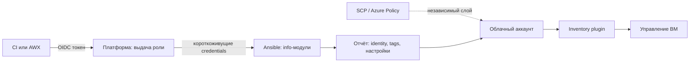

# Публичные облака (опционально)

Публичное облако не входит в базовую поставку этой вики: ядро инфраструктуры — собственная площадка на VMware ESXi. Эта страница нужна тем, у кого есть отдельный облачный аккаунт или гибридный сценарий. Ansible здесь выступает не инструментом создания инфраструктуры, а плоскостью проверки: он подтверждает, под какой учётной записью работает автоматизация, какие ресурсы не имеют обязательных тегов и какие настройки доступа отклонились от baseline.

## 1. Зачем это нужно

Облачный аккаунт отличается от филиала тем, что все ресурсы создаются через API, а границы задаются политиками провайдера. Типовые проблемы одни и те же: долгоживущие ключи доступа в CI, роли с широкими правами, ресурсы без владельца и тегов, публично доступные хранилища. Ansible не заменяет политику организации (SCP в AWS, Azure Policy) и не должен использоваться для её обхода. Его задача — регулярная проверка и приведение тегов и настроек к согласованному виду там, где это безопасно и обратимо.

Практическая польза ограничена тремя сценариями:

1. **Аудит идентичности и прав** — автоматизация запускается только под короткоживущими учётными данными.
2. **Аудит тегирования** — у каждого ресурса есть владелец, среда и класс данных.
3. **Инвентаризация** — облачные ВМ попадают в общий inventory с теми же правилами, что и филиальные хосты.

Полное развёртывание landing zone, сетей и политик делайте в Terraform или другом IaC-инструменте. Дублировать это в Ansible опасно: два источника истины дают дрейф и конфликтующие изменения.

## 2. Ключевые понятия

| Понятие | Назначение | Пример |
|---|---|---|
| `amazon.aws` | коллекция модулей и плагинов для AWS | `amazon.aws.aws_caller_info` |
| `azure.azcollection` | коллекция модулей для Azure | `azure.azcollection.azure_rm_resourcegroup_info` |
| boto3 / botocore | Python SDK для AWS, требуется `amazon.aws` | ставится в venv control node |
| Azure SDK | Python-зависимости `azure.azcollection` | `requirements-azure.txt` из коллекции |
| `aws_ec2` inventory plugin | динамический inventory из AWS | `amazon.aws.aws_ec2` |
| IAM role | роль, выдаваемая на время | assumes role через OIDC |
| OIDC federation | обмен токена CI на короткоживущие credentials | без статических ключей |
| SCP | политика организации, ограничивающая аккаунт | запрет отключения журналирования |
| Azure Policy | политика на уровне подписки или группы | обязательные теги |
| Guardrail | ограничение платформы, которое нельзя обойти из playbook | SCP, Azure Policy, permission boundary |
| Required tags | обязательный набор тегов | `owner`, `environment`, `data_class` |
| Info module | модуль только для чтения | `*_info` |

Коллекции требуют Python-зависимостей: для `amazon.aws` — boto3 и botocore, для `azure.azcollection` — пакеты из файла `requirements-azure.txt`, поставляемого коллекцией. Ставьте их в то же изолированное окружение, что и ansible-core, и фиксируйте версии.

## 3. Схема



На схеме два независимых контура. Политики провайдера ограничивают то, что вообще можно сделать, а Ansible только наблюдает и отчитывается. Если проверка в Ansible падает, это сигнал о дрейфе, а не повод ослабить политику.

## 4. Пошаговая реализация

### Шаг 1. Определите границы применимости

Зафиксируйте, что именно делает Ansible: аудит идентичности, тегов, журналирования и публичного доступа; синхронизация inventory; обратимые изменения тегов. Всё, что создаёт счета, сети, политики и ключи, остаётся в IaC и в руках владельца аккаунта. Такой список согласуйте с security до первого запуска.

### Шаг 2. Откажитесь от статических ключей

В CI используйте OIDC-федерацию: пайплайн получает токен и обменивает его на роль с ограниченным временем жизни. На control node в облаке роль выдаётся инстансу. Статические ключи допустимы только как временная миграционная мера с датой отзыва. Роль для аудита должна быть read-only; отдельная роль для правки тегов выдаётся только на нужные типы ресурсов и только в неproduction аккаунтах.

### Шаг 3. Разделите аккаунты и среды

Production, staging и sandbox — разные аккаунты или подписки. Переключение между ними выполняется профилем или ролью, а не правкой переменной в playbook. Ошибка в регионе или аккаунте — самый частый источник большого blast radius: playbook может «привести теги в порядок» в чужой среде.

Ведите реестр аккаунтов: идентификатор, владелец, назначение, роль автоматизации и срок проверки. Без реестра невозможно ответить на вопрос, какие аккаунты вообще существуют, а значит нельзя гарантировать, что аудит покрывает весь облачный периметр.

### Шаг 4. Задайте обязательные теги

Минимальный набор: `owner`, `environment`, `data_class`, `branch` или `cost_center`. Теги — это не косметика: по ним строятся отчёты об активах, доступе и стоимости. Требование фиксируется в политике провайдера, а Ansible проверяет покрытие и показывает конкретные ресурсы без тегов.

### Шаг 5. Настройте inventory plugin

```yaml
plugin: amazon.aws.aws_ec2
regions:
  - eu-central-1
filters:
  instance-state-name: running
  tag:environment: production
keyed_groups:
  - key: tags.branch
    prefix: branch
  - key: tags.environment
    prefix: env
compose:
  ansible_host: private_ip_address
cache: true
cache_plugin: jsonfile
cache_connection: ./.cache/aws_inventory
cache_timeout: 900
```

Плагин читает теги и состояние инстансов. Не включайте в выборку остановленные ресурсы и шаблоны: они не должны попадать под управление. Кэш обязателен при частых запусках, иначе каждый playbook будет ждать API.

### Шаг 6. Храните credentials вне репозитория

На control node используйте профиль AWS или переменные окружения, которые выставляет платформа. В AWX и AAP — credentials платформы. В Git не должно быть ни ключей, ни `~/.aws/credentials`. Если без секрета не обойтись, применяйте vault с отдельным ID и `no_log: true` в задачах, где значение может попасть в вывод.

## 5. Полный запускаемый пример

Пример ниже только читает данные и ничего не меняет. Он проверяет, что автоматизация не работает под root-подобной учётной записью, и показывает ресурсы без обязательных тегов.

```yaml
---
- name: Audit cloud automation identity and tag coverage
  hosts: localhost
  connection: local
  gather_facts: false

  vars:
    aws_region: eu-central-1
    required_tags:
      - owner
      - environment
      - data_class
      - branch

  tasks:
    - name: Read the caller identity
      amazon.aws.aws_caller_info:
        region: "{{ aws_region }}"
      register: caller

    - name: Require an assumed role instead of a root identity
      ansible.builtin.assert:
        that:
          - caller.arn is not search(':root')
          - caller.arn is search(':assumed-role/')
        fail_msg: >-
          Automation runs as {{ caller.arn }}.
          Use an assumed role with short-lived credentials.
        success_msg: "Automation identity: {{ caller.arn }}"

    - name: List running instances in the region
      amazon.aws.ec2_instance_info:
        region: "{{ aws_region }}"
        filters:
          instance-state-name: ["running"]
      register: ec2

    - name: Report instances without required tags
      ansible.builtin.debug:
        msg: >-
          {{ item.instance_id }} misses
          {{ required_tags | difference(item.tags.keys() | default([])) }}
      loop: "{{ ec2.instances }}"
      loop_control:
        label: "{{ item.instance_id }}"
      when: required_tags | difference(item.tags.keys() | default([])) | length > 0
```

Проверка `assumed-role` подходит для ролей, выданных через STS. Если в вашей модели используются федеративные пользователи или SSO-профили, замените условие на проверку конкретного ARN роли и зафиксируйте это в комментарии к задаче. Для Azure аналог — `azure.azcollection.azure_rm_resourcegroup_info` с проверкой тегов группы ресурсов; модуль возвращает список групп с их тегами.

## 6. Проверка результата

```bash
ansible-galaxy collection list amazon.aws azure.azcollection
ansible-playbook -i inventories/prod/aws_ec2.yml cloud-audit.yml
ansible-inventory -i inventories/prod/aws_ec2.yml --graph
aws sts get-caller-identity
az account show
```

Ожидаемый результат: `assert` проходит, отчёт перечисляет только реальные пропуски тегов, inventory показывает группы `branch_*` и `env_*`. Если `aws sts get-caller-identity` возвращает другую роль, чем в отчёте Ansible, значит профиль перекрыт переменной окружения — разберитесь до запуска изменяющих задач. Для регулярного аудита сохраняйте JSON-отчёт в артефактах CI и сравнивайте с предыдущим запуском.

## 7. Безопасность и blast radius

| Риск | Последствие | Мера |
|---|---|---|
| Статические ключи в CI | долгосрочная компрометация аккаунта | OIDC, ротация, отзыв |
| Роль с `*` в действиях | автоматизация может удалить ресурсы | read-only для аудита, отдельная роль для тегов |
| Неверный аккаунт или регион | изменения в чужой среде | явный профиль, отдельные инвентари, проверка identity |
| Отсутствие тегов | потеря владельца и класса данных | обязательные теги, отчёт покрытия |
| Публичный доступ к хранилищу | утечка данных | аудит настроек, политика провайдера |
| Обход guardrails «на время» | неконтролируемое расширение прав | запрет на изменение политик из playbook |

**Откат.** Этот playbook ничего не меняет, поэтому откат не требуется. Для задач, которые правят теги, сохраняйте исходные значения в отчёте и возвращайте их отдельным запуском с `serial` и ограничением по списку ресурсов. Удаление ресурсов в примерах не используется: такие операции выполняются только через IaC с ревью и подтверждением владельца.

!!! note "Контекст"

    Если облака в вашей сети нет, страницу можно пропустить. Все обязательные контроли для филиальной сети закрываются на собственной площадке: см. раздел про харденинг сети и облака.

## 8. Комплаенс-маппинг

| Требование | Как закрывается |
|---|---|
| CIS Control 3 (Data Protection) | классификация через `data_class`, контроль публичного доступа |
| CIS Control 5, 6 (Account, Access Management) | отдельные роли, OIDC, запрет root-подобных учёток |
| NIST CSF 2.0 ID.AM, PR.AA | инвентаризация ресурсов и управление идентичностью |
| ISO/IEC 27001:2022 A.5.23 | безопасность использования облачных сервисов |
| ISO/IEC 27001:2022 A.8.9 | документированная конфигурация и её проверка |

Доказательства: JSON-отчёт аудита с датой, вывод `aws sts get-caller-identity`, список ролей и их политик, история изменений тегов.

## 9. Типичные ошибки и troubleshooting

| Симптом | Причина | Проверка | Решение |
|---|---|---|---|
| `NoCredentialsError` | не задан профиль или роль | `aws sts get-caller-identity` | профиль, OIDC или роль инстанса |
| `AccessDenied` на info-модуле | у роли нет прав на чтение | сообщение API | добавить read-only политику |
| `InvalidClientTokenId` | истёкшие или отозванные ключи | вывод задачи | перейти на короткоживущие credentials |
| Inventory пуст | неверный регион или фильтр | `ansible-inventory --graph` | проверить `regions`, `filters` |
| `ImportError` для Azure | не установлены SDK-пакеты | traceback модуля | установить `requirements-azure.txt` |
| Ошибка при разборе тегов | у ресурса нет тегов | `item.tags` в отчёте | использовать `default([])` |
| `assert` падает на федеративной учётке | нестандартный ARN | вывод `caller.arn` | уточнить условие проверки |
| Аудит показывает не тот аккаунт | перекрыт профиль или регион | `AWS_PROFILE`, `AWS_REGION` в окружении | задать профиль явно |

## 10. Чек-лист

- [ ] Список задач, которые Ansible выполняет в облаке, согласован и ограничен.
- [ ] Автоматизация использует OIDC или роль, а не статические ключи.
- [ ] Для аудита и для изменений используются разные роли.
- [ ] Аккаунты production и non-production разделены.
- [ ] Обязательные теги зафиксированы и проверяются.
- [ ] Guardrails (SCP, Azure Policy) не изменяются из playbook.
- [ ] Inventory plugin фильтрует состояние и среду.
- [ ] Отчёты аудита сохраняются и сравниваются между запусками.
- [ ] В репозитории нет ключей и файлов credentials.

## 11. Источники

- [amazon.aws collection](https://docs.ansible.com/ansible/latest/collections/amazon/aws/index.html)
- [azure.azcollection collection](https://docs.ansible.com/ansible/latest/collections/azure/azcollection/index.html)
- [amazon.aws.aws_ec2 inventory plugin](https://docs.ansible.com/ansible/latest/collections/amazon/aws/aws_ec2_inventory.html)
- [AWS IAM security best practices](https://docs.aws.amazon.com/IAM/latest/UserGuide/best-practices.html)
- [Azure Policy overview](https://learn.microsoft.com/en-us/azure/governance/policy/overview)

## 12. Связанные страницы

- [Безопасность цепочки поставок](../secure-dev/15-supply-chain.md)
- [Сеть и облако: харденинг](../security/41-network-cloud-hardening.md)
- [Zero trust и JIT-доступ](../security/47-zero-trust.md)
- [Управление секретами](../secure-dev/11-secrets.md)
- [VMware ESXi и vCenter](24-vmware-esxi.md)
- [Масштабирование и производительность](30-scaling.md)
