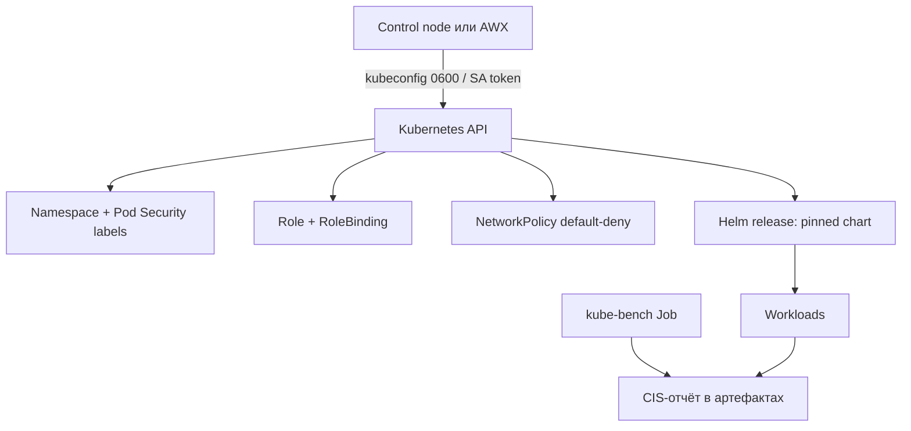

# Kubernetes и контейнеры

Kubernetes в филиальной сети обычно разворачивается on-prem и обслуживает внутренние сервисы. Ansible здесь решает две разные задачи: приводит кластер к безопасному baseline (namespaces, RBAC, сетевые политики) и выпускает Helm-релизы с зафиксированными версиями. Обе задачи работают через API-сервер, поэтому главный риск — не синтаксис YAML, а права, с которыми выполняется подключение.

## 1. Зачем это нужно

Кластер без сетевых политик превращается в плоскую сеть, где любой под видит чужой трафик. Кластер, к которому CI подключается с правами `cluster-admin`, означает, что компрометация пайплайна равна компрометации всех рабочих нагрузок. Ansible помогает закрепить оба свойства в версионируемом коде: namespace с метками Pod Security, default-deny NetworkPolicy, узкая Role для автоматизации и Helm-релиз с точной версией чарта.

При этом Ansible не обязан управлять каждым деплоем. Разумное разделение: Ansible отвечает за bootstrap и guardrails, GitOps-контроллер — за доставку приложений. Два инструмента не должны одновременно владеть одними и теми же объектами, иначе возникает конфликт и необъяснимый дрейф.

## 2. Ключевые понятия

| Понятие | Назначение | Пример |
|---|---|---|
| `kubernetes.core.k8s` | создание и обновление объектов из манифеста | namespace, NetworkPolicy, Role |
| `kubernetes.core.k8s_info` | чтение состояния объектов | проверка реплик Deployment |
| `kubernetes.core.helm` | установка и обновление Helm-релиза | `chart_version`, `atomic` |
| `kubernetes.core.helm_repository` | подключение репозитория чартов | внутренний HTTPS-репозиторий |
| kubeconfig | файл с адресом API и учётными данными | права `0600` |
| ServiceAccount | учётная запись для процессов в кластере | `automation-deployer` |
| Role / RoleBinding | права в пределах namespace | только `deployments`, `configmaps` |
| Pod Security Standards | профили `privileged`, `baseline`, `restricted` | метки namespace |
| NetworkPolicy | правила трафика между подами | default-deny плюс DNS |
| kube-bench | проверка CIS Kubernetes Benchmark | Job и JSON-отчёт |
| Helm values | параметры релиза | без секретов в открытом виде |
| External Secrets | доставка секретов из внешнего хранилища | вместо plaintext Secret |

`kubernetes.core.helm` требует бинарник `helm` на том хосте, где выполняется задача. В Execution Environment он должен быть установлен заранее; на control node — в `PATH`. Модуль не скачивает helm самостоятельно.

## 3. Схема



На схеме два потока: изменение (сверху) и проверка (снизу). Проверка не меняет кластер и может выполняться чаще, чем изменение. Права на изменение и права на чтение отчётов стоит разделять.

## 4. Пошаговая реализация

### Шаг 1. Разделите ответственность

Зафиксируйте, какие объекты принадлежат Ansible, а какие — GitOps. Типичный вариант: Ansible создаёт namespace, квоты, RBAC, сетевые политики и системные add-on; приложения выпускаются Helm-релизом из пайплайна. Если приложение уже управляется Argo CD или Flux, не применяйте те же манифесты через `kubernetes.core.k8s`: получите цикл исправлений.

### Шаг 2. Настройте аутентификацию без избыточных прав

Для автоматизации создайте отдельный ServiceAccount в целевом namespace и получите для него kubeconfig с ограниченным контекстом. Файл хранится с правами `0600` и не попадает в Git. В AWX и AAP kubeconfig передаётся как credential, а не как переменная проекта.

!!! warning "Риск"

    kubeconfig, созданный по умолчанию, обычно даёт `cluster-admin`. Проверьте это командой `kubectl auth can-i --list` до первого запуска. Файл с правами `0644` в домашнем каталоге означает, что любой локальный пользователь получает те же права на кластер.

Токен в kubeconfig — такой же секрет, как пароль. Для CI выдавайте короткоживущий токен через `kubectl create token` с ограничением по времени, а для AWX используйте credential с плановой ротацией. Статический токен ServiceAccount, записанный в файл год назад, почти наверняка имеет больше прав, чем нужно сегодня.

### Шаг 3. Ограничьте RBAC

Role должна перечислять конкретные API-группы, ресурсы и глаголы. Права на чтение `secrets` давайте только тем задачам, которым они действительно нужны: чтение секрета равносильно получению учётных данных. Кластерные объекты (`ClusterRole`, `CustomResourceDefinition`, `Namespace`) требуют отдельного, отдельно отревьюенного сценария и отдельной учётной записи.

### Шаг 4. Включите сетевые политики и Pod Security

Namespace получает метки `pod-security.kubernetes.io/enforce: restricted` и политику default-deny. Разрешение остаётся только на DNS в `kube-system`, потому что без него поды не резолвят имена и падают неочевидно. Дальнейшие разрешения добавляются по конкретным потокам, а не «на всякий случай».

Политики складываются: несколько NetworkPolicy действуют как объединение разрешений, а запрещающих правил в модели нет. Поэтому default-deny — обязательная база, а не дополнение к точечным правилам. Если добавить разрешение «на время отладки», оно останется действующим, пока его не удалят из Git.

Три метки Pod Security работают по-разному: `enforce` блокирует pod, `audit` пишет событие, `warn` показывает предупреждение клиенту. Начинайте с `audit` и `warn` на существующем namespace, чтобы увидеть список нарушений, и только затем включайте `enforce`. Иначе первый же запуск playbook заблокирует рабочие нагрузки, которые годами работали с привилегиями.

### Шаг 5. Выпускайте Helm-релизы с фиксацией версии

`chart_version` задаётся явно, `atomic: true` возвращает предыдущий релиз при неудачном обновлении, `wait: true` не позволяет playbook завершиться раньше готовности workload. Репозиторий чартов — внутренний, по HTTPS, с сертификатом внутреннего CA в системном хранилище доверия. Отключение проверки TLS в примерах не используется.

Первое применение нового чарта выполняется не в production namespace: сначала отдельный namespace или кластер, затем canary с одной репликой и только после этого полный релиз. `atomic` спасает от неудачного обновления, но не от ошибки в values, которая успешно развернулась.

### Шаг 6. Обрабатывайте секреты вне Git

Значения паролей и токенов не попадают в `values` и в манифесты. Используйте External Secrets Operator или Sealed Secrets, а в задачах, где секрет может оказаться в выводе, ставьте `no_log: true`. Helm хранит values в Secret релиза, поэтому «временный» plaintext в values остаётся в истории кластера.

Право читать Secret в namespace фактически равно доступу к приложению и его данным. Проверьте, у каких Role есть `get` и `list` на `secrets`, и оставьте их только тем компонентам, которым это действительно нужно. Аудит API-сервера и журнал событий namespace помогают увидеть, кто и когда обращался к секретам.

### Шаг 7. Проверяйте CIS отдельно от изменений

kube-bench запускается Job-ом на узлах и выдаёт JSON-отчёт по CIS Kubernetes Benchmark. Ansible доставляет манифест Job и забирает результат, но не исправляет находки автоматически: часть из них требует перезапуска компонентов control plane. Исключения фиксируются с владельцем и сроком.

Отчёт kube-bench — снимок на момент запуска. Он не проверяет образы, секреты и сетевые политики, поэтому дополняется проверками из этой страницы и сканированием образов в CI. Храните отчёты с датой и версией benchmark: сравнение возможно только между сопоставимыми запусками.

## 5. Полный запускаемый пример

```yaml
---
- name: Enforce namespace guardrails and deploy a pinned chart
  hosts: localhost
  connection: local
  gather_facts: false

  vars:
    kubeconfig_path: "{{ lookup('env', 'HOME') }}/.kube/ansible-automation.conf"
    app_namespace: payments
    app_release: payments-api
    app_chart_repo: https://charts.example.internal
    app_chart_name: payments-api
    app_chart_version: "1.8.3"

  tasks:
    - name: Inspect the kubeconfig file
      ansible.builtin.stat:
        path: "{{ kubeconfig_path }}"
      register: kubeconfig

    - name: Require a private kubeconfig for the automation account
      ansible.builtin.assert:
        that:
          - kubeconfig.stat.exists
          - kubeconfig.stat.mode == '0600'
        fail_msg: >-
          {{ kubeconfig_path }} must exist with mode 0600.
          Generate it for a namespace-scoped ServiceAccount.

    - name: Create the namespace with restricted Pod Security
      kubernetes.core.k8s:
        kubeconfig: "{{ kubeconfig_path }}"
        state: present
        definition:
          apiVersion: v1
          kind: Namespace
          metadata:
            name: "{{ app_namespace }}"
            labels:
              pod-security.kubernetes.io/enforce: restricted
              pod-security.kubernetes.io/audit: restricted
              pod-security.kubernetes.io/warn: restricted

    - name: Create a namespace-scoped Role for the automation account
      kubernetes.core.k8s:
        kubeconfig: "{{ kubeconfig_path }}"
        state: present
        definition:
          apiVersion: rbac.authorization.k8s.io/v1
          kind: Role
          metadata:
            name: automation-deployer
            namespace: "{{ app_namespace }}"
          rules:
            - apiGroups: ["apps"]
              resources: ["deployments"]
              verbs: ["get", "list", "watch", "create", "update", "patch"]
            - apiGroups: [""]
              resources: ["configmaps"]
              verbs: ["get", "list", "watch", "create", "update", "patch"]

    - name: Bind the Role to the automation ServiceAccount
      kubernetes.core.k8s:
        kubeconfig: "{{ kubeconfig_path }}"
        state: present
        definition:
          apiVersion: rbac.authorization.k8s.io/v1
          kind: RoleBinding
          metadata:
            name: automation-deployer
            namespace: "{{ app_namespace }}"
          roleRef:
            apiGroup: rbac.authorization.k8s.io
            kind: Role
            name: automation-deployer
          subjects:
            - kind: ServiceAccount
              name: automation-deployer
              namespace: "{{ app_namespace }}"

    - name: Deny all traffic except DNS by default
      kubernetes.core.k8s:
        kubeconfig: "{{ kubeconfig_path }}"
        state: present
        definition:
          apiVersion: networking.k8s.io/v1
          kind: NetworkPolicy
          metadata:
            name: default-deny
            namespace: "{{ app_namespace }}"
          spec:
            podSelector: {}
            policyTypes: ["Ingress", "Egress"]
            egress:
              - to:
                  - namespaceSelector:
                      matchLabels:
                        kubernetes.io/metadata.name: kube-system
                ports:
                  - protocol: UDP
                    port: 53
                  - protocol: TCP
                    port: 53

    - name: Register the internal chart repository
      kubernetes.core.helm_repository:
        name: internal
        repo_url: "{{ app_chart_repo }}"

    - name: Deploy the chart with a pinned version
      kubernetes.core.helm:
        kubeconfig: "{{ kubeconfig_path }}"
        name: "{{ app_release }}"
        chart_ref: "internal/{{ app_chart_name }}"
        chart_version: "{{ app_chart_version }}"
        release_namespace: "{{ app_namespace }}"
        create_namespace: false
        atomic: true
        wait: true
        timeout: "5m0s"

    - name: Read the deployed workloads
      kubernetes.core.k8s_info:
        kubeconfig: "{{ kubeconfig_path }}"
        kind: Deployment
        namespace: "{{ app_namespace }}"
        label_selectors:
          - "app.kubernetes.io/instance={{ app_release }}"
      register: deployment_info

    - name: Require at least one available replica
      ansible.builtin.assert:
        that:
          - deployment_info.resources | length > 0
          - >-
            deployment_info.resources
            | map(attribute='status.availableReplicas', default=0)
            | list | min | int > 0
        fail_msg: "No available replicas for {{ app_release }} in {{ app_namespace }}"
```

Playbook идемпотентен: повторный запуск не меняет namespace, Role и NetworkPolicy, а Helm выполняет upgrade только при отличии релиза. `atomic: true` — основной механизм отката для релиза. Удаление namespace не используется как откат: это уничтожает данные.

У создания guardrails есть особенность: Role и RoleBinding может создать только контекст с соответствующими правами, а работать приложение должно под сервисной учётной записью. Поэтому bootstrap-контекст хранится отдельно, используется только для первичной настройки и не попадает в CI. Повседневные запуски идут под kubeconfig, который выдаёт права только в целевом namespace.

## 6. Проверка результата

```bash
kubectl --kubeconfig ~/.kube/ansible-automation.conf auth can-i --list -n payments
kubectl --kubeconfig ~/.kube/ansible-automation.conf get role,rolebinding,networkpolicy -n payments
kubectl --kubeconfig ~/.kube/ansible-automation.conf get deploy -n payments
helm --kubeconfig ~/.kube/ansible-automation.conf list -n payments
```

`auth can-i --list` должен показать только `deployments` и `configmaps` в namespace `payments` и не должен содержать `*` или кластерных ресурсов. Проверка `kubectl auth can-i create clusterrole` должна вернуть `no`. Если Helm-релиз в статусе `failed`, разберите события пода и историю релиза, а не удаляйте namespace.

## 7. Безопасность и blast radius

| Риск | Последствие | Мера |
|---|---|---|
| kubeconfig с `cluster-admin` в CI | полный контроль над кластером | namespace-scoped ServiceAccount, `0600` |
| Права на чтение `secrets` | кража всех учётных данных namespace | выдавать только при необходимости |
| Незафиксированная версия чарта | неожиданное обновление и дрейф | `chart_version`, внутренний репозиторий |
| Секреты в Helm values | утечка в Git и историю релиза | External Secrets, `no_log` |
| Отсутствие NetworkPolicy | плоская сеть между подами | default-deny плюс DNS |
| Привилегированные поды | выход за границы узла | Pod Security `restricted` |
| `state: absent` по ошибке | удаление рабочей нагрузки | ревью, `--check` для манифестов, запрет на удаление namespace |
| Образ без фиксации digest | подмена образа в реестре | доверенный реестр, pin по digest |
| Отключённая проверка TLS | MITM к API-серверу | внутренний CA в trust store |

**Откат.** Для релиза — `atomic: true` при обновлении или явный `helm rollback <release> <revision>`. Для объектов guardrails откат выполняется возвратом предыдущей версии манифеста из Git; NetworkPolicy и Role удаляются только после подтверждения, что это не откроет трафик. Перед изменением RBAC сохраните текущие Role и RoleBinding в артефактах запуска, чтобы восстановить точные права.

Откат Helm не возвращает удалённые данные и не исправляет несовместимые схемы. Если релиз содержит миграцию базы, порядок отката согласуется с владельцем приложения заранее: сначала приложение, затем схема, и только в том порядке, который проверен на стенде.

## 8. Комплаенс-маппинг

| Требование | Как закрывается |
|---|---|
| CIS Kubernetes Benchmark | kube-bench, отчёт и реестр исключений |
| CIS Control 4 (Secure Configuration) | версионируемые манифесты и фиксированные версии чартов |
| CIS Control 6 (Access Management) | namespace-scoped RBAC, запрет `cluster-admin` для CI |
| NIST CSF 2.0 PR.AA, PR.PS | управление доступом и защищённая конфигурация |
| ISO/IEC 27001:2022 A.8.9, A.5.15 | конфигурация и правила доступа |

Доказательства: вывод `auth can-i --list`, манифесты Role и NetworkPolicy в Git, JSON-отчёт kube-bench, история Helm-релизов.

## 9. Типичные ошибки и troubleshooting

| Симптом | Причина | Проверка | Решение |
|---|---|---|---|
| `Forbidden` при создании объекта | RBAC не разрешает ресурс | `auth can-i --list` | расширить Role или сменить контекст |
| `Unable to connect to the server` | неверный kubeconfig или сеть | `kubectl cluster-info` | проверить путь, CA и доступ к API |
| `x509: certificate signed by unknown authority` | внутренний CA не в trust store | вывод `kubectl` | добавить CA, не отключать проверку |
| Helm: `another operation in progress` | зависший релиз | `helm history` | дождаться или разобрать статус релиза |
| `chart not found` | репозиторий не подключён или нет версии | `helm repo list` | `helm_repository`, точная версия |
| Поды не стартуют после NetworkPolicy | заблокирован DNS | события пода, логи | разрешить UDP/TCP 53 в `kube-system` |
| Pod отклонён | нарушения `restricted` | события namespace | добавить `securityContext`, убрать privileged |
| Задача `k8s` зависает | ожидание готовности ресурса | `-vvv` | ограничить ожидание и проверить события |

## 10. Чек-лист

- [ ] Определено, какие объекты принадлежат Ansible, а какие — GitOps.
- [ ] Для автоматизации используется namespace-scoped ServiceAccount.
- [ ] kubeconfig имеет права `0600` и не хранится в Git.
- [ ] `cluster-admin` не используется в CI и в playbook.
- [ ] Role перечисляет конкретные ресурсы и глаголы.
- [ ] Namespace имеет метки Pod Security.
- [ ] NetworkPolicy default-deny разрешает только DNS.
- [ ] Версия Helm-чарта зафиксирована, включены `atomic` и `wait`.
- [ ] Секреты доставляются внешним оператором, не через values.
- [ ] kube-bench запускается регулярно, исключения зарегистрированы.

## 11. Источники

- [kubernetes.core.k8s](https://docs.ansible.com/ansible/latest/collections/kubernetes/core/k8s_module.html)
- [kubernetes.core.helm](https://docs.ansible.com/ansible/latest/collections/kubernetes/core/helm_module.html)
- [Network Policies](https://kubernetes.io/docs/concepts/services-networking/network-policies/)
- [RBAC Authorization](https://kubernetes.io/docs/reference/access-authn-authz/rbac/)
- [kube-bench](https://github.com/aquasecurity/kube-bench)

## 12. Связанные страницы

- [Управление секретами](../secure-dev/11-secrets.md)
- [Сеть и облако: харденинг](../security/41-network-cloud-hardening.md)
- [Zero trust и JIT-доступ](../security/47-zero-trust.md)
- [Безопасность цепочки поставок](../secure-dev/15-supply-chain.md)
- [Диагностика и troubleshooting](../ops/60-troubleshooting.md)
- [Масштабирование и производительность](30-scaling.md)
