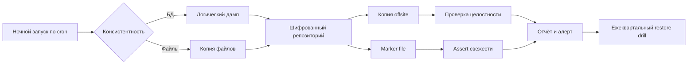

# Резервное копирование и DR

Резервная копия имеет ценность только тогда, когда из неё восстановились и когда она защищена от удаления. Ansible в этой области делает три вещи: раскладывает расписание и конфигурацию заданий, проверяет свежесть и целостность копий, документирует процедуру восстановления. Сам перенос данных выполняет специализированный инструмент, а не playbook.

## 1. Зачем это нужно

Филиальная сеть распределена: часть данных живёт на серверах в ЦОД, часть — на локальных ВМ. Обрыв WAN, ошибка администратора, шифровальщик или отказ диска приводят к одному результату — данные нужно восстанавливать. Без автоматизации расписание существует только в голове дежурного, а проверка восстановления откладывается до инцидента.

Цели формализуются двумя числами: RPO (recovery point objective) — допустимая потеря данных по времени, и RTO (recovery time objective) — допустимое время восстановления. Для разных сервисов они разные, и от них зависит частота копий, способ консистентности и площадка хранения.

## 2. Ключевые понятия

| Понятие | Назначение | Пример |
|---|---|---|
| RPO | допустимый объём потерянных данных, часы | 24 часа для файлового сервера |
| RTO | допустимое время восстановления, часы | 4 часа для сервиса филиала |
| Консистентность | согласованность данных на момент копии | дамп БД, а не копия файлов БД |
| Quiesce | краткая пауза записи перед копией | снапшот с quiescing |
| Снапшот | точка возврата на уровне гипервизора | только на время изменения |
| 3-2-1 | три копии, два носителя, одна вне площадки | локальный репозиторий плюс offsite |
| Иммутабельность | запрет удаления копий в окне хранения | WORM или object lock |
| Шифрование | защита копии при утере носителя | шифрованный репозиторий |
| Retention | сроки хранения по поколениям | 7 дней, 4 недели, 6 месяцев |
| Marker file | отметка успешного запуска | `/var/lib/backup/last-success` |
| Restore drill | учебное восстановление | ежеквартально, в изолированной сети |
| Scheduler | cron или systemd timer | `ansible.builtin.cron` |

Снапшот VMware — не резервная копия. Он живёт на том же datastore, зависит от цепочки изменений и деградирует по производительности. Его место — короткая точка возврата перед рискованным изменением, а не хранение истории за месяцы.

## 3. Схема



На схеме важно, что проверка свежести и проверка целостности — разные задачи. Marker подтверждает, что задание завершилось, а проверка репозитория — что данные читаемы. Ни одна из них не заменяет реальное восстановление.

## 4. Пошаговая реализация

### Шаг 1. Определите RPO и RTO по классам сервисов

| Класс | Пример | RPO | RTO | Частота копий |
|---|---|---|---|---|
| Критичный | биллинг, БД филиала | 1 час | 4 часа | ежечасно, журнал транзакций |
| Важный | файловый сервер, Git | 24 часа | 8 часов | ежедневно |
| Обычный | тестовые стенды | 72 часа | 48 часов | еженедельно |

Классы согласуются с владельцами сервисов. Без этого невозможно выбрать ни расписание, ни площадку, ни бюджет.

### Шаг 2. Выберите способ консистентности

Для баз данных — логический дамп (`pg_dump`, `mysqldump`) перед копированием файлов. Для виртуальных машин с файловыми сервисами — снапшот с quiescing, снятый непосредственно перед копированием и удалённый сразу после. Копирование «живых» файлов БД без дампа даёт копию, которая не восстанавливается.

### Шаг 3. Защитите репозиторий

Репозиторий шифруется на стороне клиента: пароль хранится в файле с правами `0600`, значение приходит из vault. Ключ шифрования — отдельный секрет с процедурой восстановления: потеря ключа равна потере копий. Учётная запись, которой пишет продакшен, не должна иметь прав на удаление в offsite-хранилище.

Ключ хранится отдельно от репозитория, а его копия — в escrow у двух ответственных. Проверка ключа входит в restore drill: если копия восстанавливается только потому, что пароль случайно остался в истории shell, процедура не готова к инциденту. `no_log` скрывает значение в выводе задачи, но не защищает файл на диске и не мешает журналу операционной системы, поэтому права `0600` обязательны независимо от него.

### Шаг 4. Настройте расписание

`ansible.builtin.cron` создаёт файл в `/etc/cron.d` с фиксированным именем, поэтому расписание становится версионируемым и воспроизводимым. Задание пишет лог и обновляет marker только при успехе. Пересечение запусков блокируется `flock`.

Для филиалов с узким каналом локальная копия делается чаще, чем выгрузка offsite, но интервал выгрузки не должен превышать RPO. Если канал не позволяет уложиться в RPO, меняется не расписание, а архитектура: локальный репозиторий с последующей синхронизацией либо копия на площадке с более широким каналом.

### Шаг 5. Добавьте проверку

Проверка выполняется отдельным playbook по расписанию и включает: наличие marker, его возраст, успешный вызов `restic snapshots`, попадание последнего снапшота в окно RPO. При нарушении — алерт в систему мониторинга, а не только запись в лог.

### Шаг 6. Проведите restore drill

Восстановление выполняется в изолированную сеть на отдельный хост, с замером времени. Результат фиксируется: дата, набор данных, длительность, найденные проблемы. Учебное восстановление — единственное доказательство того, что RTO достижим.

## 5. Полный запускаемый пример

```yaml
---
- name: Schedule encrypted nightly backups and verify freshness
  hosts: backup_clients
  become: true
  gather_facts: true

  vars:
    backup_repo: /srv/backup/restic
    backup_script: /usr/local/sbin/nightly-backup.sh
    backup_password_file: /etc/restic/password
    backup_marker: /var/lib/backup/last-success
    backup_max_age_hours: 26

  tasks:
    - name: Ensure backup directories exist
      ansible.builtin.file:
        path: "{{ item }}"
        state: directory
        owner: root
        group: root
        mode: "0700"
      loop:
        - /etc/restic
        - /var/lib/backup

    - name: Deploy the repository password from vault
      ansible.builtin.copy:
        content: "{{ restic_password }}\n"
        dest: "{{ backup_password_file }}"
        owner: root
        group: root
        mode: "0600"
      no_log: true

    - name: Deploy the backup wrapper script
      ansible.builtin.template:
        src: nightly-backup.sh.j2
        dest: "{{ backup_script }}"
        owner: root
        group: root
        mode: "0750"
      notify: Verify backup repository

    - name: Schedule the nightly backup job
      ansible.builtin.cron:
        name: "nightly encrypted backup"
        cron_file: nightly-backup
        user: root
        minute: "15"
        hour: "1"
        job: "{{ backup_script }} >> /var/log/nightly-backup.log 2>&1"
        state: present

    - name: Read the last-success marker
      ansible.builtin.stat:
        path: "{{ backup_marker }}"
      register: backup_marker_stat

    - name: Fail when the last successful backup is too old
      ansible.builtin.assert:
        that:
          - backup_marker_stat.stat.exists
          - >-
            (ansible_facts['date_time']['epoch'] | int)
            - (backup_marker_stat.stat.mtime | int)
            < (backup_max_age_hours | int * 3600)
        fail_msg: >-
          Last successful backup on {{ inventory_hostname }} is missing
          or older than {{ backup_max_age_hours }} hours.

    - name: List the latest snapshot in the repository
      ansible.builtin.command:
        argv:
          - restic
          - -r
          - "{{ backup_repo }}"
          - --password-file
          - "{{ backup_password_file }}"
          - snapshots
          - --latest
          - "1"
          - --json
      register: latest_snapshot
      changed_when: false

    - name: Require at least one readable snapshot
      ansible.builtin.assert:
        that:
          - (latest_snapshot.stdout | from_json) | length > 0
        fail_msg: "No snapshots found in {{ backup_repo }} on {{ inventory_hostname }}"

  handlers:
    - name: Verify backup repository
      ansible.builtin.command:
        argv:
          - restic
          - -r
          - "{{ backup_repo }}"
          - --password-file
          - "{{ backup_password_file }}"
          - check
      changed_when: false
```

Шаблон `nightly-backup.sh.j2`:

```bash
#!/usr/bin/env bash
set -euo pipefail

export RESTIC_REPOSITORY="{{ backup_repo }}"
export RESTIC_PASSWORD_FILE="{{ backup_password_file }}"

restic snapshots >/dev/null 2>&1 || restic init  # initialize once on the first run

restic backup /etc /var/lib/app --tag nightly --exclude-caches
restic forget --keep-daily 7 --keep-weekly 4 --keep-monthly 6 --prune
date --iso-8601=seconds > "{{ backup_marker }}"
```

`restic forget` удаляет старые снапшоты, но не трогает offsite-копию, если она находится в отдельном репозитории с собственным retention. `--exclude-caches` не даёт копировать кэши, которые бессмысленно восстанавливать. Путь `/var/lib/app` замените на реальные данные сервиса.

Два условия первого запуска. Каталог `{{ backup_repo }}` должен быть смонтированным томом, а не каталогом на системном разделе: иначе копии конкурируют за место с ОС. И marker появляется только после первого успешного выполнения, поэтому первичное применение playbook либо планируют после ночного окна, либо запускают скрипт вручную и повторяют проверку.

## 6. Проверка результата

```bash
cat /etc/cron.d/nightly-backup
systemctl status crond --no-pager
ansible-playbook -i inventories/prod/hosts.yml backup-verify.yml --limit branch_msk
restic -r /srv/backup/restic --password-file /etc/restic/password snapshots --latest 3
```

Проверка восстановления:

```bash
mkdir -p /var/tmp/restore-test
restic -r /srv/backup/restic --password-file /etc/restic/password \
  restore latest --target /var/tmp/restore-test --include /etc/ssh
diff -r /etc/ssh /var/tmp/restore-test/etc/ssh
```

Восстановление в `/var/tmp` безопасно: оно не затрагивает рабочую систему. Если `diff` показывает расхождения по времени модификации, сравните содержимое, а не метаданные. Для баз данных восстановление проверяется отдельно, на тестовом экземпляре СУБД.

## 7. Безопасность и blast radius

| Риск | Последствие | Мера |
|---|---|---|
| Репозиторий без шифрования | утечка данных при утере носителя | шифрование на клиенте, ключ вне репозитория |
| Пароль репозитория в мире | компрометация всех копий | файл `0600`, владелец root, vault |
| Права на удаление в offsite | шифровальщик уничтожает копии | append-only или object lock |
| Пересечение запусков | повреждение репозитория и нагрузка | `flock`, окно расписания |
| Восстановление поверх продакшена | потеря актуальных данных | restore только в отдельный каталог или хост |
| Снапшот оставлен на недели | деградация datastore | удаление сразу после копии |
| Нет restore drill | RTO недостижим | ежеквартальная проверка |

**Откат.** Расписание откатывается удалением задания: `ansible.builtin.cron` с `state: absent` и тем же `cron_file`. Скрипт и пароль удаляются отдельными задачами после остановки расписания. Восстановление данных всегда выполняется в отдельную цель: при ошибке рабочая система остаётся нетронутой, а испорченную копию можно заменить другой точкой восстановления.

!!! warning "Риск"

    Если offsite-копия доступна на запись из продакшена теми же учётными данными, атака шифровальщика уничтожит и её. Разделяйте учётные записи записи и удаления, включайте иммутабельность и проверяйте, что срок хранения нельзя сократить из playbook.

## 8. Комплаенс-маппинг

| Требование | Как закрывается |
|---|---|
| CIS Control 11 (Data Recovery) | расписание, retention, проверка восстановления |
| ISO/IEC 27001:2022 A.8.13 | резервные копии и их регулярная проверка |
| NIST CSF 2.0 PR.DS, RC.RP | защита данных и план восстановления |
| NIST SP 800-34 | документированные RTO/RPO и процедуры DR |

Доказательства: вывод `restic snapshots`, логи заданий, протокол restore drill с датой и длительностью, реестр исключений.

## 9. Типичные ошибки и troubleshooting

| Симптом | Причина | Проверка | Решение |
|---|---|---|---|
| Задание не запускается | cron-демон остановлен или файл с неверными правами | `systemctl status crond`, `ls -l /etc/cron.d` | запустить сервис, выставить владельца root |
| `command not found` в cron | урезанный `PATH` | лог задания | указать полный путь в скрипте |
| `wrong password or no key found` | не тот файл пароля | сравнить пути | синхронизировать пароль из vault |
| `repository is already locked` | прерванный запуск | `restic snapshots` | разобрать причину, затем `restic unlock` |
| Marker старый | задание падает | `/var/log/nightly-backup.log` | исправить ошибку, перезапустить вручную |
| Нет места на диске | retention не применяется | `df -h`, `restic stats` | включить `forget --prune`, увеличить том |
| Восстановление не проходит | потерян ключ или пароль | тест на копии | восстановить ключ из escrow |
| Снапшот не удаляется | цепочка зависимых снапшотов | список снапшотов ВМ | удалить всю цепочку по процедуре |

## 10. Чек-лист

- [ ] Для каждого класса сервисов определены RPO и RTO.
- [ ] Для БД используется логический дамп, а не копия файлов.
- [ ] Репозиторий шифрован, пароль хранится с правами `0600`.
- [ ] Offsite-копия защищена от удаления из продакшена.
- [ ] Расписание версионируется и разворачивается через Ansible.
- [ ] Marker обновляется только при успешном завершении.
- [ ] Проверка свежести и целостности выполняется автоматически.
- [ ] Restore drill проводится по расписанию с замером времени.
- [ ] Снапшоты VMware удаляются сразу после использования.
- [ ] Процедура восстановления описана и доступна дежурному.

## 11. Источники

- [ansible.builtin.cron](https://docs.ansible.com/ansible/latest/collections/ansible/builtin/cron_module.html)
- [ansible.builtin.stat](https://docs.ansible.com/ansible/latest/collections/ansible/builtin/stat_module.html)
- [restic documentation](https://restic.readthedocs.io/en/stable/)
- [NIST SP 800-34 Rev. 1](https://csrc.nist.gov/pubs/sp/800/34/r1/upd1/final)
- [CIS Control 11: Data Recovery](https://www.cisecurity.org/controls/data-recovery)

## 12. Связанные страницы

- [VMware ESXi и vCenter](24-vmware-esxi.md)
- [Комплаенс и доказательства](../security/44-compliance.md)
- [Реагирование на инциденты](../security/45-incident-response.md)
- [Логирование и мониторинг](../security/42-logging-monitoring.md)
- [Распределённые филиалы](20-branch-fleet.md)
- [Управление секретами](../secure-dev/11-secrets.md)
