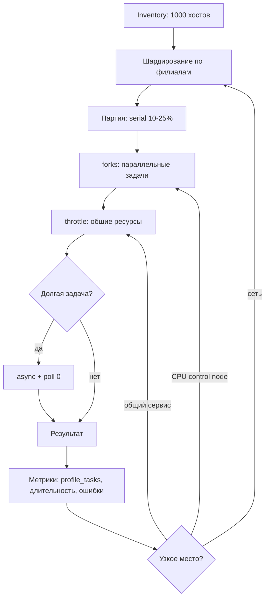

# Масштабирование и производительность

На 200–1000 хостах производительность Ansible определяется не мощностью control node, а задержкой сети, числом SSH-сессий и тем, сколько задач выполняется последовательно. Настройка `forks`, `serial`, стратегии и кэша фактов превращает многочасовой прогон в предсказуемый процесс с измеримым временем и контролируемым blast radius.

## 1. Зачем это нужно

Филиальная сеть добавляет к обычным проблемам масштаба WAN-задержки и обрывы. Если запустить playbook на все 1000 хостов с большим `forks`, control node упрётся в процессор и откроет сотни SSH-сессий, а часть хостов отвалится по таймауту. Если, наоборот, оставить `forks = 5`, обновление займёт ночь и выйдет за окно работ.

Цель настройки — не максимальная скорость, а предсказуемая пропускная способность: понятное время на партию, отсутствие таймаутов, воспроизводимый результат и метрики, по которым видно, что изменилось. Любой параметр меняется по одному, с замером до и после.

## 2. Ключевые понятия

| Понятие | Что делает | Разумный ориентир |
|---|---|---|
| `forks` | число параллельных задач в одном play | 20–50, далее растёт нагрузка |
| `serial` | размер партии хостов за проход | `1` для риска, `10–25%` для рутины |
| `throttle` | предел одновременных выполнений задачи | 2–10 для общих ресурсов |
| `strategy` | порядок выполнения по хостам | `linear` по умолчанию, `free` для независимых задач |
| pipelining | меньше SSH-операций на задачу | включён, если нет `requiretty` |
| `gathering` | когда собираются факты | `smart` |
| fact caching | кэш фактов между запусками | `jsonfile`, 12–24 часа |
| async / poll | длинная задача без удержания соединения | только для идемпотентных операций |
| ControlPersist | переиспользование SSH-соединения | 120–300 секунд |
| Sharding | разделение парка на независимые партии | по филиалам или площадкам |
| Execution node | узел запуска ближе к хостам | по одному на крупный регион |
| `max_fail_percentage` | остановка при доле отказов | 0 для критичных изменений |

`forks` ограничивает количество одновременных задач, а не количество хостов в play. При `serial` партия обрабатывается целиком, и внутри неё действует `forks`. Поэтому `serial: "10%"` и `forks: 40` при 1000 хостах означают партию из 100 хостов, из которых одновременно работают 40.

## 3. Схема



Схема показывает порядок, в котором стоит искать узкое место: сначала шардирование и размер партии, затем параллелизм, затем ограничение общих ресурсов. Менять `forks` до того, как измерено время настройки соединения, почти всегда бесполезно.

## 4. Пошаговая реализация

### Шаг 1. Снимите базовые измерения

Запустите read-only playbook с включённым callback `ansible.posix.profile_tasks` и зафиксируйте время каждой задачи, время сбора фактов и общую длительность. Повторите с `forks` 10, 25 и 50 на одной и той же группе. Если время почти не меняется, узкое место — сеть или последовательная задача, а не параллелизм.

### Шаг 2. Оцените control node

Для 200–500 хостов достаточно 4 vCPU и 8 ГБ памяти; для 1000 хостов и `forks` около 50 закладывайте 8 vCPU и 16 ГБ. Эти цифры — ориентир для планирования, а не гарантия: реальное потребление зависит от числа задач, размера фактов и callback-плагинов. Следите за load average, потреблением памяти и числом процессов SSH. Отдельный диск под кэш фактов и журналы избавляет от неожиданной нехватки места.

### Шаг 3. Включите pipelining и ControlPersist

Pipelining сокращает число SSH-операций на задачу и даёт наибольший выигрыш на высоких задержках. Он требует, чтобы у пользователя автоматизации не был включён `requiretty`. ControlPersist переиспользует соединение между задачами, но увеличивает срок жизни сессии — это приемлемо при корректном `host_key_checking`.

### Шаг 4. Настройте кэш фактов

`fact_caching = jsonfile` с временем жизни 12–24 часа ускоряет повторные запуски в разы. Ограничение: кэш может устареть после переустановки ОС или смены версии. Для задач, где факты критичны, добавляйте `gather_facts: true` в конкретный play и очищайте кэш при изменении шаблона ВМ.

### Шаг 5. Шардируйте по филиалам

Запускайте playbook отдельно для каждого филиала: это ограничивает blast radius, позволяет планировать окна и снижает влияние обрыва WAN. Варианты: отдельные inventory-файлы, `--limit branch_msk` из планировщика, execution node в регионе. При шардировании важно, чтобы глобальные задачи (сводный отчёт, проверка покрытия) выполнялись отдельно и видели весь парк.

### Шаг 6. Выберите стратегию и ограничения

`strategy: linear` сохраняет предсказуемый порядок и подходит для изменений. `strategy: free` позволяет хостам не ждать друг друга и хорошо работает для независимых read-only задач, но обработка ошибок и handlers ведут себя иначе. `throttle` ограничивает одновременный доступ к общему ресурсу: зеркалу пакетов, API vCenter, серверу обновлений.

### Шаг 7. Используйте async для длинных операций

`async` с `poll: 0` освобождает соединение на время долгой операции, а `ansible.builtin.async_status` собирает результат. Это подходит для идемпотентных задач, которые не требуют интерактивного вывода. Не применяйте async к изменениям, которые нужно немедленно проверить: потеря связи с control node оставляет задачу без контроля.

## 5. Полный запускаемый пример

`ansible.cfg` для парка до 1000 хостов:

```ini
[defaults]
inventory               = ./inventories/prod/
collections_path        = ./collections
roles_path              = ./roles
forks                   = 40
timeout                 = 45
gathering               = smart
fact_caching            = jsonfile
fact_caching_connection = ./.cache/facts
fact_caching_timeout    = 43200
host_key_checking       = True
interpreter_python       = auto_silent
retry_files_enabled     = False
callbacks_enabled       = ansible.posix.profile_tasks
deprecation_warnings    = True

[ssh_connection]
pipelining  = True
ssh_args    = -C -o ControlMaster=auto -o ControlPersist=300s
control_path = %(directory)s/%%h-%%p-%%r
```

`%(directory)s` указывает на каталог `~/.ansible/cp` с правами только для владельца; не заменяйте его на общий `/tmp`, иначе сокеты станут доступны другим пользователям. `timeout = 45` подобран под WAN; для стабильных каналов можно снизить.

Playbook с двумя режимами: чтение фактов с `strategy: free` и контролируемое обновление, которое включается только явной переменной.

```yaml
---
- name: Collect package facts across branches
  hosts: branches
  gather_facts: false
  strategy: free
  serial: "25%"
  max_fail_percentage: 20

  tasks:
    - name: Read installed packages
      ansible.builtin.package_facts:
        manager: auto
      throttle: 8
      register: package_state

    - name: Show collection summary per host
      ansible.builtin.debug:
        msg: >-
          {{ inventory_hostname }}:
          {{ package_state.ansible_facts.packages | length }} packages

- name: Apply updates in a maintenance window
  hosts: branches
  become: true
  gather_facts: true
  serial: "5%"
  max_fail_percentage: 0
  any_errors_fatal: true

  vars:
    apply_updates: false

  tasks:
    - name: Skip when the window is not approved
      ansible.builtin.meta: end_play
      when: not (apply_updates | bool)

    - name: Refresh the package cache
      ansible.builtin.dnf:
        update_cache: true
      throttle: 4
      when: ansible_facts['os_family'] == 'RedHat'

    - name: Refresh the apt cache
      ansible.builtin.apt:
        update_cache: true
        cache_valid_time: 3600
      throttle: 4
      when: ansible_facts['os_family'] == 'Debian'

    - name: Apply security updates
      ansible.builtin.dnf:
        name: "*"
        state: latest
        security: true
      throttle: 2
      when: ansible_facts['os_family'] == 'RedHat'
      register: dnf_result

    - name: Reboot when the kernel was updated
      ansible.builtin.reboot:
        reboot_timeout: 900
        msg: "Reboot after security updates"
      when:
        - ansible_facts['os_family'] == 'RedHat'
        - dnf_result is changed
```

Для Debian-семейства обновление выполняется модулем `ansible.builtin.apt` с `state: latest`; условие и набор пакетов зависят от политики. `meta: end_play` оставляет второй play безопасным по умолчанию: он не делает ничего без явного `-e apply_updates=true`. `throttle` на обновлении снижает нагрузку на зеркало и канал филиала.

## 6. Проверка результата

```bash
ansible-config dump --only-changed
ansible-playbook -i inventories/prod/hosts.yml collect-packages.yml --list-hosts
time ansible-playbook -i inventories/prod/hosts.yml collect-packages.yml
ansible-playbook -i inventories/prod/hosts.yml update.yml -e apply_updates=true --limit branch_msk
```

`--list-hosts` показывает итоговый охват до запуска. `profile_tasks` выводит время каждой задачи; смотрите на три верхние строки — там обычно `setup`, обновление кэша пакетов и задачи с внешними вызовами. Сравнивайте прогоны при одинаковом составе парка: после добавления филиала абсолютное время растёт, а время на хост должно оставаться стабильным.

## 7. Безопасность и blast radius

| Риск | Последствие | Мера |
|---|---|---|
| Слишком большой `forks` | таймауты, OOM control node | повышать по одному шагу, следить за load |
| `strategy: free` на изменении | непредсказуемый порядок, сложный разбор сбоя | `linear` для изменений |
| Один общий `throttle`-ресурс | перегрузка зеркала или API | ограничить 2–4, разнести окна |
| Устаревший кэш фактов | неверные условия и выбор модуля | `gather_facts` в критичных play, очистка кэша |
| Async без контроля | задача выполняется после сбоя playbook | только идемпотентные операции |
| Шардирование без сводного отчёта | хосты выпадают из покрытия | отдельная инвентаризация и проверка охвата |
| `control_path` в общем каталоге | доступ к чужим SSH-сокетам | каталог только для владельца |

**Откат.** Параметры производительности откатываются через Git: верните предыдущий `ansible.cfg` и перезапустите playbook. Для изменений на хостах откат определяется самой задачей: обновления пакетов — через снапшот ВМ или предыдущие версии пакетов, перезагрузка — через план восстановления. Поэтому массовые обновления выполняются с `serial: "5%"`, `max_fail_percentage: 0` и предварительным canary на одном филиале.

!!! tip "Практика"

    Сначала уменьшите объём работы: отключите сбор фактов там, где они не нужны, вынесите тяжёлые проверки в отдельный playbook и запускайте их реже. Ускорение за счёт роста параллелизма даёт меньше, чем устранение лишних задач.

## 8. Комплаенс-маппинг

| Требование | Как закрывается |
|---|---|
| ISO/IEC 27001:2022 A.8.6 | управление пропускной способностью и ресурсами |
| ISO/IEC 27001:2022 A.8.9 | версионируемая конфигурация control node |
| NIST CSF 2.0 PR.PS | предсказуемое и проверяемое выполнение изменений |
| Аудит | метрики запусков, журналы, отчёты о покрытии |

Доказательства: `ansible-config dump --only-changed`, история `ansible.cfg` в Git, отчёты `profile_tasks`, статистика длительности заданий в AWX или CI.

## 9. Типичные ошибки и troubleshooting

| Симптом | Причина | Проверка | Решение |
|---|---|---|---|
| Массовые таймауты SSH | слишком большой `forks` или узкий канал | load average, `-vvv` | снизить `forks`, поднять `timeout` |
| `sudo: sorry, you must have a tty` | `requiretty` при pipelining | `sudo -l`, sudoers | отключить `requiretty` для сервисной учётки |
| Прогон не ускоряется | узкое место в сети или последовательной задаче | `profile_tasks` | шардировать, вынести задачу |
| Условия работают неверно | устаревший кэш фактов | `ansible -m setup` | очистить кэш, включить `gather_facts` |
| Задача с `throttle` ждёт | предел одновременных выполнений | вывод задачи | увеличить `throttle` или разнести окна |
| Async-задача потерялась | перезапуск control node | `async_status` | повторить идемпотентную задачу |
| Ошибка прав на SSH-сокет | общий `control_path` | `ls -l` каталога | использовать `%(directory)s` |
| Часть хостов не попала в отчёт | шардирование без сводного запуска | `--list-hosts` по всем группам | отдельный play для покрытия |

## 10. Чек-лист

- [ ] Базовое время прогона измерено и зафиксировано.
- [ ] `forks` подобран замерами, а не наугад.
- [ ] Pipelining работает, `requiretty` отсутствует.
- [ ] Кэш фактов настроен и имеет срок жизни.
- [ ] Рискованные изменения выполняются со `serial` и `linear`.
- [ ] `throttle` ограничивает общие ресурсы.
- [ ] Шардирование по филиалам не скрывает хосты из отчёта.
- [ ] Метрики собираются и сравниваются между запусками.
- [ ] Массовые обновления включаются только явной переменной.
- [ ] Предыдущая конфигурация сохранена для отката.

## 11. Источники

- [Ansible configuration settings](https://docs.ansible.com/ansible/latest/reference_appendices/config.html)
- [Strategies](https://docs.ansible.com/ansible/latest/playbook_guide/playbooks_strategies.html)
- [Controlling where tasks run: delegation, serial, throttle](https://docs.ansible.com/ansible/latest/playbook_guide/playbooks_delegation.html)
- [Asynchronous actions and polling](https://docs.ansible.com/ansible/latest/playbook_guide/playbooks_async.html)
- [ansible.posix.profile_tasks callback](https://docs.ansible.com/ansible/latest/collections/ansible/posix/profile_tasks_callback.html)

## 12. Связанные страницы

- [Inventory и группы](../fundamentals/05-inventory.md)
- [Распределённые филиалы](20-branch-fleet.md)
- [VMware ESXi и vCenter](24-vmware-esxi.md)
- [Конфигурация ansible.cfg](../fundamentals/04-config.md)
- [AAP, AWX, Semaphore](../quality/53-aap-awx.md)
- [Диагностика и troubleshooting](../ops/60-troubleshooting.md)
