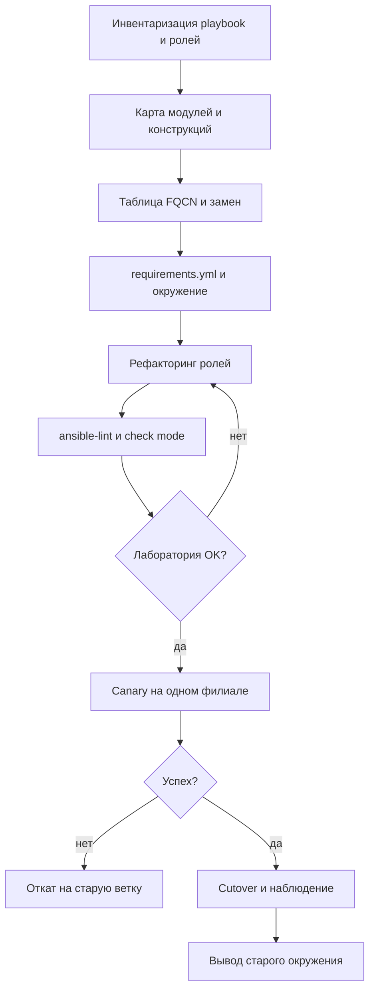

# Миграция и наследие

Переход с Ansible 2.9 на ansible-core 2.17 и коллекции — это не обновление пакета, а смена модели поставки контента. Модули переехали в коллекции, часть конструкций удалена, требования к Python изменились. Playbook, который работал годами, может собраться без ошибок и при этом выполнить другую операцию, поэтому миграция ведётся как проект с инвентаризацией, проверками и обратимым переключением.

## 1. Зачем это нужно

Старый парк playbook — это актив с неизвестными зависимостями: сокращённые имена модулей, `include`, `with_items`, обращения к фактам без пространства имён, собственные filter-плагины. На ansible-core 2.17 часть из этого не работает, часть работает иначе. Одновременно на управляемых узлах RHEL 8 остаётся Python 3.6, который с 2.17 не поддерживается, и модуль просто не запускается.

Миграция нужна не ради версии, а ради управляемости: FQCN делает зависимости явными, `requirements.yml` фиксирует контент, а проверки на каждом шаге позволяют откатиться, не восстанавливая инфраструктуру вручную.

## 2. Ключевые понятия

| Понятие | Назначение | Пример |
|---|---|---|
| ansible-core | ядро с CLI и встроенными модулями | `>=2.17` |
| Collection | пакет модулей, плагинов и ролей | `community.general` |
| FQCN | полное имя модуля с коллекцией | `ansible.builtin.copy` |
| `requirements.yml` | фиксация коллекций и версий | ставится в `./collections` |
| Deprecated module | модуль, который будет удалён | `ansible.builtin.yum` |
| `include` | удалённая конструкция 2.9 | заменяется на `include_tasks` |
| `with_items` | устаревший цикл | заменяется на `loop` |
| Namespaced facts | доступ к фактам через `ansible_facts` | `ansible_facts['os_family']` |
| Interpreter discovery | выбор Python на управляемом узле | `auto_silent` |
| Compatibility gate | playbook-проверка перед миграцией | Python и версия ядра |
| Parallel run | параллельная работа старого и нового дерева | только в check mode |
| Cutover | переключение на новую ветку | тег и символическая ссылка |

Сокращённые имена модулей всё ещё разрешаются, если коллекция установлена, но полагаться на это нельзя: при конфликте коллекций имя может указать на другой модуль. FQCN устраняет неоднозначность и делает ревью осмысленным.

## 3. Схема



На схеме важны две точки возврата: лаборатория и canary. До cutover старое дерево остаётся рабочим и доступным, поэтому откат — это переключение ветки и venv, а не восстановление из резервной копии.

## 4. Пошаговая реализация

### Шаг 1. Инвентаризируйте наследие

Зафиксируйте список playbook, ролей, inventory, собственных плагинов и внешних зависимостей. Отдельно выпишите все вызовы модулей без FQCN и все `include`, `with_*`, обращения к фактам. Старую ветку заморозьте: новые изменения идут только в ветку миграции, иначе сравнение теряет смысл.

Собственные модули в каталоге `library/`, filter- и callback-плагины требуют отдельного внимания: они не входят ни в одну коллекцию и после перехода остаются без владельца. Перенесите их в локальную коллекцию с версией и тестами либо задокументируйте как временное исключение с датой удаления. Динамические inventory-плагины проверьте отдельно: их имена и параметры тоже стали FQCN.

### Шаг 2. Соберите целевое окружение

ansible-core 2.17, control node на Python 3.10–3.12, коллекции из `requirements.yml` с точными версиями. Окружение создаётся рядом со старым, а не поверх него; `ansible --version` должен показать новую версию и ожидаемый `ansible.cfg`.

### Шаг 3. Постройте таблицу замен

| Ansible 2.9 | ansible-core 2.17 и коллекции |
|---|---|
| `copy`, `template`, `file` | `ansible.builtin.copy`, `ansible.builtin.template`, `ansible.builtin.file` |
| `yum` | `ansible.builtin.dnf` |
| `systemd` | `ansible.builtin.systemd_service` |
| `service` | `ansible.builtin.service` |
| `authorized_key` | `ansible.posix.authorized_key` |
| `sysctl` | `ansible.posix.sysctl` |
| `mount` | `ansible.posix.mount` |
| `seboolean` | `ansible.posix.seboolean` |
| `ufw`, `timezone` | `community.general.ufw`, `community.general.timezone` |
| `mysql_user` | `community.mysql.mysql_user` |
| `postgresql_user` | `community.postgresql.postgresql_user` |
| `docker_container` | `community.docker.docker_container` |
| `vmware_guest` | `community.vmware.vmware_guest` |
| `ec2` | `amazon.aws.ec2_instance` |
| `include` | `ansible.builtin.include_tasks` или `ansible.builtin.import_tasks` |

Таблица строится по фактическому использованию, а не по памяти. Для каждого заменяемого модуля прочитайте `ansible-doc` целевой версии: параметры могли переименоваться, а поведение по умолчанию — измениться.

### Шаг 4. Приведите Python на управляемых узлах в порядок

На RHEL 8 установите `python39` и задайте `ansible_python_interpreter: /usr/bin/python3.9` для этой группы. Проверьте, что нужные модули работают под этим интерпретатором: часть зависимостей (например, для работы с пакетами) требует отдельных Python-библиотек. На Ubuntu 22.04/24.04 и Debian 12 достаточно штатного `python3`.

### Шаг 5. Отрефакторите роли

Разбейте монолитные роли, вынесите переопределяемые значения в `defaults`, приведите `meta/main.yml` к `min_ansible_version: "2.17"`, замените статические включения на `import_tasks` и `import_role` там, где нужна предсказуемость тегов. Проверьте, что handlers вызываются по актуальным именам: после переименования задач `notify` часто остаётся старым и молча не срабатывает.

### Шаг 6. Запустите параллельно

Новое дерево прогоняется в `--check --diff` на боевом inventory, отчёты сравниваются со старым. Затем — лаборатория и canary на одном филиале. Изменяющие задачи на этом этапе выполняются только там, где есть подтверждённое окно; параллельный запуск двух деревьев с реальными изменениями недопустим.

Матрица тестов повторяет парк: RHEL 9, Rocky 9, Ubuntu 24.04, Debian 12 и отдельно RHEL 8 с `python39`. Роль, которая прошла только на одном дистрибутиве, не считается мигрированной. Molecule или одноразовые ВМ дают воспроизводимую проверку и служат доказательством для ревью.

### Шаг 7. Переключите и сохраните путь назад

Cutover — это тег релиза, переключение проекта в AWX или символической ссылки на venv. Старое окружение и ветка сохраняются до завершения наблюдения, обычно две недели. Откат — обратное переключение; данные на хостах при этом не откатываются, поэтому изменения, сделанные новым деревом, должны быть идемпотентны и совместимы со старыми ролями.

## 5. Полный запускаемый пример

Playbook-гейт проверяет готовность управляемых узлов и control node до миграции. Он ничего не меняет.

```yaml
---
- name: Managed node compatibility gate
  hosts: all
  gather_facts: true

  tasks:
    - name: Require Python 3.7 or newer
      ansible.builtin.assert:
        that:
          - ansible_facts['python_version'] is version('3.7', '>=')
        fail_msg: >-
          {{ inventory_hostname }} runs Python
          {{ ansible_facts['python_version'] }}.
          ansible-core 2.17 requires Python 3.7 or newer.

    - name: Check for python3.9 on the RHEL 8 family
      ansible.builtin.stat:
        path: /usr/bin/python3.9
      register: python39_binary
      when:
        - ansible_facts['os_family'] == 'RedHat'
        - ansible_facts['distribution_major_version'] == '8'

    - name: Require python39 on RHEL 8
      ansible.builtin.assert:
        that:
          - python39_binary.stat.exists
        fail_msg: >-
          Install the python39 package on {{ inventory_hostname }}
          and set ansible_python_interpreter.
      when: python39_binary is not skipped

    - name: Report the interpreter facts
      ansible.builtin.debug:
        msg: >-
          {{ inventory_hostname }}: {{ ansible_facts['distribution'] }}
          {{ ansible_facts['distribution_version'] }},
          Python {{ ansible_facts['python_version'] }}

- name: Control node compatibility gate
  hosts: localhost
  connection: local
  gather_facts: true

  tasks:
    - name: Require ansible-core 2.17 or newer
      ansible.builtin.assert:
        that:
          - ansible_version.full is version('2.17', '>=')
        fail_msg: "Expected ansible-core 2.17+, found {{ ansible_version.full }}"

    - name: Require Python 3.10 or newer on the control node
      ansible.builtin.assert:
        that:
          - ansible_facts['python_version'] is version('3.10', '>=')
        fail_msg: >-
          Control node Python {{ ansible_facts['python_version'] }}
          is outside the 3.10-3.12 range for ansible-core 2.17.
```

`ansible_version.full` — magic variable, которая показывает версию запущенного ядра. Гейт имеет смысл включить в CI перед прогоном миграционных тестов: он отсекает хосты, которые заведомо не переживут переход, и даёт список для исправления.

## 6. Проверка результата

```bash
ansible --version
ansible-galaxy collection list
ansible-lint --profile production site.yml
ansible-doc -t module ansible.builtin.dnf > /dev/null && echo "docs ok"
ansible-playbook -i inventories/prod/hosts.yml site.yml --check --diff
grep -rn "^\s*- include:" playbooks/ roles/
grep -rn "with_items:" playbooks/ roles/
```

`ansible-lint` в профиле `production` отмечает сокращённые имена модулей и устаревшие конструкции. Пустой результат двух `grep` не гарантирует чистоту: проверьте также `include:` внутри `pre_tasks`, `post_tasks` и ролей, а также собственные плагины, которые переехали в коллекции. Если `--check` показывает изменения там, где старая версия их не показывала, разберитесь до canary: это признак изменившегося поведения модуля.

## 7. Безопасность и blast radius

| Риск | Последствие | Мера |
|---|---|---|
| Непроверенная коллекция | произвольный код на всех хостах | пины версий, ревью, внутреннее зеркало |
| Параллельный запуск с изменениями | двойное применение и конфликт | новое дерево только в `--check` |
| Смена интерпретатора на RHEL 8 | модули не находят библиотеки | тест на одном хосте, явный `ansible_python_interpreter` |
| Молча изменившееся поведение модуля | неверная конфигурация без ошибки | `--check --diff`, сравнение отчётов |
| Собственный плагин без владельца | скрытая зависимость и уязвимость | перенос в коллекцию, ревью кода |
| Отсутствие точки возврата | простой при откате | старая ветка и venv сохраняются |

**Откат.** До cutover откат не требуется: новое дерево работает в check mode. После cutover возврат выполняется переключением ветки и venv, а также возвратом проекта в AWX на предыдущую ревизию. Изменения, уже применённые новыми ролями, откатываются отдельными задачами или снапшотами ВМ; поэтому canary делается на филиале с быстрым восстановлением.

!!! warning "Риск"

    Не запускайте старую и новую версию playbook одновременно против одного хоста с реальными изменениями. Даже идемпотентные задачи при разном поведении модулей дают конфликт, который трудно разобрать постфактум. Параллельный запуск допустим только для чтения и сравнения отчётов.

## 8. Комплаенс-маппинг

| Требование | Как закрывается |
|---|---|
| ISO/IEC 27001:2022 A.8.32 | управление изменениями и тестирование перед выпуском |
| ISO/IEC 27001:2022 A.8.9 | версионируемая конфигурация и окружение |
| NIST CSF 2.0 PR.PS | предсказуемое изменение и проверка |
| CIS Control 4 (Secure Configuration) | единый FQCN и зафиксированные коллекции |
| Аудит | план миграции, отчёты lint и check mode, запись cutover |

Доказательства: `requirements.yml` с пинами, вывод `ansible-lint`, отчёты `--check --diff` до и после, дата cutover и подпись владельца.

## 9. Типичные ошибки и troubleshooting

| Симптом | Причина | Проверка | Решение |
|---|---|---|---|
| `couldn't resolve module/action` | коллекция не установлена | `ansible-galaxy collection list` | добавить в `requirements.yml` |
| `ERROR! 'include' is not a valid attribute` | удалённая конструкция | `grep include:` | `include_tasks` или `import_tasks` |
| Модуль падает с `SyntaxError` | Python 3.6 на узле | `ansible -m setup` | `python39` и явный интерпретатор |
| `ansible_facts` пуст | обращение к старому имени факта | вывод `setup` | `ansible_facts['...']` |
| Filter plugin не найден | плагин переехал в коллекцию | `ansible-doc -t filter -l` | установить коллекцию, указать FQCN |
| `yum` предупреждает о deprecation | устаревший модуль | вывод задачи | `ansible.builtin.dnf` |
| Handler не срабатывает | переименован `notify` | вывод задачи, `--list-tasks` | синхронизировать имена |
| Check mode показывает лишние изменения | изменилось поведение модуля | `--diff` | разобрать до canary |

## 10. Чек-лист

- [ ] Старая ветка заморожена и доступна для отката.
- [ ] Проведена инвентаризация модулей, ролей и плагинов.
- [ ] Таблица FQCN заполнена по фактическому использованию.
- [ ] Коллекции зафиксированы в `requirements.yml` с версиями.
- [ ] ansible-core 2.17 установлен в отдельное окружение.
- [ ] На RHEL 8 установлен `python39` и задан интерпретатор.
- [ ] Роли отрефакторены, `meta/main.yml` обновлён.
- [ ] `ansible-lint` не показывает ошибок уровня production.
- [ ] `--check --diff` сравнён с поведением старой версии.
- [ ] Canary на одном филиале пройден, cutover и откат описаны.

## 11. Источники

- [Porting guide: ansible-core 2.17](https://docs.ansible.com/ansible/latest/porting_guides/porting_guide_core_2.17.html)
- [Ansible 2.10 porting guide: collections split](https://docs.ansible.com/ansible/latest/porting_guides/porting_guide_2.10.html)
- [Using collections in playbooks](https://docs.ansible.com/ansible/latest/collections_guide/collections_using_playbooks.html)
- [ansible-core support matrix](https://docs.ansible.com/ansible/latest/reference_appendices/release_and_maintenance.html)
- [ansible-lint documentation](https://ansible.readthedocs.io/projects/lint/)

## 12. Связанные страницы

- [Установка и версионирование](../fundamentals/03-install.md)
- [Playbooks, roles, handlers](../fundamentals/07-playbooks-roles.md)
- [Модули и FQCN](../fundamentals/09-modules.md)
- [Безопасность цепочки поставок](../secure-dev/15-supply-chain.md)
- [Ревью и релизы](../quality/52-review-release.md)
- [Анти-паттерны](../ops/62-antipatterns.md)
