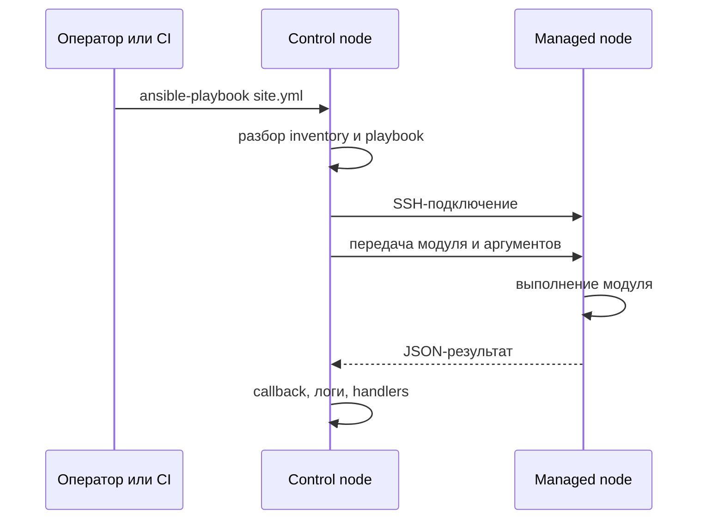

# Основы Ansible

Ansible — это система управления конфигурацией и оркестрации, которая описывает желаемое состояние инфраструктуры в YAML и применяет его к управляемым узлам по сети. Понимание модели выполнения, идемпотентности и границ применимости важнее знания отдельных модулей: без этого автоматизация превращается в набор хрупких скриптов.

## 1. Зачем это нужно

Администрирование филиальной сети из 200–1000 хостов вручную не масштабируется: изменения теряются, конфигурации расходятся, аудит невозможен. Ansible даёт единый способ описать baseline, применить его по филиалам, проверить отклонения и собрать доказательства изменений. В кибербезопасности тот же механизм используется для харденинга, управления патчами, развёртывания агентов и автоматизации реагирования.

## 2. Ключевые понятия

| Понятие | Определение | Практическое следствие |
|---|---|---|
| Agentless | На целевом узле нет постоянного агента Ansible | Подключение по SSH, WinRM/PSRP или `network_cli` |
| Push-модель | Control node инициирует выполнение | Нужен сетевой доступ от control node к узлам |
| Declarative | Описывается целевое состояние, а не команды | Модуль сам решает, что изменить |
| Idempotency | Повторный запуск не меняет уже настроенную систему | Повторный прогон должен давать `changed=0` |
| Inventory | Список хостов и групп | Определяет область применения и blast radius |
| Playbook | YAML-сценарий из play | Версионируется в Git и проходит ревью |
| Role | Переиспользуемый набор задач и ресурсов | Снижает дублирование между филиалами |
| Collection | Упаковка модулей и плагинов | Расширяет возможности, но добавляет зависимость |
| Facts | Сведения об узле, собранные автоматически | Позволяют строить условную логику |
| Handler | Задача, запускаемая по изменению | Перезапускает сервис только при необходимости |

## 3. Как выполняется playbook



Последовательность:

1. Ansible читает конфигурацию (`ansible.cfg`), inventory и аргументы командной строки.
2. Определяет целевые хосты по паттерну (`all`, `lab`, `branch_*`).
3. Разбирает playbook и формирует список задач для каждого хоста.
4. Устанавливает соединение через connection plugin: SSH для Linux, WinRM/PSRP для Windows, `network_cli` для сетевого оборудования.
5. Передаёт модуль и аргументы на целевой узел; при pipelining модуль выполняется без временного файла.
6. Модуль возвращает JSON: `changed`, `failed`, `rc`, данные результата.
7. Callback-плагин выводит результат, пишет лог; `notify` запускает handlers.

Ключевой нюанс: «безагентность» не означает отсутствие требований. Для большинства модулей на Linux нужен Python 3.7–3.12 (ansible-core 2.17+), на Windows — PowerShell, для сетевых устройств — поддерживаемый connection plugin. Модули для сетевых устройств часто выполняются на control node и взаимодействуют с устройством через CLI или API.

## 4. Идемпотентность и декларативность

Идемпотентность обеспечивают модули, а не сам Ansible. `shell` и `command` по умолчанию неидемпотентны: они просто запускают команду и сообщают `changed`.

Плохо:

```yaml
- name: Add deploy user
  ansible.builtin.shell: useradd deploy
```

Проблемы: повторный запуск завершится ошибкой, check mode не покажет корректный план, факт изменения нельзя отличить от выполнения.

Хорошо:

```yaml
- name: Ensure deploy user exists
  ansible.builtin.user:
    name: deploy
    state: present
    shell: /bin/bash
    create_home: true
```

Модуль проверяет текущее состояние, создаёт пользователя только при необходимости и поддерживает check mode. Правило: сначала ищите модуль, и только при отсутствии подходящего используйте `command`/`shell` с `creates`, `changed_when` и понятным обоснованием.

## 5. Когда Ansible подходит, а когда нет

| Задача | Подходит | Комментарий |
|---|---|---|
| Управление конфигурацией ОС | Да | Пакеты, файлы, сервисы, пользователи |
| Харденинг по CIS/STIG | Да | При наличии проверки и отката |
| Оркестрация обновлений | Да | `serial`, батчи по филиалам |
| Управление ВМ через vCenter API | Да | Коллекция `community.vmware` |
| Управление сетевыми устройствами | Да, с ограничениями | Зависит от вендора и connection plugin |
| Развёртывание приложений | Да | Для сложных сценариев — вместе с CI/CD |
| Наблюдение за процессами в реальном времени | Нет | Используйте systemd, Kubernetes, мониторинг |
| Постоянное обеспечение политики | Нет | Нужны агенты или контроллеры политик |
| Реакция на события в реальном времени | Частично | Event-Driven Ansible, но с задержками и предохранителями |
| Сборка неизменяемых образов | Частично | Обычно Packer, Ansible — провижининг |
| Интерактивная диагностика | Нет | Ad-hoc команды — только вспомогательный инструмент |

## 6. Минимальный пример

```yaml
---
- name: Ensure baseline user exists
  hosts: lab
  become: true
  gather_facts: false
  tasks:
    - name: Ensure deploy user exists
      ansible.builtin.user:
        name: deploy
        state: present
        shell: /bin/bash
        create_home: true
```

Запуск:

```bash
ansible-playbook playbooks/20-user.yml --check --diff
ansible-playbook playbooks/20-user.yml
ansible-playbook playbooks/20-user.yml
```

## 7. Проверка результата

Проверьте пользователя:

```bash
ansible lab -m ansible.builtin.getent -a "database=passwd key=deploy"
```

Ожидаемые признаки:

- первый запуск — `changed=1`;
- второй запуск — `changed=0`;
- `getent` возвращает запись пользователя `deploy`;
- check mode не вносит изменений.

## 8. Безопасность и blast radius

- **Control node — tier-0 актив.** Его компрометация даёт доступ ко всем управляемым узлам. Выделите отдельную ВМ, ограничьте вход и сетевой доступ.
- **Blast radius определяется inventory и паттерном запуска.** `hosts: all` в продакшене — максимальный радиус. Начинайте с одного хоста, затем используйте `serial`.
- **Привилегии.** `become` — только для задач, которым нужен root; сервисные учётные записи — с минимальными правами.
- **Секреты.** Не храните в playbook и не передавайте через командную строку; используйте vault или внешнее хранилище.
- **Проверка до применения.** `--check --diff` обязателен для рискованных изменений; не все модули корректно поддерживают check mode — проверяйте в лаборатории.
- **Откат.** Для каждого изменения должен быть план: обратная задача, снимок ВМ или резервная копия конфигурации.

## 9. Комплаенс-маппинг

Ansible сам по себе не покрывает контроли, но создаёт основу для управления конфигурацией: версионирование описаний, прослеживаемость изменений, повторяемость и доказательства. Конкретный маппинг «контроль → playbook → доказательство» для CIS, STIG, ISO/IEC 27001 и NIST CSF приведён на странице «Комплаенс и доказательства».

## 10. Типичные ошибки

| Симптом | Причина | Решение |
|---|---|---|
| `ping` работает, модуль падает | не хватает Python-зависимостей или прав | проверьте интерпретатор, пакеты и `become` |
| Всегда `changed=1` | используется `shell`/`command` без условий | замените модулем или добавьте `changed_when` |
| Задача не видит факты | `gather_facts: false` или нужный факт не собран | включите сбор фактов или используйте `setup` |
| Изменения применились не к тем хостам | неверный паттерн или inventory | проверьте `--list-hosts` и группы |
| `Module not found` | не установлена коллекция | установите коллекцию и используйте FQCN |
| Playbook работает у вас и не работает у коллеги | разные версии и коллекции | зафиксируйте версии в `requirements.yml` |
| Check mode показывает неполный план | модуль не поддерживает check mode | проверяйте в лаборатории, добавляйте проверки |

## 11. Чек-лист

- [ ] Понимаете разницу между декларативным модулем и `shell`.
- [ ] Знаете, где выполняется модуль и какой интерпретатор нужен.
- [ ] Повторный запуск примера даёт `changed=0`.
- [ ] Blast radius ограничен одним хостом или группой.
- [ ] Для рискованных изменений есть check mode и откат.
- [ ] Секреты не попадают в playbook и логи.
- [ ] Версии ansible-core и коллекций зафиксированы.
- [ ] Понимаете, какие задачи Ansible не должен решать.

## 12. Источники

- [Ansible playbook guide](https://docs.ansible.com/ansible/latest/playbook_guide/index.html)
- [Ansible inventory guide](https://docs.ansible.com/ansible/latest/inventory_guide/index.html)
- [Ansible builtin collection](https://docs.ansible.com/ansible/latest/collections/ansible/builtin/index.html)
- [Connection plugins](https://docs.ansible.com/ansible/latest/plugins/connection.html)
- [Check mode and diff mode](https://docs.ansible.com/ansible/latest/playbook_guide/playbooks_checkmode.html)
- [Releases and maintenance](https://docs.ansible.com/ansible/latest/reference_appendices/release_and_maintenance.html)

## 13. Связанные страницы

- [Быстрый старт](../start/quickstart.md)
- [Архитектура и компоненты](02-architecture.md)
- [Установка и версионирование](03-install.md)
- [Глоссарий](../start/glossary.md)
- Playbooks и roles — в разработке
- Модули и FQCN — в разработке
- Модель угроз автоматизации — в разработке
