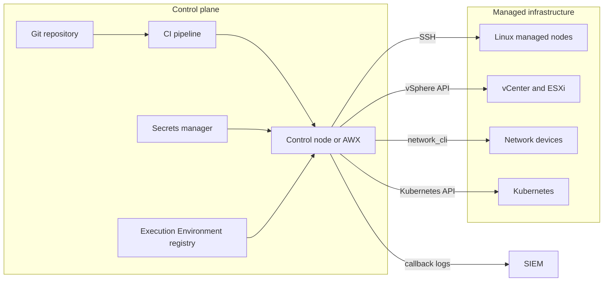

# Архитектура и компоненты

Ansible состоит из небольшого ядра и подключаемых компонентов. Понимание того, где выполняются модули, какие плагины участвуют в запуске и где проходят границы доверия, определяет безопасность и масштабируемость всей схемы.

## 1. Зачем это нужно

Одна и та же команда `ansible-playbook` может работать по-разному: использовать SSH или API, подключаться напрямую или через bastion, запускать модуль на целевом узле или на control node. Без понимания архитектуры невозможно объяснить, почему задача не видит Python, откуда берутся коллекции, где хранятся секреты и кто имеет доступ ко всем хостам сразу.

## 2. Ключевые понятия

| Компонент | Назначение | Пример |
|---|---|---|
| Control node | машина, с которой запускается автоматизация | выделенная Linux ВМ с ansible-core |
| Managed node | целевой узел или API | Linux-хост, vCenter, сетевое устройство, кластер Kubernetes |
| Inventory plugin | формирует список хостов и групп | статический YAML, динамический плагин VMware |
| Connection plugin | устанавливает транспорт до узла | `ssh`, `local`, `network_cli`, `winrm`, `psrp` |
| Module plugin | выполняет работу | `ansible.builtin.package`, `community.vmware.vmware_guest` |
| Action plugin | управляет выполнением модуля на control node | копирование файлов, шаблоны, паузы |
| Lookup plugin | получает данные на control node | файл, переменная окружения, секрет |
| Callback plugin | обрабатывает события выполнения | вывод, JSON-лог, отправка в SIEM |
| Vars plugin | подключает источники переменных | group_vars, host_vars, внешние источники |
| Strategy plugin | задаёт порядок выполнения задач | `linear`, `free`, `host_pinned` |
| Collection | упаковка модулей, плагинов и ролей | `ansible.posix`, `community.vmware` |
| Execution Environment | контейнер с ansible-core, коллекциями и зависимостями | образ для AWX/AAP или `ansible-navigator` |

## 3. Схема



На схеме важны три вещи:

1. Control plane отделён от управляемой инфраструктуры, но имеет привилегии к ней.
2. Пути управления различаются: SSH, vSphere API, CLI сетевого устройства, Kubernetes API.
3. Git, секреты и registry Execution Environments — такие же элементы доверия, как и сам control node.

## 4. Путь выполнения

1. **Конфигурация.** Ansible читает `ansible.cfg` по приоритетам, переменные окружения и аргументы CLI.
2. **Inventory.** Inventory plugin формирует хосты и группы; для vCenter или облака используется динамический источник.
3. **Паттерн хостов.** Play выбирает узлы по имени, группе или шаблону; ошибка в паттерне меняет blast radius.
4. **Соединение.** Connection plugin устанавливает SSH, WinRM, `network_cli` или API-соединение.
5. **Передача модуля.** Модуль и JSON-аргументы передаются на узел; при pipelining — без временных файлов.
6. **Выполнение.** Модуль меняет состояние и возвращает JSON: `changed`, `failed`, `rc`, полезные данные.
7. **Обработка результата.** Action plugin и callback обрабатывают вывод, пишут лог; `notify` запускает handlers.

Для Linux-модулей нужен Python 3.7–3.12 на управляемом узле. Для сетевых устройств модули часто выполняются на control node и общаются с устройством через CLI или HTTP API. Для Windows — PowerShell и WinRM/PSRP. Конкретная модель зависит от connection и module plugins.

## 5. Push, pull и платформа

- **Push-модель** — базовый режим: control node подключается к узлам. Плюс: централизованный контроль и аудит. Минус: нужен сетевой доступ от control node к каждому узлу.
- **Pull-модель (`ansible-pull`)** — узел сам забирает репозиторий и применяет playbook. Плюс: работает при нестабильном WAN и в air-gapped средах. Минус: сложнее централизованно управлять расписанием и секретами.
- **AWX / AAP** — платформа запускает те же playbook, добавляя проекты, инвентари, credentials, RBAC, расписания, workflows и аудит.
- **Execution Environment** — контейнер с фиксированными версиями ansible-core и коллекций; устраняет расхождения «у меня работает».

Для филиальной сети выбор между центральным control node, локальными execution nodes и `ansible-pull` — архитектурное решение. Оно зависит от стабильности каналов, требований к аудиту и допустимой задержки. Подробное сравнение — на странице «Распределённые филиалы».

## 6. Пример конфигурации проекта

```text
ansible-project/
  ansible.cfg
  requirements.yml
  inventories/
    prod/
      hosts.yml
      group_vars/
        all.yml
        branch_*.yml
  playbooks/
    site.yml
  roles/
    baseline/
```

Проверка архитектурных параметров:

```bash
ansible --version
ansible-config dump --only-changed
ansible-inventory --graph
ansible-doc -t connection -l
```

`ansible-config dump --only-changed` показывает, какие настройки отличаются от значений по умолчанию. `ansible-inventory --graph` визуализирует группы и помогает заметить ошибку в иерархии филиалов. `ansible-doc -t connection -l` перечисляет доступные connection plugins.

## 7. Проверка результата

- `ansible --version` показывает ожидаемые версии и пути к коллекциям.
- `ansible-config dump --only-changed` не содержит неожиданных отключений проверок безопасности.
- `ansible-inventory --graph` соответствует схеме филиалов.
- `ansible-doc -t connection -l` содержит нужный транспорт: `ssh`, `network_cli`, `winrm` или API-плагин.
- Для vCenter проверено, что используется API-подключение, а не SSH в ESXi.

## 8. Безопасность и blast radius

| Граница доверия | Риск | Контроль |
|---|---|---|
| Control node | компрометация даёт доступ ко всем узлам | выделенная ВМ, патчи, ограниченный вход, запрет интерактивной работы, резервное копирование |
| Git и CI | вредоносное изменение playbook | защищённые ветки, ревью, обязательные проверки, подпись коммитов |
| Secrets manager | утечка учётных данных | короткоживущие credentials, аудит доступа, least privilege |
| Registry Execution Environments | подмена образа | приватный registry, подпись, пиннинг по digest |
| Inventory | отравление списка хостов | версионирование, ревью, ограниченные права на динамические источники |
| vCenter API | чрезмерные права на виртуализацию | отдельная сервисная учётка, минимальные роли, апрув на разрушительные операции |
| Managed node | локальное повышение привилегий | ограниченный sudo, аудит, запрет общего root |

Дополнительно:

- Включайте `host_key_checking` и проверяйте отпечатки.
- Не храните SSH-ключи и vault-пароли на общих ресурсах.
- Ограничьте сетевой доступ control node: только необходимые сегменты и API.
- Для 200–1000 хостов планируйте ресурсы control node по пилоту: `forks`, pipelining, кэш фактов и параллелизм влияют на CPU, память и сеть.
- Разделяйте inventory production и лаборатории; один неверный паттерн не должен затрагивать продакшен.

## 9. Комплаенс-маппинг

Архитектура напрямую поддерживает управление доступом, разделение обязанностей, управление изменениями и журналирование. Конкретные контроли CIS, STIG, ISO/IEC 27001 и NIST CSF маппятся на странице «Комплаенс и доказательства»; здесь важно, что control plane должен быть защищён как привилегированная система, а действия — прослеживаемы.

## 10. Типичные ошибки

| Симптом | Причина | Решение |
|---|---|---|
| Модуль не находит Python | неверный интерпретатор или ОС | проверьте `ansible_python_interpreter`, установите Python 3.7+ |
| Коллекция не найдена | другой путь коллекций или EE | проверьте `ansible-config dump`, `requirements.yml`, образ EE |
| Работает на одной машине, не работает на другой | разные версии ядра и коллекций | зафиксируйте версии и используйте EE |
| vCenter-модуль падает по SSH | выбрана неверная модель управления | используйте `community.vmware` и API-подключение |
| Слишком медленно | forks, pipelining, факты, WAN | настройте параллелизм, кэш фактов, `serial` |
| Секреты видны в логах | `no_log` не задан или `-vvv` | настройте `no_log`, ограничьте отладку в продакшене |
| Все хосты изменились сразу | широкий паттерн и отсутствие `serial` | используйте группы филиалов и канареечные батчи |

## 11. Чек-лист

- [ ] Определены control plane и управляемые сегменты.
- [ ] Для каждого типа целей выбран корректный connection plugin.
- [ ] Inventory отражает иерархию филиалов.
- [ ] Версии ansible-core и коллекций зафиксированы.
- [ ] Секреты вынесены из репозитория.
- [ ] Control node защищён и не используется как рабочая станция.
- [ ] Настроены журналирование и аудит запусков.
- [ ] Выбрана модель управления филиалами: центральная, локальные узлы или pull.

## 12. Источники

- [Ansible playbook guide](https://docs.ansible.com/ansible/latest/playbook_guide/index.html)
- [Ansible inventory guide](https://docs.ansible.com/ansible/latest/inventory_guide/index.html)
- [Connection plugins](https://docs.ansible.com/ansible/latest/plugins/connection.html)
- [Inventory plugins](https://docs.ansible.com/ansible/latest/plugins/inventory.html)
- [Ansible collections guide](https://docs.ansible.com/ansible/latest/collections_guide/index.html)
- [Ansible builtin collection](https://docs.ansible.com/ansible/latest/collections/ansible/builtin/index.html)
- [Releases and maintenance](https://docs.ansible.com/ansible/latest/reference_appendices/release_and_maintenance.html)

## 13. Связанные страницы

- [Основы Ansible](01-concepts.md)
- [Установка и версионирование](03-install.md)
- [Быстрый старт](../start/quickstart.md)
- [Глоссарий](../start/glossary.md)
- Модель угроз автоматизации — в разработке
- Распределённые филиалы — в разработке
- AAP, AWX, Semaphore — в разработке
