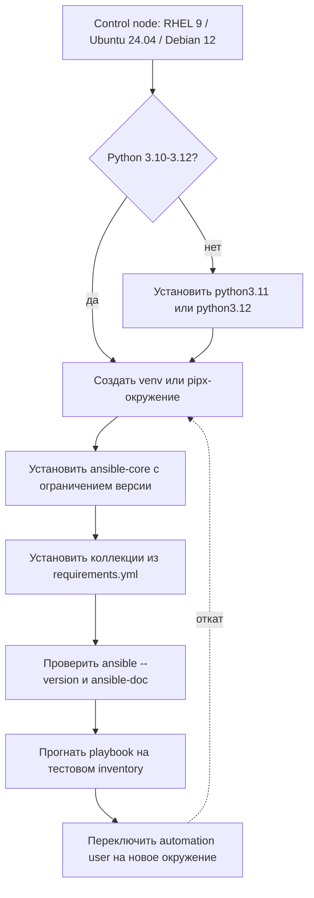

# Установка и версионирование

Control node — это точка, из которой автоматизация получает привилегии на всю инфраструктуру. Поэтому установка ansible-core — не разовая команда, а управляемый процесс: зафиксированные версии, изолированное окружение, проверенный набор коллекций и понятный откат.

## 1. Зачем это нужно

Одна и та же версия ansible-core и коллекций должна работать на рабочей станции инженера, в CI и на control node в ЦОД. Если ставить пакеты «как получится», возникают три типовые проблемы: несовместимый Python, конфликт между `ansible` и `ansible-core`, разные версии коллекций на разных машинах. В распределённой филиальной сети это приводит к тому, что playbook проходит в лаборатории и ломается на боевом хосте.

Управляемая установка решает четыре задачи:

1. **Воспроизводимость** — одинаковая версия ядра и коллекций везде.
2. **Безопасность** — никаких пакетов в системный Python, минимум прав, проверенный источник.
3. **Обновляемость** — новая версия ставится рядом со старой и проверяется до переключения.
4. **Откат** — возврат к предыдущему окружению за одну команду.

## 2. Ключевые понятия

| Понятие | Что это | Почему важно |
|---|---|---|
| ansible-core | движок с CLI и встроенными модулями | определяет совместимость playbook и версию Python |
| Пакет `ansible` | сообщество-дистрибутив: ядро плюс большое набор коллекций | тянет много зависимостей и конфликтует с `ansible-core` |
| Control node | машина, где установлен ansible-core | имеет доступ ко всем управляемым узлам |
| Managed node | целевой хост | требует Python 3.7+ для Linux-модулей |
| venv | изолированное окружение Python | позволяет держать несколько версий рядом |
| pipx | установка CLI-приложений в отдельные окружения | удобно для одной рабочей версии |
| Execution Environment | контейнер с ядром, коллекциями и зависимостями | эталон для CI, AWX и AAP |
| `requirements.yml` | список коллекций с версиями | фиксирует контент автоматизации |
| Interpreter discovery | автоматический поиск Python на узле | определяет, каким интерпретатором выполнится модуль |

## 3. Схема установки



На схеме важны две вещи: Python проверяется до установки, а новое окружение создаётся рядом со старым, а не поверх него. Переключение — отдельный шаг с точкой отката.

## 4. Матрица совместимости

| ansible-core | Python на control node | Python на managed node | Примечание |
|---|---|---|---|
| 2.17 | 3.10–3.12 | 3.7–3.12 | базовый уровень вики |
| 2.18 | 3.11–3.13 | 3.8–3.13 | поднят минимум для control node |
| 2.19 | 3.11–3.13 | 3.8–3.13 | проверяйте changelog перед обновлением |

Для RHEL 8 управляемый узел по умолчанию имеет Python 3.6, который не поддерживается с 2.17. Установите пакет `python39` и задайте интерпретатор явно. Для RHEL 9 control node стандартный Python 3.9 не подходит для 2.17 — нужен python3.11 или python3.12 в отдельном окружении.

## 5. Пошаговая установка

### Шаг 1. Подготовьте Python на control node

Ubuntu 24.04 и Debian 12:

```bash
sudo apt update
sudo apt install -y python3 python3-venv python3-pip pipx
python3 --version
```

RHEL 9:

```bash
sudo dnf install -y python3.11 python3.11-pip
python3.11 --version
```

### Шаг 2. Создайте изолированное окружение

Вариант с venv — основной: он позволяет держать несколько версий и переключаться между ними.

Ubuntu/Debian:

```bash
python3 -m venv ~/.venvs/ansible-2.17
~/.venvs/ansible-2.17/bin/python -m pip install --upgrade pip
~/.venvs/ansible-2.17/bin/pip install "ansible-core~=2.17.0"
```

RHEL 9:

```bash
python3.11 -m venv ~/.venvs/ansible-2.17
~/.venvs/ansible-2.17/bin/python -m pip install --upgrade pip
~/.venvs/ansible-2.17/bin/pip install "ansible-core~=2.17.0"
```

Ограничение `~=2.17.0` означает «2.17.x, но не 2.18». Это защищает от неожиданного перехода на новую ветку. Для полной воспроизводимости зафиксируйте точный патч и транзитивные зависимости:

```bash
~/.venvs/ansible-2.17/bin/pip freeze > control-requirements.txt
```

Вариант с pipx — если нужна одна глобальная команда `ansible`:

```bash
pipx install "ansible-core~=2.17.0"
pipx ensurepath
```

После `ensurepath` откройте новый shell. Не устанавливайте ansible-core в системный Python через `sudo pip`: на современных дистрибутивах это блокируется PEP 668, а обход блокировки создаёт конфликт с пакетами ОС.

### Шаг 3. Зафиксируйте коллекции

Создайте `requirements.yml` в корне проекта:

```yaml
---
collections:
  - name: ansible.posix
    version: "1.5.4"
  - name: community.general
    version: ">=9.0.0,<10.0.0"
  - name: community.vmware
    version: ">=4.0.0,<5.0.0"
```

Для `ansible.posix` указан точный патч. Для крупных коллекций задан диапазон: нижняя граница проверена, верхняя исключает мажорное обновление. После тестирования замените диапазоны на точные версии — это обязательное требование для продакшена.

Установите коллекции в проект, чтобы версия не зависела от домашнего каталога:

```bash
ansible-galaxy collection install -r requirements.yml -p ./collections
```

В `ansible.cfg` укажите этот каталог:

```ini
[defaults]
collections_path = ./collections
interpreter_python = auto_silent
```

`collections_path` — актуальное имя параметра; переменная окружения называется `ANSIBLE_COLLECTIONS_PATH`. Каталог `./collections` добавьте в `.gitignore`: в репозитории хранится `requirements.yml`, а не скачанный контент.

### Шаг 4. Проверьте управляемые узлы

Для RHEL/Rocky/AlmaLinux 8:

```bash
sudo dnf install -y python39
```

В inventory задайте интерпретатор для этой группы:

```yaml
all:
  children:
    rhel8:
      hosts:
        branch-app01:
          ansible_host: 192.0.2.21
      vars:
        ansible_python_interpreter: /usr/bin/python3.9
```

Для Ubuntu/Debian достаточно `python3`; для работы модуля `ansible.builtin.apt` нужен пакет `python3-apt`, который обычно уже установлен.

### Шаг 5. Проверьте установку

```bash
~/.venvs/ansible-2.17/bin/ansible --version
~/.venvs/ansible-2.17/bin/ansible-doc -t module ansible.builtin.package > /dev/null && echo "docs ok"
~/.venvs/ansible-2.17/bin/ansible-galaxy collection list
```

`ansible --version` должен показать нужную версию ядра, путь к конфигурации и интерпретатор control node. Если путь к `ansible.cfg` неожиданный, проверьте текущий каталог: Ansible ищет конфигурацию в порядке приоритета, и файл из текущего каталога важнее пользовательского.

## 6. Проверка Python на управляемых узлах

Playbook ниже не требует Python для самого факта проверки: модуль `raw` выполняется по SSH напрямую.

```yaml
---
- name: Verify managed node Python runtime
  hosts: all
  gather_facts: false

  vars:
    python_check_bin: python3

  tasks:
    - name: Read Python version without requiring Python on target
      ansible.builtin.raw: >-
        {{ python_check_bin }} -c "import sys; print('.'.join(map(str, sys.version_info[:3])))"
      register: python_runtime
      changed_when: false
      failed_when: false

    - name: Require Python 3.7 or newer
      ansible.builtin.assert:
        that:
          - python_runtime.rc == 0
          - (python_runtime.stdout | default('0', true)) is version('3.7', '>=')
        fail_msg: >-
          Python 3.7+ is required on {{ inventory_hostname }};
          found '{{ python_runtime.stdout | default('none') }}'
        success_msg: "Python {{ python_runtime.stdout }} found on {{ inventory_hostname }}"
```

Запуск:

```bash
~/.venvs/ansible-2.17/bin/ansible-playbook -i inventory/hosts.yml check-python.yml
```

Для RHEL 8 с `python39` задайте в group_vars группы `rhel8` переменную `python_check_bin: python3.9`: проверка будет выполняться тем же интерпретатором, который затем использует Ansible. Проверка не меняет систему и безопасна для первого запуска.

## 7. Обновление и откат

Новая версия ставится в отдельный venv:

```bash
python3 -m venv ~/.venvs/ansible-2.18
~/.venvs/ansible-2.18/bin/python -m pip install --upgrade pip
~/.venvs/ansible-2.18/bin/pip install "ansible-core~=2.18.0"
~/.venvs/ansible-2.18/bin/ansible --version
```

Проверьте на тестовом inventory:

```bash
~/.venvs/ansible-2.18/bin/ansible-playbook -i inventory/lab.yml site.yml --check --diff
```

Только после успешной проверки переключайте automation user:

```bash
ln -sfn ~/.venvs/ansible-2.18 ~/.venvs/ansible-current
export PATH="$HOME/.venvs/ansible-current/bin:$PATH"
```

Откат — переключение символической ссылки на прежний каталог:

```bash
ln -sfn ~/.venvs/ansible-2.17 ~/.venvs/ansible-current
```

Старое окружение не удаляйте до завершения проверки в продакшене. Это и есть точка возврата.

## 8. Безопасность и blast radius

| Действие | Blast radius | Проверка | Откат |
|---|---|---|---|
| Обновление ansible-core | все playbook и все хосты под управлением | `--check --diff` на лабораторном inventory, затем canary | переключить `ansible-current` на прежний venv |
| Добавление коллекции | новые модули и плагины во всех playbook | `ansible-lint`, прогон на одном хосте | убрать из `requirements.yml` и переустановить |
| Установка в системный Python | пакеты и утилиты ОС control node | не выполнять | пересоздать venv, не чинить системный Python |
| Смена интерпретатора на узле | все задачи на этом хосте | `ansible.builtin.setup` и одна безопасная задача | вернуть прежнюю переменную |

Control node хранит SSH-ключи и доступ к vCenter. Его компрометация равна компрометации всей автоматизации. Поэтому:

- отдельный пользователь автоматизации, без интерактивного входа;
- `sudo` только на необходимые команды, а не `ALL=(ALL) NOPASSWD: ALL`;
- домашний каталог с правами `0700`, ключи только с `0600`;
- установка пакетов только из проверенных источников, коллекции — из Galaxy или внутреннего зеркала;
- журналирование запусков и регулярный обзор изменений в `requirements.yml`.

## 9. Комплаенс-маппинг

| Требование | Как закрывается |
|---|---|
| CIS Control 4 (Secure Configuration) | зафиксированные версии ядра и коллекций, документированная процедура установки |
| NIST CSF 2.0, функция PR.PS | управление конфигурацией control node и управляемых узлов |
| ISO/IEC 27001:2022, A.8.9 | процедура установки, обновления и отката с ответственными |
| CIS/STIG baseline хостов | единый Python-интерпретатор и пакетный baseline на управляемых узлах |

Доказательства для аудита: `control-requirements.txt`, `requirements.yml` в Git, журнал обновлений и результат проверки на тестовом inventory.

## 10. Типичные ошибки и troubleshooting

| Симптом | Причина | Проверка | Решение |
|---|---|---|---|
| `externally-managed-environment` | PEP 668 блокирует pip в системный Python | `python3 -m pip --version` | использовать venv или pipx, не обходить блокировку |
| `ansible-core requires Python 3.10+` | на RHEL 9 выбран Python 3.9 | `python3 --version` | создать venv на python3.11 |
| `ansible: command not found` после pipx | каталог pipx не в `PATH` | `pipx list` | `pipx ensurepath`, открыть новый shell |
| Конфликт версий и модулей | одновременно установлены `ansible` и `ansible-core` | вывод `pip list`, строки ansible | оставить только `ansible-core` в изолированном окружении |
| `Could not find imported module` | коллекция не установлена или неверный FQCN | `ansible-galaxy collection list` | установить по `requirements.yml`, проверить имя |
| Модуль падает на RHEL 8 | используется Python 3.6 | `ansible -m setup` | установить `python39`, задать `ansible_python_interpreter` |
| `python3.13` не поддерживается в 2.17 | версия Python новее матрицы | `ansible --version` | использовать Python 3.12 или ansible-core 2.18+ |
| Коллекции не видны в проекте | установлены в другой каталог | `ansible-config dump`, строка COLLECTIONS | указать `collections_path` и переустановить |

## 11. Чек-лист

- [ ] Версия Python на control node входит в диапазон выбранной ветки ansible-core.
- [ ] ansible-core установлен в venv или pipx, а не в системный Python.
- [ ] `ansible --version` показывает ожидаемую версию и корректный `ansible.cfg`.
- [ ] Коллекции устанавливаются из `requirements.yml` с ограничениями версий.
- [ ] `collections_path` указывает на каталог проекта, скачанный контент не в Git.
- [ ] Для RHEL 8 установлен `python39` и задан интерпретатор.
- [ ] Проверочный playbook проходит на лабораторном и одном боевом хосте.
- [ ] Предыдущее окружение сохранено для отката.
- [ ] Обновление прошло `--check --diff` и canary-запуск.

## 12. Источники

- [Ansible installation guide](https://docs.ansible.com/ansible/latest/installation_guide/intro_installation.html)
- [ansible-core support matrix](https://docs.ansible.com/ansible/latest/reference_appendices/release_and_maintenance.html)
- [Installing collections](https://docs.ansible.com/ansible/latest/collections_guide/collections_installing.html)
- [Ansible configuration settings](https://docs.ansible.com/ansible/latest/reference_appendices/config.html)
- [Python interpreter discovery](https://docs.ansible.com/ansible/latest/reference_appendices/interpreter_discovery.html)
- [pipx documentation](https://pipx.pypa.io/stable/)

## 13. Связанные страницы

- [Основы Ansible](01-concepts.md)
- [Архитектура и компоненты](02-architecture.md)
- [Быстрый старт](../start/quickstart.md)
- [Маршруты чтения](../start/reading-paths.md)
- [Глоссарий](../start/glossary.md)
- Конфигурация ansible.cfg — в разработке
- Тестирование и Molecule — в разработке
