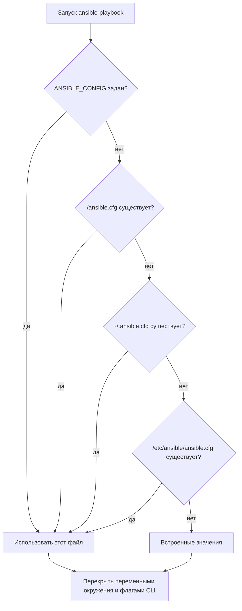

# Конфигурация ansible.cfg

`ansible.cfg` задаёт поведение Ansible по умолчанию: где искать inventory, сколько хостов обрабатывать параллельно, как проверять SSH-ключи и куда писать журнал. Ошибка в этом файле незаметно меняет blast radius всего запуска.

## 1. Зачем это нужно

Конфигурация определяет не только удобство, но и безопасность. Отключённая проверка host key, неограниченный `forks`, запись вывода в общий лог или неверный путь к inventory могут привести к работе не с теми хостами и утечке данных. Единый `ansible.cfg` в репозитории делает поведение воспроизводимым на рабочей станции, в CI и на control node.

Практическая цель — три вещи:

1. Все запуски используют один и тот же inventory и набор коллекций.
2. Опасные значения не включаются «на время».
3. Изменения конфигурации проходят ревью, как и код.

## 2. Приоритеты конфигурации

Ansible ищет настройки в фиксированном порядке. Первый найденный источник побеждает, но параметры командной строки и переменные окружения перекрывают файл.

| Приоритет | Источник | Пример |
|---|---|---|
| 1 (высший) | переменные окружения | `ANSIBLE_FORKS=20` |
| 2 | `ansible.cfg` в текущем каталоге | `./ansible.cfg` |
| 3 | `~/.ansible.cfg` | пользовательский файл |
| 4 | `/etc/ansible/ansible.cfg` | системный файл |
| 5 (низший) | встроенные значения | `forks = 5` |

Файл, доступный на запись всем, Ansible игнорирует. Это защита от подмены конфигурации другим пользователем. Держите `ansible.cfg` с правами `0644` и владельцем-сервисной учёткой.

## 3. Схема выбора конфигурации



На схеме важно, что конфигурация из текущего каталога перекрывает пользовательскую и системную. Запуск из чужого каталога может незаметно изменить параметры.

## 4. Безопасная базовая конфигурация

```ini
[defaults]
inventory              = ./inventories/prod/hosts.yml
collections_path       = ./collections
roles_path             = ./roles
host_key_checking      = True
interpreter_python     = auto_silent
forks                  = 20
timeout                = 30
retry_files_enabled    = False
deprecation_warnings   = True
gathering              = smart
fact_caching           = jsonfile
fact_caching_connection = ./.cache/facts
fact_caching_timeout   = 86400
display_skipped_hosts  = False
# log_path             = ./logs/ansible.log

[ssh_connection]
pipelining = True
```

Разберём значения:

| Параметр | Значение | Почему |
|---|---|---|
| `host_key_checking` | `True` | защита от подмены managed node |
| `forks` | `20` | компромисс между скоростью и нагрузкой на control node |
| `timeout` | `30` | отсекает зависшие SSH-сессии в филиалах |
| `gathering` | `smart` | facts собираются только при необходимости |
| `fact_caching` | `jsonfile` | ускоряет повторные запуски на 200–1000 хостах |
| `pipelining` | `True` | меньше SSH-операций, быстрее выполнение |
| `retry_files_enabled` | `False` | не оставляет файлы с именами хостов в рабочем каталоге |

`log_path` по умолчанию закомментирован. Включайте его осознанно: журнал содержит результаты задач и может раскрывать структуру инфраструктуры. Задачи с секретами обязаны иметь `no_log: true`, но это не заменяет защиту самого файла.

## 5. Конфигурация для филиальной сети

Для 200–1000 хостов и нестабильных WAN-каналов добавьте параметры повторных попыток и разделения inventory:

```ini
[defaults]
inventory = ./inventories/prod/
forks = 25
timeout = 45
gathering = smart
fact_caching = jsonfile
fact_caching_connection = ./.cache/facts
fact_caching_timeout = 43200
stdout_callback = default
callback_whitelist = profile_tasks

[ssh_connection]
pipelining = True
ssh_args = -C -o ControlMaster=auto -o ControlPersist=120s
```

`inventory` может указывать на каталог: Ansible объединит все файлы inventory в нём. Это удобно, когда филиалы описаны отдельными файлами. Не складывайте в этот каталог резервные копии и посторонние YAML — они тоже будут разобраны.

`callback_whitelist` в 2.17 всё ещё работает, но в новых версиях используется `callbacks_enabled`. Если вы поддерживаете несколько версий, проверьте вывод `ansible-config list` для своей ветки.

## 6. Проверка результата

```bash
ansible-config view
ansible-config dump --only-changed
ansible-inventory --graph
```

- `view` показывает, какой файл реально прочитан.
- `dump --only-changed` выводит только параметры, отличающиеся от встроенных.
- `graph` подтверждает, что inventory загружен из ожидаемого места.

Полный вывод `dump` полезен при разборе инцидента: он фиксирует фактические значения, а не предполагаемые.

## 7. Безопасность и blast radius

| Изменение | Blast radius | Проверка | Откат |
|---|---|---|---|
| `inventory` на другой каталог | все playbook могут пойти не на те хосты | `ansible-inventory --graph`, `--limit` | вернуть прежний путь в Git |
| `host_key_checking = False` | MITM между control node и узлами | не применять в продакшене | удалить строку, проверить known_hosts |
| рост `forks` | нагрузка на control node и сеть, таймауты | пилот на 10–20 хостах | вернуть прежнее значение |
| включение `log_path` | вывод задач, имена хостов, возможные секреты | проверить `no_log`, права `0600` | отключить и удалить журнал по регламенту |
| смена `interpreter_python` | все задачи на затронутых хостах | `setup` и одна безопасная задача | вернуть `auto_silent` |

Отдельно про `pipelining`: он требует, чтобы на управляемом узле не был включён `requiretty` для пользователя автоматизации. На современных RHEL и Ubuntu это по умолчанию так, но в старых филиальных шаблонах встречается обратное. Проверьте `sudo -l` и `/etc/sudoers` до массового включения.

## 8. Комплаенс-маппинг

| Требование | Как закрывается |
|---|---|
| CIS Control 4 | версионируемый `ansible.cfg`, запрет опасных значений |
| NIST CSF 2.0 PR.PS | управление конфигурацией control node |
| ISO/IEC 27001:2022 A.8.9 | документированные параметры и порядок изменений |
| Аудит изменений | `ansible.cfg` в Git, ревью, `ansible-config dump` в артефактах CI |

## 9. Типичные ошибки и troubleshooting

| Симптом | Причина | Проверка | Решение |
|---|---|---|---|
| Настройки не применяются | конфигурация лежит не в том каталоге | `ansible-config view` | запускать из корня проекта или задать `ANSIBLE_CONFIG` |
| Предупреждение о world-writable | файл доступен на запись всем | `ls -l ansible.cfg` | `chmod 0644`, владелец — сервисная учётка |
| `pipelining` не работает | на узле включён `requiretty` | `sudo -l`, `grep requiretty /etc/sudoers` | отключить `requiretty` для пользователя автоматизации |
| Хосты не находятся | inventory указывает на файл, а не каталог, или наоборот | `ansible-inventory --graph` | исправить путь, проверить расширения |
| Секреты в журнале | включён `log_path`, нет `no_log` | просмотреть журнал | включить `no_log`, ограничить доступ, удалить журнал |
| Разное поведение у инженеров | у каждого свой `~/.ansible.cfg` | `ansible-config view` | зафиксировать проектный файл и `ANSIBLE_CONFIG` |

## 10. Чек-лист

- [ ] `ansible.cfg` хранится в Git и проходит ревью.
- [ ] `ansible-config view` указывает на проектный файл.
- [ ] `host_key_checking = True`.
- [ ] `forks` и `timeout` проверены на пилотной группе.
- [ ] `inventory` указывает на ожидаемый каталог или файл.
- [ ] `collections_path` соответствует каталогу, куда установлены коллекции.
- [ ] `log_path` либо отключён, либо защищён и покрыт регламентом.
- [ ] Задачи с секретами имеют `no_log: true`.

## 11. Источники

- [Ansible configuration settings](https://docs.ansible.com/ansible/latest/reference_appendices/config.html)
- [ansible-config CLI](https://docs.ansible.com/ansible/latest/cli/ansible-config.html)
- [Controlling how Ansible behaves](https://docs.ansible.com/ansible/latest/installation_guide/intro_configuration.html)

## 12. Связанные страницы

- [Inventory и группы](05-inventory.md)
- [Переменные, факты и приоритеты](06-variables.md)
- [Доступ и привилегии](../secure-dev/12-access.md)
- [Аудит выполнения](../secure-dev/16-audit-logging.md)
- [Диагностика и troubleshooting](../ops/60-troubleshooting.md)
