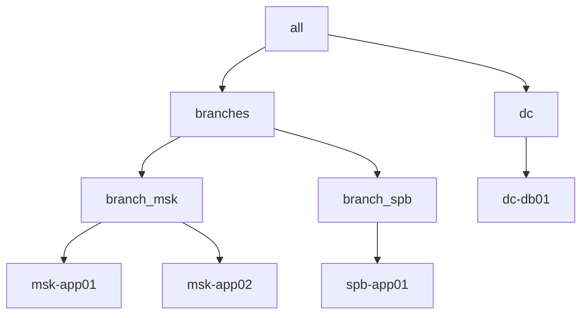

# Inventory и группы

Inventory — это карта инфраструктуры, по которой Ansible выбирает цели. Для филиальной сети inventory одновременно является схемой сегментации, границей blast radius и объектом, который нужно защищать как конфиденциальные данные.

## 1. Зачем это нужно

Одна ошибка в группе или паттерне отправляет playbook не в тот филиал. Поэтому inventory должен быть явным, версионируемым и предсказуемым. Статический YAML подходит для стабильного парка, динамический plugin — для vCenter, где состав ВМ меняется. Оба варианта могут сосуществовать: статические группы задают политику, динамические источники поставляют хосты.

## 2. Ключевые понятия

| Понятие | Назначение | Пример |
|---|---|---|
| Host | управляемый узел | `msk-app01` |
| Group | логическая группа хостов | `branch_msk`, `branches`, `dc` |
| `children` | вложенные группы | `branches` содержит филиалы |
| `group_vars` | переменные группы | `group_vars/branches.yml` |
| `host_vars` | переменные хоста | `host_vars/msk-app01.yml` |
| Pattern | выбор хостов для play | `branch_*:!branch_spb` |
| Dynamic inventory | источник хостов через plugin | `community.vmware.vmware_vm_inventory` |
| `ansible_host` | адрес подключения | `192.0.2.31` |
| `ansible_user` | пользователь SSH | `svc-ansible` |

## 3. Схема филиального inventory



Группы верхнего уровня описывают тип площадки, вложенные — конкретный филиал. Playbook выбирает либо все филиалы (`branches`), либо один (`branch_msk`), либо отдельный хост. Такая иерархия позволяет менять масштаб раскатки одним паттерном.

## 4. Статический inventory

```yaml
all:
  vars:
    ansible_user: svc-ansible
    ansible_ssh_private_key_file: ~/.ssh/ansible_ed25519
    ansible_python_interpreter: auto_silent
  children:
    branches:
      children:
        branch_msk:
          vars:
            branch_code: msk
            ntp_servers:
              - 192.0.2.10
              - 192.0.2.11
          hosts:
            msk-app01:
              ansible_host: 192.0.2.31
            msk-app02:
              ansible_host: 192.0.2.32
        branch_spb:
          vars:
            branch_code: spb
            ntp_servers:
              - 192.0.2.12
          hosts:
            spb-app01:
              ansible_host: 192.0.2.41
    dc:
      hosts:
        dc-db01:
          ansible_host: 192.0.2.51
```

Правила, которые экономят время:

- Имена групп — латиница, цифры и `_`; дефисы в именах групп избегайте.
- Имена хостов могут содержать дефисы, но не должны дублироваться в разных группах.
- `ansible_host` задавайте явно, если DNS в филиале нестабилен.
- Пароли в inventory не храните: только ключи и ссылки на vault-переменные.

## 5. Переменные групп и хостов

Структура каталога:

```text
inventories/prod/
  hosts.yml
  group_vars/
    all.yml
    branches.yml
    branch_msk.yml
  host_vars/
    msk-app01.yml
```

`group_vars/branches.yml`:

```yaml
---
branch_backup_window: "01:00-03:00"
ansible_ssh_common_args: >-
  -o ConnectTimeout=15
  -o ServerAliveInterval=30
```

`group_vars/branch_msk.yml`:

```yaml
---
dns_servers:
  - 192.0.2.10
  - 192.0.2.11
```

`host_vars/msk-app01.yml`:

```yaml
---
role_in_service: frontend
```

Файлы `group_vars/all.yml` и `group_vars/branches.yml` загружаются автоматически, если лежат рядом с inventory. Не помещайте туда зашифрованные и открытые переменные в один файл без необходимости: разделяйте `vars.yml` и `vault.yml`, чтобы ревью видело структуру без секретов.

## 6. Паттерны выбора хостов

| Паттерн | Что выбирает |
|---|---|
| `all` | все хосты inventory |
| `branches` | все филиалы |
| `branch_*` | все группы, начинающиеся с `branch_` |
| `branch_msk:!msk-app02` | филиал без одного хоста |
| `branch_msk,dc` | объединение групп |
| `branches:&branch_msk` | пересечение групп |
| `msk-app01` | один хост |

Проверка перед запуском:

```bash
ansible-inventory -i inventories/prod/hosts.yml --graph
ansible -i inventories/prod/hosts.yml 'branch_*' --list-hosts
```

`--list-hosts` безопасен: он не подключается к узлам и показывает итоговый blast radius.

## 7. Динамический inventory для VMware

Если состав ВМ меняется, используйте plugin `community.vmware.vmware_vm_inventory`. Файл `inventories/prod/vmware.vmware.yml`:

```yaml
plugin: community.vmware.vmware_vm_inventory
strict: false
hostname: vcsa01.example.local
username: svc-ansible@vsphere.local
password: !vault |
  $ANSIBLE_VAULT;1.1;AES256
  0000000000000000000000000000000000000000000000000000000000000000
validate_certs: true
properties:
  - name
  - guest.ipAddress
  - config.name
  - summary.runtime.powerState
  - guest.toolsRunningStatus
filters:
  - runtime.powerState == "poweredOn"
  - config.template == false
```

Строку `password` замените результатом `ansible-vault encrypt_string`. Не храните пароль vCenter открытым текстом и не отключайте `validate_certs` в продакшене: вместо этого добавьте внутренний CA в доверенные на control node.

Проверка динамического источника:

```bash
ansible-inventory -i inventories/prod/vmware.vmware.yml --graph
```

Если plugin не загружается, проверьте `enable_plugins` в `ansible.cfg` и наличие коллекции `community.vmware` в `requirements.yml`. Динамический inventory не заменяет статическую политику: группы филиалов и роли лучше задавать через `keyed_groups` или отдельный статический слой.

## 8. Проверка результата

```yaml
---
- name: Show inventory placement
  hosts: all
  gather_facts: false

  tasks:
    - name: Print host and groups
      ansible.builtin.debug:
        msg: >-
          {{ inventory_hostname }} belongs to
          {{ group_names | sort | join(', ') }}
```

Запуск:

```bash
ansible-playbook -i inventories/prod/hosts.yml show-inventory.yml --limit branch_msk
```

Ожидаемый результат — список групп для каждого хоста филиала. Если хост попал не туда, исправьте inventory до запуска изменяющих задач.

## 9. Безопасность и blast radius

| Риск | Последствие | Мера |
|---|---|---|
| Inventory в открытом репозитории | раскрытие топологии и адресов | ограничить доступ, не хранить секреты |
| Пароль vCenter в plugin-файле | компрометация всего vSphere | vault или внешнее хранилище |
| Слишком широкий паттерн | изменения во всех филиалах | `--list-hosts`, `--limit`, canary |
| Дублирование хоста | непредсказуемые переменные | проверка `ansible-inventory --host` |
| Динамический источник без фильтра | в управление попадают шаблоны и выключенные ВМ | `filters`, `strict: false`, ревью |

Inventory — это разведданные. `ansible-inventory --graph` показывает имена, адреса и группы, поэтому доступ к команде и к файлам должен быть ограничен той же моделью, что и доступ к инфраструктуре.

## 10. Комплаенс-маппинг

| Требование | Как закрывается |
|---|---|
| CIS Control 1 (Inventory of Assets) | версионируемый inventory, регулярная сверка |
| NIST CSF 2.0 ID.AM | идентификация активов и их владельцев |
| ISO/IEC 27001:2022 A.5.9 | реестр активов и правила доступа |
| Аудит изменений | Git-история inventory и ревью |

## 11. Типичные ошибки и troubleshooting

| Симптом | Причина | Проверка | Решение |
|---|---|---|---|
| `Unable to parse inventory` | ошибка YAML или отступов | `ansible-inventory --graph` | проверить отступы и типы |
| Группа не находится | дефис или пробел в имени | `ansible-inventory --graph` | переименовать группу в `snake_case` |
| Хост есть, но переменные пусты | файл `host_vars` не рядом с inventory | `ansible-inventory --host msk-app01` | переместить каталог или задать `inventory` на файл |
| Динамический inventory пуст | неверный фильтр или нет прав в vCenter | `ansible-inventory -vvv` | проверить фильтры, учётку и CA |
| Ошибка расшифровки vault | нет `--vault-password-file` | вывод `ansible-inventory` | передать vault password через защищённый механизм |
| Playbook задел лишние хосты | широкий паттерн | `--list-hosts` перед запуском | сузить `--limit`, использовать canary |

## 12. Чек-лист

- [ ] Inventory хранится в Git и проходит ревью.
- [ ] Имена групп в `snake_case`, хосты уникальны.
- [ ] Для каждого филиала заданы `branch_code` и сетевые параметры.
- [ ] Секреты отсутствуют в inventory и `group_vars` в открытом виде.
- [ ] Динамический plugin использует vault и `validate_certs: true`.
- [ ] `--list-hosts` проверен для каждого опасного паттерна.
- [ ] `ansible-inventory --host` показывает ожидаемые переменные.
- [ ] Доступ к inventory ограничен по модели least privilege.

## 13. Источники

- [How to build your inventory](https://docs.ansible.com/ansible/latest/inventory_guide/intro_inventory.html)
- [Inventory plugins](https://docs.ansible.com/ansible/latest/plugins/inventory.html)
- [community.vmware.vmware_vm_inventory](https://docs.ansible.com/ansible/latest/collections/community/vmware/vmware_vm_inventory_inventory.html)
- [Patterns: targeting hosts and groups](https://docs.ansible.com/ansible/latest/inventory_guide/intro_patterns.html)

## 14. Связанные страницы

- [Переменные, факты и приоритеты](06-variables.md)
- [Конфигурация ansible.cfg](04-config.md)
- [Распределённые филиалы](../admin/20-branch-fleet.md)
- [VMware ESXi и vCenter](../admin/24-vmware-esxi.md)
- [Масштабирование и производительность](../admin/30-scaling.md)
