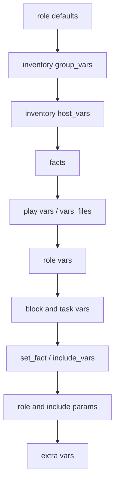

# Переменные, факты и приоритеты

Переменные — главный источник неочевидного поведения Ansible. Одно и то же имя может быть задано в роли, inventory, play и командной строке; побеждает источник с более высоким приоритетом. Понимание этой лестницы важнее, чем знание синтаксиса Jinja2.

## 1. Зачем это нужно

В филиальной сети переменные описывают различия площадок: адреса NTP, DNS, прокси, окна обслуживания, уровень харденинга. Если приоритеты не контролировать, значение из `group_vars` может неожиданно перекрыть роль, а `-e` на командной строке — отключить защитную настройку во всех филиалах. Управляемая модель переменных делает поведение предсказуемым и проверяемым.

## 2. Приоритеты переменных

Порядок от низшего к высшему (22 уровня):

| Уровень | Источник |
|---|---|
| 1 | значения параметров командной строки (например, `-u`) |
| 2 | `defaults/main.yml` роли |
| 3 | переменные группы из файла inventory или скрипта |
| 4 | `group_vars/all` из inventory |
| 5 | `group_vars/all` из playbook |
| 6 | `group_vars/*` из inventory |
| 7 | `group_vars/*` из playbook |
| 8 | переменные хоста из файла inventory |
| 9 | `host_vars/*` из inventory |
| 10 | `host_vars/*` из playbook |
| 11 | facts хоста и кэшированные `set_fact` |
| 12 | `vars` play |
| 13 | `vars_prompt` |
| 14 | `vars_files` |
| 15 | `vars/main.yml` роли |
| 16 | `vars` блока |
| 17 | `vars` задачи |
| 18 | `include_vars` |
| 19 | `set_fact` и зарегистрированные переменные |
| 20 | параметры роли и `include_role` |
| 21 | параметры `include` |
| 22 | `extra_vars` (`-e`) — всегда побеждают |

Практическое следствие: `-e` опасен для защитных настроек. Не передавайте через него `sshd_permit_root_login`, `firewall_enabled` или `selinux_mode` без отдельного апрува.

## 3. Схема распространения значений



Чем ниже блок на схеме, тем выше приоритет. Роль должна задавать безопасные значения по умолчанию в `defaults`, а не в `vars`: `defaults` легко перекрыть на уровне площадки.

## 4. Факты и magic-переменные

Facts собираются модулем `ansible.builtin.setup` и доступны через `ansible_facts`. Используйте словарный доступ, а не устаревшие `ansible_*`-переменные:

```yaml
- name: Show host facts
  ansible.builtin.debug:
    msg:
      - "distribution={{ ansible_facts['distribution'] }}"
      - "version={{ ansible_facts['distribution_version'] }}"
      - "memory_mb={{ ansible_facts['memtotal_mb'] }}"
      - "python={{ ansible_facts['python_version'] }}"
```

Часто используемые magic-переменные:

| Переменная | Значение |
|---|---|
| `inventory_hostname` | имя хоста в inventory |
| `group_names` | группы текущего хоста |
| `groups` | все группы и их хосты |
| `hostvars` | переменные всех хостов |
| `playbook_dir` | каталог playbook |
| `ansible_play_hosts` | активные хосты текущего play |
| `ansible_check_mode` | признак запуска `--check` |
| `omit` | пропустить параметр модуля |

`hostvars` удобен для шаблонов, но может содержать секреты. Не выводите его целиком в лог и не передавайте в `debug`.

## 5. Полный пример

`vars/demo.yml`:

```yaml
---
demo_value: "vars_files"
demo_environment: "production"
```

`variables-demo.yml`:

```yaml
---
- name: Demonstrate variable precedence
  hosts: branch_msk
  gather_facts: true

  vars:
    demo_value: "play vars"
    sample_packages:
      - curl
      - ca-certificates

  vars_files:
    - vars/demo.yml

  tasks:
    - name: Show effective values
      ansible.builtin.debug:
        msg:
          - "demo_value={{ demo_value }}"
          - "demo_environment={{ demo_environment }}"
          - "distribution={{ ansible_facts['distribution'] }}"

    - name: Show demo variables from hostvars
      ansible.builtin.debug:
        msg: >-
          {{ hostvars[inventory_hostname]
             | dict2items
             | selectattr('key', 'match', '^demo_')
             | map(attribute='key')
             | list }}
```

Запуск:

```bash
ansible-playbook -i inventories/prod/hosts.yml variables-demo.yml
ansible-playbook -i inventories/prod/hosts.yml variables-demo.yml -e demo_value=extra
```

В первом случае `demo_value` равно `vars_files` (уровень 14 выше `vars` play). Во втором — `extra`, потому что `-e` имеет высший приоритет. `demo_environment` приходит из `vars_files`.

## 6. Именование и организация

- `snake_case`, латиница, без пробелов.
- Префикс по роли или домену: `sshd_*`, `firewall_*`, `branch_*`.
- Не используйте префикс `ansible_` для своих переменных: он зарезервирован.
- Не называйте переменные `environment`, `name`, `state`, `user`: они конфликтуют с параметрами модулей и вводят в заблуждение.
- Секреты — только с префиксом `vault_` и в отдельном зашифрованном файле.
- Публичные значения и секреты не смешивайте в одном файле.

```yaml
# group_vars/all/vars.yml
db_password: "{{ vault_db_password }}"
db_port: 5432
```

```yaml
# group_vars/all/vault.yml (ansible-vault encrypt)
vault_db_password: "CHANGE_ME"
```

## 7. Отладка переменных

```bash
ansible-inventory -i inventories/prod/hosts.yml --host msk-app01
ansible -i inventories/prod/hosts.yml msk-app01 -m ansible.builtin.debug -a "var=hostvars[inventory_hostname]"
ansible-playbook -i inventories/prod/hosts.yml site.yml -vvv
```

`ansible-inventory --host` показывает итоговые переменные без подключения к узлу. Если значение не то, ищите источник через `grep -R "имя_переменной" inventories/ group_vars/ host_vars/ roles/`. Ansible не сообщает, из какого файла взято значение, поэтому дисциплина именования важнее инструментов.

## 8. Безопасность и blast radius

| Риск | Последствие | Мера |
|---|---|---|
| `-e` перекрывает защитную настройку | отключение firewall или SSH-ограничений | запрет опасных `-e` в CI, апрув |
| `debug: var=hostvars` | утечка секретов в лог | точечный вывод, `no_log` |
| секреты в `group_vars` без vault | компрометация учёток | `ansible-vault`, внешнее хранилище |
| «временная» переменная в роли | непредсказуемое поведение | удалить после проверки, ревью |
| `set_fact` с секретом | секрет остаётся в памяти и логах | `no_log: true`, минимизировать |

## 9. Комплаенс-маппинг

| Требование | Как закрывается |
|---|---|
| CIS Control 4 | контролируемые значения конфигурации, запрет локальных переопределений |
| NIST CSF 2.0 PR.PS | управление конфигурацией и изменениями |
| ISO/IEC 27001:2022 A.8.9 | документированные переменные и владельцы |
| Аудит | Git-история `group_vars` и `host_vars`, ревью |

## 10. Типичные ошибки и troubleshooting

| Симптом | Причина | Проверка | Решение |
|---|---|---|---|
| `undefined variable` | опечатка или переменная не загружена | `ansible-inventory --host` | исправить имя, добавить в `group_vars` |
| Значение не переопределяется | источник имеет более низкий приоритет | таблица приоритетов | перенести в `vars` роли или `extra_vars` |
| Факты устарели | включён кэш facts | `ansible_facts` | очистить кэш или `gather_facts: true` |
| `hostvars` не содержит хост | хост вне inventory | `ansible-inventory --graph` | добавить хост или группу |
| Vault-переменная не определена | файл не расшифрован | вывод с `-vvv` | передать vault password, проверить имя |
| `true`/`false` стали строками | неверный тип в YAML | `type_debug` | использовать `true`/`false` без кавычек |

## 11. Чек-лист

- [ ] Для каждой переменной известно, кто её владелец и где она задана.
- [ ] Роль использует `defaults`, а не `vars` для переопределяемых значений.
- [ ] Секреты вынесены в vault и имеют префикс `vault_`.
- [ ] `-e` не используется для отключения защитных настроек.
- [ ] `ansible-inventory --host` проверен для пилотного хоста.
- [ ] В логах нет `hostvars` целиком и секретов.
- [ ] Имена переменных не конфликтуют с параметрами модулей.

## 12. Источники

- [Using variables](https://docs.ansible.com/ansible/latest/playbook_guide/playbooks_variables.html)
- [Variable precedence](https://docs.ansible.com/ansible/latest/playbook_guide/playbooks_variables.html#understanding-variable-precedence)
- [Ansible facts](https://docs.ansible.com/ansible/latest/playbook_guide/playbooks_vars_facts.html)
- [Special variables](https://docs.ansible.com/ansible/latest/reference_appendices/special_variables.html)

## 13. Связанные страницы

- [Inventory и группы](05-inventory.md)
- [Управление секретами](../secure-dev/11-secrets.md)
- [Безопасная разработка playbook](../secure-dev/13-safe-code.md)
- [Конфигурация ansible.cfg](04-config.md)
- [Диагностика и troubleshooting](../ops/60-troubleshooting.md)
