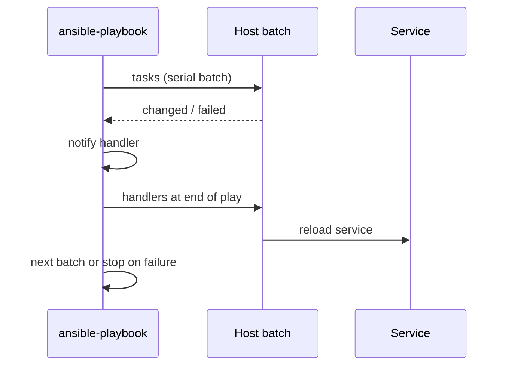

# Playbooks, roles, handlers

Playbook описывает желаемое состояние, role упаковывает повторяемую логику, handler выполняет отложенное действие после изменения. Вместе они задают структуру автоматизации, от которой зависят читаемость, идемпотентность и безопасность раскатки.

## 1. Зачем это нужно

Линейный playbook из десятков задач трудно проверять и переиспользовать. Роль отделяет параметры площадки от логики, handler не перезапускает сервис без необходимости, а `serial` ограничивает blast radius. Для филиальной сети это критично: одна и та же роль применяется к сотням хостов, но раскатывается постепенно.

## 2. Ключевые понятия

| Понятие | Назначение |
|---|---|
| Play | связка группы хостов, переменных и задач |
| Task | один вызов модуля с именем и параметрами |
| Handler | задача, выполняемая по `notify` после изменения |
| Role | структурированный набор задач, шаблонов, defaults и handlers |
| `import_*` | статический импорт при разборе playbook |
| `include_*` | динамическое включение во время выполнения |
| `block` | группировка задач с общими `when`, `become`, `tags` |
| `rescue` | обработка ошибок блока |
| `always` | задачи, выполняемые в любом случае |
| `serial` | размер партии хостов за один проход |
| `max_fail_percentage` | порог отказов, после которого раскатка останавливается |

## 3. Схема выполнения



Handler срабатывает только при `changed` и выполняется один раз в конце play, даже если его уведомили несколько задач. Это снижает число перезапусков, но означает, что при аварийном завершении handler может не выполниться.

## 4. Структура роли

```text
roles/baseline/
  defaults/main.yml
  tasks/main.yml
  handlers/main.yml
  templates/sshd_baseline.conf.j2
  templates/motd.j2
  meta/main.yml
```

`roles/baseline/defaults/main.yml`:

```yaml
---
baseline_packages:
  - curl
  - ca-certificates
baseline_motd: "Managed by Ansible. Authorized access only."
baseline_sshd_hardening: false
baseline_ssh_service: >-
  {{ 'ssh' if ansible_facts['os_family'] == 'Debian' else 'sshd' }}
```

`baseline_sshd_hardening` по умолчанию выключен: роль не должна блокировать доступ при первом применении. Включайте его осознанно, после проверки ключевого доступа.

`roles/baseline/tasks/main.yml`:

```yaml
---
- name: Install baseline packages
  ansible.builtin.package:
    name: "{{ baseline_packages }}"
    state: present

- name: Deploy baseline MOTD
  ansible.builtin.template:
    src: motd.j2
    dest: /etc/motd
    owner: root
    group: root
    mode: "0644"

- name: Deploy SSH baseline fragment
  ansible.builtin.template:
    src: sshd_baseline.conf.j2
    dest: /etc/ssh/sshd_config.d/60-baseline.conf
    owner: root
    group: root
    mode: "0644"
    validate: "sshd -t -f %s"
  when: baseline_sshd_hardening | bool
  notify: Reload sshd
```

`roles/baseline/handlers/main.yml`:

```yaml
---
- name: Reload sshd
  ansible.builtin.service:
    name: "{{ baseline_ssh_service }}"
    state: reloaded
```

`roles/baseline/templates/sshd_baseline.conf.j2`:

```jinja2
# {{ ansible_managed }}
PermitRootLogin no
PasswordAuthentication no
KbdInteractiveAuthentication no
```

`roles/baseline/templates/motd.j2`:

```jinja2
{{ baseline_motd }}
Host: {{ inventory_hostname }}
Branch: {{ branch_code | default('unknown') }}
```

`roles/baseline/meta/main.yml`:

```yaml
---
galaxy_info:
  author: automation-team
  description: Baseline packages and optional SSH hardening
  license: proprietary
  min_ansible_version: "2.17"
dependencies: []
```

## 5. Playbook с canary

`site.yml`:

```yaml
---
- name: Apply baseline to branch nodes
  hosts: branches
  become: true
  gather_facts: true
  serial: 1
  max_fail_percentage: 0
  any_errors_fatal: true

  roles:
    - role: baseline
      vars:
        baseline_sshd_hardening: true
```

`serial: 1` обрабатывает по одному хосту. `max_fail_percentage: 0` останавливает play после первой ошибки. Для большой раскатки замените на `serial: "10%"` после успешного canary, но сохраните `max_fail_percentage` ниже 100.

## 6. Блоки, rescue и always

```yaml
---
- name: Harden SSH with explicit failure reporting
  hosts: branches
  become: true
  serial: 1
  max_fail_percentage: 0

  vars:
    baseline_ssh_service: >-
      {{ 'ssh' if ansible_facts['os_family'] == 'Debian' else 'sshd' }}

  tasks:
    - name: Apply SSH hardening
      block:
        - name: Back up current sshd_config
          ansible.builtin.copy:
            src: /etc/ssh/sshd_config
            dest: /etc/ssh/sshd_config.ansible-backup
            remote_src: true
            owner: root
            group: root
            mode: "0600"

        - name: Deploy validated SSH fragment
          ansible.builtin.template:
            src: roles/baseline/templates/sshd_baseline.conf.j2
            dest: /etc/ssh/sshd_config.d/60-baseline.conf
            owner: root
            group: root
            mode: "0644"
            validate: "sshd -t -f %s"
          notify: Reload sshd

      rescue:
        - name: Report hardening failure
          ansible.builtin.debug:
            msg: >-
              SSH hardening failed on {{ inventory_hostname }}.
              Keep the existing session open and inspect sshd -t output.

      always:
        - name: Ensure SSH service is running
          ansible.builtin.service:
            name: "{{ baseline_ssh_service }}"
            state: started

  handlers:
    - name: Reload sshd
      ansible.builtin.service:
        name: "{{ baseline_ssh_service }}"
        state: reloaded
```

`rescue` не откатывает изменения автоматически. Он фиксирует сбой и оставляет хост в управляемом состоянии. Резервная копия нужна для ручного восстановления; автоматический откат конфигурации SSH опасен и должен быть отдельным проверенным сценарием.

## 7. include и import

| Конструкция | Когда выполняется | Теги | Циклы |
|---|---|---|---|
| `import_tasks` | при разборе playbook | наследуются | нельзя |
| `include_tasks` | во время выполнения | применяются к include | можно |
| `import_role` | при разборе | наследуются | нельзя |
| `include_role` | во время выполнения | применяются к include | можно |

Для статической структуры роли используйте `import_*`: ошибки видны раньше, теги работают предсказуемо. Для условного включения по фактам — `include_*`.

## 8. Проверка результата

```bash
ansible-playbook -i inventories/prod/hosts.yml site.yml --check --diff --limit branch_msk
ansible-playbook -i inventories/prod/hosts.yml site.yml --limit msk-app01
ansible-playbook -i inventories/prod/hosts.yml site.yml --limit branch_msk
```

После применения:

```bash
sudo sshd -T | grep -E 'permitrootlogin|passwordauthentication|kbdinteractiveauthentication'
sudo systemctl status sshd --no-pager
```

На Debian/Ubuntu имя сервиса — `ssh`, на RHEL-семействе — `sshd`. Проверьте, что текущая сессия остаётся открытой, а вход по ключу работает до закрытия сессии.

## 9. Безопасность и blast radius

| Риск | Последствие | Мера |
|---|---|---|
| Ошибка в SSH-фрагменте | потеря удалённого доступа | `validate`, canary, вторая сессия, таймер отката |
| `serial` не задан | одновременная потеря доступа ко всем филиалам | `serial: 1`, затем доли |
| Handler не выполнился | сервис работает со старым конфигом | проверить `changed`, `--check --diff` |
| `rescue` без отката | хост остался в промежуточном состоянии | ручной план восстановления |
| Слишком широкие теги | пропуск обязательных задач | теги не являются границей безопасности |
| `become: true` на весь play | избыточные привилегии | `become` только на нужных задачах |

## 10. Комплаенс-маппинг

| Требование | Как закрывается |
|---|---|
| CIS Control 4 | версионируемые роли и предсказуемая конфигурация |
| NIST CSF 2.0 PR.PS | управляемые изменения и проверка перед раскаткой |
| ISO/IEC 27001:2022 A.8.32 | управление изменениями и тестирование |
| Аудит | Git-история ролей, `--check --diff`, журнал запусков |

## 11. Типичные ошибки и troubleshooting

| Симптом | Причина | Проверка | Решение |
|---|---|---|---|
| Handler не сработал | задача не вернула `changed` | вывод задачи | проверить шаблон и `notify` |
| Роль не найдена | неверный `roles_path` | `ansible-config dump` | указать путь или положить роль в `roles/` |
| `validate` падает | sshd не установлен или синтаксис неверен | `sshd -t -f файл` | установить openssh-server, исправить шаблон |
| Тег пропустил задачу | тег не наследуется через `include_tasks` | `--list-tasks --tags` | использовать `import_tasks` или явные теги |
| Раскатка остановилась | `max_fail_percentage: 0` | вывод play recap | разобрать первый сбой, повторить с canary |
| Нет доступа после смены SSH | отключён вход по паролю/root | `sshd -T` | вторая сессия, резервная копия, откат |

## 12. Чек-лист

- [ ] У каждой задачи есть осмысленное `name`.
- [ ] Переопределяемые значения находятся в `defaults`.
- [ ] Handler уведомляется только при реальном изменении.
- [ ] Для рискованных изменений задан `serial`.
- [ ] `max_fail_percentage` не равен 100 для критичных ролей.
- [ ] `validate` используется для конфигов.
- [ ] `rescue` содержит понятное сообщение и не маскирует ошибку.
- [ ] Теги не используются как замена проверкам безопасности.

## 13. Источники

- [Ansible playbooks](https://docs.ansible.com/ansible/latest/playbook_guide/index.html)
- [Handlers: running operations on change](https://docs.ansible.com/ansible/latest/playbook_guide/playbooks_handlers.html)
- [Roles](https://docs.ansible.com/ansible/latest/playbook_guide/playbooks_reuse_roles.html)
- [Blocks](https://docs.ansible.com/ansible/latest/playbook_guide/playbooks_blocks.html)
- [Controlling where tasks run: delegation and rolling updates](https://docs.ansible.com/ansible/latest/playbook_guide/playbooks_delegation.html)

## 14. Связанные страницы

- [Основы Ansible](01-concepts.md)
- [Безопасная разработка playbook](../secure-dev/13-safe-code.md)
- [Тестирование автоматизации](../quality/50-testing.md)
- [Ревью и релизы](../quality/52-review-release.md)
- [Анти-паттерны](../ops/62-antipatterns.md)
