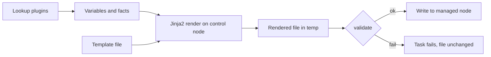

# Jinja2 и lookup-плагины

Шаблоны превращают переменные в конфигурацию, а lookup-плагины получают данные на control node. Обе возможности мощные и одновременно опасные: шаблон может раскрыть секрет, а lookup — прочитать файл или выполнить команду на управляющем узле.

## 1. Зачем это нужно

Конфигурация филиала редко состоит из статических файлов. Нужно подставить адреса DNS, список NTP-серверов, баннер, параметры прокси и сертификаты. Jinja2 позволяет делать это декларативно, а `validate` — проверить результат до применения. Lookup-плагины дают доступ к внешним источникам без копирования данных в Git.

Правило безопасности: шаблон и lookup выполняются на control node, который видит все секреты и ключи. Поэтому источник данных должен быть доверенным, а вывод — минимально необходимым.

## 2. Ключевые понятия

| Понятие | Назначение | Пример |
|---|---|---|
| Template | файл Jinja2, рендерится в конфиг | `sshd_config.j2` |
| Filter | преобразование значения | `default`, `join`, `to_json` |
| Test | проверка условия | `is defined`, `is version` |
| Lookup | получение данных на control node | `file`, `env`, `template` |
| `query` | lookup, всегда возвращающий список | `query('file', path)` |
| `validate` | проверка конфига до записи | `sshd -t -f %s` |
| `ansible_managed` | маркер управляемого файла | `# {{ ansible_managed }}` |
| `!unsafe` | запрет шаблонизации строки | `!unsafe "{{ literal }}"` |

## 3. Схема обработки шаблона



`validate` выполняется с временным файлом до записи. Если проверка не проходит, целевой файл остаётся прежним — это ключевая защита для SSH, sudo и nginx.

## 4. Безопасный шаблон

`templates/issue.net.j2`:

```jinja2
# {{ ansible_managed }}
Authorized access only.
Host: {{ inventory_hostname }}
Branch: {{ branch_code | default('unknown') }}
Support: {{ support_contact | default('it@example.local') }}
```

Playbook:

```yaml
---
- name: Render access banner
  hosts: branches
  become: true
  gather_facts: false

  vars:
    branch_code: "{{ lookup('env', 'BRANCH_CODE') | default('lab', true) }}"
    support_contact: "it@example.local"

  tasks:
    - name: Deploy issue banner
      ansible.builtin.template:
        src: templates/issue.net.j2
        dest: /etc/issue.net
        owner: root
        group: root
        mode: "0644"
        backup: true
```

`backup: true` создаёт резервную копию рядом с файлом. Это удобно для аудита, но требует места и регламента очистки. Для секретов backup опасен: копия может остаться с широкими правами.

## 5. Фильтры и тесты

| Конструкция | Результат |
|---|---|
| `value \| default('x')` | `x`, если значение не определено |
| `value \| default('x', true)` | `x`, если значение пустое или не определено |
| `value \| mandatory` | ошибка, если значение не задано |
| `list \| join(', ')` | строка из элементов |
| `dict \| combine(other)` | объединённый словарь |
| `value \| to_json` | JSON-строка |
| `text \| regex_replace('a', 'b')` | замена по регулярному выражению |
| `value is defined` | проверка наличия |
| `value is version('3.7', '>=')` | сравнение версий |
| `text is match('^ssh')` | совпадение с начала строки |
| `text is search('ssh')` | поиск подстроки |

Пример:

```yaml
- name: Show normalized values
  ansible.builtin.debug:
    msg:
      - "packages={{ baseline_packages | join(', ') }}"
      - "services={{ enabled_services | select('match', '^ssh') | list }}"
      - "payload={{ {'branch': branch_code, 'host': inventory_hostname} | to_json }}"
```

`b64encode` — кодирование, а не шифрование. Не используйте его для защиты секретов.

## 6. Lookup-плагины

```yaml
- name: Read public CA certificate from control node
  ansible.builtin.set_fact:
    ca_certificate: "{{ lookup('file', 'files/ca.crt') }}"

- name: Read API token from environment
  ansible.builtin.set_fact:
    api_token: "{{ lookup('env', 'API_TOKEN') }}"
  no_log: true

- name: Render a template into a variable
  ansible.builtin.set_fact:
    motd_preview: "{{ lookup('template', 'templates/issue.net.j2') }}"
```

`lookup` возвращает строку или первый элемент; `query` всегда возвращает список. Для нескольких файлов используйте `query('file', item)` в цикле.

`lookup('env')` удобен в CI, но переменные окружения наследуются процессами и могут попасть в дампы. Для продакшена предпочтительнее vault или credentials платформы.

## 7. Опасные lookup-плагины

| Плагин | Риск | Рекомендация |
|---|---|---|
| `pipe` | выполняет команду на control node | запретить в ревью, использовать модули |
| `url` | сетевой запрос с учётными данными | только доверенные URL, таймауты |
| `file` | читает любой доступный файл control node | ограничить путь, не брать из переменной пользователя |
| `template` | рендерит произвольный шаблон | фиксированные имена, доверенный репозиторий |
| `password` | создаёт и хранит пароль в файле | управлять правами и ротацией |

Плагин `pipe` в playbook из недоверенного репозитория — это выполнение произвольного кода на control node. Ревью должно блокировать такие конструкции, как и `shell` с внешним вводом.

## 8. Защита от инъекций

- Не подставляйте пользовательский ввод в `shell` без `| quote`.
- Для команд используйте `ansible.builtin.command` с `argv`, а не склейку строк.
- Не передавайте имя файла из переменной в `lookup('file')` без allow-list.
- Для строк, которые должны остаться литералами, используйте `!unsafe`.
- Секреты помечайте `no_log: true` и не выводите в `debug`.
- Шаблоны с секретами не коммитьте в открытый репозиторий.

```yaml
- name: Run a fixed command safely
  ansible.builtin.command:
    argv:
      - /usr/bin/logger
      - "-t"
      - ansible
      - "branch={{ branch_code }}"
  changed_when: false
```

## 9. Проверка результата

```bash
ansible-playbook -i inventories/prod/hosts.yml banner.yml --check --diff --limit msk-app01
ansible-playbook -i inventories/prod/hosts.yml banner.yml --limit msk-app01
ansible msk-app01 -m ansible.builtin.command -a "cat /etc/issue.net" --check
```

Для конфигов с `validate` проверьте, что при заведомо неверном шаблоне задача падает, а файл на хосте не меняется. Это упражнение лучше выполнить в лаборатории.

## 10. Безопасность и blast radius

| Риск | Последствие | Мера |
|---|---|---|
| Секрет в шаблоне | утечка в файл и backup | vault, `no_log`, ограничение прав |
| `pipe` lookup | выполнение кода на control node | запрет в ревью |
| `lookup('file')` с внешним путём | чтение произвольного файла | allow-list путей |
| `validate` отсутствует | сломанный конфиг применён | `validate` для SSH, sudo, nginx |
| Широкий шаблон на все хосты | неверный конфиг во всех филиалах | canary, `serial`, diff |
| `backup: true` для секретов | копия с секретом | отключить или защитить каталог |

## 11. Комплаенс-маппинг

| Требование | Как закрывается |
|---|---|
| CIS Control 4 | проверенные шаблоны и `validate` |
| NIST CSF 2.0 PR.PS | управляемая конфигурация |
| ISO/IEC 27001:2022 A.8.9 | версионирование шаблонов |
| Аудит | Git-история шаблонов, `--check --diff` |

## 12. Типичные ошибки и troubleshooting

| Симптом | Причина | Проверка | Решение |
|---|---|---|---|
| `undefined variable` в шаблоне | переменная не передана | `ansible-playbook -vvv` | добавить `default` или переменную |
| Шаблон не найден | неверный путь поиска | вывод задачи | указать путь от playbook или роли |
| Лишние пустые строки | настройки trim_blocks | сравнить diff | использовать `trim_blocks`/`lstrip_blocks` |
| `validate` падает | синтаксис конфига | запустить команду вручную | исправить шаблон |
| Lookup читает не тот файл | относительный путь | `-vvv` | использовать абсолютный путь или `playbook_dir` |
| Секрет в логе | нет `no_log` | просмотреть вывод | добавить `no_log`, ротировать секрет |

## 13. Чек-лист

- [ ] Для каждого конфига с риском синтаксиса задан `validate`.
- [ ] Шаблоны не содержат секретов в открытом виде.
- [ ] Lookup-плагины работают только с доверенными источниками.
- [ ] `pipe` и `url` lookup обоснованы и проверены на ревью.
- [ ] Пользовательский ввод не попадает в `shell` без экранирования.
- [ ] `backup` для секретных файлов отключён или защищён.
- [ ] Изменение проверено через `--check --diff` и canary.

## 14. Источники

- [Templating (Jinja2)](https://docs.ansible.com/ansible/latest/playbook_guide/playbooks_templating.html)
- [Filters](https://docs.ansible.com/ansible/latest/playbook_guide/playbooks_filters.html)
- [Tests](https://docs.ansible.com/ansible/latest/playbook_guide/playbooks_tests.html)
- [Lookups](https://docs.ansible.com/ansible/latest/playbook_guide/playbooks_lookups.html)
- [ansible.builtin.template](https://docs.ansible.com/ansible/latest/collections/ansible/builtin/template_module.html)

## 15. Связанные страницы

- [Переменные, факты и приоритеты](06-variables.md)
- [Управление секретами](../secure-dev/11-secrets.md)
- [Безопасная разработка playbook](../secure-dev/13-safe-code.md)
- [Playbooks, roles, handlers](07-playbooks-roles.md)
- [Диагностика и troubleshooting](../ops/60-troubleshooting.md)
