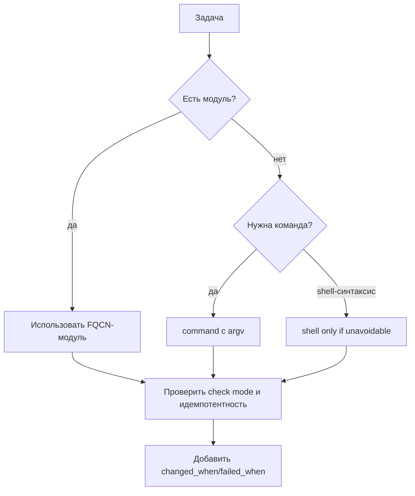

# Модули и FQCN

Модуль — единица работы Ansible. Полное имя (FQCN) указывает коллекцию и модуль, а корректные параметры и проверки превращают вызов в идемпотентную операцию. Выбор между модулем и `shell` — это выбор между управляемым состоянием и произвольной командой.

## 1. Зачем это нужно

Одна и та же задача «создать пользователя» решается модулем `ansible.builtin.user` или командой `useradd`. Первый вариант идемпотентен, поддерживает check mode и возвращает структурированный результат. Второй — меняет систему при каждом запуске и требует ручной обработки ошибок. В парке из сотен хостов такая разница определяет, можно ли доверять повторным прогонам.

FQCN устраняет неоднозначность: `copy` может быть встроенным, а `community.general.copy` — другим модулем. Полное имя делает зависимости явными и позволяет `ansible-lint` проверить коллекцию.

## 2. Ключевые понятия

| Понятие | Назначение |
|---|---|
| Module | выполняет операцию на managed node или через API |
| Action plugin | выполняет логику на control node до/после модуля |
| FQCN | `namespace.collection.module`, обязательная форма |
| Idempotency | повторный запуск не меняет систему |
| Check mode | предсказание изменений без записи |
| `register` | сохранение результата задачи в переменную |
| `changed_when` | правило определения изменения |
| `failed_when` | правило определения ошибки |
| `creates` | пропуск команды, если путь существует |
| `removes` | пропуск команды, если путь отсутствует |

## 3. Схема выбора



Порядок приоритетов: специализированный модуль → `ansible.builtin.command` → `ansible.builtin.shell`. Чем левее вариант, тем лучше предсказуемость и безопасность.

## 4. Типовые модули

| Задача | FQCN | Коллекция |
|---|---|---|
| Установить пакеты | `ansible.builtin.package` | ansible.builtin |
| Управлять репозиторием dnf | `ansible.builtin.dnf` | ansible.builtin |
| Управлять apt | `ansible.builtin.apt` | ansible.builtin |
| Создать пользователя | `ansible.builtin.user` | ansible.builtin |
| Создать группу | `ansible.builtin.group` | ansible.builtin |
| Скопировать файл | `ansible.builtin.copy` | ansible.builtin |
| Отрендерить шаблон | `ansible.builtin.template` | ansible.builtin |
| Управлять сервисом | `ansible.builtin.service` | ansible.builtin |
| Проверить путь | `ansible.builtin.stat` | ansible.builtin |
| Изменить sysctl | `ansible.posix.sysctl` | ansible.posix |
| Настроить SELinux | `ansible.posix.selinux` | ansible.posix |
| Управлять cron | `ansible.builtin.cron` | ansible.builtin |
| Управлять sudoers | `community.general.sudoers` | community.general |

Перед использованием проверьте документацию именно своей версии коллекции: параметры меняются между мажорными версиями.

```bash
ansible-doc ansible.builtin.user
ansible-doc -l | grep -i firewall
ansible-doc -t lookup ansible.builtin.file
```

## 5. Идемпотентность: плохо и хорошо

Плохо:

```yaml
- name: Create service user with shell
  ansible.builtin.shell: useradd -r -s /usr/sbin/nologin svc-reporting
```

Проблемы: команда выполняется каждый раз, при повторном запуске падает с `useradd: user 'svc-reporting' already exists`, check mode не отражает реальность, результат зависит от оболочки.

Хорошо:

```yaml
- name: Ensure service group exists
  ansible.builtin.group:
    name: svc-reporting
    system: true
    state: present

- name: Ensure service user exists
  ansible.builtin.user:
    name: svc-reporting
    group: svc-reporting
    system: true
    shell: /usr/sbin/nologin
    create_home: false
    state: present
```

Повторный запуск возвращает `changed=0`, check mode показывает только недостающие изменения.

## 6. Полный пример

```yaml
---
- name: Prepare reporting service account
  hosts: branches
  become: true
  gather_facts: true

  vars:
    service_user: svc-reporting
    service_group: svc-reporting
    reporting_dir: /var/lib/reporting
    ssh_service: "{{ 'ssh' if ansible_facts['os_family'] == 'Debian' else 'sshd' }}"

  tasks:
    - name: Ensure service group exists
      ansible.builtin.group:
        name: "{{ service_group }}"
        system: true
        state: present

    - name: Ensure service user exists
      ansible.builtin.user:
        name: "{{ service_user }}"
        group: "{{ service_group }}"
        system: true
        shell: /usr/sbin/nologin
        create_home: false
        state: present

    - name: Check reporting directory
      ansible.builtin.stat:
        path: "{{ reporting_dir }}"
      register: reporting_stat

    - name: Create reporting directory when missing
      ansible.builtin.file:
        path: "{{ reporting_dir }}"
        state: directory
        owner: "{{ service_user }}"
        group: "{{ service_group }}"
        mode: "0750"
      when: not reporting_stat.stat.exists

    - name: Initialize reporting marker
      ansible.builtin.command:
        argv:
          - /usr/bin/install
          - "-m"
          - "0640"
          - "/dev/null"
          - "{{ reporting_dir }}/.initialized"
        creates: "{{ reporting_dir }}/.initialized"

    - name: Check SSH service state
      ansible.builtin.command:
        argv:
          - systemctl
          - is-active
          - "{{ ssh_service }}"
      register: sshd_state
      changed_when: false
      failed_when: sshd_state.rc not in [0, 3]
```

`command` с `creates` пропускается, если маркер уже существует. `systemctl is-active` возвращает код 3 для неактивного сервиса; это не ошибка, поэтому `failed_when` допускает 0 и 3.

## 7. Check mode и возвращаемые значения

```bash
ansible-playbook -i inventories/prod/hosts.yml site.yml --check --diff
```

Не все модули поддерживают check mode. `command` и `shell` в check mode обычно пропускаются, если не заданы `creates`/`removes`. Если модуль не умеет предсказывать изменение, он может вернуть `changed=true` без реального действия — это повод проверить документацию, а не отключать проверку.

`register` сохраняет результат:

| Поле | Значение |
|---|---|
| `rc` | код возврата команды |
| `stdout` | стандартный вывод |
| `stdout_lines` | вывод построчно |
| `stderr` | ошибки |
| `changed` | было ли изменение |
| `failed` | считается ли задача ошибочной |
| `skipped` | была ли задача пропущена |

Не выводите `register` целиком, если команда может вернуть секрет.

## 8. Безопасность и blast radius

| Риск | Последствие | Мера |
|---|---|---|
| `shell` с внешним вводом | инъекция команд | `command` + `argv`, allow-list |
| `creates` как средство безопасности | обход проверки | использовать права и модули |
| `ignore_errors: true` | скрытая ошибка и частичное состояние | `failed_when` с явным условием |
| `no_log` без необходимости | потеря диагностики | только для секретов |
| `changed_when: false` на изменяющей команде | ложный `ok`, дрейф не виден | применять только к read-only |
| Непроверенная коллекция | вредоносный модуль | requirements.yml, ревью, подпись |

`command` не вызывает shell, поэтому не раскрывает `$VAR`, не выполняет pipe и redirect. Это делает его безопаснее, но не отменяет проверку аргументов.

## 9. Комплаенс-маппинг

| Требование | Как закрывается |
|---|---|
| CIS Control 4 | декларативные модули и предсказуемая конфигурация |
| NIST CSF 2.0 PR.PS | управляемые изменения |
| ISO/IEC 27001:2022 A.8.9 | версионирование ролей и коллекций |
| Аудит | `--check --diff`, журнал запусков |

## 10. Типичные ошибки и troubleshooting

| Симптом | Причина | Проверка | Решение |
|---|---|---|---|
| `couldn't resolve module` | неверный FQCN или коллекция не установлена | `ansible-doc` | установить коллекцию, исправить имя |
| `Unsupported parameters` | параметр из другой версии | `ansible-doc модуль` | привести параметры к версии |
| Задача всегда `changed` | команда без `changed_when` | повторный прогон | использовать модуль или `changed_when` |
| Check mode ничего не показывает | команда без `creates` | вывод `--check` | добавить `creates` или принять ограничение |
| `command` не находит файл | другой `PATH` | `-vvv` | использовать абсолютный путь |
| `failed_when` не срабатывает | неверное выражение | `debug` с `rc` | исправить условие |

## 11. Чек-лист

- [ ] Все модули указаны через FQCN.
- [ ] Для задачи выбран модуль, а не `shell`.
- [ ] `command` использует `argv`, а не склейку строк.
- [ ] Для команд заданы `creates`, `changed_when` или `failed_when`.
- [ ] Повторный запуск даёт `changed=0`.
- [ ] `--check --diff` отражает планируемые изменения.
- [ ] Секреты не попадают в `register` и лог.
- [ ] Коллекции зафиксированы в `requirements.yml`.

## 12. Источники

- [Ansible modules](https://docs.ansible.com/ansible/latest/plugins/module.html)
- [ansible.builtin.command](https://docs.ansible.com/ansible/latest/collections/ansible/builtin/command_module.html)
- [ansible.builtin.shell](https://docs.ansible.com/ansible/latest/collections/ansible/builtin/shell_module.html)
- [Return values](https://docs.ansible.com/ansible/latest/reference_appendices/common_return_values.html)
- [Check mode](https://docs.ansible.com/ansible/latest/playbook_guide/playbooks_checkmode.html)

## 13. Связанные страницы

- [Playbooks, roles, handlers](07-playbooks-roles.md)
- [Безопасная разработка playbook](../secure-dev/13-safe-code.md)
- [Управление Linux](../admin/21-os-management.md)
- [Анти-паттерны](../ops/62-antipatterns.md)
- [Диагностика и troubleshooting](../ops/60-troubleshooting.md)
