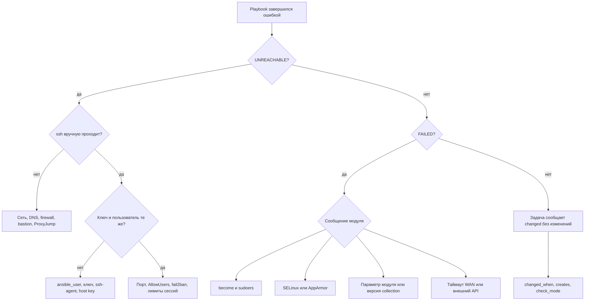

# Диагностика и troubleshooting

Диагностика в Ansible почти всегда идёт по одной схеме: отделить сеть и аутентификацию от логики playbook, затем сузить проблему до конкретного слоя — соединение, привилегии, интерпретатор, политика безопасности, внешний API. Страница собирает деревья решений и таблицы «симптом → причина → проверка → решение» для типовых отказов в филиальной сети на 200–1000 хостов.

## Зачем это нужно

Playbook, который работает в лаборатории, падает в филиале из-за таймаута WAN, SELinux или версии Python. Без системного порядка инженер начинает менять playbook наугад и увеличивает blast radius. Порядок экономит время и защищает инфраструктуру: сначала факты, потом гипотезы, потом минимальное изменение с проверкой.

Три правила диагностики:

1. Сначала воспроизведите отказ на одном хосте и одним тегом, а не на всей группе.
2. Проверяйте слой за слоем: SSH → аутентификация → привилегии → Python → модуль → политика ОС.
3. Любая диагностическая команда должна быть read-only. Изменения — отдельным шагом после подтверждённой причины.

## Ключевые понятия

| Понятие | Что означает | Где проявляется |
|---|---|---|
| `UNREACHABLE` | не удалось установить соединение или аутентифицироваться | SSH, bastion, firewall, host key |
| `FAILED` | модуль выполнился и вернул ошибку | привилегии, SELinux, параметры модуля |
| Verbosity | уровень детализации `-v`…`-vvvv` | SSH-команды, модуль, API-вызовы |
| Interpreter discovery | поиск Python на управляемом узле | `discovered_interpreter_python` |
| `become` | повышение привилегий через sudo | пароль, sudoers, `requiretty` |
| Task debugger | интерактивная остановка на ошибке | отладка переменных и аргументов |
| Callback plugin | перехват и форматирование событий | аудит, профилирование, JSON-логи |
| Persistent connection | долгоживущая сессия для сетевых устройств | `network_cli`, `ansible_command_timeout` |

## Дерево решений



На схеме важен порядок: сначала исключается транспорт, затем привилегии и политика ОС, и только потом правится код. Переход к правке playbook до проверки SSH — самая частая потеря времени.

## Инструментарий

| Инструмент | Команда | Что показывает |
|---|---|---|
| Проверка связи | `ansible all -m ansible.builtin.ping` | доступность и рабочий Python |
| Подробный SSH | `ansible branch_msk -m ansible.builtin.ping -vvv` | точная команда `ssh`, коды возврата |
| Конфигурация | `ansible-config dump --only-changed` | фактические значения и источник |
| Inventory | `ansible-inventory --graph`, `--host msk-app01` | состав групп и переменные хоста |
| Список задач | `ansible-playbook site.yml --list-tasks --list-hosts` | что и где будет выполнено |
| Синтаксис | `ansible-playbook site.yml --syntax-check` | ошибки разбора и найденные роли |
| Dry run | `--check --diff` | планируемые изменения без применения |
| Факты | `ansible msk-app01 -m ansible.builtin.setup -a "filter=ansible_python_version"` | версия интерпретатора |

`-vvvv` дополнительно печатает вызовы API модулей и содержимое временных файлов. На хостах с секретами такой вывод может содержать чувствительные данные: не публикуйте его в тикетах без очистки, а для задач с секретами используйте `no_log: true`.

## SSH: симптом, причина, проверка, решение

| Симптом | Причина | Проверка | Решение |
|---|---|---|---|
| `UNREACHABLE! ... Failed to connect to the host via ssh` | нет маршрута, закрыт порт, неверный адрес | `ssh -vv -o ConnectTimeout=10 svc-ansible@192.0.2.31` | исправить `ansible_host`, открыть порт, использовать bastion |
| `Permission denied (publickey)` | ключ не тот или не в `authorized_keys` | `ssh -vv -i ~/.ssh/ansible_ed25519 ...` | указать `ansible_ssh_private_key_file`, проверить права `0700/0600` |
| `Host key verification failed` | ключ хоста сменился или неизвестен | `ssh-keyscan -t ed25519 192.0.2.31` | сверить отпечаток с CMDB, обновить `known_hosts`, не отключать проверку |
| `Connection timed out during banner exchange` | перегрузка, MTU, промежуточный firewall | `ssh -vv`, `ping -M do -s 1400` | снизить MSS, увеличить `timeout`, проверить WAN |
| `Too many authentication failures` | ssh-agent предлагает много ключей | `ssh -vv` | `IdentitiesOnly=yes`, явный `-i` |
| Подключение есть, задач нет | неверный `ansible_user` или `remote_user` | `ansible-inventory --host` | задать пользователя в `group_vars` |

Типовой набор опций для нестабильного WAN задаётся в `group_vars/branches.yml`:

```yaml
---
ansible_ssh_common_args: >-
  -o ConnectTimeout=20
  -o ServerAliveInterval=30
  -o ServerAliveCountMax=3
  -o IdentitiesOnly=yes
```

Эти опции не отключают проверку ключа хоста и не ослабляют криптографию. Подробнее о доступе — [Доступ и привилегии](../secure-dev/12-access.md), о филиальных задержках — [Распределённые филиалы](../admin/20-branch-fleet.md).

## become и привилегии

| Симптом | Причина | Проверка | Решение |
|---|---|---|---|
| `Missing sudo password` | нужен пароль, а он не передан | `sudo -n true` на хосте | `--ask-become-pass` или `ansible_become_password` из vault |
| `sudo: a terminal is required` | в sudoers включён `requiretty` | `grep -r requiretty /etc/sudoers*` | убрать `requiretty` для сервисной учётки, согласовать с ИБ |
| `Sorry, user ... is not allowed to execute` | нет правила sudo | `sudo -l -U svc-ansible` | добавить узкое правило с `validate: "visudo -cf %s"` |
| `Incorrect sudo password` | пароль в vault устарел | ротация в vault | обновить секрет, проверить `no_log` |
| Задача работает без `become` | привилегии не нужны или уже есть | `id`, `sudo -l` | не включать `become` глобально |

`become` включайте на конкретных задачах или блоках. Глобальный `become: true` на весь play — анти-паттерн, он расширяет blast radius и усложняет аудит; разбор — в [Анти-паттерны](62-antipatterns.md).

## Python interpreter

| Симптом | Причина | Проверка | Решение |
|---|---|---|---|
| `/usr/bin/python: not found` | на узле только `python3` | `ansible host -m ansible.builtin.raw -a "command -v python3"` | `ansible_python_interpreter: /usr/bin/python3` |
| `The module failed to execute correctly` | найден неподходящий интерпретатор | `ansible host -m setup -a "filter=ansible_python_version"` | задать интерпретатор для группы |
| Ошибка `SyntaxError` в модуле | Python 3.6 на RHEL 8 | `raw: python3 --version` | установить `python39`, указать `/usr/bin/python3.9` |
| `No module named apt` | нет `python3-apt` | `raw: dpkg -l python3-apt` | установить пакет |
| Разные версии на хостах одной группы | discovery выбрал разные бинарники | `-vvv`, строка `discovered_interpreter_python` | зафиксировать `ansible_python_interpreter` в `group_vars` |

Проверка без Python на узле:

```yaml
---
- name: Check interpreter on managed nodes
  hosts: branches
  gather_facts: false

  tasks:
    - name: Read python3 version over raw SSH
      ansible.builtin.raw: python3 -c "import sys; print(sys.version.split()[0])"
      register: py
      changed_when: false
      failed_when: false

    - name: Report result
      ansible.builtin.debug:
        msg: "{{ inventory_hostname }}: {{ py.stdout | default('no python3') }} (rc={{ py.rc }})"
```

Для RHEL 8 используйте `python3.9` в `raw` и `/usr/bin/python3.9` в `ansible_python_interpreter`. Детали установки — в [Установка и версионирование](../fundamentals/03-install.md).

## SELinux

SELinux блокирует доступ, даже когда права `rwx` и владелец корректны. Признак — `Permission denied` при верных правах и запись `AVC` в audit log.

| Симптом | Причина | Проверка | Решение |
|---|---|---|---|
| Сервис не читает файл | неверный контекст после копирования | `ls -Z /path`, `matchpathcon /path` | `restorecon -Rv /path` или правило fcontext |
| Нет доступа к нестандартному порту | порт не размечен для сервиса | `semanage port -l` | `semanage port -a -t http_port_t -p tcp 8080` |
| Запись в каталог запрещена | boolean выключен | `getsebool -a` | включить минимально нужный boolean |
| Ошибка после `template` | файл создан с родительским контекстом | `ausearch -m AVC -ts recent` | `restorecon` в handler или явный `setype` |
| Всё работает после `setenforce 0` | политика действительно мешает | `sestatus` | не отключать SELinux, исправить политику |

Диагностика:

```bash
sudo ausearch -m AVC,USER_AVC -ts today | tail -n 40
sudo sealert -a /var/log/audit/audit.log
sudo semanage fcontext -l | grep /srv/app
```

Идемпотентное управление контекстом:

```yaml
---
- name: Ensure SELinux context for application content
  hosts: branch_app
  become: true

  tasks:
    - name: Set persistent fcontext rule
      community.general.sefcontext:
        target: "/srv/app(/.*)?"
        setype: httpd_sys_content_t
        state: present
      register: fcontext

    - name: Apply context to existing files
      ansible.builtin.command:
        argv: [restorecon, -Rv, /srv/app]
      changed_when: fcontext.changed
      when: fcontext.changed
```

`restorecon` вызывается только при изменении правила, поэтому повторный прогон не даёт `changed`. Подробнее — [Файлы, ACL, SELinux](../admin/23-files-acl-selinux.md).

## Таймауты WAN

| Симптом | Причина | Проверка | Решение |
|---|---|---|---|
| Задачи падают на части хостов | нестабильный канал, потери пакетов | `ping -c 100`, `mtr` | `retries`/`until`, `serial`, локальный execution node |
| `Timeout (12s) waiting for privilege escalation` | медленный sudo или перегрузка | `time`, `-vvv` | увеличить `timeout`, разгрузить хост |
| Обрыв на сборе фактов | большой `setup` на узком канале | время задачи | `gather_facts: false`, факты только по необходимости |
| Раскатка «зависает» | последовательный `serial` на медленных филиалах | вывод play recap | `serial: "10%"`, `strategy: free`, `throttle` |
| Повторный запуск конфликтует | нет идемпотентности | `--check --diff` | исправить задачу, а не увеличивать таймаут |

```yaml
---
- name: Wait for package manager lock
  hosts: branches
  become: true

  tasks:
    - name: Retry dnf transaction on busy lock
      ansible.builtin.dnf:
        name: openssl
        state: latest
      register: dnf_result
      retries: 5
      delay: 15
      until: dnf_result is succeeded
```

`retries` не заменяет исправление причины: если пакетный менеджер занят чужим процессом, повтор лишь маскирует конфликт. Для филиалов с плохим каналом используйте отдельный execution node или `ansible-pull`; сравнение вариантов — в [Распределённые филиалы](../admin/20-branch-fleet.md) и [Масштабирование](../admin/30-scaling.md).

## VMware: ESXi и vCenter API

| Симптом | Причина | Проверка | Решение |
|---|---|---|---|
| `Cannot complete login due to an incorrect user name or password` | неверные учётные данные или истёк пароль сервисной учётки | вход в vSphere Client | обновить credential в vault, проверить срок действия |
| `NoPermission` | роль без нужного привилегии | `vmware_guest_info` | выдать минимальную роль на объект |
| `SSL: CERTIFICATE_VERIFY_FAILED` | самоподписанный сертификат | `openssl s_client -connect vcenter:443` | установить корпоративный CA в trust store, не отключать проверку |
| `vim.fault.TooManyNativeClients` | исчерпаны сессии API | число параллельных задач | снизить `forks`, закрывать сессии, кэшировать факты |
| Задача «висит» на клонировании | долгая операция в vCenter | события задачи в vSphere | `async` с `poll`, увеличить `timeout` |
| Ошибка только на standalone ESXi | нет vCenter-специфичных объектов | вывод модуля | использовать параметры подключения к хосту |

Минимальная проверка доступности API:

```yaml
---
- name: Verify vCenter API and permissions
  hosts: localhost
  gather_facts: false

  tasks:
    - name: Read vCenter about info
      community.vmware.vmware_about_info:
        hostname: "{{ vcenter_hostname }}"
        username: "{{ vcenter_username }}"
        password: "{{ vcenter_password }}"
        validate_certs: true
        port: 443
      register: about

    - name: Show API details
      ansible.builtin.debug:
        var: about.about_info
```

Пароль берётся из vault-переменной, `validate_certs: true` остаётся включённым. Практики харденинга и RBAC — в [Харденинг ESXi/vCenter](../security/40-vmware-hardening.md), жизненный цикл ВМ — в [VMware ESXi и vCenter](../admin/24-vmware-esxi.md).

## Сетевые устройства

| Симптом | Причина | Проверка | Решение |
|---|---|---|---|
| `Unable to automatically determine host network os` | не задан `ansible_network_os` | `ansible-inventory --host sw01` | указать платформу и коллекцию вендора |
| `ssh connection failed` на сетевом устройстве | устройство не поддерживает интерактивный shell | `ssh admin@sw01` вручную | использовать `ansible.netcommon.network_cli` |
| `command timeout` | медленный ответ или большая конфигурация | `ansible_command_timeout` | увеличить таймаут, разбить команды |
| «Залипшая» сессия | persistent connection не закрыт | `show users` на устройстве | `ansible.builtin.meta: reset_connection` |
| Изменение применилось частично | нет проверки конфигурации | `cli_config` с diff | сделать бэкап, применить с `serial: 1`, сверить diff |
| Неверный контекст прав | нет AAA-роли | `show privilege` | настроить AAA и least privilege |

```yaml
---
- name: Collect network device facts safely
  hosts: switches
  gather_facts: false
  connection: ansible.netcommon.network_cli

  tasks:
    - name: Read version output
      ansible.netcommon.cli_command:
        command: show version
      register: version_out
      changed_when: false

    - name: Store output for audit
      ansible.builtin.copy:
        content: "{{ version_out.stdout }}\n"
        dest: "artifacts/{{ inventory_hostname }}-version.txt"
        mode: "0640"
      delegate_to: localhost
```

`cli_command` не меняет устройство, поэтому `changed_when: false` корректен. Массовые изменения с откатом описаны в [Сетевые устройства](../admin/26-network-devices.md).

## ansible-pull

| Симптом | Причина | Проверка | Решение |
|---|---|---|---|
| `git: command not found` | не установлен git | `command -v git` | установить `git` |
| `Host key verification failed` при клонировании | неизвестен SSH-ключ Git-сервера | `ssh -T git@git.example.internal` | добавить ключ в `known_hosts` или `--accept-host-key` |
| Playbook не находит inventory | не указан локальный inventory | вывод `-vvv` | `-i localhost, -c local` |
| Запуск каждую минуту создаёт нагрузку | слишком частый таймер | `systemctl list-timers` | интервал 15–60 минут, `-f` только при необходимости |
| Изменения не применяются | выбрана не та ветка | `-C main`, лог в `/var/log` | зафиксировать ветку, логировать вывод |
| Нет аудита | вывод уходит в cron-почту | журнал | писать лог в файл и отправлять в SIEM |

```bash
sudo ansible-pull -U https://git.example.internal/ansible/site.git \
  -C main -d /var/lib/ansible/pull -i localhost, -c local \
  --accept-host-key site.yml
```

`ansible-pull` уместен в филиалах без обратной связности, но он выполняется с правами локального пользователя и тянет код из сети: репозиторий должен быть защищён, ветка — подписанной и проверяемой CI. Сценарии air-gapped обновлений — в [Air-gapped среды](../security/48-airgap.md).

## Отладка playbook

`-vvv` показывает команды, `--check --diff` — планируемые изменения, но не состояние переменных в момент сбоя. Для этого служит task debugger:

```yaml
---
- name: Reproduce failure on one host
  hosts: msk-app01
  gather_facts: true
  debugger: on_failed

  tasks:
    - name: Apply configuration template
      ansible.builtin.template:
        src: app.conf.j2
        dest: /etc/app/app.conf
        validate: "/usr/bin/app --check-config %s"
```

Запуск с включённым отладчиком:

```bash
ANSIBLE_ENABLE_TASK_DEBUGGER=true ansible-playbook -i inventories/prod/hosts.yml site.yml --limit msk-app01
```

В приглашении доступны `p result`, `p task.args`, `p task_vars['inventory_hostname']`, `redo`, `continue`, `quit`. `p` печатает значение выражения, `redo` повторяет задачу после изменения аргументов через `update_task`. Не запускайте отладчик на группе хостов: он останавливает выполнение и ждёт ввода.

Callback-плагины дают тайминги и машиночитаемый вывод:

```ini
[defaults]
stdout_callback = ansible.posix.debug
callbacks_enabled = ansible.posix.profile_tasks, ansible.posix.timer
```

`profile_tasks` показывает самые долгие задачи — это первый шаг оптимизации медленной раскатки. Для аудита используйте JSON-логи и отправку в SIEM, как описано в [Аудит выполнения](../secure-dev/16-audit-logging.md).

## Безопасность и blast radius

| Действие | Blast radius | Мера |
|---|---|---|
| `-vvvv` на боевом inventory | секреты в выводе и логах | `no_log`, очистка вывода перед публикацией |
| Отключение `host_key_checking` | MITM между control node и узлом | не отключать, обновлять `known_hosts` |
| `validate_certs: false` для vCenter | перехват учётных данных API | установить CA, проверку не отключать |
| `setenforce 0` для «проверки» | снятие мандатного контроля на хосте | диагностика через `ausearch`, политику исправлять |
| Отладчик на группе | остановка раскатки, раскрытие переменных | только `--limit` на один хост |
| Повтор задачи с `ignore_errors` | скрытый отказ, дрейф конфигурации | убрать, обработать через `failed_when` |

Диагностика не должна менять систему. Если для проверки требуется изменение, оформляйте его как обычный change с `--check --diff`, `serial: 1` и планом отката.

## Комплаенс-маппинг

| Требование | Как связано с диагностикой |
|---|---|
| ISO/IEC 27001:2022, A.8.16 (мониторинг) | журналы запусков и алерты о сбоях |
| ISO/IEC 27001:2022, A.8.32 (управление изменениями) | разбор изменений только через check/diff и тикет |
| NIST CSF 2.0, DE.CM | обнаружение отказов и аномалий выполнения |
| CIS Controls v8, Control 8 (аудит-логи) | сохранение и защита диагностических данных |
| Внутренний регламент | запрет `setenforce 0`, `validate_certs: false`, `host_key_checking=False` |

## Типичные ошибки диагностики

| Ошибка | Последствие | Как правильно |
|---|---|---|
| Править playbook до проверки SSH | потеря времени, лишние изменения | сначала `ssh -vv`, потом код |
| Запускать на всей группе | массовый отказ | `--limit` на один хост |
| Игнорировать `changed` | незамеченный дрейф | `--check --diff` и разбор `changed` |
| Смотреть только `msg` | пропущена причина в `stderr` | читать `result`, `stderr`, `rc` |
| Отключать SELinux или firewall | ослабление защиты | исправлять политику и правила |
| Хранить пароли в `extra-vars` | утечка в истории shell и логах | vault или внешний секрет-менеджер |

## Чек-лист

- [ ] Отказ воспроизведён на одном хосте через `--limit`.
- [ ] Проверены `ansible --version` и `ansible-config dump --only-changed`.
- [ ] SSH-доступ проверен вручную с теми же ключом и пользователем.
- [ ] Для задачи с `become` проверены sudoers и способ передачи пароля.
- [ ] Версия Python на узле соответствует требованиям ansible-core.
- [ ] При `Permission denied` проверены контексты SELinux и AVC-записи.
- [ ] Для WAN-сбоев проверены таймауты, `retries` и размер `serial`.
- [ ] Для VMware проверены сертификат, права роли и лимит сессий API.
- [ ] Для сетевых устройств задан `ansible_network_os` и таймаут команд.
- [ ] Вывод с `-vvv` очищен от секретов перед публикацией.
- [ ] Причина устранена, а не замаскирована `ignore_errors` или повтором.

## Источники

- [Ansible troubleshooting](https://docs.ansible.com/ansible/latest/reference_appendices/troubleshooting.html)
- [Debugging Ansible playbooks](https://docs.ansible.com/ansible/latest/playbook_guide/playbooks_debugger.html)
- [Ansible configuration settings](https://docs.ansible.com/ansible/latest/reference_appendices/config.html)
- [Python interpreter discovery](https://docs.ansible.com/ansible/latest/reference_appendices/interpreter_discovery.html)
- [Network connection plugins](https://docs.ansible.com/ansible/latest/network/getting_started/index.html)
- [community.vmware collection](https://docs.ansible.com/ansible/latest/collections/community/vmware/index.html)
- [ansible-pull](https://docs.ansible.com/ansible/latest/cli/ansible-pull.html)
- [SELinux troubleshooting (Red Hat)](https://access.redhat.com/documentation/en-us/red_hat_enterprise_linux/9/html/using_selinux/troubleshooting-problems-related-to-selinux)

## Связанные страницы

- [Архитектура и компоненты](../fundamentals/02-architecture.md)
- [Конфигурация ansible.cfg](../fundamentals/04-config.md)
- [Распределённые филиалы](../admin/20-branch-fleet.md)
- [Сетевые устройства](../admin/26-network-devices.md)
- [VMware ESXi и vCenter](../admin/24-vmware-esxi.md)
- [Аудит выполнения](../secure-dev/16-audit-logging.md)
- [Анти-паттерны](62-antipatterns.md)
- [Шпаргалки](65-cheatsheet.md)
