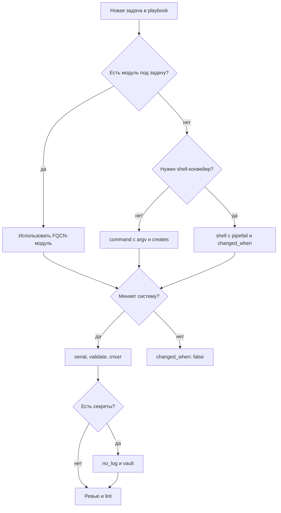

# Анти-паттерны

Анти-паттерн (anti-pattern) — решение, которое работает в демонстрации и создаёт проблему в эксплуатации: скрывает изменения, расширяет привилегии или делает откат невозможным. Ниже восемь пар «плохо/хорошо» с кодом, которые чаще всего встречаются в филиальной автоматизации.

## Зачем это нужно

Один и тот же playbook может быть корректным синтаксически и опасным по смыслу. `shell` вместо модуля ломает идемпотентность, `ignore_errors` скрывает отказ, глобальный `become` превращает ошибку в инцидент на всём парке. Анти-паттерны дороги не в момент написания, а в момент разбора: они маскируют причину и увеличивают blast radius.

Цель страницы — дать ревьюеру и автору конкретные признаки и замену. Каждая пара показывает, что именно теряется в плохом варианте и как выглядит безопасная альтернатива.

## Почему анти-паттерны появляются

Плохие решения редко выбирают осознанно. Обычно их причина — давление сроков и отсутствие быстрого способа проверить результат.

- **Перенос привычек.** Администратор быстрее напишет `shell` с знакомой командой, чем найдёт модуль и его параметры.
- **Копирование примеров.** Фрагмент из статьи под ansible 2.9 попадает в продакшн без адаптации.
- **Отсутствие стенда.** Если проверить изменение негде, автор выбирает «минимальное» решение и обходит проверки.
- **Страх отказа.** `ignore_errors` и `failed_when: false` ставят, чтобы демонстрация прошла успешно, а не чтобы отразить реальность.
- **Размытая ответственность.** Роль без владельца живёт годами, потому что никто не отвечает за её качество.

Анти-паттерн почти всегда виден на ревью, если ревьюер знает, что искать. Поэтому список признаков важнее списка запретов: он превращает субъективное «мне не нравится» в проверяемое замечание.

## Ключевые понятия

| Анти-паттерн | Что ломает | Признак в коде |
|---|---|---|
| `shell` вместо модуля | идемпотентность, переносимость | `ansible.builtin.shell: useradd ...` |
| Нет `changed_when` | достоверность `changed`, handler | `command` без условий |
| Секреты в логах | конфиденциальность | `debug: var`, пароль в аргументах |
| `ignore_errors` | обнаружение отказа | задача продолжает play после сбоя |
| Нет `serial` и отката | blast radius | `hosts: all` без партий |
| Глобальный `become` | least privilege | `become: true` на уровне play |
| Непроверенные роли | цепочка поставок | версия `master` в `requirements.yml` |
| Ad-hoc «снежинки» | воспроизводимость, аудит | изменения вручную вне Git |

## Как отличить опасный код



Схема повторяет порядок ревью: сначала выбор модуля, затем достоверность `changed`, затем границы blast radius и только потом работа с секретами. Такой порядок ловит большинство проблем до запуска.

## Shell вместо модуля

Плохо: команда не проверяет состояние, повторный запуск падает или создаёт дубликат.

```yaml
- name: Create user
  ansible.builtin.shell: useradd -m -s /bin/bash deploy
```

Хорошо: модуль описывает состояние и сам обеспечивает идемпотентность.

```yaml
- name: Ensure deploy user exists
  ansible.builtin.user:
    name: deploy
    shell: /bin/bash
    create_home: true
    state: present
```

Если модуля действительно нет, используйте `ansible.builtin.command` с `argv` и `creates`:

```yaml
- name: Initialize application directory once
  ansible.builtin.command:
    argv: [/usr/local/bin/appctl, init, --root, /srv/app]
    creates: /srv/app/.initialized
```

`creates` делает задачу идемпотентной, а `argv` исключает проблемы с кавычками. `shell` допустим только при необходимости конвейера или перенаправления, с `set -o pipefail` и явным `changed_when`.

## Отсутствие changed_when

Плохо: задача всегда сообщает `changed`, handler перезапускает сервис на каждом прогоне.

```yaml
- name: Check application health
  ansible.builtin.command: /usr/local/bin/appctl health
  notify: Restart app
```

Хорошо: проверка не меняет систему, а изменение фиксируется по реальному результату.

```yaml
- name: Check application health
  ansible.builtin.command:
    argv: [/usr/local/bin/appctl, health]
  register: health
  changed_when: false
  failed_when: health.rc not in [0, 2]
  notify: Restart app

- name: Report unhealthy state
  ansible.builtin.debug:
    msg: "Application reports degraded state"
  when: health.rc == 2
```

Разделение `changed_when` и `failed_when` позволяет отличить «деградацию» от «сбоя проверки». Без этого handler превращается в источник незапланированных перезапусков.

## Секреты в логах

Плохо: пароль попадает в вывод задачи, в `-vvv` и в журнал CI.

```yaml
- name: Configure database connection
  ansible.builtin.template:
    src: db.conf.j2
    dest: /etc/app/db.conf
  vars:
    db_password: "{{ vault_db_password }}"
```

При ошибке шаблона Ansible печатает аргументы задачи, включая содержимое файла. Хорошо: `no_log` на задаче и минимальный объём данных в шаблоне.

```yaml
- name: Configure database connection
  ansible.builtin.template:
    src: db.conf.j2
    dest: /etc/app/db.conf
    owner: root
    group: app
    mode: "0640"
  vars:
    db_password: "{{ vault_db_password }}"
  no_log: true
```

!!! warning "Риск"
`no_log: true` скрывает и полезную диагностику. Указывайте его на задачах, где действительно есть секрет, и не логируйте сами значения через `debug`. Отладочный вывод с `-vvv` может содержать данные даже при `no_log`, если секрет подставлен в `command`.

Правила: секреты только из vault или внешнего менеджера, `debug` не печатает секреты, а `ansible.builtin.uri` использует параметры `url_password` и `url_username`, а не строку URL. Подробнее — [Управление секретами](../secure-dev/11-secrets.md).

## ignore_errors

Плохо: отказ замаскирован, playbook завершается успешно, конфигурация остаётся частичной.

```yaml
- name: Apply kernel parameters
  ansible.posix.sysctl:
    name: net.ipv4.ip_forward
    value: "0"
    state: present
  ignore_errors: true
```

Хорошо: ожидаемая ошибка обрабатывается явно, неожиданная — останавливает раскатку.

```yaml
- name: Apply kernel parameters
  ansible.posix.sysctl:
    name: net.ipv4.ip_forward
    value: "0"
    state: present
    sysctl_file: /etc/sysctl.d/60-baseline.conf
  register: sysctl_result
  failed_when:
    - sysctl_result is failed
    - "'Read-only file system' not in (sysctl_result.msg | default(''))"
```

`failed_when` с конкретным условием документирует известное ограничение. Если отказ допустим, он должен быть виден в отчёте, а не скрыт. Альтернатива для необязательных шагов — `block`/`rescue` с записью в журнал.

## Нет serial и отката

Плохо: изменение применяется ко всем филиалам одновременно, при ошибке откат не предусмотрен.

```yaml
- name: Apply SSH hardening
  hosts: branches
  become: true
  roles:
    - ssh_hardening
```

Хорошо: партии, порог отказов и проверка доступности после каждой партии.

```yaml
- name: Apply SSH hardening in batches
  hosts: branches
  become: true
  serial: 1
  max_fail_percentage: 0
  any_errors_fatal: true

  roles:
    - role: ssh_hardening
      vars:
        ssh_hardening_allow_groups: [sshusers]
```

Для большой раскатки после canary используйте `serial: "10%"`, но сохраняйте низкий `max_fail_percentage`. Откат должен быть описан до запуска: резервная копия конфигурации, вторая сессия, таймер возврата правил firewall. Практики — в [Безопасная разработка playbook](../secure-dev/13-safe-code.md).

## Глобальный become

Плохо: все задачи play выполняются от root, включая чтение фактов и проверки.

```yaml
- name: Configure branch node
  hosts: branches
  become: true
  tasks:
    - name: Read application version
      ansible.builtin.command: /usr/local/bin/appctl version
```

Хорошо: привилегии выдаются только задачам, которым они нужны.

```yaml
- name: Configure branch node
  hosts: branches
  become: false

  tasks:
    - name: Read application version
      ansible.builtin.command:
        argv: [/usr/local/bin/appctl, version]
      register: app_version
      changed_when: false

    - name: Install application package
      ansible.builtin.dnf:
        name: "app-{{ app_version.stdout }}"
        state: present
      become: true
```

Отдельный сервисный пользователь с узким sudo снижает последствия компрометации control node. Требования к sudoers и ключам — в [Доступ и привилегии](../secure-dev/12-access.md).

## Непроверенные сторонние роли

Плохо: роль тянется из ветки по умолчанию, содержимое меняется без ревью.

```yaml
---
roles:
  - name: geerlingguy.nginx
```

Хорошо: источник, версия или коммит зафиксированы, роль проверена.

```yaml
---
roles:
  - name: geerlingguy.nginx
    version: ">=3.0.0,<4.0.0"
collections:
  - name: community.general
    version: ">=9.0.0,<10.0.0"
    source: https://galaxy.ansible.com
```

Проверка перед добавлением: кто владелец, когда последний релиз, какие задачи используют `become`, есть ли обращения к сети, совпадает ли лицензия с политикой. Для коллекций дополнительно выполняется `ansible-galaxy collection verify`. Роль из Git закрепляйте по полному хэшу коммита. Процесс — в [Безопасность цепочки поставок](../secure-dev/15-supply-chain.md).

## Ad-hoc «снежинки»

Плохо: изменение сделано командой на хосте и нигде не зафиксировано.

```bash
ansible branch_msk -m ansible.builtin.shell -a "sed -i 's/^PermitRootLogin.*/PermitRootLogin no/' /etc/ssh/sshd_config" -b
```

Проблемы: нет ревью, нет `validate`, нет записи о том, кто и зачем менял, при следующем прогоне конфигурация вернётся к исходной. Хорошо: изменение оформлено ролью и прошло проверку.

```yaml
- name: Disable direct root login
  ansible.builtin.copy:
    dest: /etc/ssh/sshd_config.d/70-root-login.conf
    content: |
      PermitRootLogin no
    owner: root
    group: root
    mode: "0644"
    validate: "sshd -t -f %s"
  become: true
  notify: Reload sshd
```

Ad-hoc команды допустимы для диагностики и чтения, но не для изменений в продакшене. Любое устойчивое изменение должно попасть в Git и в релизный процесс.

## Цена исправления

Анти-паттерны дешевле исправить сразу, чем после того, как роль разошлась по филиалам. Таблица показывает, во что обходится отсрочка.

| Анти-паттерн | Стоимость сейчас | Стоимость через полгода |
|---|---|---|
| `shell` вместо модуля | 10 минут на замену | переписывание логики и повторная проверка на всех ОС |
| Нет `changed_when` | одна строка | разбор ложных перезапусков и инцидентов |
| Секрет в логе | ротация одного секрета | ротация всех, кто видел лог, и уведомление ИБ |
| `ignore_errors` | удаление флага | поиск хостов с частичной конфигурацией |
| Нет `serial` | добавление параметра | восстановление доступа к филиалам |
| Глобальный `become` | перенос флага | аудит всех задач и пересмотр sudoers |
| Роль с `master` | пин на коммит | проверка всего, что успело примениться |
| Ручные правки | перенос в роль | сверка факта с baseline по всему парку |

Отсрочка почти всегда увеличивает число затронутых хостов, а не уменьшает работу. Поэтому замечания по анти-паттернам не откладывают «на следующий спринт»: они блокируют merge, если затрагивают доступ, секреты или границы раскатки.

## Как закрепить правила в команде

Список запретов работает только вместе с процессом. Три практики дают устойчивый эффект.

- **Шаблон merge request.** В описании есть пункты про идемпотентность, секреты, `serial` и откат. Автор отвечает на них до ревью.
- **Автоматика вместо памяти.** `ansible-lint --profile production` в CI блокирует merge при нарушении правил, а не после инцидента.
- **Разбор инцидентов.** Каждый случай, где анти-паттерн привёл к проблеме, добавляется в этот список с конкретным примером из своей сети.

Правила пересматриваются при изменении baseline: то, что было допустимо на ansible-core 2.9, может быть небезопасно на 2.17. Устаревшие исключения удаляются, иначе список превращается в набор формальностей.

## Проверка

```bash
ansible-lint --profile production site.yml
ansible-playbook -i inventories/prod/hosts.yml site.yml --syntax-check
ansible-playbook -i inventories/prod/hosts.yml site.yml --check --diff
ansible-playbook -i inventories/prod/hosts.yml site.yml --list-tasks
```

`ansible-lint` ловит часть проблем правилами `command-instead-of-module`, `no-changed-when`, `ignore-errors`, `no-log-password`, `risky-file-permissions`. Остальное — зона ревью: границы `become`, наличие отката, происхождение ролей.

Идемпотентность проверяется повторным прогоном: второй запуск должен дать `changed=0` для неизменной системы. Если это не так, ищите `shell`, отсутствие `creates` или шаблон с меняющейся меткой времени.

## Безопасность и blast radius

| Анти-паттерн | Потенциальный ущерб | Снижение риска |
|---|---|---|
| Секрет в логах | компрометация учётных записей | `no_log`, vault, очистка CI-логов |
| `ignore_errors` | незамеченный дрейф | явный `failed_when`, отчёты |
| `hosts: all` без `serial` | отказ всех филиалов | canary, партии, `max_fail_percentage` |
| Глобальный `become` | эскалация при ошибке в шаблоне | точечный `become`, sudoers |
| Роль с `master` | внедрение чужого кода | пин по версии или коммиту, ревью |
| Ручные правки | потеря воспроизводимости | только через Git и релиз |

## Комплаенс-маппинг

| Требование | Как закрывается |
|---|---|
| CIS Control 4 (Secure Configuration) | декларативные модули и управляемая конфигурация |
| NIST CSF 2.0 PR.PS | версионирование, ревью, тестирование изменений |
| ISO/IEC 27001:2022 A.8.32 | процесс изменения и доказательства |
| ISO/IEC 27001:2022 A.5.23 | доверенные источники ролей и коллекций |

## Чек-лист ревью

- [ ] Для каждой задачи выбран модуль, `shell` обоснован.
- [ ] У `command` и `shell` заданы `changed_when`, `creates` или `failed_when`.
- [ ] Секреты не попадают в аргументы, вывод и шаблоны логов.
- [ ] Нет `ignore_errors` без документированной причины.
- [ ] Для рискованных изменений заданы `serial` и план отката.
- [ ] `become` включён только на привилегированных задачах.
- [ ] Все роли и коллекции закреплены по версии или коммиту.
- [ ] Изменения существуют только в Git, ручных правок нет.
- [ ] `ansible-lint --profile production` проходит без ошибок.
- [ ] Повторный прогон даёт `changed=0`.

## Источники

- [Ansible best practices](https://docs.ansible.com/ansible/latest/playbook_guide/playbooks_best_practices.html)
- [Ansible playbook reference](https://docs.ansible.com/ansible/latest/reference_appendices/playbooks_keywords.html)
- [ansible-lint rules](https://ansible.readthedocs.io/projects/lint/rules/)
- [Ansible Vault](https://docs.ansible.com/ansible/latest/playbook_guide/playbooks_vault.html)
- [Handlers](https://docs.ansible.com/ansible/latest/playbook_guide/playbooks_handlers.html)

## Связанные страницы

- [Безопасная разработка playbook](../secure-dev/13-safe-code.md)
- [Тестирование автоматизации](../quality/50-testing.md)
- [Диагностика и troubleshooting](60-troubleshooting.md)
- [Модули и FQCN](../fundamentals/09-modules.md)
- [Playbooks, roles, handlers](../fundamentals/07-playbooks-roles.md)
- [Управление секретами](../secure-dev/11-secrets.md)
