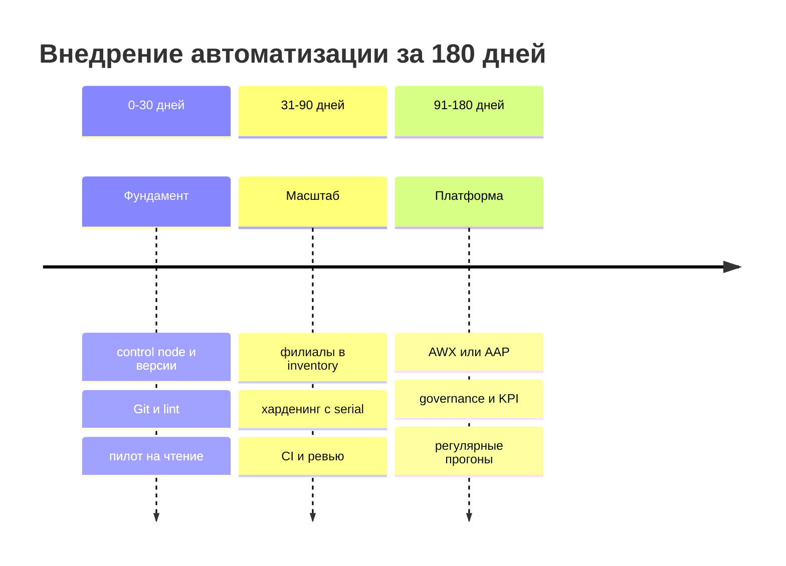

# Дорожная карта внедрения

Внедрение Ansible в распределённой сети редко проваливается из-за технологии. Чаще оно останавливается на этапе, когда пилотные playbook есть, а процесса, владельцев и метрик нет. Дорожная карта задаёт три горизонта — 30, 90 и 180 дней — с проверяемыми результатами на каждом.

## Зачем это нужно

У автоматизации в филиальной сети 200–1000 хостов три источника сопротивления: страх потерять доступ, отсутствие времени у администраторов и недоверие к «скриптам». Карта отвечает на эти возражения последовательно: сначала безопасный пилот только на чтение, затем контролируемые изменения на одном филиале, затем платформа и регламенты. Каждый этап имеет выходной критерий, без которого следующий не начинается.

Карта не является планом проекта в терминах PMI. Это рамка для архитектора и руководителя: какие результаты должны появиться, кто за них отвечает и по каким метрикам видно движение.

## Ключевые понятия

| Понятие | Значение | Как измеряется |
|---|---|---|
| Горизонт | фиксированный отрезок с результатом | 30, 90, 180 дней |
| Выходной критерий (exit criteria) | условие завершения этапа | проверяемый артефакт |
| Пилот | ограниченный по охвату запуск | один филиал, 3–5 сценариев |
| Покрытие | доля хостов и задач под управлением | проценты |
| Дрейф (drift) | расхождение факта с baseline | число хостов с `changed > 0` |
| Change failure rate | доля изменений с откатом | процент от релизов |
| Платформа | AWX, AAP или Semaphore | запуски, RBAC, аудит |
| Governance | правила, роли, исключения | утверждённый регламент |

## Схема этапов



На схеме важен принцип: платформа появляется после того, как процесс уже работает вручную. Автоматизация запуска без регламента просто ускоряет хаос.

## Дорожная карта по этапам

| Период | Цель | Ключевые результаты | Выходной критерий |
|---|---|---|---|
| 0–30 дней | фундамент и доверие | ansible-core 2.17 в venv, Git-репозиторий, inventory пилота, 3–5 read-only сценариев | пилотный отчёт, `--check` без неожиданных изменений |
| 31–60 дней | первые изменения | базовая роль, харденинг на одном филиале, `serial`, откат | успешный canary и повторный прогон с `changed=0` |
| 61–90 дней | масштаб и контроль | все филиалы в inventory, CI с lint и Molecule, ревью, секреты в vault | 100% хостов отвечают на `ping`, релизы через pipeline |
| 91–120 дней | платформа | AWX или AAP, credentials, RBAC, шаблоны запусков | запуск из платформы с аудитом, без локальных ключей |
| 121–150 дней | регулярность | периодические прогоны, отчёты о дрейфе, алертинг | еженедельный отчёт, дрейф ниже целевого |
| 151–180 дней | устойчивость | governance, KPI, обучение, план развития | утверждённый регламент, метрики за квартал |

### Этап 0–30 дней: фундамент

Задача этапа — доказать безопасность подхода, а не покрыть как можно больше задач. Выберите сценарии, которые ничего не меняют: сбор фактов, инвентаризация пакетов, проверка версий, отчёт о соответствии baseline. Администраторы видят, что Ansible не ломает хосты, и перестают воспринимать его как угрозу.

Результаты: изолированное окружение Python, `requirements.yml` с закреплёнными коллекциями, inventory одного филиала, `ansible.cfg` с `host_key_checking = True` и разумным `timeout`. Проверки — [Установка и версионирование](../fundamentals/03-install.md) и [Конфигурация ansible.cfg](../fundamentals/04-config.md).

### Этап 31–90 дней: первые изменения и масштаб

Первое изменение должно быть обратимым. Кандидаты: установка пакета, раскладка MOTD, настройка NTP, журналирование. Харденинг SSH и firewall — только после того, как отработаны canary, вторая сессия и откат.

Параллельно строится процесс: merge request, `ansible-lint`, ревью вторым инженером, семантические версии ролей. Секреты переводятся в vault, пароли не хранятся в inventory. Основные практики — [Безопасная разработка playbook](../secure-dev/13-safe-code.md) и [Управление секретами](../secure-dev/11-secrets.md).

### Этап 91–180 дней: платформа и governance

Платформа нужна, когда запусков становится много и требуется RBAC, аудит и централизованные credentials. До этого AWX добавляет сложность без пользы. Выбор между AWX, AAP и Semaphore описан в [AAP, AWX, Semaphore](../quality/53-aap-awx.md).

Governance фиксирует владельцев ролей, порядок исключений, окна изменений и метрики. Без него автоматизация расползается на десятки неподдерживаемых playbook. Процессы — в [Governance и процессы](../quality/54-governance.md).

## Как адаптировать карту под свою сеть

Карта задаёт последовательность, а не календарь. Три параметра меняются под конкретную организацию.

1. **Число филиалов.** При 10–15 площадках этап масштабирования короче, при 40–50 — длиннее: подключение филиала требует согласований и проверки каналов.
2. **Зрелость процессов.** Если change management уже работает, этап governance стартует раньше. Если нет — сначала описывается порядок изменений, иначе платформа автоматизирует хаос.
3. **Требования комплаенса.** Наличие обязательного аудита ускоряет появление отчётов и доказательств, но замедляет харденинг: каждое исключение требует обоснования.

Дополнительно учитываются доступность команды, наличие лаборатории и ограничения на установку ПО. Если лаборатории нет, её создание становится частью первого этапа: без стенда невозможно проверить ни одну рискованную роль.

## Что делать, если этап не закрыт

Этап не считается выполненным, если выходной критерий не достигнут. Возможны три решения, и все они должны быть зафиксированы.

- **Продлить этап.** Допустимо, если осталось одно-два технических препятствия и есть владелец задачи.
- **Сузить охват.** Вместо всех филиалов — один регион, вместо харденинга — только базовые пакеты. Охват расширяется позже.
- **Пересмотреть подход.** Если пилот показал, что центральный control node не проходит по каналу, выбирается локальный execution node или `ansible-pull`.

Нельзя переходить к платформе, пока не выполнены критерии этапа масштаба: AWX без работающего процесса только добавит точек отказа. Такой переход фиксируется как исключение с риском и сроком устранения.

## KPI

| Метрика | Формула | Цель к 180 дням |
|---|---|---|
| Покрытие хостов | хосты с успешным `ping` / все хосты | ≥ 98% |
| Покрытие сценариев | автоматизированные / повторяемые задачи | ≥ 60% |
| Change failure rate | откаты / релизы | ≤ 10% |
| Время изменения | от merge до продакшена | ≤ 1 рабочий день |
| Дрейф | хосты с `changed > 0` при `--check` | ≤ 5% |
| MTTR конфигурации | время восстановления после сбоя | ≤ 2 часов |
| Доля релизов через pipeline | релизы из CI / все релизы | 100% |
| Инциденты из-за автоматизации | число за квартал | 0 критичных |

Метрики собираются автоматически, иначе они превращаются в самооценку. Для дрейфа подходит еженедельный `--check` и выгрузка результата в отчёт; для релизов — данные CI и платформы.

## Команда и роли

| Роль | Ответственность | Загрузка на старте |
|---|---|---|
| Владелец платформы | control node, версии, доступность, обновления | 0,5 ставки |
| Инженер автоматизации | роли, playbook, тесты, CI | 1–2 ставки |
| SecOps | baseline, секреты, ревью безопасности | 0,3–0,5 ставки |
| Сетевой администратор | доступность каналов, сетевые устройства | по запросу |
| Виртуальный администратор | vCenter, шаблоны, снапшоты | по запросу |
| Ревьюер | второй взгляд на изменения | 0,2 ставки на инженера |
| Владелец процесса | приоритеты, бюджет, эскалация | 0,2 ставки |

Ключевой риск — зависимость от одного человека. Поэтому роли документируются, а доступ к control node и репозиторию имеют минимум два инженера с раздельными учётными записями.

## Риски и меры

| Риск | Признак | Мера |
|---|---|---|
| Нет спонсора | приоритеты меняются каждую неделю | закрепить владельца процесса и квартальные цели |
| Потеря доступа при харденинге | нет второй сессии | canary, out-of-band доступ, таймер отката |
| Секреты расползаются | пароли в inventory и CI-переменных | vault, ревизия, запрет в ревью |
| Нестабильный WAN | таймауты в части филиалов | локальные execution nodes, `serial`, `retries` |
| «Снежинки» | правки вручную мимо Git | запрет, регулярный `--check` |
| Переавтоматизация | playbook меняет сеть и доступ без ревью | классификация изменений по риску |
| Платформа без процесса | AWX есть, релизов нет | сначала процесс, потом платформа |
| Выгорание команды | очередь заявок растёт | приоритизация по частоте и риску |

## Проверка результата

Признаки, что карта выполняется, а не просто нарисована:

```bash
ansible all -i inventories/prod/hosts.yml -m ansible.builtin.ping
ansible-inventory -i inventories/prod/hosts.yml --graph
ansible-playbook -i inventories/prod/hosts.yml site.yml --check --diff
```

Дополнительно: в Git есть история изменений ролей, в CI — успешные сборки, в платформе — журнал запусков с инициатором. Если хотя бы один из этих артефактов отсутствует, этап не закрыт.

## Безопасность и blast radius

| Решение этапа | Blast radius | Ограничение |
|---|---|---|
| Read-only пилот | отсутствует | не использовать `become` |
| Первое изменение | один филиал | `serial: 1`, откат |
| Харденинг доступа | филиал целиком | вторая сессия, окно обслуживания |
| Платформа | все запуски | RBAC, аудит, отдельные credentials |
| Периодические прогоны | весь парк | исключения и `max_fail_percentage` |

Расширение охвата допустимо только после успешного повторного прогона. Если второй запуск даёт `changed`, причина устраняется до масштабирования.

## Комплаенс-маппинг

| Требование | Как закрывается |
|---|---|
| ISO/IEC 27001:2022, A.8.32 | управление изменениями и релизами |
| ISO/IEC 27001:2022, A.5.3 (разделение обязанностей) | роли автора и ревьюера |
| NIST CSF 2.0, ID.RA и PR.PS | приоритизация по риску, управление конфигурацией |
| CIS Controls v8, Control 4 | baseline и контроль дрейфа |
| Внутренний аудит | KPI, отчёты, журналы платформы |

## Чек-лист

- [ ] Определены владелец процесса и владелец платформы.
- [ ] Для каждого горизонта зафиксированы выходные критерии.
- [ ] Пилот включает только read-only сценарии.
- [ ] Первое изменение имеет план отката и окно обслуживания.
- [ ] Inventory охватывает все филиалы, группы соответствуют схеме.
- [ ] CI проверяет lint и синтаксис на каждом merge request.
- [ ] Секреты хранятся в vault, а не в Git.
- [ ] Платформа внедряется после появления процесса.
- [ ] KPI собираются автоматически и обсуждаются ежемесячно.
- [ ] Для каждой критичной роли есть второй инженер.
- [ ] Проведён ретроспективный разбор первых инцидентов.
- [ ] План на следующие 180 дней утверждён.

## Источники

- [Ansible best practices](https://docs.ansible.com/ansible/latest/playbook_guide/playbooks_best_practices.html)
- [Ansible Automation Platform](https://www.redhat.com/en/technologies/management/ansible)
- [AWX project](https://github.com/ansible/awx)
- [NIST Cybersecurity Framework](https://www.nist.gov/cyberframework)
- [CIS Controls](https://www.cisecurity.org/controls)
- [ISO/IEC 27001](https://www.iso.org/standard/27001)

## Связанные страницы

- [AAP, AWX, Semaphore](../quality/53-aap-awx.md)
- [Governance и процессы](../quality/54-governance.md)
- [Чек-листы](61-checklists.md)
- [Распределённые филиалы](../admin/20-branch-fleet.md)
- [Ревью и релизы](../quality/52-review-release.md)
- [Комплаенс и доказательства](../security/44-compliance.md)
- [Обучение и лаборатория](../quality/55-training-lab.md)
