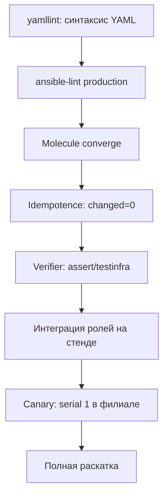

# Тестирование автоматизации

Тестирование автоматизации отвечает на три вопроса: делает ли playbook заявленное, не меняет ли он лишнего и остаётся ли результат стабильным при повторном запуске. Ответы дают статические проверки, одноразовая инфраструктура (ephemeral infrastructure) и проверки идемпотентности.

## 1. Зачем это нужно

Роль, применённая к 600 хостам филиальной сети, тиражирует любую ошибку с той же скоростью, что и исправление. Линтер (linter) ловит опечатки в именах модулей и параметрах до запуска, Molecule проверяет поведение роли в чистом контейнере, идемпотентность выявляет задачи, которые всегда возвращают `changed`, а интеграционный прогон подтверждает, что порядок ролей и handler'ов не ломает сервис. Стоимость дефекта растёт по мере продвижения к продакшену: правка в редакторе занимает минуты, разбор последствий на филиале — часы.

Тесты не заменяют ревью и canary-раскатку. Они снижают вероятность того, что до canary дойдёт заведомо сломанный код, и делают проверку воспроизводимой: результат не зависит от того, кто и когда запускал playbook.

Есть и вторая причина, организационная. В распределённой сети playbook'и пишут несколько инженеров, а применяют их дежурные смены. Без автоматических проверок качество зависит от привычек конкретного автора: один использует FQCN и `validate`, другой — `shell` и `ignore_errors`. Линтер и тесты превращают договорённости в исполняемое правило. Новый сотрудник получает обратную связь за минуту, а не после инцидента на филиале.

Наконец, тесты служат документацией. `verify.yml` перечисляет свойства, которые команда считает обязательными: какой режим у файла, какая директива должна быть в действующем конфиге, какой сервис должен быть запущен. При изменении требований правится одно место, и расхождение между текстом и реальностью обнаруживается на CI, а не на аудите.

## 2. Ключевые понятия

| Понятие | Назначение |
|---|---|
| yamllint | проверка синтаксиса и форматирования YAML |
| ansible-lint | проверка практик Ansible: FQCN, идемпотентность, именование задач |
| Профиль (profile) | набор правил ansible-lint: `min`, `basic`, `moderate`, `safety`, `shared`, `production` |
| Molecule | инструмент тестирования ролей в изолированном окружении |
| Сценарий (scenario) | набор шагов Molecule: create, converge, idempotence, verify, destroy |
| converge | применение роли к тестовому экземпляру |
| verifier | проверка результата: Ansible, testinfra или собственный скрипт |
| Идемпотентность (idempotency) | повторный прогон не даёт изменений |
| Матрица ОС (OS matrix) | прогон тестов на нескольких дистрибутивах |
| Одноразовая инфраструктура | экземпляры, создаваемые и уничтожаемые на время теста |

## 3. Пирамида проверок



Чем ниже шаг на схеме, тем дороже ошибка и тем меньше проверок успевает пройти до продакшена. Первые три шага занимают секунды и минуты, поэтому их выполняют на каждый коммит. Интеграция и canary требуют стенда и расписания, поэтому запускаются на merge и по плану.

Пирамида не означает, что верхние уровни не нужны. Контейнер не воспроизводит WAN-задержки, SELinux в режиме `enforcing`, реальные зависимости пакетов и поведение vCenter. Роль, безупречно проходящая Molecule, может отказать на хосте филиала из-за недоступного репозитория или занятого порта. Поэтому интеграционный стенд с двумя-тремя ВМ и одна канареечная группа остаются обязательными.

Отдельно стоит договориться о тестовых данных. Пароли, токены и ключи в сценариях — только заглушки, которые не действуют нигде, кроме эфемерного контейнера. Если роль требует внешнего API, в тесте используется локальная заглушка (mock) или фиктивный ответ, а не учётная запись продакшена. Это правило дешевле соблюдать, чем расследовать утечку тестового секрета, который оказался боевым.

## 4. Пошаговая реализация

1. Зафиксируйте инструменты в виртуальном окружении и в CI-образе, чтобы версии совпадали у всех.
2. Добавьте `.yamllint` с правилами форматирования, согласованными со стайлгайдом команды.
3. Включите `.ansible-lint` с профилем `production` и запустите его на текущем репозитории, чтобы получить базовый уровень замечаний.
4. Опишите Molecule-сценарий для роли: платформа, provisioner, verifier.
5. Напишите `converge.yml`, который применяет роль так же, как в продакшене, и `verify.yml` с утверждениями (`ansible.builtin.assert`).
6. Прогоните `molecule test` локально, затем добавьте те же команды в пайплайн.
7. Расширьте матрицу ОС до RHEL/Rocky/AlmaLinux 9, Ubuntu 24.04 и Debian 12.

Инструменты устанавливаются отдельно от `ansible-core`, потому что их версии развиваются независимо:

```bash
python3 -m venv .venv
. .venv/bin/activate
python -m pip install --upgrade pip
python -m pip install "ansible-core==2.17.*" "ansible-lint==24.*" \
  "molecule==24.*" "molecule-plugins[docker]>=23.5" "pytest-testinfra>=8"
ansible --version
ansible-lint --version
molecule --version
```

`molecule-plugins` нужен для драйвера `docker`: начиная с Molecule 6 драйверы вынесены в отдельный пакет. Точные минорные версии фиксируйте в `requirements-dev.txt` и обновляйте осознанно.

`.yamllint`:

```yaml
---
extends: default
rules:
  line-length:
    max: 120
    level: warning
  truthy:
    allowed-values: ["true", "false"]
    check-keys: true
  comments:
    min-spaces-from-content: 1
  indentation:
    spaces: 2
    indent-sequences: true
  document-start:
    present: true
ignore: |
  .venv/
  collections/
```

`.ansible-lint`:

```yaml
---
profile: production
offline: true
exclude_paths:
  - .cache/
  - collections/
```

Профиль `production` включает проверки безопасности и идемпотентности, которые не входят в `basic`. `offline: true` запрещает обращения к Galaxy во время линтинга: коллекции должны быть установлены заранее из `requirements.yml`, иначе сборка зависит от доступности внешней сети.

```bash
yamllint -c .yamllint .
ansible-lint --profile production
ansible-lint -f codeclimate > gl-code-quality-report.json
```

Формат `codeclimate` позволяет опубликовать замечания как отчёт Code Quality в GitLab. Ненулевой код возврата означает, что пайплайн должен остановиться: предупреждения нельзя копить «на потом».

При первом включении `production` на существующем репозитории замечаний будет много. Разумная стратегия — не отключать правила, а временно перенести часть в `warn_list`, исправить критичные категории и снижать список каждую неделю. Часть замечаний исправляется автоматически: `ansible-lint --fix` переписывает FQCN, порядок ключей и отступы, но результат обязательно проверяется глазами и отдельным прогоном тестов. Отключать правило через `skip_list` допустимо только с комментарием в конфиге и ссылкой на задачу, иначе через полгода никто не вспомнит причину.

## 5. Полный пример: сценарий Molecule для роли baseline

Структура роли и её задачи подробно разобраны в [Playbooks, roles, handlers](../fundamentals/07-playbooks-roles.md). Ниже — минимальная роль и полный набор файлов сценария, которых достаточно для запуска.

`roles/baseline/defaults/main.yml`:

```yaml
---
baseline_packages:
  - ca-certificates
baseline_motd: "Managed by Ansible. Authorized access only."
baseline_sshd_hardening: false
baseline_ssh_service: >-
  {{ 'ssh' if ansible_facts['os_family'] == 'Debian' else 'sshd' }}
```

`roles/baseline/tasks/main.yml`:

```yaml
---
- name: Install baseline packages
  ansible.builtin.package:
    name: "{{ baseline_packages }}"
    state: present

- name: Deploy baseline MOTD
  ansible.builtin.template:
    src: motd.j2
    dest: /etc/motd
    owner: root
    group: root
    mode: "0644"

- name: Deploy SSH baseline fragment
  ansible.builtin.template:
    src: sshd_baseline.conf.j2
    dest: /etc/ssh/sshd_config.d/60-baseline.conf
    owner: root
    group: root
    mode: "0644"
    validate: "sshd -t -f %s"
  when: baseline_sshd_hardening | bool
  notify: Reload sshd
```

`roles/baseline/handlers/main.yml` и шаблоны:

```yaml
---
- name: Reload sshd
  ansible.builtin.service:
    name: "{{ baseline_ssh_service }}"
    state: reloaded
```

```jinja2
{{ ansible_managed | comment }}
PermitRootLogin no
PasswordAuthentication no
KbdInteractiveAuthentication no
```

```jinja2
{{ baseline_motd }}
Host: {{ inventory_hostname }}
```

`roles/baseline/meta/main.yml`:

```yaml
---
galaxy_info:
  author: automation-team
  description: Baseline packages and optional SSH hardening
  license: proprietary
  min_ansible_version: "2.17"
dependencies: []
```

`molecule/default/molecule.yml`:

```yaml
---
dependency:
  name: galaxy
  options:
    requirements-file: requirements.yml
driver:
  name: docker
platforms:
  - name: instance
    image: "geerlingguy/docker-${MOLECULE_DISTRO:-ubuntu2404}-ansible:latest"
    pre_build_image: true
    privileged: true
    cgroupns_mode: host
    command: /usr/sbin/init
    volumes:
      - /sys/fs/cgroup:/sys/fs/cgroup:rw
    tmpfs:
      - /run
      - /tmp
provisioner:
  name: ansible
  inventory:
    group_vars:
      all:
        baseline_sshd_hardening: true
verifier:
  name: ansible
scenario:
  test_sequence:
    - dependency
    - cleanup
    - destroy
    - syntax
    - create
    - converge
    - idempotence
    - verify
    - cleanup
    - destroy
```

`privileged` и смонтированный `cgroup` нужны, чтобы systemd в контейнере запускал службы. Образы `geerlingguy/docker-*-ansible` содержат systemd и OpenSSH; для воспроизводимости фиксируйте их по digest, а не по тегу `latest`.

`molecule/default/converge.yml`:

```yaml
---
- name: Converge
  hosts: all
  become: true
  gather_facts: true

  tasks:
    - name: Apply baseline role
      ansible.builtin.include_role:
        name: baseline
      vars:
        baseline_sshd_hardening: true
```

`molecule/default/verify.yml`:

```yaml
---
- name: Verify
  hosts: all
  become: true
  gather_facts: false

  tasks:
    - name: Read effective sshd configuration
      ansible.builtin.command:
        argv:
          - sshd
          - "-T"
      register: sshd_effective
      changed_when: false

    - name: Assert that hardening directives are effective
      ansible.builtin.assert:
        that:
          - "'permitrootlogin no' in sshd_effective.stdout_lines"
          - "'passwordauthentication no' in sshd_effective.stdout_lines"
        fail_msg: "sshd is not hardened on {{ inventory_hostname }}"

    - name: Check baseline fragment permissions
      ansible.builtin.stat:
        path: /etc/ssh/sshd_config.d/60-baseline.conf
      register: sshd_fragment

    - name: Assert file mode and ownership
      ansible.builtin.assert:
        that:
          - sshd_fragment.stat.exists
          - sshd_fragment.stat.mode == '0644'
          - sshd_fragment.stat.pw_name == 'root'
```

Проверка читает действующую конфигурацию через `sshd -T`, а не содержимое файла: так тест поймает и ошибку шаблона, и ситуацию, когда фрагмент не подключён. `changed_when: false` обязателен, иначе задача проверки нарушит шаг `idempotence`.

### Что проверять в роли

| Объект проверки | Утверждение | Модуль |
|---|---|---|
| Пакет установлен | `ansible_facts.packages` содержит имя | `ansible.builtin.package_facts` |
| Файл создан | `stat.exists` | `ansible.builtin.stat` |
| Права и владелец | `stat.mode`, `stat.pw_name`, `stat.gr_name` | `ansible.builtin.stat` |
| Конфиг синтаксически верен | код возврата `validate`-команды | `ansible.builtin.command` |
| Директива действует | строка в выводе `sshd -T` | `ansible.builtin.command` |
| Сервис запущен | `status.ActiveState == 'active'` | `ansible.builtin.service_facts` |
| Порт слушается | `wait_for` с `state: started` | `ansible.builtin.wait_for` |
| Идемпотентность | второй прогон даёт `changed=0` | шаг `idempotence` |

Проверять стоит наблюдаемые свойства, а не реализацию. Утверждение «файл `/etc/ssh/sshd_config.d/60-baseline.conf` существует» хрупко: завтра роль может собирать конфиг иначе. Утверждение «действующая конфигурация запрещает вход root» устойчиво к рефакторингу и точнее отражает требование комплаенса. Там, где проверка дорогая (перезагрузка, сетевой запрос), её выносят в отдельный тег и запускают не на каждый коммит.

Команды запуска и матрица ОС:

```bash
MOLECULE_DISTRO=rockylinux9 molecule test
MOLECULE_DISTRO=ubuntu2404 molecule test
MOLECULE_DISTRO=debian12 molecule test
```

```bash
molecule converge      # применить роль без уничтожения экземпляра
molecule idempotence   # повторный converge, ожидается changed=0
molecule verify        # выполнить verify.yml
molecule login         # войти в контейнер для отладки
molecule destroy       # удалить экземпляр
```

Если команда `molecule test` недоступна на рабочей станции, те же шаги выполняются в CI; локально достаточно `converge` и `verify`. Для pytest-стека вместо Ansible-verifier задайте `verifier: name: testinfra` и опишите проверки в `tests/test_baseline.py`:

```python
def test_sshd_fragment(host):
    fragment = host.file("/etc/ssh/sshd_config.d/60-baseline.conf")
    assert fragment.exists
    assert fragment.mode == 0o644
    assert fragment.user == "root"


def test_motd(host):
    assert "Managed by Ansible" in host.file("/etc/motd").content_string
```

`pytest-testinfra` удобен командам, уже использующим pytest, но Ansible-verifier не требует второго языка и работает на том же инвентаре.

## 6. Проверка результата

```bash
yamllint -c .yamllint . ; echo "yamllint rc=$?"
ansible-lint --profile production ; echo "lint rc=$?"
molecule test 2>&1 | tee molecule.log
grep -E '^(PLAY RECAP|changed=)' molecule.log | tail -n 5
```

Ожидаемый результат: `yamllint` и `ansible-lint` завершаются с кодом 0, шаг `idempotence` в выводе Molecule не содержит `changed` больше нуля, `verify` проходит на всех дистрибутивах матрицы. Сохраните `molecule.log` как артефакт пайплайна: он нужен при разборе расхождений между локальным прогоном и CI.

Если шаг `idempotence` упал, сравните два прогона `converge`: в выводе будет задача, которая снова вернула `changed`. Типичные причины — шаблон с меткой времени или случайным значением, задача `ansible.builtin.command` без `changed_when`, `ansible.builtin.file` с `state: touch` и режимом, который не совпадает с фактическим. Исправлять нужно причину, а не отключать шаг.

Дополнительная проверка, не требующая Molecule, — двойной `--check --diff` на стенде. Первый прогон показывает планируемые изменения, второй должен вернуть пустой diff. Метод дешевле полноценного сценария и подходит для ролей, которые нельзя запустить в контейнере, например для работы с vCenter.

## 7. Безопасность и blast radius

| Риск | Последствие | Мера |
|---|---|---|
| Тесты запускаются на продакшн-inventory | реальные изменения в филиалах | отдельный `inventories/lab`, проверка `ansible_host` перед запуском |
| `privileged: true` в контейнерах | контейнер фактически равен root на хосте CI | отдельный runner, эфемерные ВМ, запрет общего доступа к сокету Docker |
| Пароль vault в переменной пайплайна | утечка в лог при `-vvv` | masked/protected CI-переменные, `no_log` |
| Тест проверяет только `changed` | ошибка конфигурации остаётся незамеченной | утверждения на действующее состояние |
| Молчаливое исключение роли из линтинга | дрейф практик в непроверенном коде | узкий `exclude_paths`, ревью исключений |
| Образ без фиксации версии | невоспроизводимый результат | пиннинг по digest, зеркало образов |

Тесты выполняются только на изолированных экземплярах. Роль, которая меняет SSH, сеть или firewall, в тесте должна проверяться с сохранением доступа: контейнерный сценарий не воспроизводит блокировку текущей сессии, поэтому после `verify` полезно отдельно проверить вход по ключу.

Blast radius тестового контура определяется тем, какие учётные данные ему выданы. Если CI-раннер имеет ключ с доступом ко всем 600 хостам, любая ошибка в условии `hosts:` превращает тест в продакшн-изменение. Поэтому у пайплайна отдельная сервисная учётная запись с доступом только к лабораторному сегменту, а продакшн-ключи выдаются лишь задаче развёртывания, защищённой окружением и ручным подтверждением. Проверка `ansible-inventory --list` перед запуском помогает убедиться, что в выборку попали ожидаемые хосты.

## 8. Комплаенс-маппинг

| Требование | Как закрывается |
|---|---|
| ISO/IEC 27001:2022 A.8.29 | тестирование изменений до ввода в эксплуатацию |
| ISO/IEC 27001:2022 A.8.32 | воспроизводимый процесс изменения и подтверждение результата |
| CIS Control 16 | проверка кода автоматизации до развёртывания |
| NIST CSF 2.0 PR.PS | управляемая конфигурация платформ и проверка изменений |
| Аудит | логи Molecule и отчёты линтеров как доказательства |

## 9. Типичные ошибки и troubleshooting

| Симптом | Причина | Проверка | Решение |
|---|---|---|---|
| `Cannot connect to the Docker daemon` | нет доступа к сокету | `docker info` | добавить пользователя в группу `docker` или использовать rootless |
| `System has not been booted with systemd` | контейнер без systemd | `docker inspect` | `command: /usr/sbin/init`, `privileged`, `cgroupns_mode: host` |
| `idempotence` падает на `command` | задача всегда `changed` | повторный `converge` | `changed_when`, `creates` |
| `ansible-lint` не находит коллекцию | не установлен `requirements.yml` | `ansible-galaxy collection list` | установить коллекции, проверить `offline` |
| `yamllint` ругается на длинные Jinja-строки | жёсткий `line-length` | вывод линтера | `level: warning` или перенос выражения |
| `verify` не видит факты | `gather_facts: false` | лог задачи | использовать `ansible_facts` из converge или включить сбор |
| Контейнеры остаются после теста | прерванный запуск | `docker ps -a` | `molecule destroy --all` |
| Тест проходит локально и падает в CI | разные версии инструментов | `pip freeze` | зафиксировать версии в образе |

## 10. Чек-лист

- [ ] `.yamllint` и `.ansible-lint` хранятся в репозитории.
- [ ] Линтеры запускаются на каждый коммит и блокируют merge при ошибке.
- [ ] Для каждой роли есть Molecule-сценарий с `verify.yml`.
- [ ] Шаг `idempotence` включён в `test_sequence`.
- [ ] Проверки читают действующее состояние, а не только файлы.
- [ ] Матрица ОС покрывает целевые дистрибутивы филиалов.
- [ ] Тесты используют лабораторный inventory, а не продакшн.
- [ ] Версии инструментов и образов зафиксированы.
- [ ] Логи тестов сохраняются как артефакты.
- [ ] Исключения из линтинга задокументированы.

## 11. Источники

- [ansible-lint documentation](https://ansible.readthedocs.io/projects/lint/)
- [Molecule documentation](https://ansible.readthedocs.io/projects/molecule/)
- [yamllint documentation](https://yamllint.readthedocs.io/en/stable/)
- [Ansible: test strategies](https://docs.ansible.com/ansible/latest/reference_appendices/test_strategies.html)
- [pytest-testinfra documentation](https://pytest-testinfra.readthedocs.io/)

## 12. Связанные страницы

- [Playbooks, roles, handlers](../fundamentals/07-playbooks-roles.md)
- [Модули и FQCN](../fundamentals/09-modules.md)
- [Безопасная разработка playbook](../secure-dev/13-safe-code.md)
- [CI/CD и GitOps](51-cicd-gitops.md)
- [Анти-паттерны](../ops/62-antipatterns.md)
