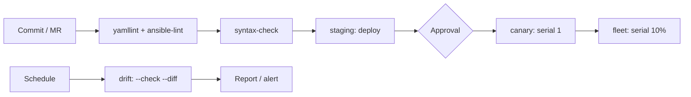

# CI/CD и GitOps

CI/CD превращает изменение в Git в проверяемую и повторяемую процедуру: линтеры, тесты, развёртывание по окружениям и подтверждение человеком. GitOps добавляет к этому принцип единственного источника истины — состояние инфраструктуры описано в репозитории, а не в действиях дежурного.

## 1. Зачем это нужно

Когда playbook'и применяются вручную с ноутбука, невозможно ответить на простые вопросы: какая версия роли работает в филиале, кто и когда её менял, почему хост отличается от остальных. Пайплайн фиксирует версию кода, окружение, результат проверок и автора изменения. Ручной запуск остаётся только как аварийный обход (break-glass) и тоже журналируется.

Второй аргумент — снижение blast radius. Пайплайн не даёт применить непроверенный коммит к продакшену, требует подтверждения для критичного окружения и выполняет раскатку партиями. Третий — скорость: типовое изменение проходит путь от merge request до canary за минуты, а не за окно согласований по почте.

Отдельно стоит проговорить границу с платформой запуска. CI отвечает за проверку и доставку артефакта, но не заменяет планировщик, RBAC и аудит выполнения. Если ночные прогоны, права по командам филиалов и журнал «кто запустил» нужны как продукт, их даёт AWX или AAP; пайплайн в этом случае собирает и публикует артефакт, а платформа его применяет. Сравнение вариантов — в [AAP, AWX, Semaphore](53-aap-awx.md).

Аварийный путь тоже должен быть описан. Break-glass — это ручной запуск с отдельной учётной записью, ограниченным лимитом хостов и обязательной записью в журнал изменений. Он не отменяет пайплайн, а фиксирует исключение: после устранения аварии коммит всё равно проходит обычную проверку, иначе состояние хостов разойдётся с репозиторием.

## 2. Ключевые понятия

| Понятие | Назначение |
|---|---|
| Pipeline | последовательность стадий и задач в CI |
| Stage | логическая группа задач: lint, test, deploy |
| Protected branch | ветка, изменения в которую проходят только через merge request |
| Protected environment | окружение с обязательными подтверждениями и ограничением ролей |
| OIDC | обмен короткоживущим токеном вместо статического секрета |
| Approval | ручное подтверждение перед развёртыванием |
| Canary | первая небольшая партия хостов для проверки изменения |
| `serial` | размер партии в playbook |
| `resource_group` | блокировка параллельных развёртываний одного окружения |
| GitOps | модель, где Git — источник истины, а расхождение устраняется автоматически |
| Drift | отличие фактического состояния хоста от описанного в репозитории |

## 3. Схема пайплайна



Ключевые точки на схеме: линтеры работают на каждый коммит и не требуют инфраструктуры; staging разворачивается автоматически после merge; продакшн защищён подтверждением; canary отделён от массовой раскатки; плановый прогон в режиме проверки обнаруживает дрейф, не меняя хосты.

## 4. Пошаговая реализация

1. Заведите репозиторий с каталогами `playbooks/`, `roles/`, `inventories/`, `collections/` и файлами `ansible.cfg`, `requirements.yml`, `requirements-dev.txt`.
2. Защитите основную ветку: запрет прямых пушей, обязательный merge request, обязательные проверки пайплайна.
3. Создайте окружения `staging` и `production` в настройках проекта, включите для `production` обязательные подтверждения.
4. Добавьте CI-переменные файлового типа: пароль vault и приватный SSH-ключ. Обе метки — protected, значение не попадает в лог.
5. Опишите стадии `lint`, `test`, `deploy` и задания для каждой.
6. Настройте канареечную раскатку: отдельный playbook с `serial: 1` и `max_fail_percentage: 0`.
7. Добавьте плановый пайплайн проверки дрейфа и отправку отчёта в SIEM или мессенджер.
8. Переведите выдачу секретов на OIDC и внешнее хранилище, когда инфраструктура будет готова.

Порядок стадий отражает стоимость обратной связи. Линт занимает секунды и останавливает пайплайн раньше, чем запустится что-либо, требующее SSH-доступа. Стадия `test` проверяет синтаксис и инвентарь, а также может запускать Molecule, если на раннере доступен Docker. Стадия `deploy` — единственная, которой выданы продакшн-учётные данные.

Модель ветвления для инфраструктурного репозитория проще, чем для приложения. Основная ветка защищена, изменения приходят короткоживущими ветками через merge request, релиз отмечается аннотированным тегом. Долгоживущие ветки на каждый филиал создают расхождение: одна и та же роль существует в нескольких версиях, и раскатка становится непредсказуемой. Если нужна поддержка двух версий одновременно, лучше завести отдельный поддерживаемый тег и отдельный пайплайн, а не ветку с ручными правками.

Для крупных изменений полезен промежуточный шаг: прогон на staging с реальным инвентарём небольшого филиала. Staging не обязан повторять продакшн полностью, но должен включать те же семейства ОС и тот же способ доступа — иначе проверка даёт ложное спокойствие.

## 5. Полный пример

`ansible.cfg` в корне репозитория. По умолчанию указан лабораторный инвентарь: случайный запуск без параметров не попадёт в продакшн.

```ini
[defaults]
inventory = inventories/lab/hosts.yml
collections_path = ./collections
roles_path = ./roles
host_key_checking = True
interpreter_python = auto_silent
retry_files_enabled = False
deprecation_warnings = True

[privilege_escalation]
become = False
become_ask_pass = False

[ssh_connection]
pipelining = True
```

`requirements-dev.txt` и `requirements.yml`:

```text
ansible-core==2.17.*
ansible-lint==24.*
yamllint==1.*
```

```yaml
---
collections:
  - name: ansible.posix
    version: ">=1.5.4,<2.0.0"
  - name: community.general
    version: ">=10.0.0,<11.0.0"
```

Диапазоны фиксируются lock-файлом или образом CI: обновление коллекции должно быть отдельным изменением с прогоном тестов, а не побочным эффектом сборки.

`playbooks/canary.yml` — первая партия:

```yaml
---
- name: Apply release to canary hosts
  hosts: canary
  become: true
  gather_facts: true
  serial: 1
  max_fail_percentage: 0
  any_errors_fatal: true

  roles:
    - role: baseline
```

`playbooks/rollout.yml` — остальной парк:

```yaml
---
- name: Roll out release to the branch fleet
  hosts: branches:!canary
  become: true
  gather_facts: true
  serial: "10%"
  max_fail_percentage: 10

  roles:
    - role: baseline
```

`serial: 1` в canary означает, что при ошибке остановится вся раскатка после первого хоста. `serial: "10%"` для 600 хостов даёт партии по 60 машин; `max_fail_percentage: 10` останавливает play, если отказов больше допустимого. Для филиалов с плохим WAN партию уменьшают до 5% и добавляют `ansible.builtin.wait_for_connection` в начало роли.

`.gitlab-ci.yml`:

```yaml
---
stages:
  - lint
  - test
  - deploy

variables:
  ANSIBLE_FORCE_COLOR: "1"
  ANSIBLE_COLLECTIONS_PATH: "$CI_PROJECT_DIR/collections"
  ANSIBLE_VAULT_PASSWORD_FILE: "$VAULT_PASSWORD_FILE"
  ANSIBLE_PRIVATE_KEY_FILE: "$SSH_PRIVATE_KEY_FILE"
  PIP_CACHE_DIR: "$CI_PROJECT_DIR/.cache/pip"

default:
  image: python:3.12-bookworm
  cache:
    key:
      files:
        - requirements-dev.txt
    paths:
      - .cache/pip
  before_script:
    - python -m venv .venv
    - . .venv/bin/activate
    - python -m pip install --upgrade pip
    - python -m pip install -r requirements-dev.txt
    - ansible-galaxy collection install -r requirements.yml -p collections

yamllint:
  stage: lint
  script:
    - yamllint -c .yamllint .
  rules:
    - if: $CI_PIPELINE_SOURCE == "merge_request_event"
    - if: $CI_COMMIT_BRANCH == $CI_DEFAULT_BRANCH

ansible-lint:
  stage: lint
  script:
    - ansible-lint --profile production -f codeclimate > gl-code-quality-report.json
  artifacts:
    when: always
    reports:
      codequality: gl-code-quality-report.json
  rules:
    - if: $CI_PIPELINE_SOURCE == "merge_request_event"
    - if: $CI_COMMIT_BRANCH == $CI_DEFAULT_BRANCH

syntax-check:
  stage: test
  script:
    - ansible-playbook -i inventories/lab/hosts.yml playbooks/site.yml --syntax-check
    - ansible-inventory -i inventories/lab/hosts.yml --graph > /dev/null
  rules:
    - if: $CI_PIPELINE_SOURCE == "merge_request_event"
    - if: $CI_COMMIT_BRANCH == $CI_DEFAULT_BRANCH

drift:check:
  stage: test
  script:
    - ansible-playbook -i inventories/prod/hosts.yml playbooks/site.yml --check --diff | tee drift.log
  artifacts:
    when: always
    expire_in: 30 days
    paths:
      - drift.log
  rules:
    - if: $CI_PIPELINE_SOURCE == "schedule"

deploy:staging:
  stage: deploy
  environment:
    name: staging
  needs: ["syntax-check"]
  script:
    - ansible-playbook -i inventories/staging/hosts.yml playbooks/rollout.yml --diff
  rules:
    - if: $CI_COMMIT_BRANCH == $CI_DEFAULT_BRANCH

deploy:production:canary:
  stage: deploy
  environment:
    name: production-canary
  resource_group: production
  needs: ["deploy:staging"]
  when: manual
  allow_failure: false
  script:
    - ansible-playbook -i inventories/prod/hosts.yml playbooks/canary.yml --diff
  rules:
    - if: $CI_COMMIT_TAG

deploy:production:fleet:
  stage: deploy
  environment:
    name: production
  resource_group: production
  needs: ["deploy:production:canary"]
  when: manual
  allow_failure: false
  script:
    - ansible-playbook -i inventories/prod/hosts.yml playbooks/rollout.yml --diff
  rules:
    - if: $CI_COMMIT_TAG
```

Разбор ключевых решений:

- `ANSIBLE_VAULT_PASSWORD_FILE` и `ANSIBLE_PRIVATE_KEY_FILE` ссылаются на файловые CI-переменные. GitLab создаёт временный файл и подставляет путь; содержимое не попадает ни в репозиторий, ни в лог.
- `drift:check` выполняется только в расписании и только в режиме проверки. Это безопасная операция чтения, которая показывает расхождение и не меняет хосты.
- `deploy:production:*` запускается только по тегу. Тег ставится на проверенный коммит, что отделяет «код в основной ветке» от «релиза».
- `when: manual` вместе с обязательными подтверждениями окружения даёт две независимые преграды: кнопку в пайплайне и апрув в настройках окружения.
- `resource_group: production` не даёт двум пайплайнам одновременно раскатывать разные версии.
- `rules` с `$CI_COMMIT_TAG` не пропускает в продакшн merge request и обычный коммит.

Раннер — часть периметра безопасности. Для заданий, которым выданы продакшн-ключи, нужен отдельный раннер с тегом, недоступный остальным проектам, без общего кэша и без возможности запускать произвольные образы. Кэш pip и каталог `collections` не должны переживать смену зависимостей: ключ кэша привязан к `requirements-dev.txt`, а коллекции устанавливаются заново в каждом задании. Артефакты (логи линтеров, отчёт дрейфа) хранятся ограниченное время и не содержат вывода задач с секретами.

### Секреты и OIDC

Статические CI-переменные — рабочий минимум, но они живут долго и копируются в каждый раннер. Следующий шаг — короткоживущие токены через OIDC: GitLab выпускает подписанный JWT, внешнее хранилище проверяет его и выдаёт секрет на время задания.

```yaml
deploy:production:vault:
  stage: deploy
  image: hashicorp/vault:1.17
  variables:
    VAULT_ADDR: "https://vault.example.internal"
  id_tokens:
    VAULT_ID_TOKEN:
      aud: https://vault.example.internal
  secrets:
    VAULT_TOKEN:
      vault: ansible/deploy@ops
      token: $VAULT_ID_TOKEN
  script:
    - vault kv get -field=password ops/ansible/deploy > /dev/null
  rules:
    - if: $CI_COMMIT_TAG
```

Токен действует минуты, привязан к проекту, ветке и окружению и не может быть использован повторно. Требования к настройке роли и политики в Vault, а также ограничения схемы описаны в [Секреты в CI/CD](../secure-dev/14-cicd-secrets.md).

### GitOps-модель

В классическом GitOps (Argo CD, Flux) контроллер постоянно сравнивает желаемое состояние кластера с фактическим. Для Ansible роль контроллера выполняет плановый пайплайн: он запускает `--check --diff`, публикует отчёт и при расхождении либо создаёт задачу, либо запускает ремедиацию с подтверждением.

Практическая модель для филиальной сети выглядит так: изменение попадает только через merge request; тег фиксирует релиз; пайплайн разворачивает его по окружениям; ночной прогон измеряет дрейф; ручные правки на хостах запрещены регламентом и обнаруживаются проверкой. Обратный путь тоже работает: откат — это revert коммита и повторный запуск, а не восстановление из резервной копии вручную.

## 6. Проверка результата

```bash
gitlab-ci-local --list
ansible-playbook -i inventories/lab/hosts.yml playbooks/site.yml --syntax-check
ansible-lint --profile production
ansible-inventory -i inventories/prod/hosts.yml --graph --limit canary
```

В GitLab проверьте: пайплайн на merge request содержит стадии `lint` и `test`; задание `deploy:production:canary` требует подтверждения; переменные `VAULT_PASSWORD_FILE` и `SSH_PRIVATE_KEY_FILE` помечены как protected; в логах нет строк с паролем или ключом. Полезная проверка — попытаться запустить пайплайн из незащищённой ветки: защищённые переменные не должны быть доступны.

Проверку стоит проводить и в обратную сторону: убедиться, что пайплайн падает при заведомой ошибке. Внесите в тестовую ветку задачу с несуществующим параметром модуля и посмотрите, остановится ли сборка на стадии `lint`, а не на `deploy`. Если ошибка проходит дальше, правило отключено или задание помечено `allow_failure`. Такой негативный тест занимает минуту и подтверждает, что защиты включены, а не только описаны в документации.

## 7. Безопасность и blast radius

| Риск | Последствие | Мера |
|---|---|---|
| Незащищённая ветка с правом деплоя | обход ревью | protected branches, правила `rules` |
| Секрет в логе задания | компрометация учётной записи | masked/protected переменные, `no_log`, запрет `-vvv` в продакшн-задачах |
| Раннер с общим доступом | кража переменных других проектов | отдельный раннер для защищённых окружений |
| Отсутствие canary | массовый отказ | `serial: 1`, затем 10% |
| Параллельные раскатки | несовместимые версии на хостах | `resource_group` |
| Долгоживущий токен | длительное окно компрометации | OIDC и короткоживущие токены |
| Автоматический деплой по любому тегу | раскатка непроверенной сборки | теги только из основной ветки после проверок |

Blast radius продакшн-задания определяется ключом, который ему выдан. Если один и тот же ключ используется для staging и production, ошибка в инвентаре стирает границу между окружениями. Разделите сервисные учётные записи, ограничьте `become` конкретными командами и держите продакшн-ключ только в защищённом окружении.

## 8. Комплаенс-маппинг

| Требование | Как закрывается |
|---|---|
| ISO/IEC 27001:2022 A.8.32 | управление изменениями через merge request и пайплайн |
| ISO/IEC 27001:2022 A.8.31 | разделение сред и запрет прямых изменений в продакшене |
| CIS Control 16 | проверки кода до развёртывания |
| NIST CSF 2.0 PR.PS | контролируемая конфигурация и повторяемый процесс |
| Аудит | журнал пайплайнов, теги, отчёты линтеров, логи дрейфа |

## 9. Типичные ошибки и troubleshooting

| Симптом | Причина | Проверка | Решение |
|---|---|---|---|
| `deploy` пропущен | правила `rules` не совпали | раздел Rules в задании | проверить `CI_COMMIT_TAG` и ветку |
| Пустой пароль vault | переменная не protected для тега | `CI/CD Variables` | включить protected или запускать из защищённой ветки |
| `Permission denied (publickey)` | ключ не подставлен | `ssh -v` на раннере | проверить `ANSIBLE_PRIVATE_KEY_FILE` и формат файла |
| `Host key verification failed` | нет `known_hosts` | вывод задания | добавить ключи хостов через CI-переменную, не отключать проверку |
| Обе задачи деплоя идут одновременно | нет `resource_group` | граф пайплайна | добавить `resource_group` |
| `ansible-lint` падает на коллекциях | не установлены до линта | лог `ansible-galaxy` | ставить коллекции в `before_script` |
| Canary прошёл, парк упал | тест не покрывает различия филиалов | логи партии | уменьшить `serial`, добавить проверки WAN |
| Дрейф-отчёт пустой | неверный инвентарь или лимит | `ansible-inventory --graph` | исправить путь к инвентарю |

## 10. Чек-лист

- [ ] Основная ветка защищена, прямые пуши запрещены.
- [ ] Линтеры запускаются на merge request и блокируют merge.
- [ ] Продакшн-окружение требует подтверждения.
- [ ] Секреты хранятся в protected-переменных или внешнем хранилище.
- [ ] В репозитории нет паролей, ключей и токенов.
- [ ] Раскатка идёт через canary с `serial: 1`.
- [ ] `max_fail_percentage` задан и меньше 100.
- [ ] Деплой защищён `resource_group`.
- [ ] Плановый прогон проверки дрейфа настроен.
- [ ] Откат описан и проверен: revert коммита и повторный пайплайн.

## 11. Источники

- [GitLab CI/CD YAML reference](https://docs.gitlab.com/ci/yaml/)
- [GitLab environments and deployments](https://docs.gitlab.com/ci/environments/)
- [GitLab ID token authentication](https://docs.gitlab.com/ci/secrets/id_token_authentication/)
- [Ansible: strategies and rolling updates](https://docs.ansible.com/ansible/latest/playbook_guide/playbooks_strategies.html)
- [Ansible: check mode and diff mode](https://docs.ansible.com/ansible/latest/playbook_guide/playbooks_checkmode.html)

## 12. Связанные страницы

- [Секреты в CI/CD](../secure-dev/14-cicd-secrets.md)
- [Тестирование автоматизации](50-testing.md)
- [Ревью и релизы](52-review-release.md)
- [AAP, AWX, Semaphore](53-aap-awx.md)
- [Безопасная разработка playbook](../secure-dev/13-safe-code.md)
