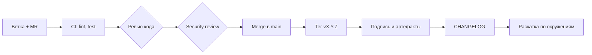

# Ревью и релизы

Ревью проверяет изменение до того, как оно получит доступ к хостам, а релиз фиксирует проверенное состояние под версией, которую можно воспроизвести. Вместе они превращают набор ролей в управляемый продукт с историей, совместимостью и понятным порядком изменений.

## 1. Зачем это нужно

Playbook отличается от обычного кода тем, что его ошибки выполняются с привилегиями на сотнях машин. Ревью здесь — не формальность: второй человек замечает `become: true` на весь play, отсутствие `serial`, секрет в `debug` и `shell` там, где хватает модуля. Стоимость такого просмотра — минуты, стоимость пропуска — инцидент с потерей доступа к филиалу.

Релиз решает другую задачу — воспроизводимость. Тег, подписанный ключом релиз-инженера, и changelog позволяют через год ответить, что именно работало на хостах в определённый день и какие изменения были в версии. Без этого откат превращается в импровизацию, а аудит — в пересказ воспоминаний.

Размер изменения влияет на качество ревью сильнее, чем опыт ревьюера. Merge request на 40 строк читают внимательно, на 800 строк — просматривают по диагонали. Поэтому крупный рефакторинг роли разбивается на серию изменений: сначала перенос файлов без правок логики, затем изменение поведения, затем удаление устаревших параметров. Каждый шаг проверяется отдельно и может быть откачен независимо.

Ревью полезно и как обучение. Замечания о `become`, `serial` и `validate` постепенно формируют общую культуру: через несколько месяцев автор сам пишет задачу так, чтобы её приняли с первого раза. Это дешевле, чем централизованный «архитектор, который всё проверяет».

## 2. Ключевые понятия

| Понятие | Назначение |
|---|---|
| Pull request / merge request | предложение изменения с обсуждением и проверками |
| Code owner | ответственный за каталог или роль, чьё согласие обязательно |
| Security review | проверка изменения на риски безопасности |
| Семантическое версионирование (SemVer) | `MAJOR.MINOR.PATCH`, смысл версии для потребителя |
| Changelog fragment | файл с описанием изменения для будущего выпуска |
| Deprecation | объявленное устаревание с сохранением работы на переходный период |
| Release signing | подпись тега и артефактов ключом GPG |
| Breaking change | изменение, несовместимое с предыдущей версией |
| Pre-release | версия `-rc.N` для проверки до финального выпуска |

## 3. Схема процесса



На схеме важны две развилки: ревью кода и security review — разные проверки с разными вопросами, а тег ставится только после merge и успешного пайплайна. Подпись и changelog формируются до раскатки, иначе версия попадает на хосты без документированного описания.

## 4. Пошаговая реализация

1. Назначьте code owners для `roles/`, `playbooks/`, `inventories/` и `collections/`.
2. Введите шаблон merge request с чек-листом и обязательными полями: цель изменения, blast radius, план отката.
3. Разделите проверки: техническое ревью, security review для изменений с высоким влиянием, проверка совместимости для коллекций.
4. Зафиксируйте правила версионирования и что считается breaking change.
5. Введите фрагменты changelog: одно изменение — один файл, конфликтов при merge нет.
6. Настройте выпуск: генерация CHANGELOG, подписанный тег, подпись артефактов, публикация.
7. Опишите политику устаревания и срок поддержки предыдущей мажорной версии.

### Чек-лист ревью

| Проверка | Что смотреть | Блокирует merge |
|---|---|---|
| Секреты | пароли, ключи, токены в коде и шаблонах; `no_log` | да |
| Привилегии | `become` только на нужных задачах, нет глобального root | да |
| Команды | `shell`/`command` обоснованы, используется `argv`, есть `creates` | да |
| Конфиги | `validate` для sshd, sudoers, nginx и подобных | да |
| Идемпотентность | повторный прогон даёт `changed=0` | да |
| Blast radius | `serial`, `max_fail_percentage`, canary | да |
| Ошибки | `block/rescue` не маскирует сбой, нет `ignore_errors` без причины | да |
| Логи | секреты не попадают в `register`, `debug`, `-vvv` | да |
| Зависимости | новые коллекции с пином и лицензией | да |
| Тесты | Molecule-сценарий и `verify.yml` обновлены | да |
| Совместимость ОС | проверено на целевых RHEL/Ubuntu/Debian | нет |
| Документация | README роли, CHANGELOG-фрагмент, примеры | нет |
| Стиль | FQCN, имена задач, отступы | нет |

Для изменений, затрагивающих SSH, sudo, firewall, сеть, аутентификацию и распространение ключей, достаточно одного пропущенного пункта, чтобы потерять управление хостом. Такие merge request'ы помечаются меткой `security-review` и требуют второго согласующего из команды ИБ.

### Security review

Security review отвечает на вопросы, которые не видны линтеру: откуда приходят данные, что произойдёт при компрометации раннера, не расширяет ли изменение права. Минимальный набор:

- Новые внешние данные (переменные инвентаря, lookup, факты) не попадают в `shell` и в шаблоны без экранирования.
- Учётные записи и ключи, добавленные изменением, имеют минимальные права и срок жизни.
- `no_log` стоит на задачах, работающих с секретами, но не скрывает diagnostics целиком.
- Новые коллекции и образы имеют источник, пин и понятную цепочку поставки.
- Изменение не отключает проверку ключей хостов, `validate_certs` или SELinux ради удобства.

Порог для обязательного security review задаётся формально, иначе метку ставят либо на всё, либо ни на что. Разумный набор признаков: изменение касается SSH, sudo, PAM, firewall, TLS, ключей, учётных записей, прав доступа или сетевых маршрутов; добавляется новая внешняя зависимость; роль получает доступ к новому сегменту сети. Если ни один признак не сработал, достаточно обычного ревью с чек-листом.

Проводить security review должен человек, который не писал изменение, но понимает модель угроз автоматизации. Для небольшой команды это может быть один из двух инженеров ИБ, для крупной — дежурный по безопасности с ротацией. Важно, чтобы у проверяющего был доступ к описанию blast radius и плану отката, а не только к diff.

### Семантическое версионирование

Для ролей и коллекций версия `MAJOR.MINOR.PATCH` читается так:

| Компонент | Когда увеличивается | Примеры |
|---|---|---|
| MAJOR | несовместимое изменение | удалён параметр, изменено значение по умолчанию, удалена ОС из матрицы |
| MINOR | новая функциональность без поломки | новый параметр с безопасным default, новая задача |
| PATCH | исправление без изменения интерфейса | опечатка в шаблоне, исправление `when` |

Пока версия `0.x`, по правилам SemVer совместимость не гарантируется, но команда всё равно обязана объявлять несовместимые изменения явно. Изменение значения по умолчанию, которое влияет на безопасность, — всегда MAJOR, даже если синтаксис не менялся: у потребителя изменится поведение без правки кода.

### Политика устаревания

Параметр или роль помечаются устаревшими в MINOR-релизе и удаляются не раньше следующего MAJOR. Минимальный срок — два минорных релиза или 90 дней, что наступит позже. Устаревание фиксируется в трёх местах: раздел `deprecated_features` в changelog, предупреждение в задаче и запись в README. Предупреждение не должно ломать прогон:

```yaml
- name: Warn about deprecated variable
  ansible.builtin.debug:
    msg: >-
      baseline_motd_path is deprecated since 2.4.0 and will be removed in 3.0.0.
      Use baseline_motd_file instead.
  when: baseline_motd_path is defined
```

## 5. Полный пример

Фрагменты changelog хранятся в `changelogs/fragments/` и собираются инструментом `antsibull-changelog`. Имя файла содержит номер merge request и тему, чтобы два автора не правили один `CHANGELOG`.

`changelogs/config.yaml`:

```yaml
---
changelog_filename_template: ../CHANGELOG.rst
changelog_filename_version_depth: 0
changes_file: changelog.yaml
changes_format: combined
keep_fragments: false
mention_ancestor: true
new_plugins_after_name: removed_features
notesdir: fragments
prelude_section_name: release_summary
prelude_section_title: Release Summary
sections:
  - [major_changes, Major Changes]
  - [minor_changes, Minor Changes]
  - [breaking_changes, Breaking Changes / Porting Guide]
  - [deprecated_features, Deprecated Features]
  - [removed_features, Removed Features]
  - [security_fixes, Security Fixes]
  - [bugfixes, Bug Fixes]
  - [known_issues, Known Issues]
title: branch-automation
trivial_section_name: trivial
```

`changelogs/fragments/142-ssh-ciphers.yml` — полный пример фрагмента:

```yaml
---
minor_changes:
  - >-
    baseline - добавлен параметр ``baseline_ssh_ciphers`` для ограничения
    согласованных алгоритмов SSH; значение по умолчанию сохраняет текущее
    поведение.
security_fixes:
  - >-
    baseline - фрагмент sshd теперь проверяется через ``sshd -t`` перед
    публикацией, что исключает применение синтаксически неверной конфигурации.
deprecated_features:
  - >-
    baseline - параметр ``baseline_motd_path`` устарел с версии 2.4.0;
    используйте ``baseline_motd_file``. Удаление запланировано в 3.0.0.
bugfixes:
  - >-
    baseline - исправлено сравнение режима файла при повторном прогоне,
    которое приводило к ложному ``changed``.
```

Каждая запись начинается с имени роли и описывает эффект для потребителя, а не детали реализации. Формулировка «исправлено сравнение режима» полезна, а «поправил шаблон» — нет: changelog читают администраторы филиалов, а не автор коммита.

Выпуск версии:

```bash
antsibull-changelog lint
antsibull-changelog release --version 2.4.0
git add CHANGELOG.rst changelogs/
git commit -m "Release 2.4.0"
git tag -s v2.4.0 -m "branch-automation 2.4.0"
git verify-tag v2.4.0
git push origin main v2.4.0
```

Сборка и подпись артефактов:

```bash
ansible-galaxy collection build --output-path dist/
sha256sum dist/*.tar.gz > dist/SHA256SUMS
gpg --detach-sign --armor dist/SHA256SUMS
gpg --verify dist/SHA256SUMS.asc dist/SHA256SUMS
ansible-galaxy collection verify branch.automation
```

`git tag -s` создаёт аннотированный тег с GPG-подписью; `git verify-tag` подтверждает, что тег не переписан. Отдельная подпись `SHA256SUMS` закрывает артефакты, которые распространяются через внутреннее зеркало. Потребитель проверяет цепочку: подпись тега, хэши файлов, содержимое коллекции. Требования к приватному Hub и зеркалам — в [Безопасность цепочки поставок](../secure-dev/15-supply-chain.md).

Публикация — последний шаг, а не первый. Собранный артефакт загружается в приватный Hub или зеркало только после проверки подписи в пайплайне; ручная загрузка «пока так» создаёт версию, происхождение которой никто не подтвердит. Полезно хранить рядом с артефактом манифест с версией ansible-core, списком коллекций и хэшем коммита — это ускоряет разбор, когда через полгода нужно понять, чем собиралась версия.

Политика поддержки формулируется заранее: обычно поддерживается текущая мажорная версия и предыдущая в режиме исправлений безопасности. Если филиал не может обновиться в срок, для него фиксируется исключение с датой пересмотра, а не «временная» ветка с правками. Исключения ведутся по правилам из [Governance и процессы](54-governance.md).

Предрелизные версии помечаются `v2.4.0-rc.1` и не считаются стабильными: они допустимы на staging, но не на продакшн-хостах. Если после `rc.1` найдена ошибка, выпускается `rc.2`, а не переписывается тег.

## 6. Проверка результата

```bash
antsibull-changelog lint
git tag -v v2.4.0
git show --stat v2.4.0
ansible-galaxy collection verify branch.automation
sha256sum -c dist/SHA256SUMS
```

Ожидаемый результат: линтер changelog не находит ошибок, `git tag -v` выводит `Good signature`, тег указывает на коммит из основной ветки, хэши совпадают. Отдельно проверьте, что в `CHANGELOG.rst` нет раздела с пустым содержимым и что удалённые параметры действительно описаны в `removed_features`.

## 7. Безопасность и blast radius

| Риск | Последствие | Мера |
|---|---|---|
| Ревью «для галочки» | дефект и избыточные привилегии в продакшене | чек-лист, code owners, метка security-review |
| Секрет в описании MR | утечка в систему трекинга | запрет вставлять значения, только ссылки на хранилище |
| Неподписанный тег | подмена артефакта | `git tag -s`, проверка подписи в пайплайне |
| Перезапись тега | несоответствие версии и содержимого | защита тегов, запрет force push |
| Удаление параметра без MAJOR | отказ ролей у потребителей | политика устаревания, `removed_features` |
| Релиз без canary | массовый отказ | раскатка по окружениям после тега |

Blast radius релиза шире, чем у отдельного merge request: тег уходит во все филиалы. Поэтому подпись и changelog — не бюрократия, а способ остановить раскатку, если содержимое версии не совпадает с ожидаемым. При обнаружении проблемы отзывается тег и выпускается PATCH, а не правится существующий артефакт.

Откат планируется до выпуска. Для ролей это означает, что предыдущая версия остаётся доступной в зеркале, а playbook фиксирует версию явно, а не «последнюю». Для изменений на хостах — что существует резервная копия конфигурации и проверенный сценарий возврата. Если откат возможен только переустановкой хоста, об этом нужно сказать в описании merge request, а не выяснять в момент инцидента.

## 8. Комплаенс-маппинг

| Требование | Как закрывается |
|---|---|
| ISO/IEC 27001:2022 A.8.32 | управление изменениями и подтверждение перед выпуском |
| ISO/IEC 27001:2022 A.8.28 | безопасная разработка и ревью |
| CIS Control 16 | проверка кода и контроль версий |
| NIST CSF 2.0 ID.SC | управление цепочкой поставки и подписи |
| Аудит | история MR, подписанные теги, CHANGELOG |

## 9. Типичные ошибки и troubleshooting

| Симптом | Причина | Проверка | Решение |
|---|---|---|---|
| `gpg: no default secret key` | ключ не импортирован | `gpg --list-secret-keys` | импортировать ключ релиз-инженера |
| `git tag -v` не находит подпись | тег создан без `-s` | `git cat-file -p v2.4.0` | удалить и создать подписанный тег до публикации |
| CHANGELOG пустой | фрагменты не попали в коммит | `ls changelogs/fragments` | добавить фрагмент, повторить `release` |
| Конфликт при merge фрагментов | два автора правят один файл | diff | отдельный файл на каждый MR |
| Версия не обновилась у потребителя | кэш Galaxy или зеркала | `ansible-galaxy collection list` | очистить кэш, проверить зеркало |
| Потребитель сломался после MINOR | скрытое изменение поведения | changelog, diff | считать изменение MAJOR, выпустить исправление |
| `verify` не проходит | артефакт собран из другого коммита | `sha256sum` | пересобрать из тега |

## 10. Чек-лист

- [ ] У каждого каталога есть code owner.
- [ ] Шаблон MR содержит blast radius и план отката.
- [ ] Security review обязателен для чувствительных изменений.
- [ ] Версия соответствует SemVer, breaking change отмечен.
- [ ] На каждое изменение есть фрагмент changelog.
- [ ] `antsibull-changelog lint` проходит.
- [ ] Тег подписан и проверен.
- [ ] Артефакты подписаны, хэши опубликованы.
- [ ] Политика устаревания соблюдена.
- [ ] Предрелизные версии не попадают в продакшн.

## 11. Источники

- [Semantic Versioning 2.0.0](https://semver.org/)
- [Keep a Changelog 1.1.0](https://keepachangelog.com/en/1.1.0/)
- [antsibull-changelog documentation](https://ansible.readthedocs.io/projects/antsibull-changelog/)
- [Ansible Galaxy user guide](https://docs.ansible.com/ansible/latest/galaxy/user_guide.html)
- [Git: signing your work](https://git-scm.com/book/en/v2/Git-Tools-Signing-Your-Work)

## 12. Связанные страницы

- [Безопасная разработка playbook](../secure-dev/13-safe-code.md)
- [Безопасность цепочки поставок](../secure-dev/15-supply-chain.md)
- [CI/CD и GitOps](51-cicd-gitops.md)
- [Governance и процессы](54-governance.md)
- [Тестирование автоматизации](50-testing.md)
