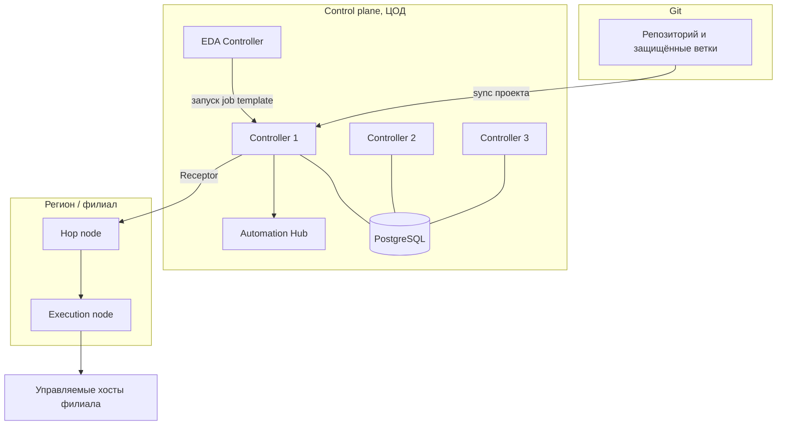

# AAP, AWX, Semaphore

Платформа автоматизации добавляет к ansible-core то, чего нет в CLI: централизованный запуск по расписанию, ролевую модель, журнал действий, управление учётными данными и единый каталог шаблонов. AWX, Semaphore и Red Hat Ansible Automation Platform (AAP) решают эту задачу с разной степенью поддержки и сложности.

## 1. Зачем это нужно

На 200–1000 хостов в 10–50 филиалах CLI перестаёт быть достаточным по организационным причинам. Нужно ответить, кто запускал обновление в филиале, какие учётные данные при этом использовались, почему ночная задача упала и кто её перезапустил. Нужно разделить права: администратор филиала видит свои хосты, инженер ИБ — журнал, подрядчик — только согласованный шаблон.

Платформа также снимает с CI часть нагрузки. Пайплайн отвечает за проверку кода и сборку артефакта; платформа — за применение по расписанию, повторный запуск, подтверждения и аудит. Разделение полезно и с точки зрения безопасности: продакшн-ключи хранятся в платформе, а не в переменных пайплайна, и не попадают в артефакты сборки.

## 2. Ключевые понятия

| Понятие | Назначение |
|---|---|
| Automation Controller | центральный компонент запуска заданий (в AWX — веб-приложение) |
| Automation Hub | приватный каталог коллекций и образов исполнения |
| Event-Driven Ansible | обработка событий через rulebook |
| Execution Environment | образ контейнера с ansible-core и коллекциями |
| Automation Mesh | распределённое выполнение через hop и execution nodes |
| Receptor | транспорт mesh между узлами |
| Job Template | шаблон запуска playbook с инвентарём и учётными данными |
| Workflow | цепочка узлов с условиями перехода и подтверждениями |
| Approval node | узел workflow, требующий ручного подтверждения |
| Instance Group | группа узлов выполнения с общими ресурсами |
| Activity Stream | журнал действий пользователей и объектов |
| Organization / Team | границы прав и владения объектами |

## 3. Сравнение платформ

| Критерий | AWX | Semaphore | AAP |
|---|---|---|---|
| Лицензия и поддержка | Apache-2.0, сообщество | открытый код, сообщество | подписка Red Hat |
| RBAC | организации, команды, роли объектов | роли проекта, базовая модель | полная, включая `Approve` |
| Аудит | Activity Stream | история задач | Activity Stream и отчёты |
| Air-gapped | приватный registry образов | бинарник и СУБД | disconnected install и приватный Hub |
| Event-Driven Ansible | отдельно, ansible-rulebook | нет | в составе платформы |
| Automation Mesh | нет | нет | да |
| HA | реплики в Kubernetes | ограниченно, внешняя СУБД | эталонные топологии |
| Стоимость | инфраструктура и труд | минимальная | подписка за управляемый узел |
| Сложность | высокая: Kubernetes | низкая | высокая |
| Когда выбирать | есть Kubernetes и своя экспертиза | небольшая команда, быстрый старт | требуется поддержка и mesh |

Цены и состав подписки меняются, поэтому стоимость считается по актуальному прайсу Red Hat и числу управляемых узлов, а не по памяти. Для 600 хостов разница между «бесплатно, но своими силами» и «подписка с поддержкой» — это в первую очередь стоимость эксплуатации и риска, а не лицензии.

### Таблица решений

| Ситуация | Рекомендация |
|---|---|
| До 50 хостов, одна команда, нет требований к аудиту | ansible-core, Git и CI |
| 200–1000 хостов, несколько команд, нужны расписания и RBAC | AWX или Semaphore |
| Малая команда, нет Kubernetes, нужен быстрый старт | Semaphore |
| Есть Kubernetes, нужны workflow и каталог шаблонов | AWX Operator |
| Требуется поддержка вендора, FIPS, mesh между филиалами | AAP |
| Нужны события из SIEM с автоматической реакцией | AAP с EDA |
| Air-gapped без поддержки | AWX с приватным registry |
| Air-gapped с требованием сертифицированного контента | AAP с приватным Hub |

## 4. Схема



На схеме три уровня доверия: Git как источник кода, control plane в ЦОД с базой данных и Hub, execution plane в регионах. Execution node находится рядом с филиалами и сокращает зависимость от WAN, но именно он получает доступ к хостам, поэтому его периметр защищается отдельно.

## 5. Компоненты и объекты

### RBAC

Права выдаются на объект, а не глобально. Базовая модель — организации и команды; роли назначаются на проект, инвентарь, шаблон или workflow. Типовые роли контроллера: `Admin`, `Auditor`, `Execute`, `Read`, `Use`, `Adhoc`, `Update`, `Approve`.

Принцип наименьших привилегий выглядит так: администратор филиала получает `Execute` на шаблон своего филиала и `Read` на инвентарь, служба ИБ — `Auditor` на организацию, подрядчик — `Execute` на один шаблон с ограниченным инвентарём. Право `Adhoc` равносильно произвольному выполнению модулей и выдаётся только дежурной смене автоматизации.

### Учётные данные

Учётные данные хранятся в зашифрованном виде и не отображаются после сохранения. Типы: машина (SSH-ключ или пароль), система контроля версий, хранилище секретов, облачные провайдеры. Для каждого окружения — отдельная учётная запись: staging не должен иметь доступ к продакшн-хостам.

Практика: ключи и пароли не дублируются в переменных проекта; шаблон ссылается на учётные данные, а те, в свою очередь, могут получать значение из внешнего хранилища через плагин. Это снижает число мест, где секрет существует в открытом виде, и упрощает ротацию.

### Проекты и инвентари

Проект — это привязка к репозиторию с указанием ветки, тега или коммита и образа исполнения. Для продакшена указывается тег или коммит, а не плавающая ветка: иначе содержимое задания меняется без изменения версии. Обновление проекта (`update_on_launch`) удобно для staging и опасно для продакшена, где версия должна быть зафиксирована.

Инвентарь может быть статическим, синхронизироваться из проекта или собираться плагином — например, из vCenter. Синхронизация из внешнего источника удобна, но требует собственной учётной записи только на чтение и проверки, что в инвентарь не попадают лишние объекты.

### Workflow и approval nodes

Workflow описывает последовательность: обновить проект, выполнить проверку в режиме `--check`, развернуть canary, дождаться подтверждения, раскатать остальные хосты. Узлы соединяются переходами `on_success`, `on_failure` и `always`, что позволяет автоматически останавливать цепочку при сбое.

Approval node останавливает выполнение до решения человека с ролью `Approve`. Это удобная точка контроля для изменений SSH, firewall и сети: подтверждающий видит, какой шаблон и какой инвентарь будут затронуты, и фиксирует решение в журнале. Таймаут подтверждения задаётся, чтобы цепочка не висела неделями.

## 6. Mesh и отказоустойчивость

Automation Mesh распределяет выполнение: control plane остаётся в ЦОД, hop nodes передают трафик между сегментами, execution nodes работают рядом с филиалами. Это снижает влияние WAN и позволяет не открывать SSH из ЦОД в каждый филиал. Плата — дополнительные узлы, сертификаты и мониторинг связности.

Отказоустойчивость строится на трёх принципах: несколько экземпляров контроллера за балансировщиком, внешняя СУБД с резервным копированием, отдельные узлы выполнения по регионам. AWX в Kubernetes масштабируется репликами, но база данных всё равно выносится наружу: восстановление пода без базы бессмысленно. Semaphore при внешней СУБД допускает несколько экземпляров, однако официальной эталонной HA-топологии у него нет, и это ограничение нужно учитывать.

## 7. Sizing для 200–1000 хостов

| Компонент | Ориентир | Примечание |
|---|---|---|
| Controller | 3 × (4 vCPU, 8 ГБ) | HA, внешняя СУБД |
| PostgreSQL | 4 vCPU, 16 ГБ, SSD | резервное копирование и реплика |
| Automation Hub | 2 × (2 vCPU, 8 ГБ) | при air-gapped или приватных коллекциях |
| EDA Controller | 2 × (2 vCPU, 8 ГБ) | при событийной автоматизации |
| Hop node | 1 × (2 vCPU, 4 ГБ) на регион | mesh |
| Execution node | 2 × (4 vCPU, 8 ГБ) на регион | близость к филиалам |

Цифры — ориентир для планирования, а не гарантия: фактическая нагрузка зависит от числа одновременных заданий, `forks`, времени сбора фактов и задержек WAN. Для 600 хостов при `serial: "10%"` одновременно работают около 60 машин, поэтому `forks` на шаблоне задаётся не меньше 64, а память контроллера рассчитывается с запасом на 20–30%.

Отдельно планируется хранилище: журналы заданий растут быстро, и глубина хранения определяется требованиями аудита. Перед промышленной эксплуатацией проводится нагрузочный тест: параллельный запуск на 10% парка с реалистичным playbook показывает, где узкое место — СУБД, сеть или сбор фактов.

## 8. Пошаговая реализация: три этапа

1. Этап 1 (0–3 месяца): ansible-core, Git, CI, роли и тесты. Этого достаточно для 200–300 хостов, если запуски редкие и команда небольшая.
2. Этап 2 (3–6 месяцев): AWX или Semaphore. Появляются расписания, RBAC, журнал, единые учётные данные.
3. Этап 3 (6–12 месяцев и позже): AAP, если нужны поддержка, mesh, EDA, приватный Hub и требования комплаенса к сертифицированному контенту.

Переход на следующий этап оправдан, когда появляется конкретная потребность, а не «потому что так принято». Признаки: ручные перезапуски по ночам, несколько команд делят один набор ключей, аудит требует журнала действий, филиалы жалуются на таймауты из ЦОД, ИБ просит автоматическую реакцию на события.

## 9. Полный пример: запуск шаблона из пайплайна

Платформа интегрируется с CI через API. Пример запускает job template, ждёт завершения и проверяет статус; токен берётся из переменной окружения и не хранится в репозитории.

`playbooks/launch_job.yml`:

```yaml
---
- name: Launch controller job template and wait for result
  hosts: localhost
  gather_facts: false

  vars:
    controller_url: "https://awx.example.internal"
    job_template_id: 42
    controller_token: "{{ lookup('env', 'CONTROLLER_TOKEN') }}"
    target_limit: "canary"

  tasks:
    - name: Launch job template
      ansible.builtin.uri:
        url: "{{ controller_url }}/api/v2/job_templates/{{ job_template_id }}/launch/"
        method: POST
        headers:
          Authorization: "Bearer {{ controller_token }}"
          Content-Type: application/json
        body_format: json
        body:
          limit: "{{ target_limit }}"
          extra_vars:
            release_version: "2.4.0"
        status_code: 201
      register: launch
      no_log: true

    - name: Wait until the job reaches a final state
      ansible.builtin.uri:
        url: "{{ controller_url }}/api/v2/jobs/{{ launch.json.id }}/"
        method: GET
        headers:
          Authorization: "Bearer {{ controller_token }}"
        status_code: 200
      register: job
      until: job.json.status in ['successful', 'failed', 'error', 'canceled']
      retries: 90
      delay: 10
      changed_when: false
      no_log: true

    - name: Fail when the job did not succeed
      ansible.builtin.assert:
        that:
          - job.json.status == 'successful'
        fail_msg: >-
          Job {{ launch.json.id }} finished with status {{ job.json.status }}.
          Inspect stdout in the controller before retrying.
```

`no_log: true` скрывает заголовок с токеном; при отладке используйте `-vvv` только на лабораторном контроллере с тестовым токеном. Ограничение `limit` передаётся в задание, поэтому тот же шаблон обслуживает canary и полную раскатку без дублирования.

## 10. Проверка результата

```bash
curl -fsS -H "Authorization: Bearer $CONTROLLER_TOKEN" \
  https://awx.example.internal/api/v2/ping/
curl -fsS -H "Authorization: Bearer $CONTROLLER_TOKEN" \
  https://awx.example.internal/api/v2/jobs/ | head -c 400
ansible-playbook playbooks/launch_job.yml -e target_limit=canary
```

Проверьте в интерфейсе: задание появилось в журнале, в поле `limit` указан `canary`, учётные данные не отображаются в выводе, Activity Stream содержит запись о запуске с именем пользователя или сервисной учётки. Если включён mesh, убедитесь, что задание выполнено на ожидаемом execution node, а не на контроллере.

## 11. Безопасность и blast radius

| Риск | Последствие | Мера |
|---|---|---|
| Общая учётная запись на все окружения | ошибка staging меняет продакшн | отдельные credentials на окружение |
| Право `Adhoc` у широкой группы | произвольное выполнение модулей | выдавать только дежурным |
| Плавающая ветка в продакшн-проекте | непредсказуемая версия | тег или коммит |
| Подтверждение без права `Approve` | узкое место и обход | роли и таймауты approval |
| Внешний инвентарь без проверки | в выборку попадают чужие хосты | фильтры и read-only учётка |
| Долгоживущий токен API | компрометация на месяцы | OIDC, ротация, ограничение scope |
| Единственный контроллер | простой автоматизации | HA и резервная копия БД |

Blast radius платформы выше, чем у отдельного пайплайна: скомпрометированный контроллер имеет доступ ко всем инвентарям и учётным данным. Поэтому control plane размещается в отдельном сегменте, доступ к интерфейсу — через bastion и MFA, а ключи к хостам выдаются по принципу минимально необходимого набора.

## 12. Комплаенс-маппинг

| Требование | Как закрывается |
|---|---|
| ISO/IEC 27001:2022 A.8.15 | журналирование действий и результатов |
| ISO/IEC 27001:2022 A.8.2 | ролевая модель и наименьшие привилегии |
| CIS Control 5, 6 | управление учётными записями и доступом |
| NIST CSF 2.0 PR.AA | аутентификация, авторизация, аудит |
| Аудит | Activity Stream, история заданий, отчёты |

## 13. Типичные ошибки и troubleshooting

| Симптом | Причина | Проверка | Решение |
|---|---|---|---|
| `401 Unauthorized` | токен истёк или неверный URL | `curl /api/v2/ping/` | обновить токен, проверить схему |
| Задание в статусе `pending` | нет свободных слотов или узлов | `instance_groups` | увеличить `forks` или добавить execution node |
| `404` при запуске | неверный `job_template_id` | `GET /api/v2/job_templates/` | взять актуальный идентификатор |
| Playbook не находит коллекцию | образ исполнения без зависимостей | лог задания | пересобрать EE |
| Approval висит | нет пользователя с ролью `Approve` | настройки workflow | назначить роль, задать таймаут |
| Медленный старт задания | сбор фактов и WAN | профиль задания | fact caching, execution node в регионе |
| После обновления AAP пропал проект | изменился путь или ветка | синхронизация проекта | обновить привязку SCM |

## 14. Чек-лист

- [ ] Выбран этап внедрения и зафиксированы критерии перехода.
- [ ] Продакшн-проект привязан к тегу, а не к ветке.
- [ ] Для каждого окружения отдельные учётные данные.
- [ ] Права выданы на объекты, а не глобально.
- [ ] `Adhoc` ограничен дежурной сменой.
- [ ] Workflow содержит проверку и approval для рискованных изменений.
- [ ] Настроены резервное копирование и проверка восстановления.
- [ ] Журналы хранятся в соответствии с требованиями аудита.
- [ ] Токены API короткоживущие и ротируются.
- [ ] Проведён нагрузочный тест на 10% парка.

## 15. Источники

- [AWX project](https://github.com/ansible/awx)
- [AWX Operator](https://github.com/ansible/awx-operator)
- [Semaphore](https://github.com/ansible-semaphore/semaphore)
- [Red Hat Ansible Automation Platform](https://www.redhat.com/en/technologies/management/ansible)
- [ansible-rulebook](https://github.com/ansible/ansible-rulebook)

## 16. Связанные страницы

- [Секреты в CI/CD](../secure-dev/14-cicd-secrets.md)
- [Безопасность цепочки поставок](../secure-dev/15-supply-chain.md)
- [Распределённые филиалы](../admin/20-branch-fleet.md)
- [Масштабирование и производительность](../admin/30-scaling.md)
- [CI/CD и GitOps](51-cicd-gitops.md)
