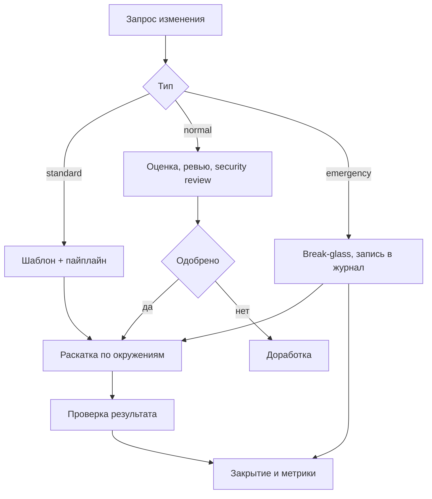

# Governance и процессы

Governance — это набор договорённостей, которые делают автоматизацию предсказуемой: кто принимает решения, как называются объекты, как изменение попадает в продакшн и по каким метрикам видно, что процесс работает. Без него технически исправный Ansible превращается в набор личных playbook'ов.

## 1. Зачем это нужно

В распределённой сети автоматизация быстро выходит за рамки одной команды. Филиалы заводят свои роли, подрядчики приносят шаблоны, ИБ требует доказательств, руководство — отчёт о покрытии. Если нет общих правил, появляются пять способов именовать инвентарь, три версии одной роли и исключения, о которых никто не помнит.

Governance не означает бюрократию. Хорошо устроенный процесс занимает минуты на типовое изменение: стандартное изменение проходит по заранее одобренному шаблону, нормальное — через ревью и апрув, аварийное — по процедуре break-glass с последующим разбором. Плохо устроенный процесс одинаково тяжёл для всех изменений, поэтому его обходят.

Признак зрелого процесса — предсказуемость, а не количество согласующих. Инженер заранее знает, сколько времени займёт изменение и какие доказательства нужно приложить. Если ответ зависит от того, кто сегодня дежурит, процесс описан недостаточно. Если же типовое изменение ждёт неделю, процесс будет обойдён при первой аварии.

## 2. Ключевые понятия

| Понятие | Назначение |
|---|---|
| RACI | матрица ролей: ответственный, исполняющий, консультирующий, информируемый |
| Стандарт именования | единые правила для групп, ролей, переменных, тегов и веток |
| Владелец (owner) | лицо или команда, отвечающие за объект |
| Change enablement | практика управления изменениями, совместимая с ITIL |
| Standard change | предварительно одобренное изменение по шаблону |
| Normal change | изменение, требующее оценки и согласования |
| Emergency change | аварийное изменение с последующим разбором |
| Исключение (exception) | временное отступление от требования с датой пересмотра |
| Automation coverage | доля хостов, охваченных регулярной автоматизацией |
| Drift rate | доля хостов, состояние которых отличается от описанного |
| MTTR ремедиации | время от обнаружения дрейфа до приведения к норме |
| Run success rate | доля успешных запусков |

## 3. Схема изменения



Схема показывает, что все три типа изменения сходятся в одной точке — раскатке и проверке результата. Различается только путь согласования. Аварийное изменение не отменяет проверку: оно лишь позволяет начать раньше, а разбор проводится после стабилизации.

## 4. Пошаговая реализация

1. Назначьте владельцев: у репозитория, каждой роли и каждого инвентаря есть ответственная команда.
2. Зафиксируйте стандарт именования и структуру репозитория в документе, который лежит рядом с кодом.
3. Опишите RACI для ключевых активностей и утвердите его у руководства.
4. Определите каталог стандартных изменений: что можно делать без согласования и при каких условиях.
5. Введите реестр исключений с обязательной датой истечения и владельцем.
6. Настройте сбор метрик из пайплайна и платформы запуска.
7. Проводите ежеквартальный обзор: метрики, исключения, инциденты, план обучения.
8. Обновляйте документы при изменении процесса, а не только при аудите.

Порядок важен: сначала владельцы и стандарты, затем процесс, затем метрики. Метрики без договорённостей измеряют хаос, а процесс без владельцев не исполняется.

## 5. RACI

| Активность | Руководитель автоматизации | Платформенный инженер | Инженер ИБ | Владелец филиала | Change manager |
|---|---|---|---|---|---|
| Стандарт именования | A | R | C | I | I |
| Ревью ролей и playbook | A | R | C | I | I |
| Security review | I | C | A/R | I | I |
| Выпуск релиза | A | R | C | I | C |
| Инвентарь филиала | I | C | I | A/R | I |
| Обработка инцидента | C | R | A | C | I |
| Реестр исключений | A | C | R | C | C |
| Метрики и отчёты | A | R | C | I | C |
| Обучение и лаборатория | A | R | C | C | I |
| Внутренний аудит | C | C | R | I | A |

`R` — выполняет, `A` — отвечает за результат, `C` — консультирует, `I` — информируется. У каждой активности ровно один `A`: если ответственных двое, решение не принимается. Для небольшой команды роли совмещаются, но матрица всё равно фиксируется письменно, иначе конфликт интересов решается по громкости голоса.

## 6. Именование и структура репозитория

| Объект | Правило | Пример |
|---|---|---|
| Группа инвентаря | `branch_<код>` | `branch_msk` |
| Роль | `<домен>_<назначение>` | `corp_baseline` |
| Переменная роли | префикс роли | `corp_baseline_sshd` |
| Тег задачи | глагол или домен | `packages`, `sshd` |
| Ветка | `feat/<номер>-<тема>` | `feat/142-ssh-ciphers` |
| Тег релиза | `vMAJOR.MINOR.PATCH` | `v2.4.0` |
| Файл инвентаря | `<env>/hosts.yml` | `prod/hosts.yml` |
| Шаблон | `<назначение>.conf.j2` | `sshd_baseline.conf.j2` |

Структура репозитория:

```text
automation/
  ansible.cfg
  requirements.yml
  requirements-dev.txt
  roles/
    corp_baseline/
  playbooks/
    site.yml
    canary.yml
    rollout.yml
  inventories/
    prod/hosts.yml
    prod/group_vars/all.yml
    staging/hosts.yml
    lab/hosts.yml
  collections/
  changelogs/fragments/
  governance/
    exceptions.yml
    naming.md
    raci.md
  docs/
    runbooks/
```

Правило «один объект — одно место» важнее конкретных названий. Инвентарь продакшена лежит только в `inventories/prod`, секреты — только в vault-файлах или внешнем хранилище, документация — рядом с кодом. Если значение продублировано в двух местах, рано или поздно они разойдутся.

## 7. Управление изменениями

Процесс описывается в терминах, совместимых с ITIL, но без лишних артефактов. Для каждого изменения фиксируются: что меняется, зачем, какой blast radius, как проверить результат, как откатить, в какое окно выполнять.

| Тип | Признаки | Согласование | Пример |
|---|---|---|---|
| Standard | шаблон из каталога, низкий риск | не требуется, достаточно пайплайна | обновление пакета, ротация MOTD |
| Normal | новый шаблон, изменение прав, сети, SSH | ревью, security review, апрув | смена параметров sshd в филиале |
| Emergency | инцидент, простой, уязвимость | break-glass, разбор в течение 48 часов | закрытие критической уязвимости |

Каталог стандартных изменений — ключевой элемент. В него попадают операции, которые уже многократно выполнялись, покрыты тестами и имеют проверенный откат. Каталог пересматривается ежеквартально: то, что год назад было нормальным изменением, сегодня может стать стандартным, и наоборот.

Окна изменений и заморозки описываются заранее. Для филиальной сети типичное окно — ночь по местному времени площадки, вне периода закрытия отчётности. Заморозка на время праздников или аудита объявляется письменно и снимается так же; иначе она либо забывается, либо становится постоянной. Аварийные изменения допускаются в любое время, но требуют записи и последующего разбора.

## 8. Метрики

| Метрика | Определение | Источник | Пример цели |
|---|---|---|---|
| Automation coverage | доля хостов с регулярным применением ролей | инвентарь и журнал запусков | 90% |
| Drift rate | доля хостов с непустым `--check --diff` | плановый прогон | ниже 5% |
| MTTR ремедиации | медиана времени от обнаружения до устранения | тикеты и логи | менее 24 часов |
| Run success rate | успешные запуски к общему числу | платформа и CI | выше 98% |
| Change failure rate | изменения, вызвавшие инцидент | журнал изменений | ниже 5% |
| Overdue exceptions | исключения с истёкшим сроком | реестр | 0 |

Значения в последней колонке — пример политики, а не отраслевой норматив: каждая организация устанавливает цели исходя из зрелости и критичности. Важнее динамика: рост покрытия, снижение дрейфа, сокращение времени ремедиации. Метрика, которая не влияет на решения, не нужна.

Метрики собираются автоматически, иначе они субъективны. `Run success rate` считается по журналу платформы, `drift rate` — по отчёту планового прогона, `overdue exceptions` — по реестру, который проверяется тем же пайплайном.

## 9. Документация, владельцы и исключения

Документация делится на три уровня: README роли (что делает, какие параметры, примеры), runbook (как реагировать на сбой), решение (ADR — почему выбрано именно так). README обновляется вместе с кодом в том же merge request; runbook — при изменении процедуры; ADR не переписывается, а дополняется новым.

Владельцы фиксируются в `CODEOWNERS` и в каталоге автоматизации. Владелец роли отвечает за её совместимость и срок поддержки, владелец филиала — за достоверность инвентаря, владелец сервиса — за приоритет изменений.

Исключения ведутся в машиночитаемом виде, чтобы их можно было проверить автоматически:

```yaml
---
exceptions:
  - id: EXC-2026-014
    scope: "branch_nsk:web"
    control: "CIS 5.2.4"
    reason: "legacy application requires an outdated protocol"
    owner: "branch-nsk-ops"
    approved_by: "security-board"
    approved_on: "2026-10-01"
    expires_on: "2027-01-31"
    compensating_control: "network segmentation and IDS rule"
    review_ticket: "SEC-4412"
```

Полный пример проверки реестра — `governance/validate_exceptions.yml`:

```yaml
---
- name: Validate exception register
  hosts: localhost
  gather_facts: false

  vars:
    register_file: "{{ playbook_dir }}/exceptions.yml"
    max_days_left: 90

  tasks:
    - name: Load exception register
      ansible.builtin.include_vars:
        file: "{{ register_file }}"
        name: registry

    - name: Fail when an exception has expired
      ansible.builtin.assert:
        that:
          - (item.expires_on | to_datetime('%Y-%m-%d')).date() > now(utc=false).date()
        fail_msg: >-
          Exception {{ item.id }} expired on {{ item.expires_on }}.
          Remove it or renew it with a new approval.
        quiet: true
      loop: "{{ registry.exceptions }}"
      loop_control:
        label: "{{ item.id }}"

    - name: Report exceptions expiring soon
      ansible.builtin.debug:
        msg: >-
          {{ item.id }} expires in
          {{ ((item.expires_on | to_datetime('%Y-%m-%d')).date() - now(utc=false).date()).days }} days
      loop: "{{ registry.exceptions }}"
      loop_control:
        label: "{{ item.id }}"
      when: >-
        ((item.expires_on | to_datetime('%Y-%m-%d')).date() - now(utc=false).date()).days
        < max_days_left
```

`include_vars` с `name: registry` загружает файл в переменную, `to_datetime` приводит дату к сравнимому типу, `now(utc=false)` даёт текущую локальную дату. Сравнение выполняется по календарным датам, поэтому часовой пояс не влияет на результат. Проверка встраивается в пайплайн и запускается по расписанию: просроченное исключение останавливает сборку и требует решения, а не тихо живёт в таблице.

## 10. Проверка результата

```bash
ansible-playbook governance/validate_exceptions.yml
ansible-playbook governance/validate_exceptions.yml -e max_days_left=30
git log --oneline -- governance/exceptions.yml | head
```

Ожидаемый результат: просроченные исключения отсутствуют, предупреждения выводятся для записей с истечением менее чем через 30 дней, история файла показывает, кто и когда менял записи. Дополнительно сверьте RACI и стандарт именования с фактическим репозиторием: расхождение означает, что документ устарел.

## 11. Безопасность и blast radius

| Риск | Последствие | Мера |
|---|---|---|
| Нет владельца роли | изменения без ответственного | `CODEOWNERS`, каталог автоматизации |
| Исключение без срока | контроль отключён навсегда | обязательное `expires_on`, автопроверка |
| Стандартное изменение с высоким риском | обход согласования | каталог и периодический пересмотр |
| Метрики «рисуются» вручную | ложная картина зрелости | сбор из журналов и пайплайна |
| Документация отдельно от кода | устаревшие инструкции в инциденте | docs рядом с кодом, ревью в MR |

Governance влияет на blast radius косвенно, но сильно: именно он определяет, кто может запустить изменение и на какую часть парка. Если право запуска есть у всех и нет каталога стандартных изменений, ограничение технических предохранителей компенсируется организационной вседозволенностью.

## 12. Комплаенс-маппинг

| Требование | Как закрывается |
|---|---|
| ISO/IEC 27001:2022 A.5.1 | утверждённые политики и стандарты |
| ISO/IEC 27001:2022 A.5.2 | распределение ролей и ответственности |
| ISO/IEC 27001:2022 A.8.32 | управление изменениями |
| NIST CSF 2.0 GV.RR | роли, ответственность, полномочия |
| CIS Control 1 | инвентаризация активов и владельцев |

## 13. Типичные ошибки и troubleshooting

| Симптом | Причина | Проверка | Решение |
|---|---|---|---|
| RACI не соблюдается | нет `A` или ролей слишком много | матрица | один ответственный на активность |
| Исключения копятся | нет автоматической проверки | реестр | пайплайн и уведомления |
| Метрики расходятся | разные источники данных | сверка | единый источник, определение метрики |
| Роли называются по-разному | нет стандарта | поиск по репозиторию | правила и линтер имён |
| Документация устарела | живёт отдельно от кода | дата последнего обзора | перенести в репозиторий, ревью |
| Каталог стандартных изменений не используется | слишком узкий или неизвестен | журнал изменений | пересмотреть, обучить |

## 14. Чек-лист

- [ ] У репозитория, ролей и инвентарей есть владельцы.
- [ ] RACI утверждён и имеет одного `A` на активность.
- [ ] Стандарт именования применяется и проверяется.
- [ ] Структура репозитория единая для всех команд.
- [ ] Каталог стандартных изменений существует и пересматривается.
- [ ] Реестр исключений машиночитаем и проверяется автоматически.
- [ ] Метрики собираются из журналов, а не вручную.
- [ ] Документация обновляется в том же merge request.
- [ ] Проводится ежеквартальный обзор процесса.
- [ ] Результаты обзора фиксируются и влияют на план.

## 15. Источники

- [ISO/IEC 27001](https://www.iso.org/standard/27001)
- [NIST Cybersecurity Framework](https://www.nist.gov/cyberframework)
- [CIS Critical Security Controls](https://www.cisecurity.org/controls)
- [Ansible playbook best practices](https://docs.ansible.com/ansible/latest/playbook_guide/playbooks_best_practices.html)

## 16. Связанные страницы

- [Комплаенс и доказательства](../security/44-compliance.md)
- [Ревью и релизы](52-review-release.md)
- [AAP, AWX, Semaphore](53-aap-awx.md)
- [Дорожная карта внедрения](../ops/63-roadmap.md)
- [CI/CD и GitOps](51-cicd-gitops.md)
