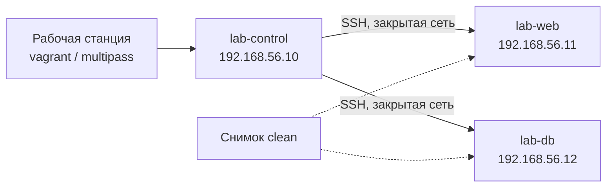

# Обучение и лаборатория

Лаборатория — это изолированный набор машин, на которых можно ошибаться без последствий для филиалов. Она нужна не только новичкам: перед раскаткой новой роли, при разборе инцидента и при проверке обновления коллекции безопаснее воспроизвести ситуацию на стенде, чем на боевом хосте.

## 1. Зачем это нужно

Ansible осваивается быстрее всего через практику, но практика на продакшене недопустима. Лаборатория даёт три вещи: безопасное пространство для ошибок, воспроизводимый сценарий для обучения и полигон для проверки изменений перед merge request. Стоимость стенда из трёх виртуальных машин несопоставима с ценой одного инцидента на филиале.

Второй эффект — общий язык. Когда вся команда прошла одни и те же сценарии, на ревью обсуждают `serial` и `validate`, а не базовый синтаксис. Обучение становится частью процесса, а не разовым мероприятием при приёме на работу.

Лаборатория нужна и для проверки обновлений. Новая версия коллекции, изменение образа исполнения, переход на другой минорный релиз ansible-core — всё это сначала проверяется на стенде, где можно сравнить поведение до и после. Такой прогон занимает час и отвечает на вопрос, который иначе выясняется на первом же филиале.

Наконец, стенд помогает разбирать инциденты. Воспроизведение сбоя на копии конфигурации позволяет проверить гипотезу, не трогая боевой хост, и подготовить проверенный откат. Это особенно полезно для SSH, firewall и сети, где ошибка в диагностике стоит доступа.

## 2. Ключевые понятия

| Понятие | Назначение |
|---|---|
| Лаборатория (lab) | изолированные ВМ для обучения и проверки |
| Vagrant | декларативное создание ВМ из `Vagrantfile` |
| Multipass | быстрый запуск ВМ Ubuntu одной командой |
| libvirt / KVM | локальная виртуализация на Linux |
| Контейнер | лёгкая среда для тестов ролей с ограничениями |
| Снимок (snapshot) | состояние ВМ для быстрого отката |
| Учебный сценарий | задача с ожидаемым результатом и проверкой |
| Capstone | итоговый проект курса |
| Воркшоп | практическое занятие в группе |

## 3. Варианты лаборатории

| Вариант | Плюсы | Ограничения | Когда подходит |
|---|---|---|---|
| Vagrant + VirtualBox | простой старт, много образов | медленнее, требует драйверов | рабочая станция инженера |
| Vagrant + libvirt | близко к серверной виртуализации | нужен `vagrant-libvirt` и права | Linux-станция, CI-стенд |
| Multipass | одна команда на ВМ, быстрый старт | только Ubuntu | обучение основам, Ubuntu-сценарии |
| libvirt + cloud-init | полный контроль, близко к продакшену | выше порог входа | стенд команды на сервере |
| Контейнеры | секунды на запуск, дёшево | нет ядра, systemd, SELinux, auditd | Molecule, тесты простых ролей |
| ВМ на существующем ESXi | реалистичная среда | нужны ресурсы и согласование | проверка VMware-ролей, репетиция раскатки |

Контейнеры удобны для линта и Molecule, но не заменяют ВМ. В контейнере нельзя проверить `sysctl`, `auditd`, `firewalld`, SELinux в режиме `enforcing`, загрузчик и работу с vCenter. Если сценарий касается безопасности ядра или сети, нужна виртуальная машина.

### Vagrant

`Vagrantfile` описывает состав стенда и повторяем на любой машине с тем же провайдером. Для libvirt требуется плагин `vagrant-libvirt`; для VirtualBox — установленный гипервизор. Образ выбирается с поддержкой нужного провайдера.

### Multipass

Подходит для быстрого сценария «control node и два управляемых хоста» на Ubuntu. Команды короткие, но параметров меньше, чем у Vagrant, и снимки ограничены.

```bash
multipass launch 24.04 --name lab-control --cpus 2 --memory 2G --disk 10G
multipass launch 24.04 --name lab-web --cpus 1 --memory 1G --disk 8G
multipass launch 24.04 --name lab-db --cpus 1 --memory 1G --disk 8G
multipass list
multipass shell lab-control
```

### libvirt и ESXi

На сервере команды удобно держать стенд на libvirt с cloud-init: те же образы, что в продакшене, и полноценные снимки. Если есть свободные ресурсы на ESXi, стенд можно поднять там — это единственный способ реалистично проверить роли `community.vmware`, работу с шаблонами и снапшотами. Отдельный кластер или ресурсный пул обязателен: лабораторные ВМ не должны конкурировать с продакшн-нагрузкой.

## 4. Схема стенда



Стенд изолирован: машины видят друг друга в приватной сети, но не имеют маршрута в корпоративную сеть. Снимок `clean` делается сразу после установки ВМ и до первого playbook — это точка возврата для любого учебного сценария.

## 5. Пошаговая реализация

1. Установите гипервизор и Vagrant либо Multipass; проверьте, что ВМ запускается.
2. Создайте `Vagrantfile` с control node и двумя управляемыми хостами в приватной сети.
3. Поднимите стенд, проверьте связность по SSH и доступ в интернет через NAT.
4. Сделайте снимок `clean` до любых изменений.
5. Настройте inventory и проверьте `ansible.builtin.ping`.
6. Прогоните первый playbook в режиме `--check --diff`, затем примените.
7. Повторите прогон и убедитесь, что изменений нет.
8. Разберите стенд после занятия или откатитесь к снимку.

## 6. Полный запускаемый пример

`Vagrantfile` в каталоге `lab/`:

```ruby
Vagrant.configure("2") do |config|
  config.vm.box = "rockylinux/9"
  config.ssh.insert_key = false
  config.vm.synced_folder ".", "/vagrant", disabled: true

  config.vm.define "control" do |ctrl|
    ctrl.vm.hostname = "lab-control"
    ctrl.vm.network "private_network", ip: "192.168.56.10"
    ctrl.vm.provider "libvirt" do |lv|
      lv.memory = 2048
      lv.cpus = 2
    end
  end

  %w[web db].each_with_index do |name, idx|
    config.vm.define name do |node|
      node.vm.hostname = "lab-#{name}"
      node.vm.network "private_network", ip: "192.168.56.#{11 + idx}"
      node.vm.provider "libvirt" do |lv|
        lv.memory = 1024
        lv.cpus = 1
      end
    end
  end
end
```

`inventories/lab/hosts.yml`:

```yaml
---
all:
  children:
    lab:
      hosts:
        lab-web:
          ansible_host: 192.168.56.11
        lab-db:
          ansible_host: 192.168.56.12
      vars:
        ansible_user: vagrant
        ansible_ssh_private_key_file: "~/.vagrant.d/insecure_private_key"
        ansible_python_interpreter: /usr/bin/python3
```

`playbooks/lab_baseline.yml`:

```yaml
---
- name: Apply a minimal baseline to lab nodes
  hosts: lab
  become: true
  gather_facts: true
  serial: 1
  max_fail_percentage: 0

  tasks:
    - name: Ensure baseline packages are present
      ansible.builtin.package:
        name:
          - ca-certificates
          - chrony
        state: present

    - name: Deploy lab MOTD
      ansible.builtin.copy:
        content: |
          Lab node {{ inventory_hostname }}
          Managed by Ansible. Destroy after training.
        dest: /etc/motd
        owner: root
        group: root
        mode: "0644"

    - name: Ensure chronyd is running
      ansible.builtin.service:
        name: chronyd
        state: started
        enabled: true
```

Запуск стенда:

```bash
cd lab
vagrant up
vagrant status
vagrant snapshot save clean
cd ..
```

Вход на control node выполняется командой `vagrant ssh control` из каталога `lab/`. Дальнейшие команды запускаются из корня репозитория:

```bash
ansible --version
ansible -i inventories/lab/hosts.yml lab -m ansible.builtin.ping
ansible-playbook -i inventories/lab/hosts.yml playbooks/lab_baseline.yml --check --diff
ansible-playbook -i inventories/lab/hosts.yml playbooks/lab_baseline.yml
ansible-playbook -i inventories/lab/hosts.yml playbooks/lab_baseline.yml
```

Второй и третий прогоны должны дать `changed=0`. Возврат к снимку и разбор стенда:

```bash
cd lab
vagrant snapshot restore clean
vagrant destroy -f
```

!!! danger "Только для лаборатории"
    `ssh.insert_key = false` оставляет стандартный небезопасный ключ Vagrant, а inventory ссылается на него. Это допустимо только в изолированной лаборатории. В продакшене используются отдельные ключи, `host_key_checking = True` и сервисные учётные записи с ограниченными правами.

## 7. Учебные сценарии

| Сценарий | Что тренирует | Проверка |
|---|---|---|
| Инвентарь и ping | группы, переменные, доступ | `ansible-inventory --graph`, успешный ping |
| Первый playbook | задачи, идемпотентность | повторный прогон `changed=0` |
| Роль и шаблон | структура роли, handler, `validate` | `sshd -T`, статус сервиса |
| Vault | шифрование переменных, `no_log` | отсутствие секрета в логе |
| Опасное изменение | `--check`, `serial`, откат | доступ сохраняется после прогона |
| Molecule | тесты роли в контейнере | `molecule test` зелёный |
| Инцидент | изоляция хоста, сбор артефактов | хост изолирован, улики сохранены |
| Дрейф | `--check --diff`, отчёт | отчёт содержит расхождение |

Сценарии строятся от простого к сложному и всегда имеют проверяемый результат. «Посмотреть, как работает модуль» — не сценарий: без критерия готовности обучаемый не понимает, достиг ли цели.

## 8. План на шесть недель

| Неделя | Тема | Практика | Результат |
|---|---|---|---|
| 1 | Основы, inventory, ad-hoc | ping, факты, группы | работающий стенд и первый отчёт |
| 2 | Playbook, роли, шаблоны | роль baseline с handler | роль проходит повторный прогон |
| 3 | Идемпотентность и безопасность | `--check`, `serial`, vault | разбор рискованного изменения |
| 4 | Линт и Molecule | `.ansible-lint`, сценарий роли | зелёный `molecule test` |
| 5 | Безопасность и аудит | SSH, sudo, auditd в лаборатории | чек-лист харденинга |
| 6 | Capstone | роль + тесты + MR | ревью и защита решения |

Неделя занимает 4–6 часов практики. Формат подходит и для самостоятельного обучения, и для внутренней программы: теория читается заранее, занятие посвящено разбору и практике.

План адаптируется под роль. Системному администратору важнее недели 1–3 и 5, разработчику автоматизации — 3–4 и 6, руководителю достаточно обзорного занятия и понимания метрик. Сертификация не является целью плана: она подтверждает базовые навыки, но не заменяет знание собственного репозитория, инвентаря и процедур.

Оценка обучения строится на артефактах, а не на самочувствии. Признаки прогресса: участник самостоятельно пишет идемпотентную роль, проходит линтер с первого раза, объясняет blast radius своего изменения и может провести ревью чужого merge request. Если через шесть недель этих навыков нет, план пересматривается, а не продлевается автоматически.

## 9. Сертификации и внутренние воркшопы

Внешняя сертификация полезна как ориентир, но не заменяет практику. У Red Hat есть экзамен EX294, построенный вокруг автоматизации Ansible; программа экзамена периодически пересматривается, поэтому перед планированием сверьтесь с актуальными целями на сайте Red Hat. Для команды достаточно, чтобы экзамен сдали один-два человека: остальным важнее внутренние стандарты.

Внутренние воркшопы проводятся раз в месяц по 2–3 часа. Формат: короткий разбор темы, затем практика на стенде, затем коллективное ревью решений. Полезный приём — «сломанный playbook»: участникам выдаётся роль с типичными ошибками (секрет в логе, отсутствие `changed_when`, глобальный `become`), и её нужно довести до состояния, проходящего линтер и тесты.

Материалы воркшопов хранятся в репозитории вместе с лабораторными сценариями, чтобы новые сотрудники проходили тот же путь. Записи и конспекты стареют быстрее кода, поэтому основной артефакт — рабочий стенд и проверяемые задания.

## 10. Проверка результата

Команды выполняются из корня репозитория; состояние ВМ проверяется в каталоге `lab/`.

```bash
(cd lab && vagrant status)
ansible -i inventories/lab/hosts.yml lab -m ansible.builtin.ping
ansible-playbook -i inventories/lab/hosts.yml playbooks/lab_baseline.yml | tail -n 3
```

Признаки готовой лаборатории: все ВМ запущены, ping проходит без предупреждений, повторный playbook даёт `changed=0`, снимок `clean` существует, стенд не имеет маршрута в корпоративную сеть. Если ping падает по таймауту, проверьте приватную сеть и ключ; если по аутентификации — пользователя и файл ключа.

## 11. Безопасность и blast radius

| Правило | Почему |
|---|---|
| Только приватная сеть, без bridge в офис | ошибка в firewall не затронет коллег |
| Отдельные ключи и учётные записи | лабораторный ключ не даёт доступа к продакшену |
| Снимок до эксперимента | откат за секунды |
| Нет боевых секретов в лаборатории | утечка стенда не компрометирует инфраструктуру |
| Не менять SSH и firewall без консоли | риск потерять доступ к ВМ |
| Разбор стенда после курса | незакрытая ВМ — забытая точка входа |

Blast radius лаборатории ограничен её сетью. Как только стенд получает маршрут в корпоративную сеть или боевые учётные данные, он перестаёт быть лабораторией и становится частью продакшн-периметра со всеми последствиями.

## 12. Комплаенс-маппинг

| Требование | Как закрывается |
|---|---|
| ISO/IEC 27001:2022 A.7.2 | компетенции и обучение персонала |
| ISO/IEC 27001:2022 A.8.29 | проверка изменений до эксплуатации |
| NIST CSF 2.0 PR.AT | осведомлённость и подготовка |
| Аудит | журнал обучения и результаты воркшопов |

## 13. Типичные ошибки и troubleshooting

| Симптом | Причина | Проверка | Решение |
|---|---|---|---|
| `vagrant up` падает на libvirt | нет плагина или прав | `vagrant plugin list` | установить `vagrant-libvirt`, добавить в группу |
| ping по SSH не проходит | неверный ключ или пользователь | `ssh -i` вручную | проверить inventory и `insert_key` |
| ВМ не видит интернет | нет NAT или DNS | `ping 8.8.8.8` | проверить настройки провайдера |
| Playbook падает на `chronyd` | другой дистрибутив | `systemctl status` | использовать имя сервиса для ОС |
| Снимок не создаётся | провайдер не поддерживает | `vagrant snapshot list` | использовать libvirt или ВМ на ESXi |
| Стенд «плывёт» после занятий | нет снимка и разбора | список ВМ | вернуть `clean`, уничтожить лишнее |
| Обучение не закрепляется | нет практики и проверки | план занятий | добавить сценарии и capstone |

## 14. Чек-лист

- [ ] Лаборатория изолирована от корпоративной сети.
- [ ] Есть control node и минимум два управляемых хоста.
- [ ] Снимок `clean` создан до экспериментов.
- [ ] Inventory и ping работают.
- [ ] Учебные сценарии имеют проверяемый результат.
- [ ] План на шесть недель утверждён.
- [ ] Лабораторные ключи не дают доступа к продакшену.
- [ ] Воркшопы проводятся регулярно.
- [ ] Материалы хранятся в репозитории.
- [ ] Стенд разбирается после курса.

## 15. Источники

- [Vagrant documentation](https://developer.hashicorp.com/vagrant/docs)
- [Multipass documentation](https://multipass.run/)
- [libvirt documentation](https://libvirt.org/)
- [Red Hat EX294 exam](https://www.redhat.com/en/services/training/ex294-red-hat-certified-engineer-rhce-exam)
- [Ansible installation guide](https://docs.ansible.com/ansible/latest/installation_guide/intro_installation.html)

## 16. Связанные страницы

- [Быстрый старт: первый безопасный playbook](../start/quickstart.md)
- [Тестирование автоматизации](50-testing.md)
- [Дорожная карта внедрения](../ops/63-roadmap.md)
- [Playbooks, roles, handlers](../fundamentals/07-playbooks-roles.md)
- [Безопасная разработка playbook](../secure-dev/13-safe-code.md)
