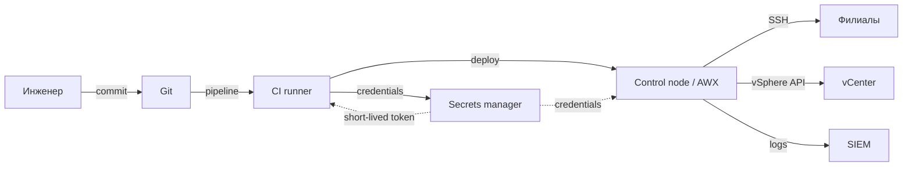

# Модель угроз автоматизации

Автоматизация концентрирует привилегии: control node хранит ключи, playbook описывает изменения на сотнях хостов, CI запускает код без человека. Компрометация этого контура равна компрометации всей инфраструктуры, поэтому модель угроз строится вокруг активов, границ доверия и путей атаки.

## 1. Зачем это нужно

Защита отдельных хостов не помогает, если злоумышленник получает доступ к раннеру CI или подменяет коллекцию. Модель угроз отвечает на три вопроса: что мы защищаем, кто и как может это нарушить, какие контроли снижают риск до приемлемого. Для филиальной сети добавляется распределённость: WAN-каналы, локальные execution nodes и офлайн-площадки расширяют поверхность атаки.

Модель — не разовый документ. Она пересматривается при изменении топологии, стека, CI-платформы и при каждом инциденте.

## 2. Активы и границы доверия

| Актив | Почему критичен | Владелец |
|---|---|---|
| Control node | ключи, доступ ко всем хостам, журналы | automation-team |
| CI/CD runner | выполняет код из репозитория, видит секреты | platform-team |
| Git-репозиторий | источник истины для конфигурации | automation-team |
| Credentials хранилище | пароли, токены, ключи | security-team |
| Execution Environment | контейнер с ядром и коллекциями | platform-team |
| Inventory | топология и адреса всех узлов | automation-team |
| Журналы запусков | доказательства и данные для разбора | soc |

Границы доверия:

1. Рабочая станция инженера → Git.
2. Git → CI runner.
3. CI runner → control node или AWX.
4. Control node → managed nodes через SSH/API.
5. Control node → внешние хранилища секретов.
6. Филиал → центральная площадка через WAN/VPN.

## 3. Схема trust boundaries



Красная линия модели: всё, что находится выше control node, может инициировать изменение на любом хосте. Защита CI и Git так же важна, как защита самого Ansible.

## 4. STRIDE для контура автоматизации

| Категория | Проявление | Пример |
|---|---|---|
| Spoofing | подмена control node или vCenter | самоподписанный сертификат, отключённая проверка host key |
| Tampering | изменение playbook или коллекции | вредоносный модуль в `requirements.yml` |
| Repudiation | отсутствие доказательств запуска | отключённый журнал, общий аккаунт |
| Information disclosure | утечка секретов и топологии | `debug: var=hostvars`, лог с паролем |
| Denial of service | блокировка доступа к филиалу | ошибочный firewall-playbook без отката |
| Elevation of privilege | повышение прав через become | глобальный `become: true` и слабый sudoers |

## 5. Сценарии угроз и контроли

| Сценарий | Влияние | Контроль | Остаточный риск |
|---|---|---|---|
| Компрометация control node | полный контроль над парком | отдельный узел, MFA, минимум ключей, EDR, сеть | высокий: нужен быстрый отзыв ключей |
| Отравленный inventory | изменения не на тех хостах | ревью, `--list-hosts`, ограничение прав | средний |
| Вредоносная коллекция | выполнение кода на control node | пины версий, приватный Hub, подпись, ревью | средний |
| Инъекция в шаблоне | изменение конфига или выполнение команды | `!unsafe`, allow-list, `command` с `argv` | низкий |
| Утечка секрета в лог | компрометация учётки | `no_log`, vault, ограничение `log_path` | средний |
| Компрометация CI runner | кража токенов и деплой | OIDC, эфемерные runner, protected branches | средний |
| Подмена журналов | сокрытие действий | централизованный SIEM, неизменяемое хранилище | низкий |
| Ошибка в опасном playbook | потеря доступа к филиалу | check/diff, canary, rollback timer | средний |

## 6. Контроли

Технические:

- отдельный control node без интерактивного входа; доступ только через bastion и MFA;
- SSH host key checking включён, known_hosts управляется централизованно;
- секреты только в vault или внешнем хранилище, короткоживущие токены;
- `no_log` для задач с секретами, журналы с ограниченным доступом;
- коллекции и Execution Environments зафиксированы и проверены;
- CI использует OIDC и эфемерные runner, а не долгоживущие ключи;
- опасные изменения проходят check/diff, canary и имеют план отката.

Процессные:

- ревью каждого playbook и `requirements.yml`;
- разделение ролей: автор, ревьюер, оператор запуска;
- журнал изменений и регулярный обзор прав;
- учения по отзыву ключей и восстановлению control node;
- пересмотр модели угроз после инцидента.

## 7. Проверка цепочки поставок

```bash
ansible-galaxy collection install -r requirements.yml --signature --keyring ~/.ansible/pubring.kbx
ansible-galaxy collection verify -r requirements.yml
ansible-lint --profile production playbooks/
```

Подпись коллекции проверяется только при наличии подписи и настроенного keyring. Если коллекция не подписана, это не делает её вредоносной, но снижает гарантии. Для air-gapped среды используйте внутреннее зеркало с контрольной суммой и подписанный бандл.

## 8. Остаточный риск

Полностью исключить риск нельзя: control node по определению имеет широкие права. Реалистичная цель — сделать компрометацию обнаруживаемой и ограниченной по времени:

- ключи и токены имеют срок жизни и отзываются автоматически;
- действия оператора попадают в SIEM;
- критичные изменения требуют второго человека;
- есть процедура break-glass и восстановления control node;
- у каждого остаточного риска есть владелец и дата пересмотра.

## 9. Комплаенс-маппинг

| Требование | Как закрывается |
|---|---|
| NIST CSF 2.0 ID.RA | идентификация и оценка рисков |
| NIST CSF 2.0 GV.RM | управление рисками и роли |
| ISO/IEC 27001:2022 A.5.7 | анализ угроз и уязвимостей |
| ISO/IEC 27001:2022 A.8.25 | безопасная разработка |
| CIS Control 16 | безопасность ПО и цепочки поставок |

## 10. Чек-лист

- [ ] Определены активы, владельцы и границы доверия.
- [ ] Для каждого сценария указаны контроль и остаточный риск.
- [ ] Control node изолирован и не используется как рабочая станция.
- [ ] Секреты не хранятся в Git и не попадают в логи.
- [ ] Коллекции зафиксированы и проверяются.
- [ ] CI использует короткоживущие credentials.
- [ ] Опасные изменения проходят canary и имеют откат.
- [ ] Модель угроз пересматривается после инцидентов и изменений.

## 11. Источники

- [NIST Cybersecurity Framework 2.0](https://www.nist.gov/cyberframework)
- [MITRE ATT&CK](https://attack.mitre.org/)
- [ISO/IEC 27001:2022](https://www.iso.org/standard/27001)
- [Ansible Galaxy: collection signatures](https://docs.ansible.com/ansible/latest/galaxy/user_guide.html#installing-signed-collections)
- [ansible-lint documentation](https://ansible.readthedocs.io/projects/lint/)

## 12. Связанные страницы

- [Архитектура и компоненты](../fundamentals/02-architecture.md)
- [Управление секретами](11-secrets.md)
- [Доступ и привилегии](12-access.md)
- [Секреты в CI/CD](14-cicd-secrets.md)
- [Безопасность цепочки поставок](15-supply-chain.md)
- [Аудит выполнения](16-audit-logging.md)
