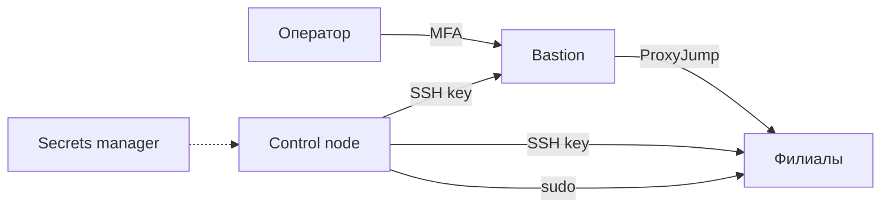

# Доступ и привилегии

Ansible подключается к хостам по SSH и повышает права через `become`. Это две самые чувствительные точки: ключ даёт вход, sudo — возможность изменить систему. Модель доступа должна быть минимальной, проверяемой и восстановимой при потере управления.

## 1. Зачем это нужно

Если у automation-пользователя есть `NOPASSWD: ALL`, compromise control node означает root на всех хостах. Если ключи не ротируются, уволенный инженер сохраняет доступ. Если `authorized_key` с `exclusive` применён без резервного ключа, можно закрыть себе вход во все филиалы. Управляемый доступ — это баланс между автоматизацией и защитой от самоблокировки.

## 2. Ключевые понятия

| Понятие | Назначение |
|---|---|
| `ansible_user` | пользователь SSH на managed node |
| `ansible_ssh_private_key_file` | ключ control node |
| `authorized_key` | управление ключами на хосте |
| `exclusive` | удаление всех ключей, кроме перечисленных |
| `become` | повышение прав через sudo/su |
| `sudoers.d` | отдельные файлы правил sudo |
| `validate` | проверка sudoers через `visudo` |
| bastion / ProxyJump | промежуточный узел доступа |
| break-glass | аварийный доступ при отказе основной схемы |

## 3. Схема доступа



Control node подключается к филиалам напрямую или через bastion. В обоих случаях host key проверяется, а приватный ключ существует только на control node и в защищённом хранилище.

## 4. Полный пример управления доступом

```yaml
---
- name: Manage automation access
  hosts: branches
  become: true
  gather_facts: true
  serial: 1
  max_fail_percentage: 0

  vars:
    automation_user: svc-ansible
    automation_group: automation
    automation_keys:
      - "ssh-ed25519 AAAAC3NzaC1lZDI1NTE5AAAAIExampleKey automation@example"
    sudo_group: "{{ 'sudo' if ansible_facts['os_family'] == 'Debian' else 'wheel' }}"

  tasks:
    - name: Ensure automation group exists
      ansible.builtin.group:
        name: "{{ automation_group }}"
        system: true
        state: present

    - name: Ensure automation user exists
      ansible.builtin.user:
        name: "{{ automation_user }}"
        group: "{{ automation_group }}"
        groups: "{{ sudo_group }}"
        append: true
        shell: /bin/bash
        create_home: true
        state: present

    - name: Install automation public keys
      ansible.posix.authorized_key:
        user: "{{ automation_user }}"
        key: "{{ item }}"
        state: present
        exclusive: false
      loop: "{{ automation_keys }}"

    - name: Deploy restricted sudoers rule
      ansible.builtin.template:
        src: templates/sudoers-automation.j2
        dest: /etc/sudoers.d/90-automation
        owner: root
        group: root
        mode: "0440"
        validate: "visudo -cf %s"

    - name: Verify sudo rule for automation user
      ansible.builtin.command:
        argv:
          - sudo
          - "-l"
          - "-U"
          - "{{ automation_user }}"
      register: sudo_check
      changed_when: false
      failed_when: sudo_check.rc != 0
```

`templates/sudoers-automation.j2`:

```jinja2
# {{ ansible_managed }}
Cmnd_Alias AUTOMATION_RELOAD = /usr/bin/systemctl reload sshd
svc-ansible ALL=(root) NOPASSWD: AUTOMATION_RELOAD
```

Правило разрешает только перезагрузку конфигурации SSH. Не выдавайте `ALL` и не разрешайте `systemctl` без ограничения: через него можно запустить произвольный сервис.

## 5. Ключи и ротация

Порядок ротации без простоя:

1. Добавьте новый ключ в `automation_keys`, не удаляя старый.
2. Примените на canary-хосте и проверьте вход новым ключом.
3. Раскатайте на остальные хосты.
4. Удалите старый ключ из списка.
5. Отзовите старый ключ в хранилище и журнале.

`exclusive: true` удаляет все ключи, кроме перечисленных. Это полезно для наведения порядка, но опасно: если забыть аварийный ключ, доступ будет потерян. Применяйте только с canary, вторым активным ключом и проверкой в отдельной сессии.

## 6. Host key checking и bastion

```yaml
all:
  vars:
    ansible_ssh_common_args: >-
      -o ProxyJump=bastion.example.local
      -o StrictHostKeyChecking=yes
      -o ConnectTimeout=15
```

`StrictHostKeyChecking=yes` — явное подтверждение проверки host key. Не отключайте её в продакшене: это открывает путь MITM. Для нового хоста добавьте ключ заранее:

```bash
ssh-keyscan -t ed25519 192.0.2.31 >> ~/.ssh/known_hosts
ssh-keygen -lf ~/.ssh/known_hosts | grep 192.0.2.31
```

Сверьте отпечаток с инвентарной записью или консолью. `ssh-keyscan` по сети без проверки отпечатка не защищает от MITM; он лишь упрощает первичное заполнение.

## 7. Сервисные учётки и RBAC

- Для приложений — отдельные системные пользователи с `nologin` и без sudo.
- Для автоматизации — отдельный пользователь, не личная учётная запись инженера.
- Для vCenter — сервисный аккаунт с ролью только на нужные объекты.
- Для AWX/AAP — роли организации, проекта и inventory, а не глобальный администратор.
- Для Git — защищённые ветки и обязательное ревью.

Личный аккаунт инженера не должен использоваться в playbook: при увольнении или смене роли доступ автоматизации сохранится.

## 8. Break-glass

Аварийный доступ нужен, если SSH-ключ утерян или конфигурация сломана. Требования:

- отдельная учётная запись с длинным паролем в vault;
- доступ только через консоль или изолированную сеть;
- журналирование входа и действий;
- процедура активации с апрувом;
- проверка не реже раза в квартал;
- отзыв после использования.

Break-glass не должен быть повседневным способом входа. Его наличие проверяется на учениях, а не в момент инцидента.

## 9. Безопасность и blast radius

| Риск | Последствие | Мера |
|---|---|---|
| `exclusive: true` без резервного ключа | потеря доступа ко всем хостам | canary, второй ключ, отдельная сессия |
| `NOPASSWD: ALL` | root на хосте | узкие команды в sudoers |
| Глобальный `become: true` | избыточные права | `become` только на нужных задачах |
| Отключён host key checking | MITM | `StrictHostKeyChecking=yes` |
| Общий аккаунт | нет атрибуции | персональные и сервисные учётки |
| Ключ без срока действия | доступ после увольнения | ротация и отзыв |

## 10. Комплаенс-маппинг

| Требование | Как закрывается |
|---|---|
| CIS Control 5 | управление учётными записями и доступом |
| CIS Control 6 | контроль привилегий |
| NIST CSF 2.0 PR.AA | аутентификация и авторизация |
| ISO/IEC 27001:2022 A.8.2 | привилегированный доступ |
| ISO/IEC 27001:2022 A.8.5 | безопасная аутентификация |

## 11. Типичные ошибки и troubleshooting

| Симптом | Причина | Проверка | Решение |
|---|---|---|---|
| `Permission denied (publickey)` | ключ не установлен или неверный пользователь | `ssh -vv` | проверить `ansible_user`, ключ, права |
| `sudo: a password is required` | нет NOPASSWD или правило не совпало | `sudo -l -U svc-ansible` | исправить sudoers, проверить путь команды |
| `visudo` не проходит | синтаксис шаблона | `visudo -cf файл` | исправить шаблон |
| Потерян доступ после `exclusive` | удалён аварийный ключ | консоль | break-glass, восстановить ключ |
| Host key mismatch | хост переустановлен | `ssh-keygen -F host` | удалить старый ключ, сверить отпечаток |
| `ProxyJump` не работает | bastion недоступен или ключ не проброшен | `ssh -J` вручную | проверить маршрут и `ssh_args` |

## 12. Чек-лист

- [ ] Автоматизация использует отдельного сервисного пользователя.
- [ ] Sudo разрешает только необходимые команды.
- [ ] `sudoers` проверяется через `visudo -cf %s`.
- [ ] Host key checking включён.
- [ ] Ключи ротируются, старые отзываются.
- [ ] `exclusive` применяется только с резервным ключом и canary.
- [ ] Break-glass существует и проверяется.
- [ ] Личные аккаунты не используются в playbook.

## 13. Источники

- [ansible.posix.authorized_key](https://docs.ansible.com/ansible/latest/collections/ansible/posix/authorized_key_module.html)
- [Understanding privilege escalation: become](https://docs.ansible.com/ansible/latest/playbook_guide/playbooks_privilege_escalation.html)
- [Connection plugins and SSH](https://docs.ansible.com/ansible/latest/plugins/connection.html)
- [OpenSSH ssh_config](https://man.openbsd.org/ssh_config)
- [sudoers manual](https://www.sudo.ws/docs/man/sudoers.man/)

## 14. Связанные страницы

- [Модель угроз автоматизации](10-threat-model.md)
- [Управление секретами](11-secrets.md)
- [SSH, PAM, sudo, MFA](../security/36-auth-ssh-pam.md)
- [Zero trust и JIT-доступ](../security/47-zero-trust.md)
- [Базовая сеть хоста](../admin/25-network-basics.md)
