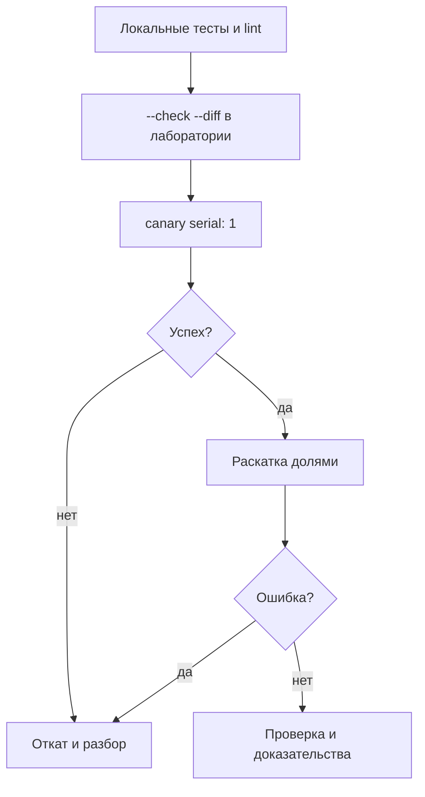

# Безопасная разработка playbook

Безопасный playbook — это не только отсутствие ошибок. Это предсказуемый blast radius, проверка до изменения, возможность отката и понятный след для аудита. Для SSH, firewall, sudo и сети эти свойства обязательны.

## 1. Зачем это нужно

Автоматизация выполняет изменения быстрее человека и сразу на многих хостах. Ошибка в одной задаче может закрыть доступ к филиалу, сломать вход или отключить сервис. Защита строится из нескольких барьеров: декларативные модули, `validate`, check/diff, canary, `serial`, `block/rescue`, handlers и план отката.

## 2. Ключевые понятия

| Понятие | Назначение |
|---|---|
| Идемпотентность | повторный запуск не меняет систему |
| Check mode | предсказание изменений без записи |
| Diff | показ различий файлов |
| Validate | проверка конфига до записи |
| Canary | первое применение на одном хосте |
| `serial` | размер партии хостов |
| `max_fail_percentage` | остановка после доли ошибок |
| `block/rescue/always` | обработка сбоя и завершение |
| Rollback | возврат к предыдущему состоянию |
| Blast radius | круг хостов и сервисов, затронутых изменением |

## 3. Схема безопасного изменения



Каждый переход — отдельный запуск с фиксацией результата. Не объединяйте проверку и полную раскатку в одну команду.

## 4. Полный пример с откатом

```yaml
---
- name: Apply validated SSH policy
  hosts: branches
  become: true
  gather_facts: true
  serial: 1
  max_fail_percentage: 0
  any_errors_fatal: true

  vars:
    ssh_fragment: /etc/ssh/sshd_config.d/60-baseline.conf
    ssh_backup: /etc/ssh/sshd_config.ansible-backup
    ssh_service: "{{ 'ssh' if ansible_facts['os_family'] == 'Debian' else 'sshd' }}"
    safe_change_confirmed: false

  tasks:
    - name: Require explicit confirmation before SSH change
      ansible.builtin.assert:
        that:
          - safe_change_confirmed | bool
        fail_msg: >-
          Open a second SSH session and rerun with
          -e safe_change_confirmed=true

    - name: Check sshd binary
      ansible.builtin.stat:
        path: /usr/sbin/sshd
      register: sshd_bin

    - name: Fail when sshd is not installed
      ansible.builtin.assert:
        that:
          - sshd_bin.stat.exists

    - name: Apply SSH fragment with rollback
      block:
        - name: Back up current sshd_config
          ansible.builtin.copy:
            src: /etc/ssh/sshd_config
            dest: "{{ ssh_backup }}"
            remote_src: true
            owner: root
            group: root
            mode: "0600"
            backup: true

        - name: Deploy validated SSH fragment
          ansible.builtin.template:
            src: templates/sshd_baseline.conf.j2
            dest: "{{ ssh_fragment }}"
            owner: root
            group: root
            mode: "0644"
            validate: "sshd -t -f %s"
          notify: Reload sshd

        - name: Flush handler inside the block
          ansible.builtin.meta: flush_handlers

        - name: Verify effective SSH configuration
          ansible.builtin.command:
            argv:
              - /usr/sbin/sshd
              - "-T"
          register: sshd_effective
          changed_when: false
          failed_when: sshd_effective.rc != 0

      rescue:
        - name: Remove failed SSH fragment
          ansible.builtin.file:
            path: "{{ ssh_fragment }}"
            state: absent

        - name: Reload sshd after rollback
          ansible.builtin.service:
            name: "{{ ssh_service }}"
            state: reloaded

        - name: Report rollback
          ansible.builtin.debug:
            msg: >-
              SSH change rolled back on {{ inventory_hostname }}.
              Keep the current session open and inspect the logs.

  handlers:
    - name: Reload sshd
      ansible.builtin.service:
        name: "{{ ssh_service }}"
        state: reloaded
```

`meta: flush_handlers` внутри блока важен: без него handler выполнится в конце play, и его ошибка не попадёт в `rescue`. Rollback удаляет новый фрагмент и перезагружает SSH, возвращая прежнее поведение.

## 5. Запуск

```bash
# 1. Проверка в лаборатории
ansible-playbook -i inventories/lab/hosts.yml site.yml --check --diff

# 2. Canary на одном хосте
ansible-playbook -i inventories/prod/hosts.yml site.yml \
  --limit msk-app01 -e safe_change_confirmed=true

# 3. Один филиал
ansible-playbook -i inventories/prod/hosts.yml site.yml \
  --limit branch_msk -e safe_change_confirmed=true

# 4. Все филиалы, партиями по 10%
ansible-playbook -i inventories/prod/hosts.yml site.yml \
  -e safe_change_confirmed=true
```

Для шага 4 замените `serial: 1` на `serial: "10%"`, но сохраните `max_fail_percentage: 0` или значение ниже 100.

## 6. Проверка результата

- `--check --diff` показывает только ожидаемые изменения.
- Повторный запуск даёт `changed=0`.
- `sshd -T` не содержит запрещённых значений.
- Вход по ключу работает в новой сессии.
- Handler выполнился, сервис активен.
- Журнал запуска сохранён как доказательство.

Проверяйте вход в отдельной сессии до закрытия текущей. Ansible не может гарантировать, что новая конфигурация не заблокирует аутентификацию, поэтому человеческая проверка обязательна.

## 7. Чек-лист ревью

| Проверка | Вопрос ревьюера |
|---|---|
| Blast radius | какие хосты и сервисы затронуты? |
| Идемпотентность | что будет при повторном запуске? |
| Проверка | есть ли `validate` и `--check --diff`? |
| Откат | как вернуть прежнее состояние? |
| Секреты | нет ли открытых значений и логов? |
| Права | минимален ли `become`? |
| Ошибки | есть ли `rescue` для опасного блока? |
| Наблюдаемость | как понять, что изменение удалось? |

## 8. Безопасность и blast radius

| Риск | Последствие | Мера |
|---|---|---|
| Нет `serial` | одновременная потеря доступа | canary и доли |
| Нет `validate` | сломанный конфиг | проверка до записи |
| `rescue` без rollback | промежуточное состояние | удалить фрагмент, перезагрузить сервис |
| Handler вне блока | ошибка не перехвачена | `flush_handlers` внутри блока |
| `ignore_errors` | скрытая ошибка | явный `failed_when` |
| `-e` для опасных настроек | обход защиты | только флаг подтверждения |

## 9. Комплаенс-маппинг

| Требование | Как закрывается |
|---|---|
| CIS Control 4 | контролируемые изменения и проверка |
| NIST CSF 2.0 PR.PS | управление конфигурацией |
| ISO/IEC 27001:2022 A.8.32 | управление изменениями |
| ISO/IEC 27001:2022 A.8.25 | безопасная разработка |

## 10. Типичные ошибки и troubleshooting

| Симптом | Причина | Проверка | Решение |
|---|---|---|---|
| Playbook меняет всё при `--check` | модуль не поддерживает check mode | вывод задачи | проверить документацию, использовать `creates` |
| Повторный запуск снова `changed` | команда без `changed_when` | второй прогон | заменить на модуль или добавить условие |
| Rollback не сработал | handler вне блока | структура play | `flush_handlers` внутри `block` |
| Потерян доступ | не открыта вторая сессия | консоль | break-glass, восстановить backup |
| `validate` пропускает ошибку | проверяется не тот файл | `sshd -t -f` вручную | исправить команду validate |
| Раскатка продолжилась после сбоя | `max_fail_percentage` слишком высок | play recap | уменьшить порог |

## 11. Чек-лист

- [ ] Изменение проверено в лаборатории.
- [ ] `--check --diff` показывает ожидаемый результат.
- [ ] Для конфигов задан `validate`.
- [ ] Опасное изменение идёт через `serial: 1`.
- [ ] Есть `rescue` и понятный rollback.
- [ ] Handler выполняется внутри блока.
- [ ] Вторая сессия открыта до применения.
- [ ] Секреты не попадают в вывод и diff.
- [ ] Журнал и результат сохранены.

## 12. Источники

- [Validating tasks: check mode and diff mode](https://docs.ansible.com/ansible/latest/playbook_guide/playbooks_checkmode.html)
- [Blocks](https://docs.ansible.com/ansible/latest/playbook_guide/playbooks_blocks.html)
- [Handlers](https://docs.ansible.com/ansible/latest/playbook_guide/playbooks_handlers.html)
- [Rolling update batch size](https://docs.ansible.com/ansible/latest/playbook_guide/playbooks_delegation.html#rolling-update-batch-size)
- [ansible-lint](https://ansible.readthedocs.io/projects/lint/)

## 13. Связанные страницы

- [Playbooks, roles, handlers](../fundamentals/07-playbooks-roles.md)
- [Модули и FQCN](../fundamentals/09-modules.md)
- [Тестирование автоматизации](../quality/50-testing.md)
- [Ревью и релизы](../quality/52-review-release.md)
- [Анти-паттерны](../ops/62-antipatterns.md)
