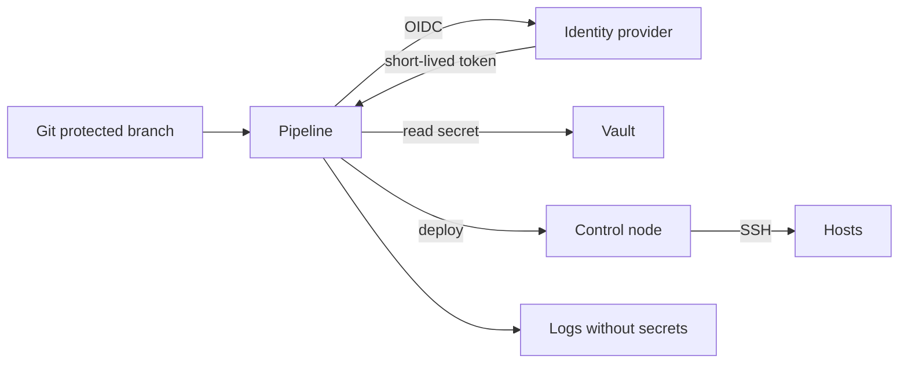

# Секреты в CI/CD

CI/CD запускает playbook без человека и имеет доступ к секретам. Если токен хранится в переменной репозитория бессрочно, а runner общий, компрометация пайплайна становится компрометацией инфраструктуры. Задача — короткоживущие credentials, защищённые ветки и минимальные права.

## 1. Зачем это нужно

Пайплайн объединяет три риска: код из репозитория, секреты и привилегии на инфраструктуру. Ошибка в конфигурации CI может отправить секрет в лог, выполнить изменённый playbook на продакшене или оставить токен в кэше. Для филиальной сети это означает потенциальный доступ ко всем площадкам сразу.

## 2. Ключевые понятия

| Понятие | Назначение |
|---|---|
| Protected branch | ветка, изменения в которую требуют ревью |
| Protected variable | переменная доступна только на защищённых ветках |
| Masked variable | значение скрывается в логах |
| OIDC | короткоживущий токен вместо статического ключа |
| Environment | среда с правилами и апрувом |
| Runner | исполнитель задания; для прода — выделенный |
| Artifact | результат задания, который нельзя считать доверенным |
| Vault integration | получение секрета во время выполнения |

## 3. Схема потока



Секрет не хранится в переменной репозитория навсегда. Пайплайн получает короткоживущий токен, обменивает его на нужный секрет и теряет доступ после завершения задания.

## 4. GitLab CI: базовый пайплайн

```yaml
stages:
  - lint
  - test
  - deploy

default:
  image: python:3.12
  before_script:
    - pip install "ansible-core~=2.17.0" ansible-lint yamllint

lint:
  stage: lint
  script:
    - yamllint playbooks/ roles/
    - ansible-lint --profile production playbooks/

test:
  stage: test
  before_script:
    - pip install "ansible-core~=2.17.0" ansible-lint molecule "molecule-plugins[docker]"
  script:
    - molecule test

deploy:
  stage: deploy
  rules:
    - if: '$CI_COMMIT_BRANCH == "main"'
      when: manual
  environment:
    name: production
  before_script:
    - set +x
    - pip install "ansible-core~=2.17.0"
    - install -m 0600 /dev/null "$CI_PROJECT_DIR/.vault-pass"
    - printf '%s' "$ANSIBLE_VAULT_PASSWORD" > "$CI_PROJECT_DIR/.vault-pass"
  script:
    - ansible-playbook -i inventories/prod/hosts.yml site.yml
      --vault-password-file "$CI_PROJECT_DIR/.vault-pass"
  after_script:
    - shred -u "$CI_PROJECT_DIR/.vault-pass" 2>/dev/null || rm -f "$CI_PROJECT_DIR/.vault-pass"
```

Требования к переменным:

- `ANSIBLE_VAULT_PASSWORD` — masked и protected;
- переменная доступна только защищённым веткам;
- `when: manual` и environment approval для продакшена;
- runner для продакшена — выделенный и защищённый.

`set +x` отключает трассировку shell, чтобы команда не вывела секрет. `printf` не добавляет перевод строки, который может сломать пароль.

## 5. OIDC вместо статического токена

GitLab:

```yaml
deploy:
  id_tokens:
    VAULT_ID_TOKEN:
      aud: https://vault.example.local
  script:
    - ansible-playbook ... 
```

Токен `VAULT_ID_TOKEN` передаётся в Vault по JWT-аутентификации. Политика Vault привязывает доступ к проекту, ветке и environment. Статический `VAULT_TOKEN` в переменных не нужен.

GitHub Actions:

```yaml
permissions:
  contents: read
  id-token: write

jobs:
  deploy:
    runs-on: self-hosted
    environment: production
    steps:
      - uses: actions/checkout@v4
      - uses: actions/setup-python@v5
        with:
          python-version: "3.12"
      - run: pip install "ansible-core~=2.17.0"
      - run: ansible-playbook -i inventories/prod/hosts.yml site.yml
```

Для supply chain фиксируйте actions по commit SHA, а не по плавающему тегу. `environment: production` включает правила защиты и апрув.

## 6. Защита runner

- Отдельный runner для продакшена, без совместного использования с публичными проектами.
- Эфемерный runner: контейнер или ВМ, уничтожаемая после задания.
- Запрет `privileged` без необходимости.
- Ограничение сетевого доступа: runner видит только control node и Vault.
- Регулярное обновление образа runner.
- Логи и артефакты не содержат секретов.

Если runner скомпрометирован, злоумышленник получает его токены и сетевой доступ. Изоляция важнее удобства.

## 7. Секреты в логах

| Источник утечки | Мера |
|---|---|
| `set -x` | `set +x` перед работой с секретом |
| `debug: var=hostvars` | точечный вывод, `no_log` |
| `--diff` для секретного файла | `no_log: true`, ограничить diff |
| Артефакт с `.vault-pass` | удалять в `after_script`, не публиковать |
| Кэш pip | не кэшировать каталоги с credentials |
| Маскирование | masked variable + проверка логов |

Маскирование не заменяет `no_log`: оно скрывает точное значение, но не защищает от частичного вывода или производных данных.

## 8. Проверка результата

```bash
gitlab-ci-lint .gitlab-ci.yml
ansible-lint --profile production playbooks/
grep -R "ANSIBLE_VAULT_PASSWORD\|vault_" .gitlab-ci.yml
```

Проверьте в тестовом пайплайне, что секрет не появляется в логах при успехе и при ошибке. Отдельно проверьте поведение при отмене задания: временный файл должен удаляться.

## 9. Безопасность и blast radius

| Риск | Последствие | Мера |
|---|---|---|
| Секрет в переменной без защиты | доступ из любой ветки | protected + masked |
| Общий runner | кража токенов | выделенный эфемерный runner |
| Долгоживущий токен | доступ после инцидента | OIDC и TTL |
| Автодеплой в main | изменение без апрува | manual + environment protection |
| Секрет в артефакте | утечка через хранение | удаление, запрет публикации |
| Плавающий тег action | подмена зависимости | пин по SHA |

## 10. Комплаенс-маппинг

| Требование | Как закрывается |
|---|---|
| CIS Control 6 | управление доступом и привилегиями |
| NIST CSF 2.0 PR.AA | аутентификация в CI/CD |
| ISO/IEC 27001:2022 A.8.24 | управление секретами и ключами |
| ISO/IEC 27001:2022 A.8.32 | управление изменениями |

## 11. Типичные ошибки и troubleshooting

| Симптом | Причина | Проверка | Решение |
|---|---|---|---|
| `Vault password not found` | переменная не передана | лог job | добавить protected variable |
| Секрет в логе | `set -x` или `no_log` отсутствует | поиск по логу | отключить трассировку, добавить `no_log` |
| Deploy доступен из ветки | нет protected branch | настройки проекта | защитить ветку |
| OIDC не работает | нет `id_tokens`/`id-token: write` | лог обмена токена | добавить разрешение |
| Временный файл остался | `after_script` не выполнился | файловая система runner | эфемерный runner, очистка |
| Артефакт содержит секрет | публикация всего каталога | artifacts paths | сузить пути |

## 12. Чек-лист

- [ ] В репозитории нет открытых секретов.
- [ ] Переменные masked и protected.
- [ ] Продакшен требует ручного апрува.
- [ ] Runner для продакшена выделенный и эфемерный.
- [ ] OIDC используется вместо долгоживущих токенов.
- [ ] Временные файлы с секретами удаляются.
- [ ] Логи проверены на утечки.
- [ ] Actions и образы зафиксированы по версии или SHA.

## 13. Источники

- [GitLab CI/CD variables](https://docs.gitlab.com/ee/ci/variables/)
- [GitLab CI/CD job token and OIDC](https://docs.gitlab.com/ee/ci/secrets/id_token_authentication.html)
- [GitHub Actions OIDC](https://docs.github.com/en/actions/deployment/security-hardening-your-deployments/about-security-hardening-with-openid-connect)
- [Ansible Vault](https://docs.ansible.com/ansible/latest/vault_guide/index.html)

## 14. Связанные страницы

- [Управление секретами](11-secrets.md)
- [Модель угроз автоматизации](10-threat-model.md)
- [Безопасность цепочки поставок](15-supply-chain.md)
- [CI/CD и GitOps](../quality/51-cicd-gitops.md)
- [AAP, AWX, Semaphore](../quality/53-aap-awx.md)
