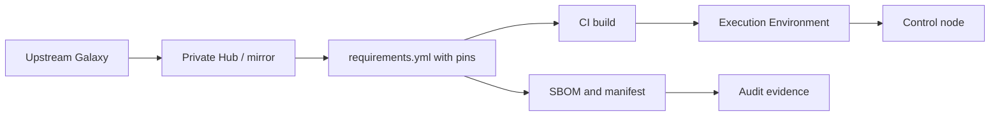

# Безопасность цепочки поставок

Playbook зависит от коллекций, ролей, Python-пакетов и базового образа Execution Environment. Каждый элемент может быть подменён, устарел или содержать вредоносный код. Цепочка поставок — это управление тем, что именно попадает на control node и в CI.

## 1. Зачем это нужно

Коллекция выполняется с правами control node и видит все секреты. Вредоносный модуль может отправить ключи наружу или изменить конфигурацию на всех хостах. Даже добросовестная коллекция с неограниченным диапазоном версий ломает воспроизводимость. Нужны пины, проверка источника, подписи и понятный процесс обновления.

## 2. Ключевые понятия

| Понятие | Назначение |
|---|---|
| `requirements.yml` | декларация коллекций и ролей с версиями |
| Pin | фиксация точной версии |
| Private Galaxy / Hub | внутренний репозиторий проверенного контента |
| Signature | криптографическая подпись коллекции |
| Keyring | набор публичных ключей для проверки |
| SBOM | перечень компонентов и версий |
| Execution Environment | воспроизводимый контейнер с зависимостями |
| Offline mirror | локальное зеркало для air-gapped среды |

## 3. Схема цепочки



В продакшене control node не обращается напрямую к публичному Galaxy. Контент проходит через внутреннее зеркало, проверку и сборку Execution Environment.

## 4. requirements.yml с пинами

```yaml
---
collections:
  - name: ansible.posix
    version: "1.5.4"
  - name: community.general
    version: "9.1.0"
  - name: community.vmware
    version: "4.5.0"
  - name: kubernetes.core
    version: "5.0.0"
```

Правила:

- точная версия, а не диапазон, для продакшена;
- обновление — отдельный PR с changelog и тестами;
- запрет `version: "*"` и установки без `requirements.yml`;
- проверка коллекции на совместимость с ansible-core 2.17;
- фиксация источника, если используется приватный Hub.

Версии в примере — ориентир. Перед применением сверьте доступные версии в своём Galaxy/Hub и зафиксируйте те, которые прошли тесты.

## 5. Установка с проверкой

```bash
ansible-galaxy collection install -r requirements.yml \
  -p ./collections \
  --signature \
  --keyring ~/.ansible/pubring.kbx

ansible-galaxy collection verify -r requirements.yml
```

`--signature` требует наличия подписи и настроенного keyring. Если коллекция не подписана, установка с этим флагом не даст гарантии: проверьте политику источника. Для внутреннего Hub подпись обязательна.

Проверка установленного контента:

```bash
ansible-galaxy collection list
ansible-galaxy collection list --format json > collections.json
```

`collections.json` — минимальный манифест для аудита. Он не заменяет полноценный SBOM, но фиксирует версии.

## 6. Execution Environment

```yaml
---
version: 3

images:
  base_image:
    name: registry.example.local/ubi9/python-312-minimal:latest

dependencies:
  ansible_core:
    package_pip: ansible-core==2.17.7
  ansible_runner:
    package_pip: ansible-runner==2.4.0
  galaxy: requirements.yml
  python:
    - jmespath
    - netaddr

additional_build_steps:
  append_final:
    - RUN rm -rf /root/.cache /tmp/*
```

Сборка:

```bash
ansible-builder build \
  -f execution-environment.yml \
  -t registry.example.local/ee-ansible:2.17
```

Точные версии `ansible-core` и `ansible-runner` фиксируются после тестов. Базовый образ должен быть из доверенного registry и регулярно обновляться.

## 7. Подписи и SBOM

- Подписывайте собственные коллекции и EE.
- Проверяйте подписи сторонних коллекций при установке.
- Формируйте SBOM из `collections.json` и `pip freeze`.
- Для контейнера используйте генератор SBOM (например, Syft/CycloneDX) и храните результат с образом.
- Сверяйте SBOM с фактически установленными версиями перед релизом.

SBOM без процесса реагирования бесполезен. При выходе CVE нужен быстрый поиск затронутых образов и хостов.

## 8. Офлайн-зеркало

```bash
ansible-galaxy collection download -r requirements.yml -p ./bundle
sha256sum ./bundle/* > ./bundle/SHA256SUMS
```

Перенос в air-gapped среду:

1. Скачайте коллекции и зависимости на подключённом узле.
2. Проверьте контрольные суммы и подписи.
3. Передайте бандл по утверждённому каналу.
4. Установите из локального каталога.
5. Зафиксируйте версии и результат проверки.

```bash
ansible-galaxy collection install ./bundle/*.tar.gz -p ./collections
```

Для Execution Environment экспортируйте образ в tar и проверьте digest после импорта.

## 9. Безопасность и blast radius

| Риск | Последствие | Мера |
|---|---|---|
| Диапазон версий | неожиданное обновление | точный пин |
| Публичный Galaxy на control node | подмена контента | приватный Hub, подпись |
| Неподписанная EE | вредоносный слой | подпись и digest |
| SBOM отсутствует | невозможно найти затронутые хосты | манифест и SBOM |
| Обновление без тестов | регрессия на всех хостах | PR, changelog, Molecule |
| Офлайн-бандл без checksum | подмена при переносе | SHA256 и подпись |

## 10. Комплаенс-маппинг

| Требование | Как закрывается |
|---|---|
| NIST CSF 2.0 ID.SC | управление цепочкой поставок |
| ISO/IEC 27001:2022 A.5.19 | безопасность поставщиков |
| ISO/IEC 27001:2022 A.8.30 | аутсорсинг и внешние компоненты |
| CIS Control 16 | безопасность ПО |

## 11. Типичные ошибки и troubleshooting

| Симптом | Причина | Проверка | Решение |
|---|---|---|---|
| `collection not found` | версия недоступна | `ansible-galaxy collection list` | исправить версию, проверить Hub |
| Подпись не проверяется | нет keyring | вывод установки | импортировать публичный ключ |
| Разные версии у инженеров | установка без requirements | `collection list` | использовать EE или локальный каталог |
| Обновление сломало роль | мажорная версия | changelog | откатить пин, добавить тест |
| SBOM не совпадает | установка вручную | сверка manifest | запретить ручную установку |

## 12. Чек-лист

- [ ] Все коллекции зафиксированы точными версиями.
- [ ] Продакшен использует приватный Hub или зеркало.
- [ ] Подписи проверяются, keyring управляется.
- [ ] Execution Environment собирается из зафиксированных зависимостей.
- [ ] SBOM и manifest хранятся с релизом.
- [ ] Обновление проходит PR, тесты и ревью.
- [ ] Офлайн-бандл проверяется по checksum.
- [ ] Есть процесс поиска затронутых CVE.

## 13. Источники

- [Installing collections](https://docs.ansible.com/ansible/latest/collections_guide/collections_installing.html)
- [Collection signatures](https://docs.ansible.com/ansible/latest/galaxy/user_guide.html#installing-signed-collections)
- [ansible-builder](https://ansible.readthedocs.io/projects/builder/)
- [CycloneDX SBOM](https://cyclonedx.org/)
- [NIST SSDF](https://csrc.nist.gov/projects/ssdf)

## 14. Связанные страницы

- [Установка и версионирование](../fundamentals/03-install.md)
- [Секреты в CI/CD](14-cicd-secrets.md)
- [Air-gapped среды](../security/48-airgap.md)
- [AAP, AWX, Semaphore](../quality/53-aap-awx.md)
- [Ревью и релизы](../quality/52-review-release.md)
