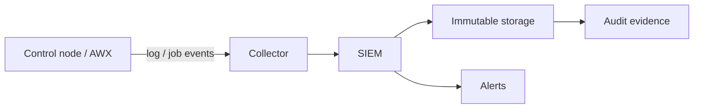

# Аудит выполнения

Аудит отвечает на вопросы: кто запустил playbook, на каких хостах, что изменилось и чем это подтверждается. Без журналов автоматизация становится «чёрным ящиком», а инцидент невозможно разобрать.

## 1. Зачем это нужно

Ansible выполняет привилегированные операции от имени сервисной учётки. Если журнал отключён или хранится только на control node, злоумышленник может удалить следы. Для комплаенса нужны доказательства: факт запуска, состав хостов, результат задач и отсутствие несанкционированных изменений.

Аудит — это не только лог. Это модель доступа к логам, срок хранения, защита от изменения и связь с SIEM.

## 2. Ключевые понятия

| Понятие | Назначение |
|---|---|
| `log_path` | журнал выполнения на control node |
| Callback plugin | обработчик событий Ansible |
| `ansible-runner` | запуск с артефактами `job_events` |
| Job events | события задания в AWX/AAP |
| SIEM | централизованный сбор и корреляция |
| `no_log` | подавление вывода задачи с секретом |
| Retention | срок хранения журналов |
| WORM | хранилище с защитой от изменения |

## 3. Схема аудита



Журнал на control node — первичный источник, SIEM — система доказательств. Хранить только локальный файл недостаточно: он доступен тому, кто скомпрометировал узел.

## 4. Базовая конфигурация

```ini
[defaults]
log_path = /var/log/ansible/ansible.log
stdout_callback = ansible.builtin.default
callbacks_enabled = 
```

Каталог:

```bash
sudo install -d -m 0750 -o root -g adm /var/log/ansible
```

Права должны исключать запись для непривилегированных пользователей. Группа `adm` — пример; используйте группу, которая соответствует вашей модели доступа.

`log_path` пишет вывод задач. Он не является структурированным журналом и не заменяет SIEM. Для структурированных событий используйте `ansible-runner` или AWX job events.

## 5. ansible-runner и job events

`ansible-runner` сохраняет артефакты запуска:

```bash
ansible-runner run /srv/ansible/project \
  -p site.yml \
  -i inventories/prod \
  --artifact-dir /var/log/ansible/artifacts
```

В каталоге артефактов появляются `stdout`, `rc` и `job_events/` с JSON-событиями. Их можно отправлять в SIEM и хранить как доказательства. Это удобнее для парсинга, чем свободный текст `log_path`.

В AWX/AAP события задания доступны через API и журнал платформы. Для аудита используйте встроенные роли и журнал, а не только локальный лог runner.

## 6. Запись метаданных запуска

```yaml
---
- name: Record automation run metadata
  hosts: localhost
  connection: local
  become: true
  gather_facts: true

  vars:
    run_id: "{{ lookup('env', 'CI_PIPELINE_ID') | default('manual', true) }}"
    operator: "{{ lookup('env', 'USER') | default('unknown', true) }}"

  tasks:
    - name: Ensure audit directory exists
      ansible.builtin.file:
        path: /var/log/ansible/runs
        state: directory
        owner: root
        group: root
        mode: "0750"

    - name: Write run record
      ansible.builtin.copy:
        content: |
          {
            "run_id": "{{ run_id }}",
            "playbook": "site.yml",
            "inventory": "inventories/prod/hosts.yml",
            "operator": "{{ operator }}",
            "timestamp": "{{ ansible_facts['date_time']['iso8601'] }}"
          }
        dest: "/var/log/ansible/runs/{{ run_id }}.json"
        owner: root
        group: root
        mode: "0640"
```

Запись фиксирует факт запуска, но не доказывает, что было изменено. Для доказательств используйте job events и `--check --diff` в артефактах. Файл на control node можно изменить; SIEM должен получать копию сразу.

## 7. Отправка в SIEM

```text
# /etc/rsyslog.d/60-ansible.conf
$ModLoad imfile
$InputFileName /var/log/ansible/ansible.log
$InputFileTag ansible:
$InputFileStateFile ansible-state
$InputFileSeverity info
$InputRunFileMonitor

*.* @@siem.example.local:6514
```

Для TLS используйте настройки `omfwd` с проверкой сертификата; шаблон выше — только транспорт. Не отправляйте журналы по незашифрованному каналу через недоверенную сеть.

Требования:

- время синхронизировано через NTP;
- журнал не содержит секретов;
- SIEM коррелирует `run_id`, оператора, inventory и хосты;
- алерты на аномальные запуски и массовые изменения;
- доступ к журналу ограничен.

## 8. no_log и его ограничения

`no_log: true` скрывает аргументы и результат задачи в выводе и `log_path`. Ограничения:

- секрет может остаться в журнале удалённой системы;
- аргументы команды видны в `ps` на хосте;
- `--diff` для файла с секретом требует отдельной проверки;
- callback-плагин может получить данные до маскирования.

Поэтому `no_log` дополняет, а не заменяет vault, права `0600` и отказ от передачи секретов аргументами.

## 9. Безопасность и blast radius

| Риск | Последствие | Мера |
|---|---|---|
| Журнал только на control node | удаление следов | SIEM и immutable storage |
| Секрет в логе | компрометация учётки | `no_log`, vault, проверка логов |
| Широкий доступ к журналу | раскрытие топологии | RBAC, группа `adm` |
| Короткий retention | нет доказательств | срок по политике |
| Нет NTP | невозможна корреляция | chrony/NTP |
| Лог не ротируется | заполнение диска | logrotate, мониторинг |

## 10. Комплаенс-маппинг

| Требование | Как закрывается |
|---|---|
| CIS Control 8 | аудит журналов |
| NIST CSF 2.0 DE.AE | обнаружение и анализ событий |
| ISO/IEC 27001:2022 A.8.15 | журналирование |
| ISO/IEC 27001:2022 A.8.16 | мониторинг |
| PCI DSS, если применимо | хранение и защита журналов |

## 11. Типичные ошибки и troubleshooting

| Симптом | Причина | Проверка | Решение |
|---|---|---|---|
| `log_path` не создаётся | нет прав на каталог | `ls -ld` | создать каталог с нужными правами |
| Журнал пуст | задачи не выполнялись или путь относительный | `ansible-config dump` | указать абсолютный путь |
| Секрет в журнале | нет `no_log` | поиск по логу | добавить `no_log`, ротировать секрет |
| SIEM не получает события | rsyslog не перезапущен | `systemctl status rsyslog` | проверить конфиг и TLS |
| Время событий неверно | NTP не настроен | `timedatectl` | включить синхронизацию |
| job events недоступны | нет прав в AWX | API/UI | выдать роль аудитора |

## 12. Чек-лист

- [ ] `log_path` включён и защищён правами.
- [ ] Журналы отправляются в SIEM.
- [ ] Время синхронизировано.
- [ ] Секреты не попадают в журнал.
- [ ] Job events сохраняются для критичных запусков.
- [ ] Retention соответствует политике.
- [ ] Доступ к журналам ограничен и аудируется.
- [ ] Есть алерты на аномальные запуски.

## 13. Источники

- [Ansible configuration: log_path](https://docs.ansible.com/ansible/latest/reference_appendices/config.html)
- [Callback plugins](https://docs.ansible.com/ansible/latest/plugins/callback.html)
- [ansible-runner](https://ansible.readthedocs.io/projects/runner/)
- [AWX job events API](https://docs.ansible.com/automation-controller/latest/html/controllerapi/api_ref.html)
- [NIST SP 800-92: Guide to Computer Security Log Management](https://csrc.nist.gov/pubs/sp/800/92/final)

## 14. Связанные страницы

- [Секреты в CI/CD](14-cicd-secrets.md)
- [Логирование и мониторинг](../security/42-logging-monitoring.md)
- [AAP, AWX, Semaphore](../quality/53-aap-awx.md)
- [Комплаенс и доказательства](../security/44-compliance.md)
- [Диагностика и troubleshooting](../ops/60-troubleshooting.md)
