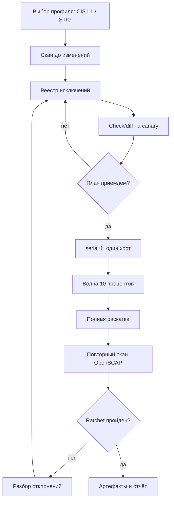

# Харденинг Linux

Харденинг (hardening) — приведение сервера к заранее выбранному эталону безопасности и удержание его в этом состоянии. Для парка из 200–1000 хостов в филиалах это не разовая акция, а непрерывный процесс с измеримым результатом: профиль, скан, отклонения, доказательства.

## 1. Зачем это нужно

Филиальные серверы часто обслуживаются без постоянного администратора на площадке. Если эталон настраивается вручную по памяти, через полгода на десяти хостах будет десять разных конфигураций: где-то останется `PermitRootLogin yes`, где-то не включены автообновления, где-то работает тестовый сервис. Проверить это глазами невозможно, а аудитор просит не описание практик, а выгрузку результатов проверки с датой.

Ansible решает три задачи одновременно. Во-первых, эталон становится версионируемым кодом: изменение проходит ревью и попадает в Git. Во-вторых, появляется воспроизводимость: `--check --diff` показывает план, повторный прогон даёт `changed=0`. В-третьих, формируется доказательная база: XML-результат OpenSCAP, HTML-отчёт, журнал запуска и хеш файла отчёта складываются в артефакты конкретного прогона.

Отдельная ценность — единый язык с аудитом. CIS Benchmark, DISA STIG и профили SCAP описывают одни и те же требования в разных форматах; выбрав один эталон и один сканер, вы получаете метрику «доля выполненных правил» вместо субъективных оценок.

Экономика процесса тоже важна. Один прогон по 800 хостам занимает десятки минут и не требует присутствия на площадке; ручная сверка тех же параметров силами двух инженеров растягивается на недели. При этом плохой автоматизации хуже ручной работы: роль, скачанная без ревью, может отключить сетевой стек или перезаписать `sudoers`. Поэтому базлайн строится из проверяемых задач, каждая из которых имеет `validate`, а рискованные шаги отделены от остальных.

## 2. Ключевые понятия

| Понятие | Назначение |
|---|---|
| CIS Benchmark | эталон Center for Internet Security для ОС; версии для RHEL, Ubuntu, Debian |
| CIS Level 1 | базовые меры с минимальным влиянием на функциональность |
| CIS Level 2 | усиленные меры для сред с повышенными требованиями; чаще ломают совместимость |
| DISA STIG | эталон Минобороны США; категории CAT I, CAT II, CAT III |
| STIG CAT I | критичное правило: прямо ведёт к компрометации или повышению привилегий |
| SCAP | семейство стандартов для машинно-читаемых проверок: XCCDF, OVAL, CPE |
| XCCDF profile | именованный набор правил внутри политики, например `cis` или `stig` |
| SSG | SCAP Security Guide: открытый контент проверок, поставляется как datastream |
| Datastream | единый XML-файл `ssg-*-ds.xml`, который читает `oscap` |
| ansible-lockdown | набор ролей для CIS/STIG-профилей RHEL, Ubuntu, Debian с отчётами |
| dev-sec | более легкие роли baseline: ssh, os-hardening, auditd |
| Исключение (exception) | документированное отклонение с владельцем и сроком действия |
| Ratchet | правило «число проваленных проверок не растёт», порог снижается итерациями |
| Evidence | артефакт прогона: отчёт сканера, хеш, журнал, ссылка на коммит |

## 3. Схема



На схеме важны два контура: левый — подготовка и согласование исключений до изменений, правый — измеримая проверка после. Скан «до» нужен, чтобы отличить внесённые отклонения от унаследованных.

## 4. Пошаговая реализация

### Шаг 1. Зафиксируйте профиль и версию эталона

Выберите один профиль на класс хостов: например, CIS Level 1 для приложений и CIS Level 2 для bastion и инфраструктурных узлов. Запишите версию бенчмарка и версию SCAP-контента в `group_vars`; без этого результаты сканов несравнимы между прогонами.

### Шаг 2. Снимите исходное состояние

До первого изменения запустите `oscap` на 2–3 типовых хостах каждой площадки. Отчёт покажет, какие правила уже выполнены средствами инсталлятора, а какие требуют вмешательства. Это же значение станет базой для ratchet.

### Шаг 3. Опишите исключения

Исключение — не «строчка в when», а запись с идентификатором, причиной, владельцем и датой истечения. Пример: `rpcbind` нужен файловому серверу филиала до миграции на NFSv4, владелец — команда инфраструктуры, срок — 90 дней. Исключения хранятся в Git рядом с ролью и попадают в отчёт.

### Шаг 4. Прогоните check/diff на canary

Один хост, полный набор задач, `--check --diff`. Особое внимание — задачи, которые останавливают сервисы или меняют SSH: в diff должно быть ровно то, что вы ожидаете.

### Шаг 5. Раскатывайте волнами

`serial: "10%"` с `max_fail_percentage` ниже 100 останавливает раскатку на первой серии отказов. Для филиалов с плохим WAN уменьшите `serial` до 1–3 хостов и увеличьте `timeout`.

### Шаг 6. Соберите доказательства и повторите скан

Отчёты складываются в артефакты CI с привязкой к коммиту и инвентарю. Повторный скан должен показать снижение числа провалов не ниже порога ratchet.

### Шаг 7. Учтите различия платформ

Один playbook на три семейства ОС работает только там, где различия вынесены в переменные. Практика показывает, что расхождения касаются имён пакетов, путей, имён сервисов и инструментов управления политиками аутентификации.

| Аспект | RHEL / Rocky / Alma 8–9 | Ubuntu 22.04 / 24.04 | Debian 12 |
|---|---|---|---|
| Менеджер пакетов | `dnf`, репозитории подписки | `apt`, `universe` для части пакетов | `apt`, `main` |
| Имя сервиса SSH | `sshd` | `ssh` | `ssh` |
| Drop-in для sshd | `/etc/ssh/sshd_config.d/` | `/etc/ssh/sshd_config.d/` | `/etc/ssh/sshd_config.d/` |
| Политики PAM | `authselect` | `pam-auth-update` | `pam-auth-update` |
| Мандатный доступ | SELinux | AppArmor | AppArmor |
| Межсетевой экран | `firewalld` | `ufw` | `ufw` (nftables) |
| Автообновления | `dnf-automatic` | `unattended-upgrades` | `unattended-upgrades` |
| SCAP-контент | `scap-security-guide` | `scap-security-guide` | пакет SSG для Debian |

Для RHEL 8 помните про Python: ansible-core 2.17+ не поддерживает Python 3.6 на управляемых узлах, поэтому в inventory задаётся `ansible_python_interpreter: /usr/bin/python3.9`. Для RHEL 9 системный Python 3.9 на managed node допустим, но на control node нужен 3.11 или 3.12.

Профили SCAP тоже различаются: у RHEL 9 идентификатор профиля CIS отличается от идентификатора в контенте Ubuntu, а набор правил для Debian заметно меньше. Поэтому `hardening_oscap_profile` задаётся в `group_vars` по семейству, а не вычисляется в шаблоне. Если файл datastream не найден, playbook останавливается с понятным сообщением — это лучше, чем молча пропустить скан и оставить аудит без доказательств.

### Готовые роли вместо самописного эталона

Писать 200 правил вручную не нужно. `ansible-lockdown` содержит роли `RHEL9-CIS`, `UBUNTU24-CIS`, `DEBIAN12-CIS` с уровнями 1/2 и отчётами, `dev-sec` — компактные роли `os-hardening`, `ssh-hardening`, `auditd`. Их применяют с фиксацией версии, ревью задач и обязательным `--check`. Playbook ниже — минимальный собственный базлайн: он не заменяет отраслевую роль, но показывает механику, на которой строятся исключения, проверки и доказательства. Версию SCAP-контента фиксируйте вместе с эталоном: после обновления пакета набор правил меняется, и сравнение отчётов двух недель теряет смысл.

!!! warning "Риск"
  Отключение сервисов и изменение SSH в одном прогоне затрудняет диагностику. Разделяйте этапы тегами и не совмещайте харденинг с обновлением ядра в одно окно.

## 5. Полный запускаемый пример

`requirements.yml`:

```yaml
---
collections:
  - name: ansible.posix
    version: ">=1.5.0,<2.0.0"
  - name: community.general
    version: ">=9.0.0,<11.0.0"
```

В продакшене фиксируйте точные версии, полученные `ansible-galaxy collection list`, и обновляйте их осознанно.

`templates/sshd_20-hardening.conf.j2`:

```jinja2
# {{ ansible_managed }}
{{ hardening_sshd_fragment }}
```

`templates/99-ansible-hardening.conf.j2`:

```jinja2
# {{ ansible_managed }}

install {{ module }} /bin/false

```

`playbooks/35-linux-hardening.yml`:

```yaml
---
- name: Linux hardening baseline
  hosts: linux_branches
  become: true
  gather_facts: true
  serial: "10%"
  max_fail_percentage: 10

  vars:
    hardening_exception_ids: []
    hardening_max_failed_rules: 25
    hardening_oscap_profile: "xccdf_org.ssgproject.content_profile_cis"
    hardening_ssg_datastream: >-
      {{ ssg_datastream_by_distribution[ansible_facts['distribution']] }}
    ssg_datastream_by_distribution:
      RedHat: /usr/share/xml/scap/ssg/content/ssg-rhel9-ds.xml
      Rocky: /usr/share/xml/scap/ssg/content/ssg-rhel9-ds.xml
      AlmaLinux: /usr/share/xml/scap/ssg/content/ssg-rhel9-ds.xml
      Ubuntu: /usr/share/xml/scap/ssg/content/ssg-ubuntu2404-ds.xml
      Debian: /usr/share/xml/scap/ssg/content/ssg-debian12-ds.xml
    hardening_tools:
      RedHat:
        - openscap-scanner
        - scap-security-guide
        - aide
        - audit
        - dnf-automatic
      Debian:
        - openscap-scanner
        - aide
        - auditd
        - unattended-upgrades
    hardening_disabled_services:
      - avahi-daemon.service
      - cups.service
      - rpcbind.service
      - rpcbind.socket
      - nfs-server.service
    hardening_blacklist_modules:
      - cramfs
      - freevxfs
      - jffs2
      - hfs
      - hfsplus
      - udf
    hardening_sshd_fragment: |
      PermitRootLogin no
      X11Forwarding no
      MaxAuthTries 4
      ClientAliveInterval 300
      ClientAliveCountMax 2
      Banner /etc/issue.net

  tasks:
    - name: Assert supported platform
      ansible.builtin.assert:
        that:
          - ansible_facts['os_family'] in ['RedHat', 'Debian']
        fail_msg: "Unsupported OS family: {{ ansible_facts['os_family'] }}"

    - name: Install hardening tooling
      ansible.builtin.package:
        name: "{{ hardening_tools[ansible_facts['os_family']] }}"
        state: present

    - name: Verify SCAP datastream exists
      ansible.builtin.stat:
        path: "{{ hardening_ssg_datastream }}"
      register: ssg_datastream

    - name: Fail with actionable message when datastream is missing
      ansible.builtin.assert:
        that:
          - ssg_datastream.stat.exists
        fail_msg: >-
          Datastream {{ hardening_ssg_datastream }} not found.
          Run ls /usr/share/xml/scap/ssg/content and set the path in group_vars.

    - name: Collect service facts
      ansible.builtin.service_facts:

    - name: Disable unnecessary services
      ansible.builtin.service:
        name: "{{ item }}"
        state: stopped
        enabled: false
      loop: "{{ hardening_disabled_services }}"
      when:
        - item in ansible_facts.services
        - item.split('.')[0] not in hardening_exception_ids

    - name: Ensure sshd drop-in directory exists
      ansible.builtin.file:
        path: /etc/ssh/sshd_config.d
        state: directory
        owner: root
        group: root
        mode: "0755"

    - name: Deploy validated SSH hardening fragment
      ansible.builtin.template:
        src: templates/sshd_20-hardening.conf.j2
        dest: /etc/ssh/sshd_config.d/20-hardening.conf
        owner: root
        group: root
        mode: "0644"
        backup: true
        validate: "sshd -t -f %s"
      notify: Reload sshd

    - name: Deploy login banner
      ansible.builtin.copy:
        dest: /etc/issue.net
        content: |
          Authorized access only. All activity is logged.
        owner: root
        group: root
        mode: "0644"

    - name: Blacklist unused filesystems
      ansible.builtin.template:
        src: templates/99-ansible-hardening.conf.j2
        dest: /etc/modprobe.d/99-ansible-hardening.conf
        owner: root
        group: root
        mode: "0644"

    - name: Configure automatic updates on RHEL family
      when: ansible_facts['os_family'] == 'RedHat'
      block:
        - name: Enable dnf-automatic timer
          ansible.builtin.systemd_service:
            name: dnf-automatic.timer
            state: started
            enabled: true

        - name: Apply security updates automatically
          ansible.builtin.lineinfile:
            path: /etc/dnf/automatic.conf
            regexp: '^apply_updates'
            line: "apply_updates = yes"
            owner: root
            group: root
            mode: "0644"

    - name: Configure automatic updates on Debian family
      when: ansible_facts['os_family'] == 'Debian'
      block:
        - name: Deploy unattended-upgrades policy
          ansible.builtin.copy:
            dest: /etc/apt/apt.conf.d/20auto-upgrades
            content: |
              APT::Periodic::Update-Package-Lists "1";
              APT::Periodic::Unattended-Upgrade "1";
            owner: root
            group: root
            mode: "0644"

        - name: Ensure unattended-upgrades is running
          ansible.builtin.systemd_service:
            name: unattended-upgrades.service
            state: started
            enabled: true

    - name: Run OpenSCAP baseline scan
      ansible.builtin.command:
        argv:
          - oscap
          - xccdf
          - eval
          - --profile
          - "{{ hardening_oscap_profile }}"
          - --results
          - /var/tmp/oscap-results.xml
          - --report
          - /var/tmp/oscap-report.html
          - "{{ hardening_ssg_datastream }}"
      register: oscap_run
      changed_when: false
      failed_when: oscap_run.rc not in [0, 2]

    - name: Read scan results
      ansible.builtin.slurp:
        src: /var/tmp/oscap-results.xml
      register: oscap_results

    - name: Count failed rules
      ansible.builtin.set_fact:
        oscap_failed: >-
          {{ (oscap_results.content | b64decode
              | regex_findall('<result>\\s*fail\\s*</result>')) | length }}

    - name: Enforce failure ratchet
      ansible.builtin.assert:
        that:
          - oscap_failed | int <= hardening_max_failed_rules | int
        fail_msg: >-
          {{ oscap_failed }} failed rules exceed allowed
          {{ hardening_max_failed_rules }}. Review /var/tmp/oscap-report.html.
        success_msg: >-
          {{ oscap_failed }} failed rules within the allowed threshold.

    - name: Collect scan evidence
      ansible.builtin.fetch:
        src: "{{ item }}"
        dest: "artifacts/{{ inventory_hostname }}-{{ item | basename }}"
        flat: true
      loop:
        - /var/tmp/oscap-results.xml
        - /var/tmp/oscap-report.html

  handlers:
    - name: Reload sshd
      ansible.builtin.service:
        name: "{{ 'ssh' if ansible_facts['os_family'] == 'Debian' else 'sshd' }}"
        state: reloaded
```

Запуск:

```bash
ansible-galaxy collection install -r requirements.yml
ansible-playbook -i inventories/prod/hosts.yml playbooks/35-linux-hardening.yml --check --diff --limit branch_msk
ansible-playbook -i inventories/prod/hosts.yml playbooks/35-linux-hardening.yml --limit msk-app01
ansible-playbook -i inventories/prod/hosts.yml playbooks/35-linux-hardening.yml --limit branch_msk
```

`--limit` на одном хосте — это canary. `serial: "10%"` применяет волнами, `max_fail_percentage: 10` останавливает серию, если отказов больше допустимого. `failed_when: oscap_run.rc not in [0, 2]` учитывает документированный код 2: сканирование завершилось, но часть правил провалена. Это не ошибка выполнения.

## 6. Проверка результата

```bash
ansible linux_branches -b -m ansible.builtin.command -a "sshd -T" | grep -E 'permitrootlogin|x11forwarding'
ansible linux_branches -b -m ansible.builtin.command -a "systemctl is-enabled dnf-automatic.timer" 
ansible linux_branches -b -m ansible.builtin.command -a "oscap xccdf eval --profile xccdf_org.ssgproject.content_profile_cis --report /var/tmp/recheck.html /usr/share/xml/scap/ssg/content/ssg-rhel9-ds.xml"
sha256sum artifacts/*.xml > artifacts/SHA256SUMS
```

Признаки успеха: повторный прогон playbook даёт `changed=0`; число провалов в отчёте не растёт; файлы отчётов лежат в артефактах с хешем; SSH-фрагмент прошёл `sshd -t`; текущая сессия не разорвана.

Отдельно проверьте, что отключённые сервисы действительно не нужны: `systemctl list-dependencies --reverse <unit>` покажет, кто зависит от юнита. Для `rpcbind` это часто NFS-клиенты.

Сравнивать сканы между прогонами нужно по одному и тому же профилю и одной версии контента. Если обновить пакет `scap-security-guide`, число правил изменится, и метрика «стало лучше» окажется ложной. Поэтому версия контента фиксируется в отчёте прогона, а сравнение идёт только между сопоставимыми запусками.

## 7. Безопасность и blast radius

Blast radius одного прогона — весь филиал, если не ограничен `serial` и `--limit`. Наибольший риск не в самих правилах, а в побочных эффектах: отключённый сервис останавливает приложение, обновления ставятся в рабочее окно, blacklist модулей ломает монтирование ISO.

| Риск | Последствие | Мера |
|---|---|---|
| Отключение нужного сервиса | простой приложения филиала | инвентаризация зависимостей, `--check`, canary |
| Blacklist `udf`/`usb-storage` | не монтируются ISO и внешние носители | отдельный список на класс хостов |
| Автообновления без окон | перезапуск сервисов в часы пик | `dnf-automatic` с таймером вне пиков, тест на canary |
| Потеря SSH после фрагмента | нет доступа к хосту | `validate`, вторая сессия, консоль vCenter, откат |
| Слишком строгий ratchet | playbook падает на унаследованных отклонениях | ratchet с шагом, исключения с owner и expiry |
| Отчёт без хеша | доказательство нельзя проверить | `sha256sum`, неизменяемое хранилище артефактов |

Откат: SSH-фрагмент удаляется или восстанавливается из `.bak`, созданного `backup: true`; сервисы включаются обратно точечно модулем `ansible.builtin.service`; автообновления отключаются остановкой таймера. Полный откат харденинга на сотнях хостов нереалистичен, поэтому изменения вносятся малыми партиями с отдельными коммитами.

Исключения живут по циклу: заявка, согласование с владельцем риска, запись в Git, автоматическая проверка срока, удаление после устранения причины. Просроченное исключение должно ронять проверку compliance-отчёта, иначе оно превращается в постоянную дыру. Хорошая практика — отдельный playbook, который раз в неделю сверяет список исключений с датами и открывает задачу на пересмотр.

## 8. Комплаенс-маппинг

| Требование | Как закрывается |
|---|---|
| CIS Benchmark Level 1 | профиль `cis`, скан OpenSCAP, порог провалов |
| DISA STIG CAT I/II | профиль `stig`, приоритет правил CAT I |
| CIS Controls v8, Control 4 | версионируемая конфигурация и управление изменениями |
| ISO/IEC 27001:2022 A.8.9 | эталонные конфигурации и контроль соответствия |
| NIST CSF 2.0 PR.PS, DE.CM | защитные конфигурации и непрерывный мониторинг отклонений |
| Доказательства | XML/HTML-отчёты, хеши, журнал запусков, коммиты |

## 9. Типичные ошибки и troubleshooting

| Симптом | Причина | Проверка | Решение |
|---|---|---|---|
| `Datastream not found` | другое имя файла SSG или версия ОС | `ls /usr/share/xml/scap/ssg/content` | задать путь в `group_vars` |
| `oscap` вернул 2 | часть правил провалена | `/var/tmp/oscap-report.html` | разобрать правила, скорректировать baseline |
| `sshd -t` падает на фрагменте | опечатка или неподдерживаемая опция | `sshd -t -f файл` | исправить шаблон, проверить версию OpenSSH |
| Сервис снова запущен | его включает socket или зависимость | `systemctl list-dependencies --reverse` | отключать socket-юнит, а не только сервис |
| Повторный прогон `changed` | `lineinfile` не совпал по regexp | `--check --diff` | уточнить шаблон строки |
| `aide`/`audit` не установились | другое имя пакета в семействе | `apt-cache policy` | скорректировать список пакетов |
| Раскатка встала на 10% | `max_fail_percentage` | play recap | разобрать первый отказ, повторить canary |
| Автообновления не работают | таймер выключен или репозиторий недоступен | `systemctl status dnf-automatic.timer` | включить таймер, проверить зеркало |

## 10. Чек-лист

- [ ] Профиль и версия эталона зафиксированы в `group_vars`.
- [ ] Скан «до» выполнен и сохранён.
- [ ] Исключения имеют владельца, причину и срок.
- [ ] `--check --diff` просмотрен на canary.
- [ ] `serial` и `max_fail_percentage` заданы.
- [ ] SSH-фрагмент проходит `sshd -t`, вторая сессия открыта.
- [ ] Отключённые сервисы проверены на зависимости.
- [ ] Порог ratchet не повышается задним числом.
- [ ] Отчёты и хеши сохранены с привязкой к коммиту.
- [ ] Повторный прогон даёт `changed=0`.

## 11. Источники

- [CIS Benchmarks](https://www.cisecurity.org/cis-benchmarks)
- [OpenSCAP documentation](https://www.open-scap.org/tools/openscap-base/)
- [SCAP Security Guide](https://github.com/ComplianceAsCode/content)
- [ansible-lockdown](https://github.com/ansible-lockdown)
- [dev-sec os-hardening](https://github.com/dev-sec/ansible-collection-hardening)

## 12. Связанные страницы

- [Управление Linux](../admin/21-os-management.md)
- [SSH, PAM, sudo, MFA](36-auth-ssh-pam.md)
- [Межсетевой экран](37-firewall.md)
- [Ядро и системный аудит](38-kernel-audit.md)
- [Комплаенс и доказательства](44-compliance.md)
- [Безопасная разработка playbook](../secure-dev/13-safe-code.md)
