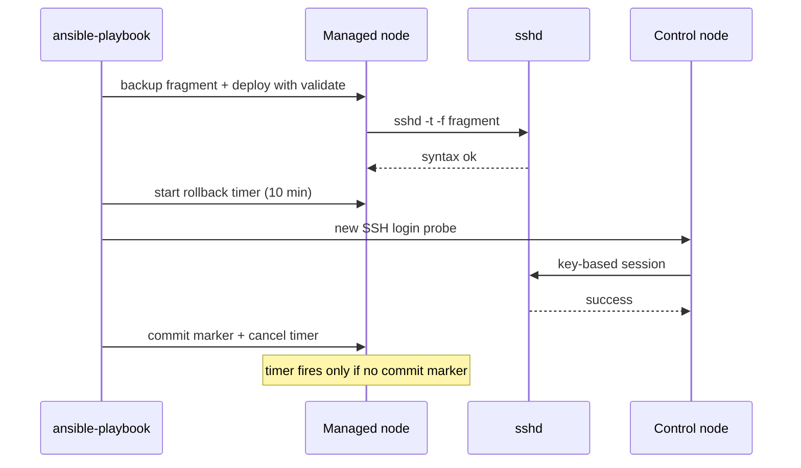

# SSH, PAM, sudo, MFA

Аутентификация и повышение привилегий — самая чувствительная часть конфигурации Linux-хоста. Здесь одна ошибка в шаблоне означает потерю доступа ко всему филиалу, а слишком мягкие настройки — прямой путь к компрометации. Ansible позволяет менять эти параметры воспроизводимо, но только при наличии валидации, второй сессии и таймера отката.

## 1. Зачем это нужно

В распределённой сети вход по паролю и прямой вход root — типовые находки аудита. Пароль переиспользуется, попадает в историю и в резервные копии, а root-сессия не даёт понять, кто именно выполнял действие. Отключение паролей и root-входа закрывает целый класс атак, но при неудачной раскатке оставляет администратора без связи с хостом.

Второй слой — политика паролей и блокировка перебора. `pam_faillock` ограничивает число неудачных попыток, `pam_pwquality` задаёт длину и сложность, `pwhistory` запрещает повтор. Третий слой — `sudo`: минимальные права, отдельные группы, журналирование команд и запрет `NOPASSWD` там, где он не нужен. Всё это должно быть одинаковым на сотнях хостов и проверяемым одной командой.

Ansible даёт три обязательных свойства. Валидация до применения: `sshd -t -f` и `visudo -cf` не дадут записать синтаксически неверный файл. Постепенность: `serial: 1` не роняет доступ сразу на всех площадках. Обратимость: резервная копия и временный таймер возвращают конфигурацию, если проверка не прошла.

Есть и четвёртое, часто недооценённое свойство — атрибуция. Когда вход root запрещён, а `sudo` пишет в журнал команду, пользователя и время, инцидент разбирается по фактам, а не по воспоминаниям. Для филиала, где нет постоянного администратора, это единственный способ понять, кто менял конфигурацию в выходные.

## 2. Ключевые понятия

| Понятие | Назначение |
|---|---|
| Drop-in каталог | `/etc/ssh/sshd_config.d/`, подключается через `Include` и переопределяет базовый файл |
| `Match` | блок sshd с условиями по пользователю, группе, адресу или порту |
| `AllowGroups` | второй контур авторизации: вход только для членов указанных групп |
| PAM | подсистема аутентификации; sshd вызывает её при `UsePAM yes` |
| `pam_faillock` | блокировка учётной записи после N неудачных попыток |
| `pam_pwquality` | проверка качества пароля при смене |
| `pam_pwhistory` | запрет повторного использования последних паролей |
| authselect | управление профилями PAM в RHEL; ручные правки `system-auth` перезаписываются |
| sudoers | политика повышения привилегий, включается из `/etc/sudoers.d/` |
| `use_pty` | выполнение команд sudo в отдельном псевдотерминале |
| `log_output` | запись ввода-вывода sudo для последующего разбора |
| MFA | второй фактор: TOTP, аппаратный ключ или push |
| `AuthenticationMethods` | порядок факторов, которые обязан пройти пользователь |
| Break-glass | аварийная учётная запись с независимым путём доступа |

## 3. Схема



На схеме ключевой момент: таймер отката взводится до проверки и снимается только после успешного входа по ключу. Пока маркер не создан, любая потеря доступа автоматически возвращает старый фрагмент.

## 4. Пошаговая реализация

### Шаг 1. Инвентаризируйте способы входа

Соберите, кто и как входит на хосты: ключи, пароли, jump host, сервисные учётки. Проверьте `sshd -T` на нескольких хостах и сравните с ожидаемым. Без этого списка `AllowGroups` превращается в лотерею.

### Шаг 2. Создайте группу доступа и добавьте администраторов

Группа `ssh-users` — единая точка авторизации. В неё входят администраторы и учётная запись автоматизации. Пустая группа или отсутствие в ней автоматизационной учётки равносильны самоблокировке.

### Шаг 3. Определите параметры sshd

Таблица ниже — рабочий минимум для филиального сервера. Значения подобраны так, чтобы не ломать типовые сценарии: интерактивная работа, `scp`, туннели для мониторинга.

| Параметр | Значение | Почему |
|---|---|---|
| `PermitRootLogin` | `no` | действия атрибутируются конкретному пользователю |
| `PasswordAuthentication` | `no` | исключает перебор и утечку пароля из бэкапов |
| `KbdInteractiveAuthentication` | `no` | закрывает второй путь ввода пароля через PAM |
| `PubkeyAuthentication` | `yes` | основной способ входа |
| `PermitEmptyPasswords` | `no` | запрет учёток с пустым паролем |
| `MaxAuthTries` | `3` | ограничивает попытки в одном соединении |
| `MaxSessions` | `4` | ограничивает число каналов в сессии |
| `LoginGraceTime` | `30` | сокращает жизнь полуоткрытых соединений |
| `ClientAliveInterval` | `300` | обрывает брошенные сессии |
| `ClientAliveCountMax` | `2` | итоговый таймаут около 10 минут |
| `AllowGroups` | `ssh-users` | вход только для разрешённых групп |
| `AllowTcpForwarding` | `no` | запрет туннелей, если они не нужны |
| `PermitTunnel` | `no` | запрет tun/tap через SSH |
| `X11Forwarding` | `no` | лишняя поверхность атаки на сервере |
| `LogLevel` | `VERBOSE` | фиксирует отпечаток ключа при входе |
| `Banner` | `/etc/ssh/banner` | предупреждение о допустимом использовании |
| `Ciphers`, `MACs`, `KexAlgorithms` | AEAD и ETM-наборы | отключает устаревшие алгоритмы |

Для RHEL 8 (OpenSSH 8.0) параметр `KbdInteractiveAuthentication` ещё не поддерживается: там используется `ChallengeResponseAuthentication no`. `sshd -t` это поймает, но лучше развести шаблон по версии заранее.

!!! warning "Риск"
  Изменение SSH, sudo и PAM может отрезать доступ ко всем хостам сразу. Держите открытой вторую сессию, имейте консольный доступ через vCenter и не запускайте playbook без `serial: 1` и таймера отката.

### Шаг 4. Настройте PAM

На RHEL политика включается через `authselect`: `with-faillock` и `with-pwhistory` добавляют модули в цепочку, а параметры читаются из `/etc/security/faillock.conf` и `/etc/security/pwhistory.conf`. Прямая правка `/etc/pam.d/system-auth` бессмысленна: следующее обновление или `authselect select` её перезапишет.

На Ubuntu и Debian цепочка собирается через `pam-auth-update`, а строки `pam_faillock` в `/etc/pam.d/common-auth` добавляются профилем, если он установлен в системе. Проверьте наличие профиля до включения: `ls /usr/share/pam-configs | grep -i faillock`. Если профиля нет, настройка выполняется вручную и требует отдельного ревью.

### Шаг 5. Ограничьте sudo

Политика строится из трёх элементов: глобальные `Defaults`, узкий `Cmnd_Alias` для рутинных операций чтения и группа администраторов с паролем. `NOPASSWD` допустим только для read-only команд, которые не позволяют обойти ограничения. `Defaults use_pty` защищает от побега из-под sudo через родительский терминал, `log_output` даёт запись сессии для разбора инцидента.

### Шаг 6. Проверьте и зафиксируйте результат

После раскатки проверьте `sshd -T`, `visudo -c`, вход по ключу и работу `sudo -l`. Только после этого создавайте маркер, снимающий таймер отката.

### Шаг 7. Решите, нужен ли MFA

Второй фактор имеет смысл там, где есть риск кражи ключа: администраторы филиалов, подрядчики, доступ из недоверенных сетей. Типовой вариант — `publickey,keyboard-interactive` с TOTP-модулем PAM. Порядок факторов означает, что ключ проверяется первым, а код запрашивается только после успешной проверки ключа; это снижает шум и не раскрывает существование учётной записи.

У MFA есть цена. Потеря токена блокирует работу, поэтому нужны резервные коды, заранее выданные каждому администратору, и break-glass учётная запись с отдельным путём доступа и усиленным мониторингом. Автоматизировать регистрацию TOTP нельзя: секрет должен создаваться и храниться у пользователя, а не проходить через Ansible и логи. Поэтому playbook включает только конфигурацию sshd и проверку наличия PAM-модуля, а регистрация остаётся ручной процедурой.

## 5. Полный запускаемый пример

`templates/10-hardening.conf.j2`:

```jinja2
# {{ ansible_managed }}
PermitRootLogin no
PasswordAuthentication no

KbdInteractiveAuthentication yes
AuthenticationMethods publickey,keyboard-interactive

ChallengeResponseAuthentication no

KbdInteractiveAuthentication no

PubkeyAuthentication yes
PermitEmptyPasswords no
MaxAuthTries 3
MaxSessions 4
LoginGraceTime 30
ClientAliveInterval 300
ClientAliveCountMax 2
AllowGroups {{ ssh_allowed_group }}
AllowTcpForwarding no
PermitTunnel no
X11Forwarding no
PermitUserEnvironment no
LogLevel VERBOSE
Banner /etc/ssh/banner
Ciphers chacha20-poly1305@openssh.com,aes256-gcm@openssh.com,aes128-gcm@openssh.com,aes256-ctr
MACs hmac-sha2-512-etm@openssh.com,hmac-sha2-256-etm@openssh.com
KexAlgorithms curve25519-sha256,curve25519-sha256@libssh.org,ecdh-sha2-nistp256,ecdh-sha2-nistp384
```

`templates/50-secops.sudoers.j2`:

```jinja2
# {{ ansible_managed }}
Defaults use_pty
Defaults log_output
Defaults iolog_dir=/var/log/sudo-io
Defaults timestamp_timeout=5
Defaults passwd_tries=3
Defaults env_reset
Defaults secure_path="/usr/local/sbin:/usr/local/bin:/usr/sbin:/usr/bin:/sbin:/bin"

Cmnd_Alias READONLY = /usr/bin/journalctl, /usr/bin/systemctl status *, /usr/bin/ss -lntp, /usr/bin/last
%{{ sudo_readonly_group }} ALL=(root) NOPASSWD: READONLY
```

`playbooks/36-auth.yml`:

```yaml
---
- name: SSH and PAM policy
  hosts: linux_branches
  become: true
  gather_facts: true
  serial: 1
  max_fail_percentage: 0

  vars:
    ssh_allowed_group: ssh-users
    ssh_allowed_users:
      - ansible
      - secops
    ssh_mfa_enabled: false
    ssh_fragment: /etc/ssh/sshd_config.d/10-hardening.conf

  tasks:
    - name: Assert automation account stays allowed
      ansible.builtin.assert:
        that:
          - ssh_allowed_users | length > 0
          - ansible_user | default('') in ssh_allowed_users
        fail_msg: >-
          ansible_user {{ ansible_user }} must be a member of
          {{ ssh_allowed_group }}, otherwise access will be lost.

    - name: Ensure access group exists
      ansible.builtin.group:
        name: "{{ ssh_allowed_group }}"
        state: present

    - name: Add administrators to access group
      ansible.builtin.user:
        name: "{{ item }}"
        groups: "{{ ssh_allowed_group }}"
        append: true
        state: present
      loop: "{{ ssh_allowed_users }}"

    - name: Validate current sshd configuration
      ansible.builtin.command:
        argv: [sshd, -t]
      register: sshd_precheck
      changed_when: false

    - name: Ensure sshd drop-in directory exists
      ansible.builtin.file:
        path: /etc/ssh/sshd_config.d
        state: directory
        owner: root
        group: root
        mode: "0755"

    - name: Check current SSH fragment
      ansible.builtin.stat:
        path: "{{ ssh_fragment }}"
      register: ssh_fragment_stat

    - name: Back up current SSH fragment
      ansible.builtin.copy:
        src: "{{ ssh_fragment }}"
        dest: "{{ ssh_fragment }}.bak"
        remote_src: true
        owner: root
        group: root
        mode: "0600"
      when: ssh_fragment_stat.stat.exists

    - name: Check TOTP PAM module when MFA is enabled
      ansible.builtin.command:
        argv: [grep, -q, pam_google_authenticator, /etc/pam.d/sshd]
      register: mfa_pam
      changed_when: false
      failed_when: mfa_pam.rc not in [0, 1]
      when: ssh_mfa_enabled | bool

    - name: Refuse MFA without the PAM module
      ansible.builtin.assert:
        that:
          - mfa_pam.rc | default(1) == 0
        fail_msg: >-
          Configure pam_google_authenticator in /etc/pam.d/sshd before
          enabling AuthenticationMethods, otherwise login will fail.
      when: ssh_mfa_enabled | bool

    - name: Deploy validated SSH fragment
      ansible.builtin.template:
        src: templates/10-hardening.conf.j2
        dest: "{{ ssh_fragment }}"
        owner: root
        group: root
        mode: "0644"
        backup: true
        validate: "sshd -t -f %s"
      notify: Reload sshd

    - name: Deploy SSH banner
      ansible.builtin.copy:
        dest: /etc/ssh/banner
        content: |
          Authorized access only. All sessions are logged.
        owner: root
        group: root
        mode: "0644"

    - name: Deploy faillock policy
      ansible.builtin.copy:
        dest: /etc/security/faillock.conf
        content: |
          deny = 5
          fail_interval = 900
          unlock_time = 900
          even_deny_root
          audit
        owner: root
        group: root
        mode: "0644"

    - name: Deploy password quality policy
      ansible.builtin.copy:
        dest: /etc/security/pwquality.conf
        content: |
          minlen = 14
          minclass = 3
          maxrepeat = 2
          dcredit = -1
          ucredit = -1
          lcredit = -1
          ocredit = -1
          difok = 8
          enforce_for_root
        owner: root
        group: root
        mode: "0644"

    - name: Read current authselect profile
      ansible.builtin.command: authselect current
      register: authselect_state
      changed_when: false
      failed_when: authselect_state.rc not in [0, 1]
      when: ansible_facts['os_family'] == 'RedHat'

    - name: Enable faillock and password history in PAM
      ansible.builtin.command:
        argv: [authselect, enable-feature, with-faillock, with-pwhistory]
      when:
        - ansible_facts['os_family'] == 'RedHat'
        - authselect_state.rc | default(1) == 0
        - "'with-faillock' not in (authselect_state.stdout | default('')) or 'with-pwhistory' not in (authselect_state.stdout | default(''))"
      changed_when: true

    - name: Install rollback script
      ansible.builtin.copy:
        dest: /usr/local/sbin/sshd-rollback.sh
        mode: "0700"
        owner: root
        group: root
        content: |
          #!/usr/bin/env bash
          set -euo pipefail
          [ -f /run/sshd-hardening-committed ] && exit 0
          if [ -f "{{ ssh_fragment }}.bak" ]; then
            cp -a "{{ ssh_fragment }}.bak" "{{ ssh_fragment }}"
          else
            rm -f "{{ ssh_fragment }}"
          fi
          if systemctl list-unit-files | grep -q '^sshd.service'; then
            systemctl reload sshd
          else
            systemctl reload ssh
          fi
          logger -t ansible-rollback "sshd hardening rolled back"

    - name: Stop stale rollback timer
      ansible.builtin.command:
        argv: [systemctl, stop, sshd-rollback.timer]
      register: stale_timer
      changed_when: false
      failed_when: stale_timer.rc not in [0, 5]

    - name: Schedule rollback in 10 minutes
      ansible.builtin.command:
        argv:
          - systemd-run
          - --collect
          - --on-active=10min
          - --unit=sshd-rollback
          - /usr/local/sbin/sshd-rollback.sh

    - name: Flush handlers before verification
      ansible.builtin.meta: flush_handlers

    - name: Verify effective sshd settings
      ansible.builtin.command:
        argv: [sshd, -T]
      register: sshd_effective
      changed_when: false

    - name: Assert hardened values are effective
      ansible.builtin.assert:
        that:
          - "'permitrootlogin no' in sshd_effective.stdout"
          - "'passwordauthentication no' in sshd_effective.stdout"
          - "('allowgroups ' ~ ssh_allowed_group) in sshd_effective.stdout"
        fail_msg: Effective sshd settings do not match the policy.

    - name: Check key-based login from control node
      ansible.builtin.command:
        argv:
          - ssh
          - -o
          - BatchMode=yes
          - -o
          - ConnectTimeout=5
          - "{{ ansible_user }}@{{ ansible_host | default(inventory_hostname) }}"
          - "true"
      delegate_to: localhost
      become: false
      changed_when: false
      register: ssh_probe
      failed_when: ssh_probe.rc != 0

    - name: Mark SSH change as committed
      ansible.builtin.file:
        path: /run/sshd-hardening-committed
        state: touch
        owner: root
        group: root
        mode: "0600"

    - name: Cancel rollback timer
      ansible.builtin.command:
        argv: [systemctl, stop, sshd-rollback.timer]
      register: timer_stop
      changed_when: false
      failed_when: timer_stop.rc not in [0, 5]

  handlers:
    - name: Reload sshd
      ansible.builtin.service:
        name: "{{ 'ssh' if ansible_facts['os_family'] == 'Debian' else 'sshd' }}"
        state: reloaded
```

`playbooks/36-sudo.yml`:

```yaml
---
- name: Sudo policy
  hosts: linux_branches
  become: true
  gather_facts: true
  serial: "20%"
  max_fail_percentage: 0

  vars:
    sudo_readonly_group: secops
    sudo_readonly_members:
      - secops

  tasks:
    - name: Ensure readonly group exists
      ansible.builtin.group:
        name: "{{ sudo_readonly_group }}"
        state: present

    - name: Add members to readonly group
      ansible.builtin.user:
        name: "{{ item }}"
        groups: "{{ sudo_readonly_group }}"
        append: true
        state: present
      loop: "{{ sudo_readonly_members }}"

    - name: Ensure sudo IO log directory exists
      ansible.builtin.file:
        path: /var/log/sudo-io
        state: directory
        owner: root
        group: root
        mode: "0700"

    - name: Deploy validated sudoers fragment
      ansible.builtin.template:
        src: templates/50-secops.sudoers.j2
        dest: /etc/sudoers.d/50-secops
        owner: root
        group: root
        mode: "0440"
        validate: "visudo -cf %s"

    - name: Validate the whole sudoers configuration
      ansible.builtin.command:
        argv: [visudo, -c]
      register: visudo_check
      changed_when: false
```

Про MFA: при `ssh_mfa_enabled: true` в шаблон добавляется `AuthenticationMethods publickey,keyboard-interactive` и `KbdInteractiveAuthentication yes`. Перед этим обязательно проверьте, что в `/etc/pam.d/sshd` присутствует `pam_google_authenticator`, а у администраторов есть резервные коды. Секреты TOTP не передаются через Ansible: регистрация выполняется пользователем лично, иначе второй фактор перестаёт быть вторым.

## 6. Проверка результата

```bash
ansible msk-app01 -b -m ansible.builtin.command -a "sshd -T"
ansible msk-app01 -b -m ansible.builtin.command -a "sshd -T -C user=secops,host=10.0.0.5,addr=10.10.0.5"
ansible msk-app01 -b -m ansible.builtin.command -a "visudo -c"
ansible msk-app01 -b -m ansible.builtin.command -a "sudo -l -U secops"
ansible msk-app01 -b -m ansible.builtin.command -a "faillock --user secops"
```

`sshd -T -C` проверяет эффективные значения с учётом блоков `Match` — это единственный надёжный способ увидеть, что получит конкретный пользователь с конкретного адреса. `visudo -c` проверяет весь набор файлов, включая `/etc/sudoers.d`.

Признаки успеха: вход по ключу работает, вход по паролю отклоняется, `sudo -l -U secops` показывает только `READONLY`, в `/var/log/sudo-io` появляются каталоги сессий, `faillock` фиксирует счётчик неудач.

## 7. Безопасность и blast radius

| Риск | Последствие | Мера |
|---|---|---|
| Ошибка в `AllowGroups` | все администраторы теряют вход | assert на `ansible_user`, canary, вторая сессия |
| Неверный `sshd -t` пропущен | sshd не стартует после reload | `validate`, `backup: true` |
| Таймер не снят | откат срабатывает после успешной раскатки | маркер `/run/sshd-hardening-committed` |
| `NOPASSWD: ALL` | полный root без пароля | узкий `Cmnd_Alias` |
| `log_output` без ротации | журнал занимает диск | ротация `iolog`, лимит хранения |
| MFA без резервного кода | блокировка при потере токена | break-glass и коды восстановления |
| `authselect` перезаписал PAM | потеря пользовательских настроек | профиль в Git, проверка после включения |

Откат SSH выполняется скриптом: он возвращает `.bak` или удаляет фрагмент, перезагружает сервис и пишет событие в syslog. Таймер `systemd-run --on-active=10min` живёт в памяти systemd и исчезает при перезагрузке, поэтому не может «выстрелить» неожиданно. Для sudo откат проще: удалить `/etc/sudoers.d/50-secops` и выполнить `visudo -c`.

Порядок действий при аварии: не закрывать текущую сессию, открыть консоль через vCenter, проверить `sshd -t`, при необходимости выполнить `cp` из `.bak` и `systemctl reload`. Если недоступен и vCenter — использовать out-of-band доступ площадки.

Отдельно спланируйте последовательность раскатки. Сначала один тестовый хост, затем один филиал, затем волнами по площадкам. Не совмещайте изменение SSH с изменением межсетевого экрана в одном окне: если оба изменения содержат ошибку, диагностика усложняется вдвое, а путь восстановления сужается до консоли. Между окнами должно пройти не меньше суток, чтобы дежурная смена успела отработать типовые сценарии входа.

Проверьте заранее и нестандартные сценарии: сбор логов по `scp`, туннели для резервного копирования, вход подрядчика с ограниченным сроком. Каждый такой сценарий либо попадает в политику, либо документированно исключается. Запрет, обнаруженный после раскатки, откатывается дороже, чем согласованный заранее.

## 8. Комплаенс-маппинг

| Требование | Как закрывается |
|---|---|
| CIS Benchmark 5.2 (SSH) | параметры sshd из таблицы, `sshd -T` |
| CIS Benchmark 5.3 (PAM) | faillock, pwquality, pwhistory |
| DISA STIG RHEL/Ubuntu | CAT I по аутентификации и sudo |
| CIS Controls v8, Control 6 | управление учётными записями и правами |
| ISO/IEC 27001:2022 A.8.2, A.8.5 | привилегированный доступ и защищённая аутентификация |
| NIST CSF 2.0 PR.AA | идентификация, аутентификация, контроль доступа |

## 9. Типичные ошибки и troubleshooting

| Симптом | Причина | Проверка | Решение |
|---|---|---|---|
| `Permission denied (publickey)` | пользователь не в `AllowGroups` | `sshd -T`, `id user` | добавить в группу, повторить reload |
| `sshd -t` не принимает параметр | старая версия OpenSSH | `ssh -V` | использовать `ChallengeResponseAuthentication` |
| sudo просит пароль после `NOPASSWD` | `Cmnd_Alias` не совпал по пути | `sudo -l -U user` | указать абсолютный путь и аргументы |
| `visudo -cf` падает | синтаксис или порядок `Defaults` | вывод `visudo` | исправить шаблон до повторного запуска |
| PAM-настройки исчезли | перезаписал `authselect` | `authselect current` | включить функцию через `authselect` |
| `faillock` не блокирует | модуль не в цепочке PAM | `grep faillock /etc/pam.d/*` | включить `with-faillock` |
| Rollback не сработал | скрипт не исполняемый или нет прав | `ls -l /usr/local/sbin` | режим `0700`, владелец root |
| Сессии рвутся через 10 минут | `ClientAlive*` слишком строгие | `sshd -T` | увеличить интервал для Long-running задач |

## 10. Чек-лист

- [ ] Список способов входа собран и согласован.
- [ ] Группа доступа создана, автоматизационная учётка в ней.
- [ ] `sshd -t -f` проходит до reload.
- [ ] Вторая сессия открыта до применения.
- [ ] Таймер отката взведён и снят только после проверки.
- [ ] `sshd -T -C` подтверждает значения для конкретного пользователя.
- [ ] `visudo -c` проходит, `NOPASSWD` ограничен read-only.
- [ ] faillock и pwquality включены и проверены.
- [ ] MFA имеет резервный код и break-glass.
- [ ] Журналы sudo защищены и ротируются.

## 11. Источники

- [OpenSSH sshd_config manual](https://man.openbsd.org/sshd_config)
- [Red Hat: authselect](https://docs.redhat.com/en/documentation/red_hat_enterprise_linux/9/html/configuring_basic_system_settings/managing-user-authentication)
- [sudoers manual](https://www.sudo.ws/docs/man/sudoers.man/)
- [Ansible: ansible.builtin.template](https://docs.ansible.com/ansible/latest/collections/ansible/builtin/template_module.html)
- [NIST SP 800-63B: authentication](https://pages.nist.gov/800-63-4/sp800-63b.html)

## 12. Связанные страницы

- [Доступ и привилегии](../secure-dev/12-access.md)
- [Харденинг Linux](35-linux-hardening.md)
- [Межсетевой экран](37-firewall.md)
- [Реагирование на инциденты](45-incident-response.md)
- [Zero trust и JIT-доступ](47-zero-trust.md)
