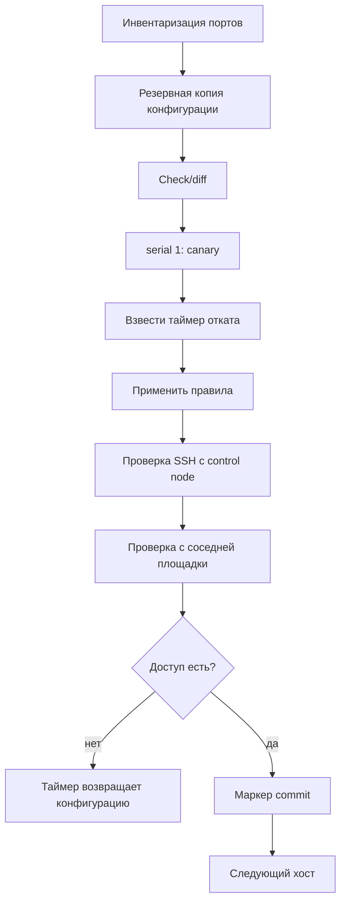

# Межсетевой экран

Межсетевой экран (firewall) на хосте — последний барьер, который остаётся, когда сегментация сети уже обойдена. Политика по умолчанию «запретить всё, что не разрешено явно» превращает список открытых портов в документированное решение, а не в побочный эффект установки пакетов.

## 1. Зачем это нужно

В филиальной сети серверы часто стоят в одном широком сегменте вместе с рабочими станциями и периферией. Если на хосте нет собственной политики, любая ошибка маршрутизации или ACL на коммутаторе открывает доступ к базе данных, Redis или панели управления. Хостовый firewall не заменяет сегментацию, но делает её отказ безопасным: даже при неверном ACL трафик до закрытого порта не доходит.

Вторая причина — управляемость. `firewalld` и `ufw` на сотнях хостов настраиваются по-разному: кто-то добавил порт вручную «на пять минут», кто-то оставил зону `trusted`, кто-то отключил службу. Ansible фиксирует целевое состояние в коде, а `--check --diff` показывает расхождения до применения.

Третья причина — доказуемость. Для аудита нужен не факт наличия firewall, а перечень разрешённых потоков с обоснованием, привязкой к сервису и владельцем. Такой перечень проще поддерживать, когда он совпадает с переменными роли.

Главный риск здесь очевиден: неверное правило отрезает SSH, и хост остаётся управляемым только через консоль гипервизора. Поэтому любое изменение сопровождается резервной копией, таймером отката и проверкой со стороны.

В филиале к этому добавляется человеческий фактор. На площадке может не быть администратора, а дежурный инженер не обязан знать, что на хосте меняли firewall ночью. Если после изменения пропадает мониторинг, это замечают позже, чем пропадает доступ. Отсюда правило: сначала проверка доступности с двух точек, потом подтверждение, и только потом следующий хост.

## 2. Ключевые понятия

| Понятие | Назначение |
|---|---|
| Default deny | политика, при которой разрешён только явно перечисленный трафик |
| Зона (firewalld) | именованный набор правил и политик для интерфейса или источника |
| `public` zone | зона по умолчанию для внешних интерфейсов; в ней уже действует запрет |
| Rich rule | правило firewalld с условиями по адресу, сервису и действию |
| `ufw` | надстройка над nftables в Ubuntu и Debian с простым синтаксисом |
| nftables | современная подсистема фильтрации ядра, единая для обоих вариантов |
| Порядок правил | правила проверяются сверху вниз; первое совпадение определяет действие |
| Conntrack | таблица состояний соединений; разрешённый ответ приходит по established |
| Rollback timer | запланированная задача, возвращающая конфигурацию при отсутствии подтверждения |
| Out-of-band | независимый путь доступа: консоль ESXi, IPMI, терминальный сервер |
| `serial: 1` | последовательная раскатка по одному хосту |
| Canary | первый хост, на котором проверяется изменение |

## 3. Схема



На схеме важен порядок: резервная копия и таймер появляются до применения правил, а маркер подтверждения — только после двух независимых проверок доступа.

## 4. Пошаговая реализация

### Шаг 1. Опишите разрешённые потоки

Для каждого класса хостов составьте таблицу: сервис, порт, протокол, источники, владелец. Например, веб-сервер принимает 443 от балансировщика и 22 от сети управления, а отправляет запросы к базе на 5432. Всё остальное — запрещено. Эта таблица становится переменными роли, а не комментариями в конфиге.

### Шаг 2. Зафиксируйте сеть управления

`mgmt_cidrs` — список подсетей, откуда разрешён SSH и мониторинг. Он не должен быть пустым: пустой список в шаблоне rich rule означает либо правило без источника, либо ошибку рендеринга. Добавьте проверку `assert` до задач firewall.

### Шаг 3. Сделайте резервную копию

Копия `/etc/firewalld` или `/etc/ufw` в `/var/backups` — единственный способ вернуть состояние, если правила оказались неверными. Копия делается до первой изменяющей задачи и переживает перезагрузку.

### Шаг 4. Проверьте план

`--check --diff` на canary. Модули firewall в check mode показывают, какие правила будут добавлены или удалены, но не гарантируют, что итоговая конфигурация работоспособна. Это лишь первый фильтр.

### Шаг 5. Примените и взведите таймер

Правила добавляются до включения политики запрета. Для `ufw` это критично: `default deny` вступает в силу немедленно, и правило для SSH должно существовать раньше. Для `firewalld` безопаснее сначала добавить rich rule с источником, затем удалить общий сервис `ssh`.

### Шаг 6. Проверьте доступ и подтвердите изменение

Проверка выполняется с control node и с соседней площадки. Только после успешного входа создаётся маркер, снимающий таймер. Если проверка не прошла, таймер вернёт копию и перезагрузит правила без участия человека.

### Шаг 7. Разберитесь с порядком правил

В nftables и iptables правило срабатывает по первому совпадению, поэтому широкое разрешение выше узкого запрета отменяет запрет. В firewalld порядок определяется зоной, источником и rich rule: сначала подбирается зона по интерфейсу или адресу источника, затем внутри неё применяются разрешённые сервисы и порты. Практический вывод один: не смешивайте общий сервис `ssh` и адресное rich rule в одной зоне, иначе адресное ограничение теряет смысл. Отдельно проверяйте IPv6: `ufw` и `firewalld` включают его автоматически, и правило, описанное только для IPv4, оставляет вторую дверь открытой.

В `ufw` порядок задаётся очерёдностью добавления правил. Модуль `community.general.ufw` умеет вставлять правило в начало через `insert: 1`, но злоупотреблять этим не стоит: предсказуемее держать один плоский список, где сначала идут разрешения для сетей управления, затем прикладные порты. Явные запреты нужны редко — политика default deny уже закрывает остальное.

!!! warning "Риск"
  Включение политики default deny без правила для SSH отрезает доступ ко всем хостам в партии. Держите открытой вторую сессию, знайте путь к консоли ESXi и не запускайте playbook на всю группу сразу.

## 5. Полный запускаемый пример

`playbooks/37-firewall.yml`:

```yaml
---
- name: Host firewall baseline
  hosts: linux_branches
  become: true
  gather_facts: true
  serial: 1
  max_fail_percentage: 0

  vars:
    mgmt_cidrs:
      - 10.10.0.0/24
      - 10.20.0.0/24
    app_ports:
      - 443/tcp
      - 9100/tcp
    firewall_backup_dir: /var/backups/firewall
    firewall_commit_marker: /run/firewall-committed

  pre_tasks:
    - name: Refuse to continue without management networks
      ansible.builtin.assert:
        that:
          - mgmt_cidrs | length > 0
        fail_msg: mgmt_cidrs must contain at least one trusted network.

    - name: Ensure backup directory exists
      ansible.builtin.file:
        path: "{{ firewall_backup_dir }}"
        state: directory
        owner: root
        group: root
        mode: "0700"

    - name: Back up firewalld configuration
      ansible.builtin.command:
        argv:
          - tar
          - -C
          - /etc
          - -czf
          - "{{ firewall_backup_dir }}/firewalld.tgz"
          - firewalld
      changed_when: false
      when: ansible_facts['os_family'] == 'RedHat'

    - name: Back up ufw configuration
      ansible.builtin.command:
        argv:
          - tar
          - -C
          - /etc
          - -czf
          - "{{ firewall_backup_dir }}/ufw.tgz"
          - ufw
      changed_when: false
      when: ansible_facts['os_family'] == 'Debian'

    - name: Install rollback script
      ansible.builtin.copy:
        dest: /usr/local/sbin/firewall-rollback.sh
        owner: root
        group: root
        mode: "0700"
        content: |
          #!/usr/bin/env bash
          set -euo pipefail
          [ -f "{{ firewall_commit_marker }}" ] && exit 0
          if [ -f "{{ firewall_backup_dir }}/firewalld.tgz" ]; then
            rm -rf /etc/firewalld
            tar -C /etc -xzf "{{ firewall_backup_dir }}/firewalld.tgz"
            firewall-cmd --reload
          fi
          if [ -f "{{ firewall_backup_dir }}/ufw.tgz" ]; then
            tar -C /etc -xzf "{{ firewall_backup_dir }}/ufw.tgz"
            ufw --force enable
          fi
          logger -t ansible-rollback "firewall configuration rolled back"

    - name: Schedule rollback in 15 minutes
      ansible.builtin.command:
        argv:
          - systemd-run
          - --collect
          - --on-active=15min
          - --unit=firewall-rollback
          - /usr/local/sbin/firewall-rollback.sh

  tasks:
    - name: Configure firewalld on RHEL family
      when: ansible_facts['os_family'] == 'RedHat'
      block:
        - name: Install firewalld
          ansible.builtin.package:
            name: firewalld
            state: present

        - name: Enable firewalld
          ansible.builtin.systemd_service:
            name: firewalld
            state: started
            enabled: true

        - name: Allow SSH from management networks
          ansible.posix.firewalld:
            rich_rule: >-
              rule family="ipv4" source address="{{ item }}"
              service name="ssh" accept
            zone: public
            permanent: true
            immediate: true
            state: enabled
          loop: "{{ mgmt_cidrs }}"

        - name: Allow application ports from management networks
          ansible.posix.firewalld:
            port: "{{ item }}"
            zone: public
            permanent: true
            immediate: true
            state: enabled
          loop: "{{ app_ports }}"

        - name: Remove unrestricted SSH service
          ansible.posix.firewalld:
            service: ssh
            zone: public
            permanent: true
            immediate: true
            state: disabled

    - name: Configure ufw on Debian family
      when: ansible_facts['os_family'] == 'Debian'
      block:
        - name: Install ufw
          ansible.builtin.package:
            name: ufw
            state: present

        - name: Allow SSH from management networks before enabling deny
          community.general.ufw:
            rule: allow
            port: "22"
            proto: tcp
            src: "{{ item }}"
          loop: "{{ mgmt_cidrs }}"

        - name: Allow application ports
          community.general.ufw:
            rule: allow
            port: "{{ item.split('/')[0] }}"
            proto: "{{ item.split('/')[1] }}"
          loop: "{{ app_ports }}"

        - name: Set default deny for incoming traffic
          community.general.ufw:
            default: deny
            direction: incoming

        - name: Set default deny for routed traffic
          community.general.ufw:
            default: deny
            direction: routed

        - name: Enable ufw logging
          community.general.ufw:
            logging: low

        - name: Enable ufw
          community.general.ufw:
            state: enabled

    - name: Verify SSH port is reachable from control node
      ansible.builtin.wait_for:
        host: "{{ ansible_host | default(inventory_hostname) }}"
        port: 22
        timeout: 20
        delay: 2
      delegate_to: localhost
      become: false

    - name: Read effective firewall state on RHEL family
      ansible.builtin.command:
        argv: [firewall-cmd, --list-all]
      register: firewalld_state
      changed_when: false
      when: ansible_facts['os_family'] == 'RedHat'

    - name: Read effective firewall state on Debian family
      ansible.builtin.command:
        argv: [ufw, status, verbose]
      register: ufw_state
      changed_when: false
      when: ansible_facts['os_family'] == 'Debian'

    - name: Assert expected ports are open
      ansible.builtin.assert:
        that:
          - item in ((firewalld_state.stdout | default('')) ~ (ufw_state.stdout | default('')))
      loop: "{{ app_ports }}"

    - name: Mark firewall change as committed
      ansible.builtin.file:
        path: "{{ firewall_commit_marker }}"
        state: touch
        owner: root
        group: root
        mode: "0600"

    - name: Cancel rollback timer
      ansible.builtin.command:
        argv: [systemctl, stop, firewall-rollback.timer]
      register: fw_timer
      changed_when: false
      failed_when: fw_timer.rc not in [0, 5]
```

Таймер отката — обычный transient unit systemd: он исчезает при перезагрузке и не оставляет следов в постоянной конфигурации. Скрипт отката защищён правами `0700` и принадлежит root; изменение скрипта обычным пользователем невозможно. Альтернатива для систем без systemd — `at`:

```bash
echo '/usr/local/sbin/firewall-rollback.sh' | at now + 15 minutes
atrm <job_id>
```

## 6. Проверка результата

```bash
ansible msk-app01 -b -m ansible.builtin.command -a "firewall-cmd --list-all --zone=public"
ansible msk-app01 -b -m ansible.builtin.command -a "ufw status verbose"
ansible bastion_msk -m ansible.builtin.wait_for -a "host=10.20.0.15 port=443 timeout=10"
ansible msk-app01 -b -m ansible.builtin.command -a "ss -lntp"
```

Проверка с соседней площадки важнее локальной: она подтверждает, что путь через WAN и промежуточные ACL действительно работает. Локальный `ss -lntp` показывает только слушающие сокеты и ничего не говорит о фильтрации.

Признаки успеха: SSH доступен только из сетей управления; приложение отвечает на разрешённом порту; в логе отказов видны заблокированные попытки; повторный прогон даёт `changed=0`.

Заблокированные попытки стоит читать регулярно. Всплеск отказов на 22 или 3389 в филиале часто означает сканирование из заражённого сегмента, а единичные отказы с адресов мониторинга — забытое правило. Логи firewall отправляются в SIEM вместе с остальными журналами; без этого хостовая политика остаётся немой и не участвует в обнаружении.

Ещё одна проверка — обратимость. Раз в квартал прогоняйте playbook в режиме `--check` и убеждайтесь, что расхождений нет. Если они появились, значит, кто-то менял правила вручную, и эталон перестал быть источником истины.

## 7. Безопасность и blast radius

| Риск | Последствие | Мера |
|---|---|---|
| Default deny до правила SSH | потеря доступа ко всей партии | сначала allow, потом политика |
| Пустой `mgmt_cidrs` | правило без источника или ошибка | `assert` до задач |
| Удаление сервиса `ssh` без rich rule | доступ только с консоли | порядок задач, canary |
| Таймер не снят | откат после успешной раскатки | маркер в `/run` |
| Скрипт отката изменён | обход защиты при следующем запуске | права `0700`, владелец root, аудит |
| Правило «на время» вручную | дрейф конфигурации | периодический прогон в check mode |
| Открытый порт без владельца | лишняя поверхность атаки | реестр потоков, ревью |

Blast radius одного хоста — сам хост и его сервисы; blast radius playbook без `serial` — весь филиал. Поэтому `serial: 1` и `max_fail_percentage: 0` здесь не рекомендация, а обязательное условие.

Откат: таймер возвращает архив и перезагружает правила. Если архив повреждён, остаётся ручное восстановление через консоль: `firewall-cmd --add-service=ssh --permanent && firewall-cmd --reload` или `ufw allow 22/tcp`. Эти команды стоит держать в runbook площадки.

Хостовый firewall не отменяет сегментацию. Он дополняет её: периметр филиала фильтрует межсегментный трафик, а хостовая политика защищает от ошибок внутри сегмента.

Перед окном изменений проверьте путь восстановления. Консоль ESXi должна открываться у дежурного, пароль от неё — храниться в согласованном месте, а не только в голове одного инженера. Для standalone-хостов без vCenter полезно заранее проверить доступ к DCUI и убедиться, что на площадке есть человек, способный нажать нужные клавиши. Таймер отката снимает большую часть риска, но не заменяет план на случай, когда недоступен и гипервизор.

## 8. Комплаенс-маппинг

| Требование | Как закрывается |
|---|---|
| CIS Benchmark 3.x (firewall) | включённый firewall, default deny, минимальный набор портов |
| CIS Controls v8, Control 4 | конфигурация сетевой инфраструктуры под управлением |
| ISO/IEC 27001:2022 A.8.20, A.8.22 | защита сетей и сегментация |
| NIST CSF 2.0 PR.IR, PR.PS | архитектура сети и защитные конфигурации |
| Аудит | реестр разрешённых потоков, `--check`, журнал запусков |

## 9. Типичные ошибки и troubleshooting

| Симптом | Причина | Проверка | Решение |
|---|---|---|---|
| SSH не отвечает после прогона | политика применена раньше правила | `firewall-cmd --list-all`, консоль | таймер отката или allow вручную |
| `ufw` не включается | правило с синтаксической ошибкой | `ufw status verbose` | исправить правило, повторить |
| Порт открыт, но сервис недоступен | сервис слушает только localhost | `ss -lntp` | изменить bind-адрес сервиса |
| Правило есть, трафик не идёт | ошибка маршрута или ACL выше | `traceroute`, `conntrack -L` | согласовать с сетевой командой |
| `firewalld` недоступен по D-Bus | служба не запущена | `systemctl status firewalld` | запустить службу до задач |
| Повторный прогон `changed` | rich rule форматируется иначе | `--check --diff` | привести шаблон к одной строке |
| Откат не сработал | маркер создан раньше проверки | `ls /run/firewall-committed` | изменить порядок задач |

## 10. Чек-лист

- [ ] Реестр разрешённых потоков согласован с владельцами сервисов.
- [ ] `mgmt_cidrs` заполнен и проверен `assert`.
- [ ] Резервная копия сделана до изменений.
- [ ] `--check --diff` просмотрен на canary.
- [ ] Allow-правила применяются раньше default deny.
- [ ] Таймер отката взведён и снят после проверки.
- [ ] Доступ проверен с control node и с другой площадки.
- [ ] Путь к консоли ESXi известен дежурной смене.
- [ ] Повторный прогон даёт `changed=0`.
- [ ] Неиспользуемые порты закрыты.

## 11. Источники

- [firewalld documentation](https://firewalld.org/documentation/)
- [Ubuntu ufw documentation](https://help.ubuntu.com/community/UFW)
- [ansible.posix.firewalld](https://docs.ansible.com/ansible/latest/collections/ansible/posix/firewalld_module.html)
- [community.general.ufw](https://docs.ansible.com/ansible/latest/collections/community/general/ufw_module.html)
- [nftables wiki](https://wiki.nftables.org/wiki-nftables/index.php/Main_Page)

## 12. Связанные страницы

- [Базовая сеть хоста](../admin/25-network-basics.md)
- [SSH, PAM, sudo, MFA](36-auth-ssh-pam.md)
- [Реагирование на инциденты](45-incident-response.md)
- [Распределённые филиалы](../admin/20-branch-fleet.md)
- [Zero trust и JIT-доступ](47-zero-trust.md)
