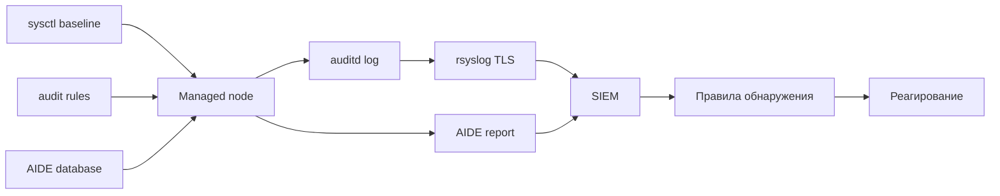

# Ядро и системный аудит

Параметры ядра уменьшают поверхность атаки, а системный аудит фиксирует действия, которые иначе не оставляют следа. Вместе они дают то, чего не хватает большинству филиальных серверов: возможность восстановить хронологию события и доказать, что базовая защита включена.

## 1. Зачем это нужно

Стандартная установка Linux рассчитана на совместимость, а не на безопасность. Ядро принимает ICMP-редиректы, разрешает дампы памяти с правами root, позволяет читать `dmesg` непривилегированным пользователям и не ограничивает `ptrace`. По отдельности это мелочи, вместе — удобная среда для повышения привилегий после первичного доступа.

Аудит отвечает на другой вопрос: что произошло. Без правил `auditd` невозможно сказать, кто менял `sudoers`, кто запускал `passwd` и какой процесс получил привилегии. Журнал systemd фиксирует факт запуска сервиса, но не аргументы команды и не идентификатор пользователя. Для разбора инцидента и для аудита нужны именно события с привязкой к учётной записи.

Третий элемент — контроль целостности. AIDE строит эталонную базу хешей и позволяет заметить подмену бинарника, изменение конфигурации PAM или появление нового файла в `/etc`. Это не замена EDR, но дешёвый и проверяемый слой обнаружения.

Для SOC эти три слоя дают разную телеметрию. Параметры ядра описывают состояние, правила аудита — действия, AIDE — изменения файлов. Разбор инцидента обычно начинается с вопроса «когда появился файл», продолжается вопросом «кто запускал команду» и заканчивается проверкой «не изменились ли настройки ядра после этого». Без каждого из слоёв картина остаётся неполной.

У всего этого есть цена. Правила `execve` на сборочном сервере дают десятки тысяч событий в час, AIDE при инициализации читает весь диск, а `rp_filter` может уронить маршрутизацию через VPN. Поэтому baseline строится по классам хостов, а не одной универсальной ролью.

## 2. Ключевые понятия

| Понятие | Назначение |
|---|---|
| sysctl | интерфейс параметров ядра во время работы |
| `sysctl.d` | каталог постоянных параметров, применяется `sysctl --system` |
| `rp_filter` | проверка обратного пути пакета; чувствительна к асимметричной маршрутизации |
| `auditd` | демон аудита ядра |
| audit rule | правило: syscall, watch на файл или контроль конфигурации |
| watch | правило вида `-w путь -p wa`, отслеживает запись и атрибуты |
| key | метка правила для поиска через `ausearch -k` |
| `auid` | идентификатор пользователя входа, сохраняется через `sudo` |
| `augenrules` | сборка `/etc/audit/rules.d/*.rules` в один набор |
| immutable mode | режим `-e 2`: правила нельзя изменить до перезагрузки |
| backlog | очередь событий ядра; переполнение ведёт к потере записей |
| AIDE | система контроля целостности файлов по хешам и атрибутам |
| AIDE database | эталонная база, с которой сравнивается файловая система |

## 3. Схема



Схема подчёркивает, что локальный журнал — промежуточное звено. Пока события не ушли на внешний коллектор, злоумышленник с root может их удалить; локальная защита лишь выигрывает время.

## 4. Пошаговая реализация

### Шаг 1. Соберите baseline ядра

Начните с параметров, которые почти не влияют на приложения: рандомизация адресного пространства, запрет дампов suid-процессов, защита жёстких и символических ссылок, ограничение `dmesg` и `ptrace`, синхронные cookie, отключение редиректов и source routing. Каждый параметр записывается в `sysctl.d` с комментарием, иначе через год никто не объяснит, зачем он нужен.

| Параметр | Значение | Причина |
|---|---|---|
| `kernel.randomize_va_space` | `2` | полная рандомизация ASLR |
| `kernel.dmesg_restrict` | `1` | журнал ядра недоступен обычным пользователям |
| `kernel.kptr_restrict` | `2` | адреса ядра скрыты в выводе |
| `kernel.yama.ptrace_scope` | `1` | трассировка только своих процессов |
| `fs.suid_dumpable` | `0` | запрет дампов памяти suid-программ |
| `fs.protected_hardlinks` | `1` | защита от подмены через hardlink |
| `fs.protected_symlinks` | `1` | защита от атак через symlink в /tmp |
| `net.ipv4.conf.all.rp_filter` | `1` | отбрасывание пакетов с ложным обратным путём |
| `net.ipv4.conf.all.accept_redirects` | `0` | запрет ICMP-редиректов |
| `net.ipv4.conf.all.send_redirects` | `0` | хост не выступает маршрутизатором |
| `net.ipv4.tcp_syncookies` | `1` | защита от SYN-флуда |
| `net.ipv4.conf.all.log_martians` | `1` | журналирование подозрительных пакетов |

Параметры `fs.protected_fifos` и `fs.protected_regular` доступны на новых ядрах; перед включением проверьте наличие ключа через `sysctl -a`.

### Шаг 2. Определите, что аудировать

Минимальный набор: изменения учётных записей и групп, изменения `sudoers`, повышение привилегий, запуск команд от имени пользователя, изменение времени, изменение сетевых настроек, загрузка модулей ядра и изменения самой конфигурации аудита. Для каждого класса задаётся свой `key`, чтобы разбор шёл по метке, а не по всему журналу.

### Шаг 3. Ограничьте объём событий

Правило `execve` с фильтром `auid>=1000` фиксирует каждую команду интерактивного пользователя. На админском хосте это приемлемо, на сборочном — нет. Варианты: исключить каталоги сборки через `-F dir!=`, оставить только привилегированные бинарники или вовсе заменить `execve` на watch по критичным путям. Решение фиксируется в правилах и в документации класса хостов.

Оценивайте объём до включения неизменяемости. Прогон правил на одном хосте в течение суток даёт понятную цифру: сколько событий, сколько места, какая доля приходится на `execve`. Если журнал растёт быстрее, чем диск, правило нужно сузить, а не увеличивать бюджет хранения. Аудит, который роняет сервис из-за заполнения раздела, приносит больше вреда, чем пользы.

### Шаг 4. Включите неизменяемость осознанно

Строка `-e 2` в конце набора делает правила неизменяемыми до перезагрузки. Это правильная настройка для боевого хоста, но она означает, что любое исправление правил требует окна и перезагрузки. В playbook неизменяемость выключена по умолчанию: сначала правила проверяются, затем включается флаг.

### Шаг 5. Постройте эталон AIDE

Инициализация AIDE читает файловую систему целиком и нагружает диск. Её выполняют в maintenance window, а базу хранят вне хоста: локальная база бесполезна, если злоумышленник может её пересобрать. Проверка `aide --check` запускается по расписанию и отправляет отчёт в SIEM.

Отдельно решите, что считать эталоном. Если в базу попадёт каталог с постоянно меняющимися файлами, отчёт будет шуметь и его перестанут читать. Типовой набор — `/etc`, `/bin`, `/sbin`, `/usr/bin`, `/usr/sbin`, конфигурация загрузчика и модули ядра; каталоги приложений добавляются осознанно, с пониманием частоты их изменений.

### Шаг 6. Защитите журналы

`auditd` пишет в `/var/log/audit/audit.log`. Права `0600`, владелец root, ротация с сохранением, формат `ENRICHED` с именами пользователей и групп. Обязательна отправка на внешний коллектор по TLS: локальный журнал — расходный материал.

!!! warning "Риск"
  `rp_filter` и отключение `accept_ra` ломают асимметричную маршрутизацию и SLAAC. Не включайте их на хостах с VPN-туннелями без проверки на canary.

## 5. Полный запускаемый пример

`templates/50-ansible.rules.j2`:

```jinja2
## Identity and authorisation
-w /etc/passwd -p wa -k identity
-w /etc/group -p wa -k identity
-w /etc/shadow -p wa -k identity
-w /etc/gshadow -p wa -k identity
-w /etc/sudoers -p wa -k privilege
-w /etc/sudoers.d/ -p wa -k privilege

## Privilege escalation
-a always,exit -F arch=b64 -S setuid -S setgid -S setreuid -S setregid -F auid>=1000 -F auid!=unset -k privilege
-a always,exit -F arch=b64 -S execve -F auid>=1000 -F auid!=unset -k exec

## Time changes
-a always,exit -F arch=b64 -S adjtimex -S settimeofday -S clock_settime -k time
-w /etc/localtime -p wa -k time

## Network configuration
-a always,exit -F arch=b64 -S sethostname -S setdomainname -k network
-w /etc/hosts -p wa -k network

## Kernel modules
-a always,exit -F arch=b64 -S init_module -S delete_module -k modules
-w /usr/sbin/modprobe -p x -k modules

## Audit configuration
-w /etc/audit/ -p wa -k auditconfig
-w /etc/audit/rules.d/ -p wa -k auditconfig


## Immutable until reboot
-e 2

```

`playbooks/38-kernel-audit.yml`:

```yaml
---
- name: Kernel and audit baseline
  hosts: linux_branches
  become: true
  gather_facts: true
  serial: "20%"
  max_fail_percentage: 10

  vars:
    audit_immutable: false
    audit_rules_file: /etc/audit/rules.d/50-ansible.rules
    kernel_params:
      kernel.randomize_va_space: "2"
      kernel.dmesg_restrict: "1"
      kernel.kptr_restrict: "2"
      kernel.yama.ptrace_scope: "1"
      fs.suid_dumpable: "0"
      fs.protected_hardlinks: "1"
      fs.protected_symlinks: "1"
      net.ipv4.conf.all.rp_filter: "1"
      net.ipv4.conf.all.accept_redirects: "0"
      net.ipv4.conf.all.send_redirects: "0"
      net.ipv4.conf.all.accept_source_route: "0"
      net.ipv4.conf.all.log_martians: "1"
      net.ipv4.tcp_syncookies: "1"
      net.ipv4.icmp_echo_ignore_broadcasts: "1"

  tasks:
    - name: Apply kernel hardening parameters
      ansible.posix.sysctl:
        name: "{{ item.key }}"
        value: "{{ item.value }}"
        sysctl_file: /etc/sysctl.d/99-security.conf
        sysctl_set: true
        state: present
        reload: true
      loop: "{{ kernel_params | dict2items }}"
      loop_control:
        label: "{{ item.key }}"

    - name: Install audit and integrity packages
      ansible.builtin.package:
        name: "{{ audit_packages[ansible_facts['os_family']] }}"
        state: present
      vars:
        audit_packages:
          RedHat: [audit, aide]
          Debian: [auditd, aide]

    - name: Ensure audit rules directory exists
      ansible.builtin.file:
        path: /etc/audit/rules.d
        state: directory
        owner: root
        group: root
        mode: "0750"

    - name: Deploy audit rules
      ansible.builtin.template:
        src: templates/50-ansible.rules.j2
        dest: "{{ audit_rules_file }}"
        owner: root
        group: root
        mode: "0640"
      notify: Load audit rules

    - name: Validate audit rules syntax
      ansible.builtin.command:
        argv: [augenrules, --check]
      register: audit_check
      changed_when: false

    - name: Tune audit daemon settings
      ansible.builtin.lineinfile:
        path: /etc/audit/auditd.conf
        regexp: "^{{ item.key }} ="
        line: "{{ item.key }} = {{ item.value }}"
      loop:
        - { key: max_log_file, value: "200" }
        - { key: num_logs, value: "10" }
        - { key: max_log_file_action, value: "keep_logs" }
        - { key: space_left_action, value: "syslog" }
        - { key: admin_space_left_action, value: "syslog" }
        - { key: log_format, value: "ENRICHED" }
        - { key: flush, value: "incremental_async" }
        - { key: freq, value: "50" }

    - name: Flush handlers before AIDE initialisation
      ansible.builtin.meta: flush_handlers

    - name: Initialise AIDE database
      ansible.builtin.command:
        argv: [aide, --init, --config, "{{ aide_config }}"]
        creates: "{{ aide_db_new }}"
      register: aide_init
      failed_when: aide_init.rc not in [0, 1, 2, 4]
      vars:
        aide_config: "{{ '/etc/aide.conf' if ansible_facts['os_family'] == 'RedHat' else '/etc/aide/aide.conf' }}"
        aide_db_new: "{{ '/var/lib/aide/aide.db.new.gz' if ansible_facts['os_family'] == 'RedHat' else '/var/lib/aide/aide.db.new' }}"

    - name: Promote AIDE database
      ansible.builtin.copy:
        src: "{{ aide_db_new }}"
        dest: "{{ aide_db }}"
        remote_src: true
        owner: root
        group: root
        mode: "0600"
      vars:
        aide_db_new: "{{ '/var/lib/aide/aide.db.new.gz' if ansible_facts['os_family'] == 'RedHat' else '/var/lib/aide/aide.db.new' }}"
        aide_db: "{{ '/var/lib/aide/aide.db.gz' if ansible_facts['os_family'] == 'RedHat' else '/var/lib/aide/aide.db' }}"

    - name: Schedule weekly AIDE check
      ansible.builtin.cron:
        name: aide check
        user: root
        weekday: "0"
        hour: "4"
        minute: "30"
        job: >-
          {{ '/usr/sbin/aide' if ansible_facts['os_family'] == 'RedHat' else '/usr/bin/aide' }}
          --check --config {{ '/etc/aide.conf' if ansible_facts['os_family'] == 'RedHat' else '/etc/aide/aide.conf' }}
          > /var/log/aide-check.log 2>&1

  handlers:
    - name: Load audit rules
      ansible.builtin.command:
        argv: [augenrules, --load]
      changed_when: true
```

`aide --init` возвращает битовую маску различий, поэтому `failed_when` допускает коды 0, 1, 2 и 4: это не ошибки выполнения, а признаки отличий при построении базы. Коды выше означают сбой и останавливают play.

Проверка правил выполняется `augenrules --check` после записи файла, а не через `validate`. Причина техническая: `augenrules` читает каталог `/etc/audit/rules.d`, а `validate` передаёт временный файл, который сборщик не увидит. Порядок задач гарантирует, что синтаксическая ошибка обнаружится до загрузки правил в ядро.

## 6. Проверка результата

```bash
ansible msk-app01 -b -m ansible.builtin.command -a "sysctl kernel.randomize_va_space kernel.yama.ptrace_scope net.ipv4.conf.all.rp_filter"
ansible msk-app01 -b -m ansible.builtin.command -a "auditctl -l"
ansible msk-app01 -b -m ansible.builtin.command -a "auditctl -s"
ansible msk-app01 -b -m ansible.builtin.command -a "aureport --summary"
ansible msk-app01 -b -m ansible.builtin.command -a "ausearch -k privilege -ts today"
ansible msk-app01 -b -m ansible.builtin.command -a "aide --check --config /etc/aide.conf"
```

`auditctl -s` показывает `backlog` и `lost`; ненулевое `lost` означает, что события теряются и нужно увеличивать `-b` или сокращать правила. `aureport --summary` даёт сводку по типам событий и помогает оценить объём. `ausearch -k privilege -ts today` — типовой запрос при разборе повышения привилегий.

Признаки успеха: правила видны в `auditctl -l`, `lost` равно нулю, отчёт AIDE не содержит неожиданных изменений, параметры ядра совпадают с baseline после перезагрузки.

Проверять параметры нужно именно после перезагрузки: часть настроек применяется только при старте, и `sysctl` в работающей системе может показывать значение, которое не сохранится. Для филиальных хостов с редкими окнами это особенно важно — ошибка обнаружится в самый неудобный момент.

## 7. Безопасность и blast radius

| Риск | Последствие | Мера |
|---|---|---|
| `rp_filter` при асимметричной маршрутизации | обрыв VPN и балансировки | canary на хосте с туннелем |
| `ptrace_scope: 1` | не работают отладчики и профилировщики | исключение для dev-хостов |
| `dmesg_restrict` | ломается сбор метрик | проверить агенты мониторинга |
| `execve` без фильтра | переполнение журнала и потеря событий | ключи, исключения, `-b` |
| `-e 2` без плана | правка правил требует перезагрузки | включать после стабилизации |
| AIDE в рабочее время | нагрузка на диск и рост latency | окно, `nice`, `ionice` |
| Локальный журнал без отправки | события удаляются атакующим | TLS-коллектор, контроль доставки |

Откат: параметры ядра возвращаются удалением файла `/etc/sysctl.d/99-security.conf` и `sysctl --system`; правила аудита — удалением файла и `augenrules --load`, если неизменяемость не включена. При включённом `-e 2` откат возможен только после перезагрузки, поэтому флаг включается последним и отдельным коммитом.

AIDE не откатывается: восстановление базы выполняется из проверенной копии, а расхождения разбираются вручную. Автоматическая пересборка базы после изменений опасна — она маскирует подмену.

Влияние на производительность измеряется, а не предполагается. Снимите `auditctl -s` до и после включения правил, посмотрите `aureport --summary` за сутки и оцените долю событий `execve`. Если `lost` растёт или журнал занимает гигабайты в сутки, сначала настройте фильтры и только потом увеличивайте backlog: память ядра не бесконечна, и рост `-b` сам по себе не решает проблему объёма. На сборочных хостах разумно начинать с watch по критичным путям и добавлять `execve` только после оценки.

## 8. Комплаенс-маппинг

| Требование | Как закрывается |
|---|---|
| CIS Benchmark 1.5 (auditd), 3.x (kernel) | правила и параметры из baseline |
| CIS Benchmark 1.3 (integrity) | AIDE и регулярная проверка |
| DISA STIG CAT II (audit) | покрытие identity, privilege, time, modules |
| ISO/IEC 27001:2022 A.8.15, A.8.16 | журналирование и мониторинг |
| NIST CSF 2.0 DE.AE, DE.CM | события аудита и контроль целостности |
| CIS Controls v8, Control 8 | журналы аудита и их защита |

## 9. Типичные ошибки и troubleshooting

| Симптом | Причина | Проверка | Решение |
|---|---|---|---|
| `auditctl -l` пуст | правила не загружены | `augenrules --check` | перезапустить handler, проверить путь |
| `lost` растёт | мал backlog | `auditctl -s` | увеличить `-b`, сократить правила |
| Правила не применяются | включён `-e 2` | `auditctl -s` | перезагрузка в окне |
| `augenrules --check` падает | синтаксис или опечатка в ключе | вывод команды | исправить шаблон |
| Событий нет в SIEM | rsyslog не отправляет audit.log | `rsyslogd -N1` | настроить imfile и TLS |
| `aide --init` «падает» | код 1/2/4 — это различия | `echo $?` | не считать ошибкой |
| Сервис не стартует после sysctl | несовместимый параметр | `sysctl --system` | удалить параметр, проверить ядро |
| Диск заполнен | нет ротации audit.log | `du -sh /var/log/audit` | `num_logs`, `max_log_file_action` |

## 10. Чек-лист

- [ ] Baseline ядра согласован по классам хостов.
- [ ] Параметры записаны в `sysctl.d` и применяются после перезагрузки.
- [ ] Правила аудита покрывают identity, privilege, time, modules.
- [ ] У каждого правила есть `key`.
- [ ] `augenrules --check` проходит до загрузки.
- [ ] `lost` равно нулю под нагрузкой.
- [ ] Неизменяемость включается отдельным окном.
- [ ] База AIDE хранится вне хоста.
- [ ] Журналы уходят на внешний коллектор по TLS.
- [ ] Отчёт AIDE и сводка `aureport` попадают в SIEM.

## 11. Источники

- [Red Hat: auditing the system](https://docs.redhat.com/en/documentation/red_hat_enterprise_linux/9/html/security_hardening/auditing-the-system_security-hardening)
- [Linux audit project](https://github.com/linux-audit/audit-userspace)
- [AIDE documentation](https://aide.github.io/)
- [sysctl man page](https://man7.org/linux/man-pages/man8/sysctl.8.html)
- [CIS Benchmarks](https://www.cisecurity.org/cis-benchmarks)

## 12. Связанные страницы

- [Харденинг Linux](35-linux-hardening.md)
- [Логирование и мониторинг](42-logging-monitoring.md)
- [Реагирование на инциденты](45-incident-response.md)
- [Файлы, ACL, SELinux/AppArmor](../admin/23-files-acl-selinux.md)
- [Комплаенс и доказательства](44-compliance.md)
