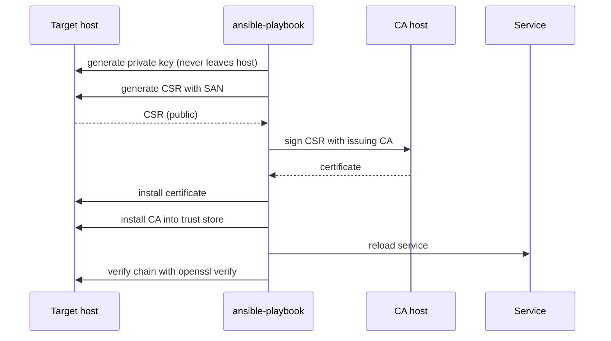

# TLS и PKI

Внутренняя инфраструктура открытых ключей (PKI) решает две задачи: подтверждает подлинность сервиса и защищает трафик от подмены. Без собственного удостоверяющего центра (CA) администраторы ставят самоподписанные сертификаты и отключают проверку в клиентах — что сводит защиту TLS к шифрованию без аутентификации.

## 1. Зачем это нужно

Филиальная сеть состоит из десятков сервисов: панели управления, API, внутренние балансировщики, агенты мониторинга, брокеры сообщений. Каждый требует сертификата. Если выпуск выполняется вручную, появляются три типовые проблемы: сертификаты с истёкшим сроком, самоподписанные сертификаты без цепочки и клиенты с отключённой проверкой.

Истечение сертификата — самый частый способ устроить себе простой. Он случается предсказуемо, но всегда неожиданно, потому что учёт сроков ведётся в таблице, а таблица устаревает. Автоматизация даёт инвентарь, проверку остатка дней и предсказуемое продление.

Вторая причина — управляемость доверия. Клиенты должны доверять внутреннему CA через системное хранилище, а не через флаг «не проверять». Это дисциплинирует: сертификат либо выпущен CA, либо соединение не состоится.

Третья — сегментация ответственности. Ключ CA не должен лежать на том же хосте, что и приложение. Ansible позволяет разделить роли: на цели генерируется закрытый ключ, на CA подписывается запрос, на цели устанавливается готовый сертификат. Закрытый ключ сервиса не покидает хост, а ключ CA остаётся на выделенной машине.

Наконец, PKI нужна для управления, а не для галочки. Инвентарь сертификатов с датами, владельцами и назначением позволяет ответить на вопрос «что сломается, если этот CA отозвать». Без инвентаря замена корневого сертификата превращается в многодневный поиск всех клиентов, которые ему доверяют.

## 2. Ключевые понятия

| Понятие | Назначение |
|---|---|
| Root CA | корневой центр; его сертификат распространяется в хранилища доверия |
| Issuing CA | промежуточный CA, которым подписываются сертификаты сервисов |
| CSR | запрос на подпись сертификата, содержит открытый ключ и атрибуты |
| SAN | список имён и адресов, для которых действителен сертификат |
| Key Usage | назначение ключа: подпись, шифрование, подпись сертификатов |
| Extended Key Usage | сценарий: `serverAuth`, `clientAuth` |
| Chain | цепочка от сертификата сервиса до корня |
| Trust store | системное хранилище доверенных корней |
| CRL | список отозванных сертификатов |
| OCSP | онлайн-проверка статуса сертификата |
| ACME | протокол автоматического выпуска, RFC 8555 |
| Passphrase | парольная фраза для шифрования закрытого ключа |

## 3. Схема



На схеме видно разделение: закрытый ключ сервиса создаётся на целевом хосте, а подпись выполняется на CA. Control node переносит только открытые артефакты — CSR и сертификат.

## 4. Пошаговая реализация

### Шаг 1. Спроектируйте иерархию

Минимум: корневой CA с длительным сроком и выдающий CA со сроком короче. Корневой ключ используется редко и хранится изолированно, выдающий — на машине, доступной автоматизации. Для небольшой сети допустим один CA, но тогда его ключ должен быть максимально защищён.

### Шаг 2. Определите сроки и алгоритмы

Для внутренних сервисов практичны сертификаты на 90–397 дней: короткий срок снижает ценность украденного ключа и заставляет отработать автоматическое продление. Ключ RSA 3072 или ECDSA P-256, подпись `sha256`. Устаревшие алгоритмы и короткие ключи не используйте, даже если оборудование их поддерживает.

### Шаг 3. Зафиксируйте имена в SAN

Современные клиенты игнорируют Common Name и проверяют только SAN. Поэтому в запрос попадают все имена, по которым к сервису обращаются: короткое имя, FQDN, имя в внутренней зоне, при необходимости IP. Ошибка в SAN проявляется как ошибка проверки у клиента, а не при выпуске.

### Шаг 4. Разделите генерацию ключа и подпись

Ключ создаётся на целевом хосте с правами `0600` и владельцем root. Если сервис работает под отдельным пользователем, допустим режим `0640` с группой сервиса. CSR передаётся на CA, подписывается, сертификат возвращается. Такой порядок исключает хранение ключей сервисов на control node.

Хранение ключей — отдельное решение, а не деталь реализации. Простейший вариант: файл на диске с правами `0600`, passphrase из vault для ключа CA. Более строгий: ключ в HSM или TPM, где сам носитель не позволяет выгрузить материал. Промежуточный: ключ в отдельном файле, права на который есть только у сервисной учётной записи, а резервные копии шифруются. В любом случае ключи не попадают в Git, в артефакты CI и в незашифрованные бэкапы. Для passphrase CA используйте отдельный vault-секрет с ограниченным доступом: компрометация этого секрета равна компрометации всей PKI.

### Шаг 5. Распространите корень в хранилище доверия

На RHEL корень кладётся в `/etc/pki/ca-trust/source/anchors/` и применяется `update-ca-trust`. На Debian и Ubuntu — в `/usr/local/share/ca-certificates/` и `update-ca-certificates`. Без этого клиенты не смогут проверить цепочку, и кто-то снова отключит проверку.

### Шаг 6. Настройте продление

Проверка остатка дней выполняется ежедневно: `openssl x509 -checkend 2592000` возвращает код 1, если сертификат истекает в течение 30 дней. По этому сигналу запускается выпуск нового сертификата и перезагрузка сервиса. Продление должно перекрывать текущий сертификат, а не заменять его в последний день.

### Шаг 7. Опишите отзыв

Отзыв нужен при компрометации ключа, увольнении администратора с доступом к CA и выводе сервиса из эксплуатации. Минимальный вариант — CRL, публикуемый по HTTP и проверяемый клиентами. Короткие сроки жизни сертификатов снижают срочность отзыва, но не отменяют его.

!!! note "Контекст"
  ACME (RFC 8555) автоматизирует выпуск и продление. Для публичных имён подходит Let's Encrypt с проверкой через HTTP-01 или DNS-01; для внутренних — внутренний ACME-сервер. В примерах ниже используется собственный CA: он не требует внешних зависимостей и работает в изолированной сети.

## 5. Полный запускаемый пример

`playbooks/39-tls-pki.yml`:

```yaml
---
- name: Generate keys and certificate requests
  hosts: tls_targets
  become: true
  gather_facts: true
  vars:
    pki_name: "{{ inventory_hostname }}"
    pki_key_dir: /etc/pki/tls/private
    pki_csr_dir: /etc/pki/tls/csr
    pki_domain: branch.example.local

  tasks:
    - name: Ensure PKI directories exist
      ansible.builtin.file:
        path: "{{ item.path }}"
        state: directory
        owner: root
        group: root
        mode: "{{ item.mode }}"
      loop:
        - { path: "{{ pki_key_dir }}", mode: "0700" }
        - { path: "{{ pki_csr_dir }}", mode: "0755" }

    - name: Generate service private key
      community.crypto.openssl_privatekey:
        path: "{{ pki_key_dir }}/{{ pki_name }}.key"
        type: RSA
        size: 3072
        mode: "0600"
        owner: root
        group: root
        backup: true

    - name: Generate certificate request
      community.crypto.openssl_csr:
        path: "{{ pki_csr_dir }}/{{ pki_name }}.csr"
        privatekey_path: "{{ pki_key_dir }}/{{ pki_name }}.key"
        common_name: "{{ pki_name }}.{{ pki_domain }}"
        subject_alt_name:
          - "DNS:{{ pki_name }}"
          - "DNS:{{ pki_name }}.{{ pki_domain }}"
        key_usage:
          - digitalSignature
          - keyEncipherment
        extended_key_usage:
          - serverAuth
        digest: sha256
        mode: "0644"

    - name: Fetch certificate request to control node
      ansible.builtin.fetch:
        src: "{{ pki_csr_dir }}/{{ pki_name }}.csr"
        dest: "{{ playbook_dir }}/../pki_requests/{{ pki_name }}.csr"
        flat: true

- name: Sign certificates on the internal CA
  hosts: pki_ca
  become: true
  gather_facts: true
  vars:
    pki_ca_dir: /srv/pki
    pki_ca_key: /srv/pki/private/ca.key
    pki_ca_cert: /srv/pki/certs/ca.crt
    pki_request_dir: "{{ playbook_dir }}/../pki_requests"

  tasks:
    - name: Ensure CA directories exist
      ansible.builtin.file:
        path: "{{ item }}"
        state: directory
        owner: root
        group: root
        mode: "0700"
      loop:
        - "{{ pki_ca_dir }}/private"
        - "{{ pki_ca_dir }}/certs"
        - "{{ pki_ca_dir }}/csr"
        - "{{ pki_ca_dir }}/issued"

    - name: Generate CA private key
      community.crypto.openssl_privatekey:
        path: "{{ pki_ca_key }}"
        type: RSA
        size: 4096
        passphrase: "{{ vault_pki_ca_passphrase }}"
        cipher: auto
        mode: "0600"
      no_log: true

    - name: Generate CA certificate request
      community.crypto.openssl_csr:
        path: "{{ pki_ca_dir }}/csr/ca.csr"
        privatekey_path: "{{ pki_ca_key }}"
        privatekey_passphrase: "{{ vault_pki_ca_passphrase }}"
        common_name: "Branch Internal CA"
        basic_constraints:
          - CA:TRUE
          - pathlen:0
        basic_constraints_critical: true
        key_usage:
          - keyCertSign
          - cRLSign
        key_usage_critical: true
        digest: sha256
      no_log: true

    - name: Create self-signed CA certificate
      community.crypto.x509_certificate:
        path: "{{ pki_ca_cert }}"
        csr_path: "{{ pki_ca_dir }}/csr/ca.csr"
        privatekey_path: "{{ pki_ca_key }}"
        privatekey_passphrase: "{{ vault_pki_ca_passphrase }}"
        provider: selfsigned
        selfsigned_not_after: "+3650d"
        selfsigned_digest: sha256
        backup: true
      no_log: true

    - name: Sign server certificates
      community.crypto.x509_certificate:
        path: "{{ pki_ca_dir }}/issued/{{ item }}.crt"
        csr_content: "{{ lookup('ansible.builtin.file', pki_request_dir + '/' + item + '.csr') }}"
        provider: ownca
        ownca_path: "{{ pki_ca_cert }}"
        ownca_privatekey_path: "{{ pki_ca_key }}"
        ownca_privatekey_passphrase: "{{ vault_pki_ca_passphrase }}"
        ownca_not_after: "+397d"
        ownca_digest: sha256
      loop: "{{ groups['tls_targets'] }}"
      no_log: true

    - name: Fetch issued certificates to control node
      ansible.builtin.fetch:
        src: "{{ pki_ca_dir }}/issued/{{ item }}.crt"
        dest: "{{ playbook_dir }}/../pki_issued/{{ item }}.crt"
        flat: true
      loop: "{{ groups['tls_targets'] }}"

    - name: Fetch CA certificate to control node
      ansible.builtin.fetch:
        src: "{{ pki_ca_cert }}"
        dest: "{{ playbook_dir }}/../pki_issued/ca.crt"
        flat: true

- name: Install certificates and trust the internal CA
  hosts: tls_targets
  become: true
  gather_facts: true
  vars:
    pki_name: "{{ inventory_hostname }}"
    pki_key_dir: /etc/pki/tls/private
    pki_cert_dir: /etc/pki/tls/certs
    pki_ca_local: "{{ playbook_dir }}/../pki_issued/ca.crt"
    pki_ca_anchor: >-
      {{ '/etc/pki/ca-trust/source/anchors/branch-internal-ca.crt'
         if ansible_facts['os_family'] == 'RedHat'
         else '/usr/local/share/ca-certificates/branch-internal-ca.crt' }}
    ca_trust_command: "{{ ['update-ca-trust'] if ansible_facts['os_family'] == 'RedHat' else ['update-ca-certificates'] }}"

  tasks:
    - name: Ensure certificate directory exists
      ansible.builtin.file:
        path: "{{ pki_cert_dir }}"
        state: directory
        owner: root
        group: root
        mode: "0755"

    - name: Install server certificate
      ansible.builtin.copy:
        src: "{{ playbook_dir }}/../pki_issued/{{ pki_name }}.crt"
        dest: "{{ pki_cert_dir }}/{{ pki_name }}.crt"
        owner: root
        group: root
        mode: "0644"
        validate: "openssl x509 -noout -in %s"

    - name: Install internal CA into trust store
      ansible.builtin.copy:
        src: "{{ pki_ca_local }}"
        dest: "{{ pki_ca_anchor }}"
        owner: root
        group: root
        mode: "0644"
      notify: Update CA trust

    - name: Verify certificate chain
      ansible.builtin.command:
        argv:
          - openssl
          - verify
          - -CAfile
          - "{{ pki_ca_anchor }}"
          - "{{ pki_cert_dir }}/{{ pki_name }}.crt"
      register: chain_check
      changed_when: false
      failed_when: chain_check.rc != 0

  handlers:
    - name: Update CA trust
      ansible.builtin.command:
        argv: "{{ ca_trust_command }}"
```

Сертификат CA попадает на control node задачей `fetch` в каталог `pki_issued/`. Ни ключ CA, ни ключи сервисов через control node не проходят.

Проверка продления — отдельный короткий playbook, который можно запускать по расписанию:

```yaml
---
- name: Certificate expiry report
  hosts: tls_targets
  gather_facts: false
  vars:
    pki_cert: "/etc/pki/tls/certs/{{ inventory_hostname }}.crt"

  tasks:
    - name: Check if certificate expires within 30 days
      ansible.builtin.command:
        argv: [openssl, x509, -checkend, "2592000", -noout, -in, "{{ pki_cert }}"]
      register: cert_check
      changed_when: false
      failed_when: cert_check.rc not in [0, 1]

    - name: Report certificates that need renewal
      ansible.builtin.debug:
        msg: "{{ inventory_hostname }}: certificate expires within 30 days"
      when: cert_check.rc == 1
```

`openssl x509 -checkend` возвращает 0, если сертификат действителен дольше указанного числа секунд, и 1, если истекает раньше. Это не ошибка, поэтому `failed_when` допускает оба кода.

## 6. Проверка результата

```bash
openssl x509 -in /etc/pki/tls/certs/msk-app01.crt -noout -subject -issuer -dates -ext subjectAltName
openssl verify -CAfile /etc/pki/ca-trust/source/anchors/branch-internal-ca.crt /etc/pki/tls/certs/msk-app01.crt
openssl s_client -connect msk-app01.branch.example.local:443 -servername msk-app01.branch.example.local -CAfile /etc/pki/ca-trust/source/anchors/branch-internal-ca.crt </dev/null
openssl x509 -in /etc/pki/tls/certs/msk-app01.crt -noout -checkend 2592000; echo $?
```

`openssl s_client` проверяет то, что видит клиент: цепочку, имя в SAN и срок. Флаг `-servername` обязателен для виртуальных хостов, иначе сервер вернёт сертификат по умолчанию.

Полезно проверять не только сам сервис, но и путь до него: балансировщик или reverse proxy может подменять сертификат. В этом случае `s_client` с именем внутреннего узла и с внешним именем дадут разные ответы, и расхождение нужно устранить до того, как его заметят пользователи. Тот же приём используют при проверке после продления: сравнение отпечатков `openssl x509 -fingerprint -sha256` показывает, что клиент получил именно новый сертификат.

Признаки успеха: `verify` возвращает `OK`, `s_client` показывает `Verify return code: 0 (ok)`, срок больше 30 дней, ключ имеет режим `0600`.

Проверку стоит ставить в CI, а не выполнять по памяти. Тогда каждое изменение инфраструктуры сопровождается подтверждением, что сертификат на месте, цепочка собирается и до истечения осталось достаточно времени.

## 7. Безопасность и blast radius

| Риск | Последствие | Мера |
|---|---|---|
| Компрометация ключа CA | подделка любого сервиса | изоляция CA, passphrase, HSM |
| Ключ на control node | утечка через бэкап или лог | ключи создаются только на целевых хостах |
| Ошибка в SAN | отказ клиентов, простой | проверка `s_client` до переключения |
| Истечение сертификата | отказ сервиса и мониторинга | `-checkend`, алерты, автопродление |
| Passphrase в логе | компрометация CA | `no_log: true` |
| Доверие самоподписанному | обход аутентификации | только корень CA в trust store |
| Нет CRL | украденный ключ работает до истечения | CRL или короткие сроки |

Blast radius: ошибка в корневом сертификате затрагивает все хосты, которые ему доверяют. Поэтому замена корня выполняется как отдельный проект с перекрытием: новый корень ставится рядом со старым, проверяется, и только потом старый удаляется.

Откат: старый сертификат и ключ сохраняются до подтверждения работы (`.bak` от `backup: true`). Если сервис не стартует, возвращается предыдущая пара и выполняется reload. Удаление старого сертификата сразу после установки нового — распространённая ошибка, которая лишает возможности откатиться.

При компрометации ключа CA порядок обратный привычному: сначала фиксируется инцидент и время, затем отзываются все выпущенные сертификаты, затем строится новый CA и выполняется перевыпуск. Клиенты при этом должны доверять и старому, и новому корню в период перехода, иначе доверие рвётся в обе стороны. Именно поэтому короткие сроки жизни сертификатов и автоматический перевыпуск ценнее, чем редкие ручные операции: они делают такую миграцию routine-задачей, а не аварией.

## 8. Комплаенс-маппинг

| Требование | Как закрывается |
|---|---|
| CIS Controls v8, Control 12 | управление сетевыми сервисами и шифрованием |
| ISO/IEC 27001:2022 A.8.24 | криптография и управление ключами |
| NIST CSF 2.0 PR.DS | защита данных при передаче |
| PCI DSS 4.0 (применимо) | инвентарь сертификатов и сроки |
| Аудит | журнал выпуска, сроки, отзывы |

Для аудита важны не только сертификаты, но и следы операций: кто выпускал, когда, по какому запросу. Журнал запусков playbook плюс каталог `pki_issued` с датами дают такую хронологию без отдельной системы учёта. Если сертификат выпускается вручную, эта связь теряется, и восстановить историю можно только по косвенным признакам.

## 9. Типичные ошибки и troubleshooting

| Симптом | Причина | Проверка | Решение |
|---|---|---|---|
| `unable to verify the first certificate` | нет промежуточного или корневого в trust store | `openssl verify` | установить корень, обновить trust store |
| `certificate has expired` | не настроено продление | `-checkend` | выпустить новый, включить проверку |
| `hostname mismatch` | SAN не содержит имя | `-ext subjectAltName` | перевыпустить с нужным SAN |
| Сервис не читает ключ | права или SELinux-контекст | `ls -l`, `ausearch` | `0600`, восстановить контекст |
| `update-ca-trust` не помог | сертификат не в `anchors` | `trust list` | положить в правильный каталог |
| `openssl verify` падает на цепочке | подписан не тем CA | `-issuer` | перевыпустить на нужном CA |
| Passphrase не подходит | изменён vault-секрет | `no_log`, vault | восстановить секрет, перевыпустить ключ |

## 10. Чек-лист

- [ ] Иерархия CA и сроки согласованы.
- [ ] Ключ CA защищён passphrase и хранится изолированно.
- [ ] SAN содержит все имена и адреса.
- [ ] Ключи сервисов не покидают целевые хосты.
- [ ] Корень CA установлен в trust store.
- [ ] Цепочка проверена `openssl verify` и `s_client`.
- [ ] Проверка `-checkend` запускается ежедневно.
- [ ] Продление перекрывает текущий сертификат.
- [ ] Процедура отзыва описана.
- [ ] Старые сертификаты сохраняются до подтверждения.

## 11. Источники

- [community.crypto.x509_certificate](https://docs.ansible.com/ansible/latest/collections/community/crypto/x509_certificate_module.html)
- [community.crypto.openssl_csr](https://docs.ansible.com/ansible/latest/collections/community/crypto/openssl_csr_module.html)
- [OpenSSL verify manual](https://docs.openssl.org/master/man1/openssl-verify/)
- [RFC 8555: ACME](https://datatracker.ietf.org/doc/html/rfc8555)
- [NIST SP 800-57: key management](https://csrc.nist.gov/pubs/sp/800/57/pt1/r5/final)

## 12. Связанные страницы

- [Управление секретами](../secure-dev/11-secrets.md)
- [SSH, PAM, sudo, MFA](36-auth-ssh-pam.md)
- [Харденинг ESXi/vCenter](40-vmware-hardening.md)
- [Реагирование на инциденты](45-incident-response.md)
- [Логирование и мониторинг](42-logging-monitoring.md)
