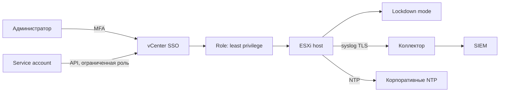

# Харденинг ESXi/vCenter

Гипервизор — самый привилегированный слой инфраструктуры: доступ к нему равен доступу ко всем виртуальным машинам на хосте. Харденинг ESXi и vCenter сводится к трём вещам: минимизировать пути входа, разделить полномочия и обеспечить наблюдаемость действий администраторов.

## 1. Зачем это нужно

Типовая картина в филиале: vCenter с локальной учётной записью администратора, общий пароль в документации площадки, SSH на ESXi включён «для диагностики», syslog пишется только локально. Любая компрометация учётной записи даёт противнику возможность создать ВМ, смонтировать ISO, изменить сеть или скопировать диск. Локальные журналы при этом исчезают вместе с хостом.

Вторая проблема — незаметный дрейф. Настройки хоста меняются вручную: кто-то включил SSH, кто-то ослабил политику паролей, кто-то добавил порт-группу с разрешённым promiscuous mode. Без декларативного описания эти изменения не видны, пока не приведут к инциденту.

Ansible закрывает обе задачи частично. Он умеет управлять доступом, службами, NTP, syslog и частью расширенных параметров через API vCenter, но не заменяет vSphere Certificate Manager и не настраивает всё, что описано в CIS Benchmark. Поэтому задачу делят: автоматизируемое — в playbook, остальное — в регламент с проверкой.

Важное ограничение: `community.vmware` работает через API vCenter и требует прав на запись. На бесплатной лицензии ESXi запись недоступна. Для standalone-хостов без vCenter часть модулей неприменима, и там остаётся ручная настройка через DCUI или Host Client.

Отдельно стоит проговорить ответственность. Гипервизор защищает не только себя: он определяет, кто может подключить ISO, изменить сетевой адаптер ВМ или снять снапшот с диском. Поэтому «харденинг ESXi» — это ещё и контроль над жизненным циклом ВМ. Если администратор приложения может менять настройки виртуальной машины, он может обойти часть защиты гостевой ОС, например подключив отладочный образ. Роли должны это учитывать.

## 2. Ключевые понятия

| Понятие | Назначение |
|---|---|
| SSO | единая аутентификация vSphere, источник истины для входа |
| Identity source | подключённый каталог: AD, LDAP или локальные пользователи |
| RBAC | роли и разрешения на объекты: datacenter, cluster, folder, host |
| Custom role | роль с минимальным набором привилегий под задачу |
| Service account | учётная запись для интеграций, а не для человека |
| Lockdown mode | режим, при котором вход на хост разрешён только через vCenter |
| Exception user | учётная запись, которой разрешён прямой вход при lockdown |
| DCUI | консольный интерфейс хоста, доступный через гипервизор |
| TSM-SSH | служба SSH на ESXi |
| TSM | служба ESXi Shell |
| MOB | Managed Object Browser, веб-интерфейс API; в продакшене отключён |
| VMCA | сертификатный орган vSphere |
| vDS | распределённый коммутатор с политиками безопасности |
| KMS | сервер ключей для шифрования ВМ и vSAN |

## 3. Схема



На схеме два независимых контура: люди входят через SSO с MFA и получают роль, сервисы — через отдельную учётную запись с узкими правами. Прямой вход на хост закрыт lockdown-режимом, а журналы уходят за пределы площадки.

## 4. Пошаговая реализация

### Шаг 1. Наведите порядок в идентичности

Подключите vCenter к каталогу, оставьте локальные учётки только для аварийного доступа, включите MFA на стороне провайдера идентичности. Учётная запись `administrator@vsphere.local` не используется для повседневной работы и не хранится в playbook. Для автоматизации создаётся отдельная учётная запись с ролью, включающей только необходимые привилегии.

### Шаг 2. Опишите роли

Минимум три роли: администратор инфраструктуры, оператор ВМ (запуск, остановка, снапшоты в рамках политики) и аудитор (только чтение). Разрешения выдаются на конкретные объекты, а не на корень инвентаря. Практика показывает, что роль «Read only плюс одна привилегия» почти всегда достаточна для интеграций.

### Шаг 3. Закройте интерактивные службы

SSH и ESXi Shell выключаются на всех хостах, кроме окна диагностики. Таймауты `ESXiShellTimeOut` и `ESXiShellInteractiveTimeOut` ограничивают время жизни сессии, если службу всё же включили. MOB отключается: это веб-интерфейс API, который не нужен в продакшене и даёт лишнюю поверхность.

### Шаг 4. Включите lockdown

Lockdown mode заставляет администраторов работать через vCenter, где действуют роли и журналирование. Режим `normal` разрешает прямой вход только exception-пользователям, `strict` запрещает и его. Перед включением убедитесь, что exception-пользователи созданы и их пароли доступны дежурной смене, иначе при недоступности vCenter хост останется без управления.

### Шаг 5. Настройте время и журналы

NTP обязателен: без синхронизации времени журналы и Kerberos-аутентификация становятся бесполезны. Syslog настраивается на внешний коллектор по TLS. В `community.vmware` нет отдельного модуля syslog, поэтому используется расширенная настройка `Syslog.global.logHost` через `vmware_host_config_manager` — это документированный способ задать удалённый коллектор.

### Шаг 6. Приведите сертификаты и сеть

Сертификаты vCenter и ESXi выдаются внутренним CA, срок отслеживается, замена выполняется через vSphere Certificate Manager в окно. На распределённом коммутаторе запрещаются promiscuous mode, forged transmits и смена MAC, если это не требуется задачей. Порт-группы разделяются по назначению: management, storage, VM traffic.

Снапшоты и шифрование относятся к тому же уровню. Снапшот — не резервная копия: он растёт вместе с изменениями диска, замедляет ввод-вывод и при неудачной консолидации оставляет ВМ в уязвимом состоянии. Нужна политика: срок жизни, владелец, автоматический алерт на снапшоты старше нескольких суток. Шифрование ВМ и vSAN требует внешнего KMS; без него ключи хранятся локально, и защита от компрометации хранилища снижается. Эти темы редко закрываются одним модулем, поэтому они попадают в регламент и проверяются выборочно.

### Шаг 7. Настройте резервное копирование конфигурации

Конфигурация ESXi сохраняется штатными средствами: `vim-cmd hostsvc/firmware/backup_config` в maintenance window или `Get-VMHostFirmware -BackupConfiguration` через PowerCLI. Ansible оркестрирует окно и проверку, но сам бэкап делает платформа. Без копии конфигурации восстановление хоста после сбоя начинается с нуля.

!!! warning "Риск"
  Lockdown mode и отключение SSH могут оставить хост без управления, если vCenter недоступен. Включайте режим только после проверки exception-пользователей и доступа к DCUI.

## 5. Полный запускаемый пример

Инвентарь: группа `vmware_esxi`, где `inventory_hostname` совпадает с именем хоста в vCenter. Playbook выполняется с `connection: local`, модули обращаются к API vCenter.

`playbooks/40-vmware-hardening.yml`:

```yaml
---
- name: ESXi host hardening
  hosts: vmware_esxi
  connection: local
  gather_facts: false
  serial: 1
  max_fail_percentage: 0

  vars:
    vcenter_hostname: vcenter01.example.local
    vcenter_username: svc-ansible-hardening
    vcenter_validate_certs: true
    ntp_servers:
      - 10.0.0.10
      - 10.0.0.11
    syslog_server: "ssl://log01.example.local:6514"

  tasks:
    - name: Disable SSH service
      community.vmware.vmware_host_service_manager:
        hostname: "{{ vcenter_hostname }}"
        username: "{{ vcenter_username }}"
        password: "{{ vault_vcenter_password }}"
        validate_certs: "{{ vcenter_validate_certs }}"
        esxi_hostname: "{{ inventory_hostname }}"
        service_name: TSM-SSH
        service_policy: "off"
        state: absent
      no_log: true

    - name: Disable ESXi Shell service
      community.vmware.vmware_host_service_manager:
        hostname: "{{ vcenter_hostname }}"
        username: "{{ vcenter_username }}"
        password: "{{ vault_vcenter_password }}"
        validate_certs: "{{ vcenter_validate_certs }}"
        esxi_hostname: "{{ inventory_hostname }}"
        service_name: TSM
        service_policy: "off"
        state: absent
      no_log: true

    - name: Configure NTP servers
      community.vmware.vmware_host_ntp:
        hostname: "{{ vcenter_hostname }}"
        username: "{{ vcenter_username }}"
        password: "{{ vault_vcenter_password }}"
        validate_certs: "{{ vcenter_validate_certs }}"
        esxi_hostname: "{{ inventory_hostname }}"
        ntp_servers: "{{ ntp_servers }}"
        state: present
      no_log: true

    - name: Apply conservative advanced settings
      community.vmware.vmware_host_config_manager:
        hostname: "{{ vcenter_hostname }}"
        username: "{{ vcenter_username }}"
        password: "{{ vault_vcenter_password }}"
        validate_certs: "{{ vcenter_validate_certs }}"
        esxi_hostname: "{{ inventory_hostname }}"
        options:
          Config.HostAgent.plugins.solo.enableMob: false
          UserVars.ESXiShellTimeOut: "900"
          UserVars.ESXiShellInteractiveTimeOut: "900"
          Security.AccountLockFailures: "5"
          Security.AccountUnlockTime: "900"
          Config.HostAgent.log.level: "info"
          Syslog.global.logHost: "{{ syslog_server }}"
      no_log: true

    - name: Report host configuration after change
      community.vmware.vmware_host_config_info:
        hostname: "{{ vcenter_hostname }}"
        username: "{{ vcenter_username }}"
        password: "{{ vault_vcenter_password }}"
        validate_certs: "{{ vcenter_validate_certs }}"
        esxi_hostname: "{{ inventory_hostname }}"
      register: host_config
      changed_when: false
      no_log: true

    - name: Assert syslog and MOB state
      vars:
        esxi_settings: "{{ host_config.hosts_info[inventory_hostname] }}"
      ansible.builtin.assert:
        that:
          - esxi_settings['Syslog.global.logHost'] == syslog_server
          - esxi_settings['Config.HostAgent.plugins.solo.enableMob'] | string | lower == 'false'
        fail_msg: Advanced settings were not applied as expected.
```

Второй, отдельный playbook включает lockdown. Он запускается только после проверки, что vCenter-доступ стабилен и exception-пользователи настроены в интерфейсе vCenter: модуль управляет режимом, но не списком исключений.

`playbooks/40-vmware-lockdown.yml`:

```yaml
---
- name: Lockdown mode for ESXi hosts
  hosts: vmware_esxi
  connection: local
  gather_facts: false
  serial: 1
  max_fail_percentage: 0

  vars:
    vcenter_hostname: vcenter01.example.local
    vcenter_username: svc-ansible-hardening

  tasks:
    - name: Enable normal lockdown mode
      community.vmware.vmware_host_lockdown:
        hostname: "{{ vcenter_hostname }}"
        username: "{{ vcenter_username }}"
        password: "{{ vault_vcenter_password }}"
        validate_certs: true
        esxi_hostname: "{{ inventory_hostname }}"
        state: normal
      no_log: true

    - name: Confirm vCenter connectivity after lockdown
      community.vmware.vmware_host_config_info:
        hostname: "{{ vcenter_hostname }}"
        username: "{{ vcenter_username }}"
        password: "{{ vault_vcenter_password }}"
        validate_certs: true
        esxi_hostname: "{{ inventory_hostname }}"
      register: lockdown_check
      changed_when: false
      no_log: true
```

Модуль `vmware_host_service_manager` помечен как устаревающий: в будущих версиях коллекции его заменяет `vmware.vmware.esxi_service`. Планируйте миграцию заранее и проверяйте документацию установленной версии коллекции.

## 6. Проверка результата

```bash
ansible vmware_esxi -m community.vmware.vmware_host_ntp_info -a "hostname=vcenter01.example.local username=svc-ansible-hardening esxi_hostname=esx-msk-01"
ansible vmware_esxi -m community.vmware.vmware_host_config_info -a "hostname=vcenter01.example.local username=svc-ansible-hardening esxi_hostname=esx-msk-01"
ansible-playbook playbooks/40-vmware-lockdown.yml --check --limit esx-msk-01
```

Состояние lockdown удобно проверять идемпотентностью: повторный запуск playbook в режиме `--check` должен вернуть `changed=0`. Если модуль показывает изменение, режим на хосте не совпадает с заявленным.

Признаки успеха: SSH и ESXi Shell в состоянии stopped с политикой off, NTP содержит только корпоративные серверы, `Syslog.global.logHost` указывает на коллектор по TLS, lockdown включён, в vCenter видны события входа администраторов.

Отдельно проверьте, что изменения переживают перезагрузку. Расширенные параметры и настройки NTP постоянны, а вот службы, включённые вручную в обход vCenter, могут вернуться после обновления хоста. Повторный прогон playbook в режиме `--check` через неделю после раскатки показывает, сохранилось ли эталонное состояние.

Проверку журналов нужно делать на коллекторе: события ESXi должны появляться в течение нескольких минут. Если их нет, проблема чаще в сертификате коллектора или в фильтрации порта 6514, а не в настройке хоста.

## 7. Безопасность и blast radius

| Риск | Последствие | Мера |
|---|---|---|
| Отключение SSH без альтернативы | нет доступа при сбое vCenter | DCUI, exception-пользователь, окно |
| Lockdown без exception | хост неуправляем при падении vCenter | проверить список исключений заранее |
| Неверная роль сервисной учётки | отказ автоматизации или избыточные права | custom role, тест на одном хосте |
| Просроченный сертификат vCenter | недоступность интерфейса и API | мониторинг срока, замена в окно |
| NTP недоступен | рассинхронизация журналов и Kerberos | несколько источников, алерты |
| Syslog TLS без доверия | потеря журналов | проверить цепочку, тестовая отправка |
| Снапшоты «на всякий случай» | рост datastore и деградация | политика, алерты, консолидация |

Blast radius одного хоста — все ВМ на нём. Blast radius vCenter — весь кластер и все площадки, которые им управляются. Поэтому изменения прав и lockdown выполняются по одному хосту, а работы с сертификатами и SSO — только в согласованное окно.

Откат: SSH включается модулем `vmware_host_service_manager` со `state: present` и `service_policy: on`, lockdown снимается `vmware_host_lockdown` со `state: disabled`. Расширенные настройки возвращаются предыдущими значениями, которые нужно зафиксировать до изменения: соберите `vmware_host_config_info` и сохраните вывод как артефакт.

Артефакт до изменения — обязательная часть процедуры. Вывод `vmware_host_config_info` в JSON, список служб, состояние lockdown и текущие сертификаты складываются в каталог с датой. Восстановление по памяти опасно: часть параметров влияет на сеть и хранилище, и неверное значение проявляется не сразу, а при следующей перезагрузке хоста. Храните артефакты вне самого кластера, иначе при потере площадки вы потеряете и резервную копию, и инструкцию по восстановлению.

## 8. Комплаенс-маппинг

| Требование | Как закрывается |
|---|---|
| CIS VMware ESXi Benchmark | службы, lockdown, NTP, syslog, пароли |
| VMware Hardening Guide | расширенные настройки и политики vDS |
| DISA STIG VMware | CAT I по доступу и журналированию |
| ISO/IEC 27001:2022 A.8.2, A.8.15 | привилегированный доступ и журналы |
| NIST CSF 2.0 PR.AA, DE.CM | аутентификация и мониторинг |
| CIS Controls v8, Control 4, 8 | конфигурация и аудит журналов |

## 9. Типичные ошибки и troubleshooting

| Симптом | Причина | Проверка | Решение |
|---|---|---|---|
| `Permission denied` при вызове API | у учётной записи нет привилегий | события vCenter | выдать роль на нужный объект |
| `vim.fault.NoPermission` на запись | бесплатная лицензия или read-only | `about` хоста | использовать vCenter с лицензией |
| Модуль не находит модуль `vmware_host_syslog` | такого модуля в коллекции нет | `ansible-doc -l community.vmware` | использовать `vmware_host_config_manager` |
| `state: present` не останавливает службу | для остановки нужен `state: absent` | документация модуля | указать `absent` и `service_policy: off` |
| Lockdown не включается | нет прав или хост в другой сети | события vCenter | проверить роль и связность |
| Журналы не приходят | неверный `logHost` или TLS | `vmware_host_config_info` | исправить строку, проверить сертификат |
| Время расходится | NTP-серверы не заданы или недоступны | `vmware_host_ntp_info` | задать список, открыть UDP 123 |

## 10. Чек-лист

- [ ] SSO подключён к каталогу, MFA включена.
- [ ] `administrator@vsphere.local` не используется в автоматизации.
- [ ] Сервисная учётная запись имеет минимальную роль.
- [ ] SSH и ESXi Shell выключены на всех хостах.
- [ ] MOB отключён.
- [ ] Lockdown включён, exception-пользователи проверены.
- [ ] NTP и syslog настроены, журналы доходят до SIEM.
- [ ] Сертификаты не истекают в ближайшие 90 дней.
- [ ] Политики vDS соответствуют сегментации.
- [ ] Конфигурация хостов сохранена и проверена восстановлением.

## 11. Источники

- [VMware vSphere documentation](https://docs.vmware.com/en/VMware-vSphere/index.html)
- [VMware Security Advisories and Hardening](https://core.vmware.com/security)
- [CIS VMware ESXi Benchmark](https://www.cisecurity.org/benchmark/vmware)
- [community.vmware collection](https://docs.ansible.com/ansible/latest/collections/community/vmware/index.html)
- [vmware_host_service_manager](https://docs.ansible.com/ansible/latest/collections/community/vmware/vmware_host_service_manager_module.html)

## 12. Связанные страницы

- [VMware ESXi и vCenter](../admin/24-vmware-esxi.md)
- [TLS и PKI](39-tls-pki.md)
- [Логирование и мониторинг](42-logging-monitoring.md)
- [Комплаенс и доказательства](44-compliance.md)
- [Резервное копирование и DR](../admin/29-backup-dr.md)
