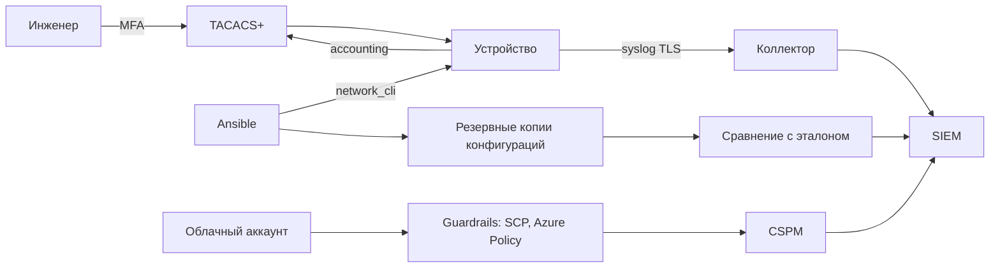

# Сеть и облако

Сетевое оборудование и облачные аккаунты объединяет одно свойство: они находятся вне хоста, но определяют, кто и куда может ходить. Харденинг здесь начинается с централизованной аутентификации и эталонной конфигурации, а не с отдельных правил на каждом устройстве.

## 1. Зачем это нужно

Локальные учётные записи на коммутаторах и маршрутизаторах — типичная находка аудита. Пароль известен всей смене, не меняется годами, а после увольнения инженера остаётся действующим. Общий аккаунт не даёт понять, кто именно менял ACL в ночь инцидента. Централизованная AAA решает обе задачи: вход через TACACS+ или RADIUS, индивидуальные учётные записи, авторизация команд и запись всех действий.

Вторая проблема — дрейф конфигураций. На сорока устройствах сорок вариантов `banner`, `logging` и `ip http`. Сравнить их вручную невозможно, а именно расхождения чаще всего и оказываются причиной инцидента. Эталонная конфигурация (golden config) и регулярное сравнение с ней превращают эту работу в проверяемый процесс.

Третья — облака. Если аккаунт существует, кто-то должен отвечать на вопросы: какие организации и подписки, кто имеет права владельца, включено ли журналирование, ограничены ли регионы. Без guardrails и регулярной проверки конфигурации облако быстро превращается в набор ресурсов с публичными адресами.

Ansible здесь выполняет роль оркестратора и регистратора: он применяет эталон, сохраняет резервные копии, проверяет результат. Но он не заменяет платформенные механизмы — SCP в AWS, Azure Policy, CSPM. Их нельзя «настроить playbook-ом», зато можно проверять их состояние и включать в отчёт.

Есть и организационная причина. Сетевые устройства и облачные подписки обычно обслуживают разные команды, а инцидент почти всегда идёт через границу между ними: скомпрометированный сервер в облаке атакует филиал, или устройство с общим паролем становится точкой входа в облачную сеть. Единый эталон и единый журнал помогают увидеть эту границу целиком, а не по частям.

## 2. Ключевые понятия

| Понятие | Назначение |
|---|---|
| AAA | authentication, authorization, accounting: кто, что и когда |
| TACACS+ | протокол AAA с разделением функций и авторизацией команд |
| RADIUS | протокол AAA, чаще для сетевого доступа и VPN |
| Command authorization | разрешение конкретных команд для конкретной роли |
| Fallback | локальная аутентификация при недоступности AAA-сервера |
| Break-glass | аварийная учётная запись с независимым путём входа |
| Golden config | эталонная конфигурация устройства |
| `cli_config` | модуль применения конфигурации через сетевой CLI |
| `cli_command` | модуль выполнения команд и сбора вывода |
| `network_cli` | тип подключения Ansible к сетевому устройству |
| SCP | Service Control Policy: ограничения на уровне организации в AWS |
| Azure Policy | декларативные правила и их оценка в Azure |
| CSPM | контроль защищённости облачной конфигурации |
| Guardrail | платформенное ограничение, которое нельзя обойти ролью |

## 3. Схема



На схеме два независимых контура: устройства получают политику доступа от AAA и отдают журналы, а облако ограничивается платформенными guardrails и проверяется CSPM. Ansible работает с обеими сторонами, но разными средствами.

## 4. Пошаговая реализация

### Шаг 1. Поднимите AAA до массовых изменений

Сначала TACACS+ или RADIUS, затем — перевод устройств. На этом этапе важны три вещи: резервный локальный вход, документированная break-glass учётная запись и проверка, что AAA-серверы доступны из каждой площадки. Если серверы стоят только в ЦОД, при обрыве WAN устройство останется без управления.

### Шаг 2. Настройте авторизацию команд

Аутентификация отвечает на вопрос «кто вошёл», авторизация — «что ему можно». Для сетевого оборудования это критично: чтение конфигурации и изменение ACL должны быть разными правами. Начните с двух профилей: полный административный и read-only для дежурной смены и мониторинга.

### Шаг 3. Приведите базовую конфигурацию

Минимальный набор: SSH версии 2, отключённые HTTP-серверы, баннер с предупреждением, таймаут неактивной сессии, синхронизация времени, отправка журналов на коллектор, ограничение попыток входа. Каждый пункт — отдельная строка эталона, а не «настройка по вкусу».

| Команда | Назначение |
|---|---|
| `aaa new-model` | включает подсистему AAA |
| `aaa authentication login default group TACGRP local` | вход через AAA с локальным резервом |
| `aaa authorization exec default group TACGRP local if-authenticated` | авторизация сессии |
| `aaa accounting exec default start-stop group TACGRP` | учёт начала и конца сессии |
| `ip ssh version 2` | только SSHv2 |
| `no ip http server` | отключение HTTP-интерфейса |
| `no ip http secure-server` | отключение встроенного HTTPS-сервера |
| `login block-for 120 attempts 3 within 60` | блокировка при переборе |
| `logging host <collector> transport tcp port 6514` | журналы на коллектор |
| `banner login` | предупреждение о допустимом использовании |

`service password-encryption` не является мерой защиты: это обратимое кодирование, а не шифрование. Полагаться на него нельзя, а секреты в конфигурации должны рассматриваться как компрометируемые при утечке резервной копии.

### Шаг 4. Снимайте копии и сравнивайте с эталоном

`cli_config` с `backup: true` сохраняет конфигурацию до применения изменений. Копии складываются в Git или объектное хранилище с ограниченным доступом: в них есть общие секреты и топология сети. Сравнение с эталоном выполняется регулярно, а расхождения попадают в отчёт, а не в чат дежурного.

### Шаг 5. Ограничьте облако guardrails

Для AWS это Service Control Policies на уровне организации, для Azure — Azure Policy на уровне management group. Смысл один: даже владелец подписки не должен иметь возможности отключить журналирование или открыть ресурс в интернет. CSPM проверяет фактическое состояние и находит обходы.

### Шаг 6. Сегментируйте и контролируйте каналы

Филиальная сеть делится на сегменты: management, пользователи, серверы, гостевой доступ. VPN и SD-WAN задают политику между площадками, а не только шифруют канал. Правила на периметре должны совпадать с хостовой политикой, иначе одна из сторон создаёт ложное чувство защиты. Отдельно проверяйте, что гостевой сегмент не имеет маршрута к management: одна ошибка в маршрутизации сводит на нет весь остальной харденинг. Для облака те же границы описываются security groups и private endpoints, а не адресами.

!!! warning "Риск"
  Перевод устройства на AAA без локального резерва и второй сессии — прямой путь к потере управления. Держите открытой консоль, проверяйте `aaa authentication login` до сохранения конфигурации.

## 5. Полный запускаемый пример

`templates/ios-baseline.j2`:

```jinja2
tacacs server TAC1
 address ipv4 {{ tacacs_primary }}
 key 0 {{ vault_tacacs_key }}
tacacs server TAC2
 address ipv4 {{ tacacs_secondary }}
 key 0 {{ vault_tacacs_key }}
aaa group server tacacs+ TACGRP
 server name TAC1
 server name TAC2
aaa new-model
aaa authentication login default group TACGRP local
aaa authorization exec default group TACGRP local if-authenticated
aaa authorization commands 15 default group TACGRP local if-authenticated
aaa accounting exec default start-stop group TACGRP
aaa accounting commands 15 default start-stop group TACGRP
ip ssh version 2
no ip http server
no ip http secure-server
login block-for 120 attempts 3 within 60
logging host {{ syslog_host }} transport tcp port 6514
banner login ^CAuthorized access only. All activity is logged.^C
```

`playbooks/41-network-baseline.yml`:

```yaml
---
- name: Network device AAA and baseline
  hosts: network_devices
  gather_facts: false
  become: true
  serial: 1
  max_fail_percentage: 0

  vars:
    ansible_connection: ansible.netcommon.network_cli
    ansible_network_os: cisco.ios.ios
    ansible_become_method: ansible.netcommon.enable
    tacacs_primary: 10.0.0.20
    tacacs_secondary: 10.0.0.21
    syslog_host: 10.0.0.30

  tasks:
    - name: Ensure local backup directory exists
      ansible.builtin.file:
        path: "backups/{{ inventory_hostname }}"
        state: directory
        mode: "0700"
      delegate_to: localhost
      become: false

    - name: Apply AAA and management baseline
      ansible.netcommon.cli_config:
        config: "{{ lookup('ansible.builtin.template', 'templates/ios-baseline.j2') }}"
        backup: true
        backup_options:
          dir_path: "backups/{{ inventory_hostname }}"
          filename: "pre-change.cfg"
        diff_match: line
      no_log: true

    - name: Read applied AAA authentication
      ansible.netcommon.cli_command:
        command: "show running-config | include aaa authentication login"
      register: aaa_auth
      changed_when: false

    - name: Read applied AAA accounting
      ansible.netcommon.cli_command:
        command: "show running-config | include aaa accounting exec"
      register: aaa_acct
      changed_when: false

    - name: Read SSH state
      ansible.netcommon.cli_command:
        command: "show running-config | include ip ssh version"
      register: mgmt_state
      changed_when: false

    - name: Assert baseline is in place
      ansible.builtin.assert:
        that:
          - "'group TACGRP local' in aaa_auth.stdout"
          - "'start-stop group TACGRP' in aaa_acct.stdout"
          - "'ip ssh version 2' in mgmt_state.stdout"
        fail_msg: AAA or management baseline is not applied.

    - name: Verify TACACS+ servers are reachable
      ansible.netcommon.cli_command:
        command: "test aaa group tacacs+ ansible-probe Probe-Pass-1 legacy"
      register: aaa_probe
      changed_when: false
      # Expected rejection by TACACS+ is a healthy result, not a task failure.
      failed_when: false
```

Проверка `test aaa` намеренно использует заведомо неверные учётные данные: ожидаемый ответ — отказ от сервера, а не таймаут. Таймаут означает, что сервер недоступен, и переводить устройство на AAA в этот момент нельзя. Задача не считается ошибочной, потому что отказ — штатный результат проверки; решение принимает инженер по выводу команды.

`ansible_become_password` для режима enable хранится в vault и подставляется в inventory группе `network_devices`, а не в playbook. Пароль enable и ключ TACACS+ — разные секреты с разными сроками ротации.

## 6. Проверка результата

```bash
ansible network_devices -m ansible.netcommon.cli_command -a "command='show running-config | include aaa'" --limit branch-msk-sw01
ansible network_devices -m ansible.netcommon.cli_command -a "command='show tacacs'" --limit branch-msk-sw01
ansible network_devices -m ansible.netcommon.cli_command -a "command='show logging'" --limit branch-msk-sw01
```

`show tacacs` показывает счётчики обращений к серверам: если растут ошибки, проблема в ключе, доступности или источнике пакетов. `show logging` подтверждает, что журналы уходят на коллектор.

Проверять статус HTTP-интерфейса лучше отдельной командой `show ip http server status`: строка `no ip http server` в running-config появляется не на всех версиях, и её отсутствие не означает, что сервер включён. Такой нюанс — типичная причина ложных срабатываний проверок, поэтому сравнение с эталоном должно учитывать значения по умолчанию конкретной платформы.

Признаки успеха: вход выполняется индивидуальной учётной записью, в журнале TACACS+ видны команды, локальный вход работает при отключённом AAA-сервере, конфигурация устройства совпадает с эталоном.

## 7. Безопасность и blast radius

| Риск | Последствие | Мера |
|---|---|---|
| AAA без локального резерва | потеря управления при обрыве WAN | `local` в цепочке, вторая сессия |
| Неверный ключ TACACS+ | отказ всех входов | проверка `test aaa` до сохранения |
| `no ip http server` на устройстве управления | потеря доступа к панели | убедиться, что UI не используется |
| Копии конфигураций в открытом виде | утечка секретов | шифрование, ограниченный доступ |
| SCP отключает нужную интеграцию | простой сервиса | тест в отдельном аккаунте |
| CSPM без владельца | отчёт читают, но не исправляют | процесс и SLA на находки |

Blast radius одного устройства — его сегмент; ошибка в шаблоне без `serial` — вся сеть филиалов. Для магистральных устройств используйте отдельную группу и отдельное окно.

В облаке blast radius определяется правами, а не географией. Роль с правом изменять guardrails сводит на нет всю защиту, поэтому такие права выдаются единицам и только с MFA. Отдельно проверяйте долгоживущие ключи доступа: они не истекают, не требуют второго фактора и чаще всего попадают в CI-переменные и репозитории. Предпочтительны федерация и краткоживущие токены.

Откат: конфигурация восстанавливается из `pre-change.cfg` через консоль или OOB-доступ. На устройствах с поддержкой архива конфигураций полезно включить `archive` и `configure replace`; это ускоряет возврат к предыдущему состоянию. Ansible-откат по копии возможен, но требует проверки синтаксиса на тестовом устройстве. В облаке откат guardrail выполняется изменением политики в отдельном аккаунте с последующей проверкой CSPM, а не прямой правкой ресурсов.

## 8. Комплаенс-маппинг

| Требование | Как закрывается |
|---|---|
| CIS Controls v8, Control 4, 5, 6 | эталон, учётные записи, права |
| ISO/IEC 27001:2022 A.8.2, A.8.20 | привилегированный доступ, защита сетей |
| NIST CSF 2.0 PR.AA, PR.IR | аутентификация и архитектура |
| CIS Benchmark (network devices) | базовые команды управления |
| Аудит | журнал AAA, копии конфигураций, отчёты сравнения |

## 9. Типичные ошибки и troubleshooting

| Симптом | Причина | Проверка | Решение |
|---|---|---|---|
| `Authentication failed` после AAA | неверный ключ или источник | `show tacacs` | исправить ключ, проверить маршрут |
| Нет авторизации команд | сервер не поддерживает авторизацию | лог TACACS+ | включить профиль или `if-authenticated` |
| `cli_config` не подключается | неверный `ansible_network_os` | `-vvv` | указать правильную платформу |
| `become` не работает | не задан метод enable | inventory | `ansible_become_method: ansible.netcommon.enable` |
| Конфигурация применяется каждый раз | порядок строк отличается | `--diff` | привести шаблон к устойчивому порядку |
| Журналы не приходят | порт или TLS | `show logging` | открыть 6514, проверить сертификат |
| SCP блокирует автоматизацию | ограничение на уровне организации | события CloudTrail | согласовать исключение с ИБ |

## 10. Чек-лист

- [ ] AAA-серверы доступны из каждой площадки.
- [ ] В цепочке аутентификации есть локальный резерв.
- [ ] Break-glass учётная запись задокументирована.
- [ ] Авторизация команд разделена по ролям.
- [ ] SSHv2 включён, HTTP-серверы отключены.
- [ ] Журналы уходят на коллектор по защищённому каналу.
- [ ] Копии конфигураций защищены и версионируются.
- [ ] Эталон сравнивается с устройствами регулярно.
- [ ] В облаке включены guardrails и CSPM.
- [ ] Находки CSPM имеют владельца и срок.

## 11. Источники

- [ansible.netcommon.cli_config](https://docs.ansible.com/ansible/latest/collections/ansible/netcommon/cli_config_module.html)
- [ansible.netcommon.cli_command](https://docs.ansible.com/ansible/latest/collections/ansible/netcommon/cli_command_module.html)
- [Ansible network automation guide](https://docs.ansible.com/ansible/latest/network/index.html)
- [CIS Benchmarks](https://www.cisecurity.org/cis-benchmarks)
- [NIST SP 800-53 control catalog](https://csrc.nist.gov/projects/cprt/catalog#/cprt/framework/version/SP_800_53_5_1_1/home)

## 12. Связанные страницы

- [Сетевые устройства](../admin/26-network-devices.md)
- [Публичные облака](../admin/27-cloud.md)
- [Межсетевой экран](37-firewall.md)
- [Zero trust и JIT-доступ](47-zero-trust.md)
- [Логирование и мониторинг](42-logging-monitoring.md)
