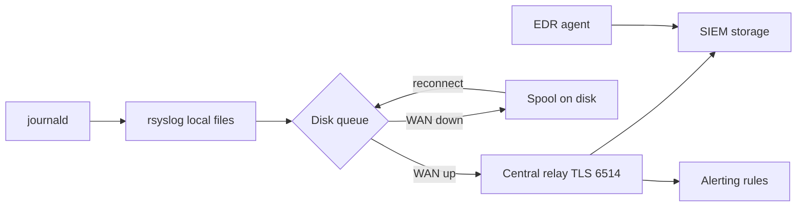

# Логирование и мониторинг

Логи на сотнях хостов в филиалах бесполезны, если они остаются локально: при компрометации злоумышленник удаляет их первым, при обрыве WAN они накапливаются на диске и теряются при переполнении. Задача автоматизации — построить предсказуемый конвейер «хост → локальный журнал → защищённая передача → центральное хранилище» и измерять, где этот конвейер разорван.

## 1. Зачем это нужно

Централизованный сбор журналов (centralized logging) решает три задачи одновременно. Первая — обнаружение: аналитика SIEM (Security Information and Event Management) работает только по полным данным, а решение по инциденту невозможно без истории аутентификации и изменений привилегий. Вторая — расследование: при разборе инцидента нужен неизменённый след на хосте и его копия вне хоста. Третья — комплаенс: требования CIS Controls, ISO/IEC 27001 и DISA STIG прямо предписывают хранение журналов и защиту их от изменения.

В филиальной сети к этому добавляется транспортная проблема. Канал между филиалом и ЦОД нестабилен: он рвётся на минуты и часы, задержка меняется, а пропускная способность ограничена. Если агент передачи не умеет буферизовать события на диск, каждый обрыв превращается в слепую зону, о которой никто не узнает. Поэтому в конфигурации важны не только адрес и TLS, но и очередь (queue) с ограничением по диску и бесконечными повторами.

Наконец, конфигурация должна быть одинаковой. Ручная настройка rsyslog на 600 хостах гарантирует расхождения: где-то забыт CA-сертификат, где-то порт 514 без шифрования, где-то journald не сохраняет журнал между перезагрузками. Ansible фиксирует целевое состояние и, что важнее, позволяет регулярно проверять полноту покрытия (coverage) по каждому филиалу.

Отдельная проблема — формат. Разные источники пишут по-разному: ядро и systemd дают структурированные записи, приложения — свободный текст, сетевые устройства — syslog по RFC 5424. Без нормализации (parsing) SIEM либо теряет поля, либо хранит события как непрозрачный текст, и тогда корреляция по пользователю, адресу или процессу невозможна. Практичный минимум: единый формат пересылки, обязательные поля `hostname`, `programname`, `timestamp` в UTC и явное требование к приложениям писать структурированные сообщения. Всё, что не удалось разобрать, должно попадать в отдельный индекс, а не отбрасываться: необработанное событие — это потенциально пропущенный инцидент.

Срок хранения (retention) — компромисс между стоимостью и требованиями. Типовой профиль: 30–90 дней горячего хранения с полнотекстовым поиском, 12 месяцев холодного хранения для расследований и обязательный минимум по отраслевому требованию. Политика retention должна быть одинаковой для хоста и для SIEM; ситуация, когда на хосте журнал живёт 7 дней, а в отчёте обещан год, — типичная находка аудита. Поэтому сроки задаются переменными и проверяются автоматически, а не остаются в текстовом документе.

## 2. Ключевые понятия

| Понятие | Назначение |
|---|---|
| journald | сборщик журналов systemd; хранит структурированные записи в `/var/log/journal` |
| rsyslog | транспорт и маршрутизация: приём, фильтрация, запись в файлы, пересылка |
| `omfwd` | модуль rsyslog для пересылки по TCP с TLS |
| `gtls` | драйвер TLS в rsyslog; проверяет сертификат и имя узла |
| Disk-assisted queue | очередь с выгрузкой на диск при недоступности сервера |
| `action.resumeRetryCount` | число повторов; значение `-1` означает бесконечно |
| SIEM | центральная система корреляции и хранения событий |
| EDR | агент на хосте для обнаружения и реагирования на конечной точке |
| Coverage | доля хостов, чьи журналы реально доходят до SIEM |
| Retention | срок хранения журналов; задаётся политикой и местом на диске |
| Tamper protection | защита журналов от удаления и подмены на хосте и в хранилище |
| FSS sealing | криптографическая печать записей journald (`Seal=yes`) |

## 3. Схема



На схеме важен диск-ассистированный буфер между хостом и центральным релеем: именно он превращает обрыв WAN в задержку доставки, а не в потерю событий. Второй важный элемент — центральный релей, который принимает TLS-соединения от филиалов и пересылает данные в SIEM в одном формате.

## 4. Пошаговая реализация

1. Зафиксируйте целевую архитектуру: какой узел принимает журналы (релей в ЦОД), какие порты открыты, кто выдаёт сертификаты. Один релей на площадку проще сопровождать, чем прямые соединения каждого хоста с SIEM.
2. Определите переменные площадки в `group_vars`: адрес релея, путь к CA, лимит очереди, срок хранения. Значения по умолчанию держите в `defaults` роли, а не в задаче.
3. Распространите CA-сертификат внутреннего удостоверяющего центра. Это отдельная задача PKI; в примере ниже файл кладётся из репозитория, но в продакшене его выдаёт роль из страницы про TLS и PKI.
4. Настройте journald на постоянное хранение и ограничение объёма. Без `Storage=persistent` журнал исчезает после перезагрузки, и расследование инцидента теряет контекст.
5. Настройте rsyslog: фрагмент в `/etc/rsyslog.d/`, проверка синтаксиса через `validate`, перезапуск через handler. Не перезаписывайте `/etc/rsyslog.conf` целиком — вы потеряете настройки дистрибутива.
6. Разверните агенты SIEM и EDR отдельной ролью, независимо от rsyslog. Агент EDR нужен как второй канал: если сломана пересылка syslog, телеметрия конечной точки всё ещё видна. Токен подключения (enrollment token) храните в `!vault`, задачу установки помечайте `no_log: true`, а файл конфигурации — правами `0600`. Не включайте в один playbook установку агента и агрессивные изменения firewall: при сбое вы потеряете и агент, и доступ.
7. Включите защиту от подмены. На хосте это restrictive-права на каталоги журналов, `Seal=yes` для journald, контроль целостности через AIDE и правила auditd на запись в `/var/log` и `/etc/rsyslog.d`. В центральном хранилище — неизменяемое хранение (WORM) или отдельная учётная запись только на запись, чтобы скомпрометированный хост не мог удалить свои события.
8. Проверьте доставку на одном канареечном хосте: тестовое сообщение, состояние очереди, TCP-соединение с релеем, подтверждение на стороне SIEM.
9. Запустите проверку покрытия по всем филиалам и сохраните отчёт: он нужен и для эксплуатации, и как доказательство для аудита.

## 5. Полный запускаемый пример

`logging.yml` в корне репозитория (рядом с каталогами `templates/`, `files/`, `reports/`):

```yaml
---
- name: Configure centralized logging
  hosts: branches
  become: true
  gather_facts: true
  serial: [1, "25%"]
  max_fail_percentage: 10

  vars:
    siem_relay_host: "logs-relay.dc.example.net"
    siem_relay_port: 6514
    rsyslog_ca_file: /etc/pki/ca-trust/source/anchors/branch-ca.pem
    rsyslog_queue_max_mb: 512
    journald_max_use: "2G"
    journald_retention: "90d"
    journald_seal: true
    rsyslog_service: rsyslog

  tasks:
    - name: Ensure rsyslog is installed
      ansible.builtin.package:
        name: rsyslog
        state: present

    - name: Ensure journald drop-in directory exists
      ansible.builtin.file:
        path: /etc/systemd/journald.conf.d
        state: directory
        owner: root
        group: root
        mode: "0755"

    - name: Ensure rsyslog spool directory exists
      ansible.builtin.file:
        path: /var/spool/rsyslog
        state: directory
        owner: root
        group: root
        mode: "0700"

    - name: Deploy journald limits
      ansible.builtin.template:
        src: templates/journald-ansible.conf.j2
        dest: /etc/systemd/journald.conf.d/60-ansible.conf
        owner: root
        group: root
        mode: "0644"
      notify: Restart systemd-journald

    - name: Ensure internal CA certificate is present
      ansible.builtin.copy:
        src: files/branch-ca.pem
        dest: "{{ rsyslog_ca_file }}"
        owner: root
        group: root
        mode: "0644"

    - name: Verify CA certificate presence
      ansible.builtin.stat:
        path: "{{ rsyslog_ca_file }}"
      register: rsyslog_ca_stat

    - name: Deploy rsyslog forwarding fragment
      ansible.builtin.template:
        src: templates/rsyslog-siem.conf.j2
        dest: /etc/rsyslog.d/60-ansible-siem.conf
        owner: root
        group: root
        mode: "0644"
        validate: "/usr/sbin/rsyslogd -N1 -f %s"
      notify: Restart rsyslog

    - name: Ensure rsyslog is enabled and running
      ansible.builtin.service:
        name: "{{ rsyslog_service }}"
        state: started
        enabled: true

    - name: Flush handlers before verification
      ansible.builtin.meta: flush_handlers

    - name: Validate the full rsyslog configuration
      ansible.builtin.command:
        argv:
          - /usr/sbin/rsyslogd
          - -N1
      register: rsyslog_check
      changed_when: false
      failed_when: rsyslog_check.rc != 0

    - name: Collect service facts
      ansible.builtin.service_facts:

    - name: Inspect spool directory
      ansible.builtin.find:
        paths: /var/spool/rsyslog
        file_type: file
        recurse: false
      register: rsyslog_spool

    - name: Count journald entries from the last hour
      ansible.builtin.command:
        argv:
          - journalctl
          - "--since=-1h"
          - --no-pager
          - --output=short
      register: journal_recent
      changed_when: false

    - name: Record coverage facts
      ansible.builtin.set_fact:
        log_coverage:
          branch: "{{ branch_code | default('unknown') }}"
          rsyslog_state: "{{ ansible_facts.services['rsyslog.service'].state | default('absent') }}"
          rsyslog_unit: "{{ ansible_facts.services['rsyslog.service'].status | default('disabled') }}"
          queue_bytes: "{{ rsyslog_spool.files | map(attribute='size') | sum }}"
          journal_lines: "{{ journal_recent.stdout_lines | length }}"
          ca_present: "{{ rsyslog_ca_stat.stat.exists }}"
          collected_at: "{{ ansible_date_time.iso8601 }}"

    - name: Warn about queue backlog
      ansible.builtin.debug:
        msg: >-
          Queue backlog on {{ inventory_hostname }} is
          {{ (log_coverage.queue_bytes | int / 1048576) | round(1) }} MiB.
      when: log_coverage.queue_bytes | int > 67108864

  handlers:
    - name: Restart rsyslog
      ansible.builtin.service:
        name: "{{ rsyslog_service }}"
        state: restarted

    - name: Restart systemd-journald
      ansible.builtin.service:
        name: systemd-journald
        state: restarted

- name: Build coverage report on the control node
  hosts: localhost
  gather_facts: true
  tasks:
    - name: Ensure reports directory exists
      ansible.builtin.file:
        path: reports
        state: directory
        mode: "0750"

    - name: Write CSV coverage report
      ansible.builtin.template:
        src: templates/log-coverage.csv.j2
        dest: "reports/log-coverage-{{ ansible_date_time.date }}.csv"
        mode: "0640"
```

`templates/journald-ansible.conf.j2`:

```jinja2
# {{ ansible_managed }}
[Journal]
Storage=persistent
SystemMaxUse={{ journald_max_use }}
MaxRetentionSec={{ journald_retention }}
ForwardToSyslog=yes
Seal={{ 'yes' if journald_seal | bool else 'no' }}
```

`templates/rsyslog-siem.conf.j2`:

```jinja2
# {{ ansible_managed }}
$WorkDirectory /var/spool/rsyslog

global(
  DefaultNetstreamDriver="gtls"
  DefaultNetstreamDriverCAFile="{{ rsyslog_ca_file }}"
)

*.* action(
  type="omfwd"
  target="{{ siem_relay_host }}"
  port="{{ siem_relay_port }}"
  protocol="tcp"
  StreamDriver="gtls"
  StreamDriverMode="1"
  StreamDriverAuthMode="x509/name"
  StreamDriverPermittedPeers="{{ siem_relay_host }}"
  queue.type="LinkedList"
  queue.filename="siem_fwd"
  queue.maxDiskSpace="{{ rsyslog_queue_max_mb }}m"
  queue.saveOnShutdown="on"
  action.resumeRetryCount="-1"
  action.resumeInterval="30"
)
```

`templates/log-coverage.csv.j2`:

```jinja2
host,branch,rsyslog_state,unit_state,journal_lines,queue_mib,ca_present,collected_at

{{ h }},{{ hostvars[h].log_coverage.branch }},{{ hostvars[h].log_coverage.rsyslog_state }},{{ hostvars[h].log_coverage.rsyslog_unit }},{{ hostvars[h].log_coverage.journal_lines }},{{ (hostvars[h].log_coverage.queue_bytes | int / 1048576) | round(1) }},{{ hostvars[h].log_coverage.ca_present }},{{ hostvars[h].log_coverage.collected_at }}

```

Проверка `validate` выполняется для отдельного фрагмента, поэтому в него добавлен `$WorkDirectory`: без рабочего каталога rsyslog не сможет проверить параметры очереди. Полная проверка объединённой конфигурации выполняется задачей `rsyslogd -N1` после перезапуска.

Размер очереди считается просто. Возьмите средний поток событий на хост (например, 2–5 МиБ в сутки для обычного сервера), умножьте на максимальную длительность обрыва WAN, которую вы готовы пережить, и добавьте запас. Для 8 часов и 5 МиБ в сутки достаточно 128 МиБ; лимит 512 МиБ покрывает несколько суток и при этом не угрожает корневой файловой системе. Если очередь достигла лимита, rsyslog начинает отбрасывать новые события — это точка, после которой покрытие формально есть, а фактически уже нет. Поэтому backlog проверяется в плейбуке и должен попадать в мониторинг как отдельная метрика.

`StreamDriverAuthMode="x509/name"` вместе с `StreamDriverPermittedPeers` означает, что хост проверяет не только подпись сертификата релея, но и его имя. Это защита от подмены сервера в филиальной сети, где возможен перехват трафика. Обратная проверка (клиентский сертификат хоста) настраивается на релее и в этом плейбуке не показана: она усложняет выдачу сертификатов для 600 хостов, но именно она даёт уверенность, что события прислал конкретный управляемый узел, а не произвольный клиент с валидным CA.

## 6. Проверка результата

```bash
ansible-playbook -i inventories/prod/hosts.yml playbooks/logging.yml --check --diff --limit branch_msk
ansible-playbook -i inventories/prod/hosts.yml playbooks/logging.yml --limit msk-app01
```

На управляемом узле:

```bash
sudo rsyslogd -N1
sudo systemctl status rsyslog --no-pager
sudo ss -tnp state established '( dport = :6514 )'
sudo du -sh /var/spool/rsyslog
sudo journalctl --disk-usage
logger -p local0.notice "logging-check $(hostname)"
```

Тестовое сообщение должно появиться в SIEM в течение 30–60 секунд. Если оно есть локально, но не приходит центрально, проблема почти всегда в TLS: не совпало имя в сертификате, истёк срок, неверный CA или закрыт порт. Отчёт `reports/log-coverage-*.csv` показывает хосты с неактивным rsyslog и растущей очередью — это и есть измеренное покрытие по филиалам.

Практическая метрика покрытия формулируется так: доля хостов, у которых сервис активен, CA на месте, очередь ниже 64 МиБ и за последний час есть записи в journald. Для парка в 600 хостов норма — не менее 98%: несколько хостов всегда в обслуживании или выключены. Если показатель падает по конкретному филиалу, причина обычно одна на всех: изменился адрес релея, истёк сертификат, закрыли порт на периметре. Поэтому отчёт стоит строить не только по хостам, но и по площадкам, и сравнивать день к дню.

Отдельно сверяйте данные с SIEM: локальная проверка подтверждает, что хост отправляет, но не подтверждает, что события дошли и проиндексированы. Раз в неделю сравните число активных источников в SIEM с числом хостов в inventory и зафиксируйте расхождение как задачу. Такая сверка занимает минуты и закрывает самый частый вопрос аудитора — «откуда вы знаете, что журналы собираются со всех серверов».

## 7. Безопасность и blast radius

| Риск | Последствие | Мера |
|---|---|---|
| Неверное имя в `StreamDriverPermittedPeers` | журналы молча не доставляются | canary-хост, `rsyslogd -N1`, тестовое сообщение |
| Перезапуск rsyslog без `saveOnShutdown` | потеря очереди в памяти | `queue.saveOnShutdown="on"`, диск-очередь |
| Слишком большой `queue.maxDiskSpace` | переполнение `/var` и отказ сервисов | лимит 256–512 MiB, мониторинг очереди |
| Закрытый порт 6514 на релее | рост очереди до лимита | проверка `ss`/`nc` с хоста, firewall-тикет |
| Перезапись `/etc/rsyslog.conf` | потеря маршрутов дистрибутива | только фрагменты в `/etc/rsyslog.d/` |
| `chattr +i` на конфигурации | невозможность централизованного изменения | включать только осознанно, помнить о снятии |
| Токен агента SIEM в открытом виде | компрометация агента | `!vault`, `no_log: true`, права `0600` |
| Часы хоста ушли | TLS-сессия отклоняется, корреляция ломается | NTP-проверка в отдельной задаче |

Откат: удалите фрагмент `/etc/rsyslog.d/60-ansible-siem.conf` и drop-in journald, перезапустите сервисы через handler. Перед удалением убедитесь, что очередь не содержит неотправленных событий: при необходимости поднимите релей или временно направьте поток на резервный адрес. Для рискованных изменений сначала `--check --diff`, затем `serial: "25%"` с `max_fail_percentage`.

!!! warning "Риск"
    Перезапуск rsyslog и journald не рвёт SSH-сессии, но при неверном шаблоне вы теряете видимость инцидентов, не замечая этого. Держите второй, независимый канал (например, EDR-агент) до подтверждения покрытия.

## 8. Комплаенс-маппинг

| Требование | Как закрывается |
|---|---|
| CIS Control 8 (Audit Log Management) | централизованный сбор, retention, проверка покрытия |
| CIS Control 13 (Network Monitoring) | передача по TLS на выделенный релей |
| NIST CSF 2.0 DE.CM-01, DE.AE-03 | непрерывный мониторинг и корреляция событий |
| NIST CSF 2.0 PR.PS-04 | журналы как источник доказательств состояния |
| ISO/IEC 27001:2022 A.8.15, A.8.16 | ведение журналов и мониторинг деятельности |
| DISA STIG (RHEL/Ubuntu) | удалённая передача журналов и защита целостности |

## 9. Типичные ошибки и troubleshooting

| Симптом | Причина | Проверка | Решение |
|---|---|---|---|
| Локально журнал есть, в SIEM нет | TLS-ошибка или закрытый порт | `ss -tnp`, `journalctl -u rsyslog -n 50` | сверить CA и имя узла, открыть 6514 |
| Очередь растёт постоянно | релей недоступен или медленный | `du -sh /var/spool/rsyslog` | восстановить канал, увеличить лимит временно |
| Дубли событий | journald и rsyslog оба шлют напрямую | сравнить счётчики на SIEM | оставить один путь, `ForwardToSyslog` в один поток |
| `validate` падает | фрагмент неполон или синтаксис устарел | `rsyslogd -N1 -f файл` | исправить шаблон, использовать современный `action()` |
| Журнал пуст после перезагрузки | нет `Storage=persistent` | `journalctl --disk-usage` | включить persistent и создать каталог |
| `Seal=yes` не работает | нет FSS или journald непостоянный | `journalctl --header` | отключить seal, использовать пересылку |
| События теряются пачками | rate limit journald | `journalctl -u systemd-journald` | `RateLimitIntervalSec`/`RateLimitBurst` |
| Сертификат «not yet valid» | расхождение часов | `timedatectl` | включить и проверить NTP/chrony |

## 10. Чек-лист

- [ ] Журналы передаются только по TLS с проверкой имени узла.
- [ ] Включена диск-ассистированная очередь с ограничением объёма.
- [ ] `Storage=persistent` и лимиты journald заданы через drop-in.
- [ ] Конфигурация rsyslog разложена фрагментами, не поверх `/etc/rsyslog.conf`.
- [ ] Шаблон проходит `validate`, полная конфигурация проверена `rsyslogd -N1`.
- [ ] Есть canary-хост и подтверждение доставки на стороне SIEM.
- [ ] Отчёт покрытия формируется регулярно и хранится как доказательство.
- [ ] Токены агентов SIEM/EDR хранятся в vault, задачи с ними помечены `no_log`.
- [ ] Описан откат: удаление фрагментов и перезапуск сервисов.

## 11. Источники

- [ansible.builtin.template](https://docs.ansible.com/ansible/latest/collections/ansible/builtin/template_module.html)
- [rsyslog: omfwd module](https://www.rsyslog.com/doc/configuration/modules/omfwd.html)
- [rsyslog: queues](https://www.rsyslog.com/doc/concepts/queues.html)
- [journald.conf(5)](https://www.freedesktop.org/software/systemd/man/latest/journald.conf.html)
- [ansible.builtin.find](https://docs.ansible.com/ansible/latest/collections/ansible/builtin/find_module.html)

## 12. Связанные страницы

- [Аудит выполнения](../secure-dev/16-audit-logging.md)
- [Ядро и системный аудит](38-kernel-audit.md)
- [Реагирование на инциденты](45-incident-response.md)
- [Event-Driven Ansible](46-eda.md)
- [Комплаенс и доказательства](44-compliance.md)
- [Распределённые филиалы](../admin/20-branch-fleet.md)
