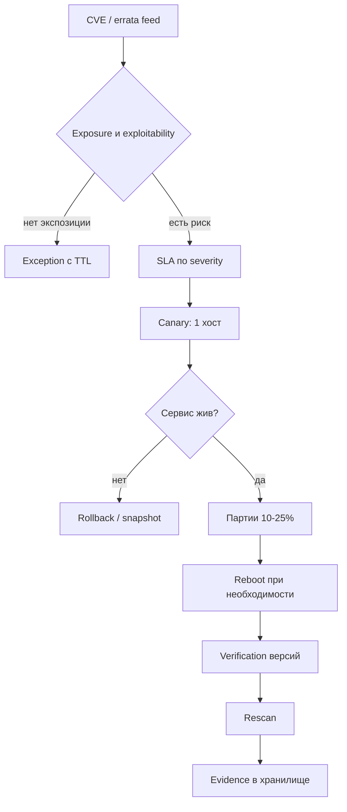

# Уязвимости и патчи

Управление уязвимостями — это не «поставить все обновления», а управляемый процесс: найти, оценить риск, устранить в срок, подтвердить устранение и сохранить доказательство. Ansible закрывает исполнительную часть — от экстренного патча до верификации, — но только если приоритизация и сроки заданы до запуска.

## 1. Зачем это нужно

В парке из 600 хостов и 20 филиалов ручное обновление превращается в лотерею. Кто-то обновил ядро и не перезагрузился, кто-то применил только часть errata, кто-то держит пакет на версии двухлетней давности из-за «так работает». Сканер уязвимостей видит формальную версию пакета, но не видит, что хост не перезагружался после обновления ядра, и продолжает показывать уязвимость — или, наоборот, перестаёт, хотя уязвимый модуль остался загружен в память.

Второй разрыв — между приоритетом и действием. Публикация CVE сама по себе не означает, что нужно останавливать филиал. Решение зависит от exploitability, наличия публичного эксплойта, экспозиции сервиса и критичности актива. Без формализованной матрицы сроков (SLA) команда либо патчит всё подряд в порядке поступления, либо не патчит ничего до инцидента. Автоматизация полезна только после того, как матрица зафиксирована: она делает соблюдение SLA измеримым.

Третий разрыв — доказательства. Аудитор спрашивает не «патчите ли вы», а «покажите, что критичный CVE закрыт на всех затронутых хостах в срок». Значит, каждый запуск должен оставлять след: какие пакеты обновлялись, с какой версии на какую, кто инициировал, когда, требовалась ли перезагрузка и была ли она выполнена. Этот след строится тем же playbook, а не отдельной ручной таблицей.

## 2. Ключевые понятия

| Понятие | Назначение |
|---|---|
| CVE | идентификатор опубликованной уязвимости |
| CVSS | базовая оценка серьёзности; не учитывает ваш контекст |
| EPSS | вероятность эксплуатации в ближайшие 30 дней |
| KEV | каталог уязвимостей, эксплуатируемых в реальных атаках |
| Errata / security update | обновление, помеченное как исправление безопасности |
| SLA | предельный срок устранения по уровню критичности |
| Canary | первая небольшая партия хостов для проверки патча |
| Reboot-required | признак необходимости перезагрузки (ядро, glibc, systemd) |
| Rescan | повторное сканирование для подтверждения устранения |
| Exception | согласованное исключение с обоснованием и сроком |
| `update_only` | режим dnf, запрещающий установку новых пакетов |

Матрица SLA ниже — пример, а не норматив: сроки утверждает владелец риска, исходя из отрасли и требований регулятора. Важно, чтобы сроки были записаны в одном месте и проверялись автоматически.

| Уровень | Условие отнесения | Срок устранения |
|---|---|---|
| Критичный | CVSS 9.0–10.0 или CVE в KEV при сетевой экспозиции | 72 часа, экстренный режим |
| Высокий | CVSS 7.0–8.9 при наличии экспозиции | 14 календарных дней |
| Средний | CVSS 4.0–6.9 или высокий балл без экспозиции | 30 календарных дней |
| Низкий | CVSS ниже 4.0, локальная эксплуатация | 90 календарных дней или плановое окно |
| Исключение | риск принят, есть компенсирующий контроль | не более 90 дней с пересмотром |

Приоритизация по одному CVSS ошибочна: оценка не знает, опубликован ли эксплойт и открыт ли сервис в интернет. Практичный порядок — сначала KEV (эксплуатация уже наблюдается), затем EPSS выше порога (например, 0.1) при сетевой экспозиции, затем высокий CVSS без эксплойта. Уязвимость с CVSS 9.8 на сервисе, доступном только из management-VLAN, всё равно требует исправления, но её приоритет ниже, чем у уязвимости с CVSS 7.5 на публичном веб-сервисе с готовым эксплойтом. Матрица должна допускать такое понижение и требовать фиксации причины, иначе решение будет выглядеть произвольным.

## 3. Схема процесса



Схема подчёркивает две точки, где автоматизация экономит больше всего времени: проверка после canary и сбор доказательств. Именно они чаще всего пропускаются при ручном процессе.

## 4. Пошаговая реализация

1. Инвентаризуйте активы и владельцев. Без группы хостов, привязанной к бизнес-сервису, невозможно выбрать canary и оценить blast radius.
2. Зафиксируйте матрицу SLA по критичности и типу экспозиции. Матрица должна быть короткой: четыре-пять уровней, иначе её не будут применять.
3. Настройте источники данных: сканер уязвимостей, `dnf updateinfo`, `apt list --upgradable`, подписка на KEV и EPSS. Ansible не заменяет сканер, он исполняет решения.
4. Подготовьте playbook с двумя режимами: плановое обновление безопасности и точечная установка списка пакетов из advisory. Второй режим нужен для экстренных случаев, когда ждать очередного окна нельзя.
5. Определите порядок раскатки: один хост, затем 10%, затем 25% с повтором. Для каждого филиала назначьте окно обслуживания, чтобы перезагрузка не совпала с пиком нагрузки.
6. Реализуйте проверку необходимости перезагрузки: `needs-restarting -r` для RHEL-семейства и файл `/run/reboot-required` для Debian/Ubuntu. Перезагрузка — отдельное решение, а не побочный эффект обновления.
7. Верифицируйте результат по версиям пакетов и по состоянию сервисов. Версия в базе RPM/DPKG — необходимое, но не достаточное условие: процесс мог остаться старым.
8. Сохраните доказательства и запустите rescan. Расхождение между отчётом Ansible и сканером разбирайте отдельно: обычно это хост вне inventory или исключённый профиль сканирования.

## 5. Полный запускаемый пример

`patching.yml`:

```yaml
---
- name: Apply security updates with canary rollout
  hosts: branches
  become: true
  gather_facts: true
  serial: [1, "10%", "25%"]
  max_fail_percentage: 5

  vars:
    patch_mode: security          # security | targeted
    patch_packages: []            # заполняется для экстренного патча
    patch_allow_reboot: true
    patch_min_free_mb: 1024
    patch_evidence_dir: evidence/patching
    patch_exceptions: []          # host, cve, expires, ticket
    patch_expected_versions: []   # name, min_version

  tasks:
    - name: Fail when an expired exception exists for this host
      ansible.builtin.assert:
        that:
          - patch_exceptions
            | selectattr('host', 'equalto', inventory_hostname)
            | selectattr('expires', 'lt', ansible_date_time.date)
            | list | length == 0
        fail_msg: "Expired patch exception on {{ inventory_hostname }}"
        quiet: true

    - name: Check free space on the package cache filesystem
      ansible.builtin.command:
        argv:
          - df
          - --output=avail
          - -m
          - /var/cache
      register: patch_df
      changed_when: false
      check_mode: false

    - name: Refuse to patch when free space is insufficient
      ansible.builtin.assert:
        that:
          - (patch_df.stdout_lines[1] | trim | int) >= patch_min_free_mb
        fail_msg: "Only {{ patch_df.stdout_lines[1] | trim }} MiB free on /var/cache"

    - name: Apply security errata (RedHat family)
      ansible.builtin.dnf:
        name: "*"
        state: latest
        security: true
        update_only: true
        update_cache: true
      when:
        - ansible_facts['os_family'] == 'RedHat'
        - patch_mode == 'security'
        - patch_packages | length == 0

    - name: Install targeted updates (RedHat family)
      ansible.builtin.dnf:
        name: "{{ patch_packages }}"
        state: latest
        update_only: true
        update_cache: true
      when:
        - ansible_facts['os_family'] == 'RedHat'
        - patch_packages | length > 0

    - name: Upgrade within the maintenance window (Debian family)
      ansible.builtin.apt:
        upgrade: safe
        update_cache: true
        autoremove: false
      when:
        - ansible_facts['os_family'] == 'Debian'
        - patch_mode == 'security'
        - patch_packages | length == 0

    - name: Install targeted updates (Debian family)
      ansible.builtin.apt:
        name: "{{ patch_packages }}"
        state: latest
        only_upgrade: true
        update_cache: true
      when:
        - ansible_facts['os_family'] == 'Debian'
        - patch_packages | length > 0

    - name: Ensure dnf-utils is installed for needs-restarting
      ansible.builtin.package:
        name: "{{ 'dnf-utils' if ansible_facts['distribution_major_version'] == '8' else 'dnf-plugins-core' }}"
        state: present
      when: ansible_facts['os_family'] == 'RedHat'

    - name: Check reboot requirement (Debian family)
      ansible.builtin.stat:
        path: /run/reboot-required
      register: reboot_flag
      when: ansible_facts['os_family'] == 'Debian'

    - name: Check reboot requirement (RedHat family)
      ansible.builtin.command:
        argv:
          - needs-restarting
          - -r
      register: needs_restarting
      changed_when: false
      failed_when: needs_restarting.rc not in [0, 1]
      when: ansible_facts['os_family'] == 'RedHat'

    - name: Set reboot flag for the Debian family
      ansible.builtin.set_fact:
        patch_reboot_required: "{{ reboot_flag.stat.exists }}"
      when: ansible_facts['os_family'] == 'Debian'

    - name: Set reboot flag for the RedHat family
      ansible.builtin.set_fact:
        patch_reboot_required: "{{ needs_restarting.rc == 1 }}"
      when: ansible_facts['os_family'] == 'RedHat'

    - name: Default the reboot flag for other platforms
      ansible.builtin.set_fact:
        patch_reboot_required: false
      when: patch_reboot_required is not defined

    - name: Reboot when required
      ansible.builtin.reboot:
        reboot_timeout: 900
        connect_timeout: 60
        test_command: /usr/bin/whoami
        msg: "Reboot after security updates"
      when:
        - patch_allow_reboot | bool
        - patch_reboot_required | bool

    - name: Reload package facts after patching
      ansible.builtin.package_facts:
        manager: auto

    - name: Verify expected package versions
      ansible.builtin.assert:
        that:
          - ansible_facts.packages[item.name] is defined
          - ansible_facts.packages[item.name][0].version is version(item.min_version, '>=')
        fail_msg: >-
          {{ item.name }} is
          {{ ansible_facts.packages[item.name] | default([]) | map(attribute='version') | first | default('absent') }},
          expected >= {{ item.min_version }}
        quiet: true
      loop: "{{ patch_expected_versions }}"
      loop_control:
        label: "{{ item.name }}"
      when: not ansible_check_mode

    - name: Record patch evidence
      ansible.builtin.set_fact:
        patch_evidence:
          host: "{{ inventory_hostname }}"
          branch: "{{ branch_code | default('unknown') }}"
          mode: "{{ patch_mode }}"
          packages: "{{ patch_packages }}"
          kernel: "{{ ansible_facts['kernel'] }}"
          reboot_required: "{{ patch_reboot_required }}"
          kernel_package: "{{ ansible_facts.packages['kernel'] | default([]) | map(attribute='version') | first | default('n/a') }}"
          collected_at: "{{ ansible_date_time.iso8601 }}"

    - name: Ensure local evidence directory exists
      ansible.builtin.file:
        path: "{{ patch_evidence_dir }}/{{ ansible_date_time.date }}"
        state: directory
        mode: "0750"
      become: false
      delegate_to: localhost

    - name: Write patch evidence file
      ansible.builtin.copy:
        content: "{{ patch_evidence | to_nice_json }}\n"
        dest: "{{ patch_evidence_dir }}/{{ ansible_date_time.date }}/{{ inventory_hostname }}.json"
        mode: "0640"
      become: false
      delegate_to: localhost
```

Различие платформ существенно. В `ansible.builtin.dnf` есть явный фильтр `security: true`, поэтому на RHEL, Rocky и AlmaLinux playbook применяет только security-errata. В `ansible.builtin.apt` такого фильтра нет: `upgrade: safe` обновляет всё, что предлагает mirror, и это допустимо только в согласованное окно обслуживания. Для «только безопасности» на Debian и Ubuntu используйте либо `unattended-upgrades` с включёнными security-архивами, либо точечный список пакетов из advisory — второй режим и реализован в примере.

`only_upgrade: true` не позволяет apt установить новый пакет, которого не было в системе. Это защита от ситуации, когда имя пакета в advisory совпало с названием другого продукта. Для dnf аналогичную роль играет `update_only: true`.

Экстренный режим отличается не скоростью, а порядком согласования. Список пакетов приходит из advisory, запуск инициируется по тикету, а не по расписанию, окно обслуживания сокращается до минимума, но не отменяется. Перед запуском зафиксируйте, какие сервисы затрагиваются, кто подтвердил риск перезагрузки и где хранится снапшот. `serial: 1` на первом хосте остаётся обязательным: даже при активной эксплуатации уязвимости потеря управления филиалом ухудшает ситуацию быстрее, чем промедление на десять минут.

!!! warning "Риск"
    Перезагрузка в составе playbook означает, что при ошибке загрузки хост останется недоступен, а `serial` продолжит работу со следующей партией. Перед первым запуском убедитесь, что у вас есть доступ через консоль ESXi и снапшот или резервная копия.

## 6. Проверка результата

```bash
ansible-playbook -i inventories/prod/hosts.yml patching.yml --check --diff --limit msk-app01
ansible-playbook -i inventories/prod/hosts.yml patching.yml --limit msk-app01
```

На хосте:

```bash
sudo dnf updateinfo list security
sudo dnf history list --reverse | tail -5
sudo needs-restarting -r; echo "rc=$?"
sudo apt list --upgradable 2>/dev/null
uname -r
sudo cat /var/run/reboot-required 2>/dev/null
```

Отдельно проверяйте процессы, которые держат старые библиотеки. Обновление glibc или openssl не меняет уже запущенный процесс, и сканер, читающий версию файла, покажет «исправлено», хотя сервис продолжает работать с уязвимым кодом. Признак — время старта процесса раньше времени установки пакета. Для критичных сервисов добавьте явный перезапуск через handler, а не полагайтесь на перезагрузку хоста.

`needs-restarting -r` возвращает 0, если перезагрузка не нужна, и 1, если нужна; любой другой код — ошибка проверки, а не признак «всё хорошо». После перезагрузки повторите проверку и убедитесь, что загружено новое ядро, а не только установлено. Затем запустите rescan в сканере уязвимостей и сравните список с `evidence/patching/<date>/<host>.json`: расхождение по конкретному хосту почти всегда означает, что хост не попал в inventory или сканируется с другим профилем.

## 7. Безопасность и blast radius

Blast radius оценивается до запуска и в терминах сервиса, а не хоста. Обновление openssl на балансировщике филиала затрагивает весь филиал, обновление вспомогательного агента — один хост. Поэтому группы inventory должны быть привязаны к сервисам, а порядок партий — идти от наименее критичных площадок к наиболее критичным.

| Риск | Последствие | Мера |
|---|---|---|
| Массовая перезагрузка без canary | недоступность филиала целиком | `serial: [1, "10%", "25%"]` |
| Обновление ядра без перезагрузки | уязвимость остаётся, версия «исправлена» | `needs-restarting -r`, отдельное решение |
| Заполнение `/var/cache` | сбой транзакции и потеря доступа к репозиторию | проверка свободного места до старта |
| Обновление openssh/glibc с обрывом | потеря SSH на части хостов | консоль ESXi, снапшот, `max_fail_percentage: 5` |
| Транзакция dnf прервана | частично обновлённые пакеты | `dnf history undo`, восстановление из снапшота |
| apt без возможности отката | нет штатного возврата версии | снапшот ВМ до окна (см. VMware) |
| Просроченное исключение | уязвимость живёт бесконечно | автоматическая проверка `expires` |
| Пакет из недоверенного репозитория | компрометация хоста | `gpgcheck`, подписанные внутренние зеркала |

Откат для dnf возможен командой `dnf history undo <id>` — но только если транзакция не затронула ядро и не была частично перезаписана следующей. Для apt штатного отката нет, поэтому единственный надёжный путь — снапшот ВМ или резервная копия до окна. Проверяйте `--check --diff` и не запускайте первый прогон на всей группе: одна партия, ручная проверка ключевого сервиса, затем продолжение.

Исключения — часть процесса, а не его обход. У каждого исключения должны быть CVE или пакет, конкретный хост или группа, компенсирующий контроль, тикет, владелец и дата истечения. Playbook проверяет дату и останавливает работу на хосте с просроченным исключением: это заставляет вернуться к решению, а не продлевать его молча. Отдельно фиксируйте исключения в отчёте для аудитора, иначе они выглядят как пропущенное исправление.

## 8. Комплаенс-маппинг

| Требование | Как закрывается |
|---|---|
| CIS Control 7 (Continuous Vulnerability Management) | SLA, canary, верификация, rescan |
| CIS Control 4 (Secure Configuration) | `update_only`, доверенные репозитории |
| NIST CSF 2.0 ID.RA, PR.PS | идентификация уязвимостей и поддержание ПО |
| ISO/IEC 27001:2022 A.8.8 | управление техническими уязвимостями |
| ISO/IEC 27001:2022 A.8.32 | управление изменениями и окна обслуживания |
| PCI DSS 4.0, требование 6.3.3 | установка патчей по оценке риска в срок |

## 9. Типичные ошибки и troubleshooting

| Симптом | Причина | Проверка | Решение |
|---|---|---|---|
| `dnf` зависает на блокировке | параллельный процесс или другой администратор | `ps aux | grep dnf` | дождаться или снять блокировку осознанно |
| GPG check FAILED | неверный ключ внутреннего зеркала | `dnf repolist -v` | импортировать ключ, проверить подпись пакета |
| `Reboot timeout` | хост не загрузился или сеть не поднялась | консоль ESXi | восстановление из снапшота, разбор логов |
| Перезагрузка не произошла | `patch_allow_reboot: false` | вывод задачи `Reboot when required` | включить флаг в окне |
| `needs-restarting` не найден | не установлен `dnf-utils` | `rpm -q dnf-utils` | установить пакет, он ставится в playbook |
| apt держит пакет | pinning или hold | `apt-mark showhold` | снять hold с обоснованием |
| Версия «исправлена», сканер видит CVE | сервис не перезапущен | `systemctl status`, время старта | перезапуск сервиса или перезагрузка |
| Задача verify падает на epoch | сравнение без учёта epoch | `rpm -q --qf '%{EPOCH}:%{VERSION}'` | задать `min_version` с учётом epoch или проверять release |
| Verify падает в `--check` | обновление ещё не применено | режим запуска | исключить verify из check-прогона через `when: not ansible_check_mode` |

## 10. Чек-лист

- [ ] Матрица SLA утверждена и опубликована.
- [ ] Для каждого типа обновлений определён режим: плановый или точечный.
- [ ] Задан `serial` и порог отказов, canary выделен явно.
- [ ] Проверка свободного места выполняется до транзакции.
- [ ] Перезагрузка — отдельное условие, а не побочный эффект.
- [ ] Версии проверяются после обновления, сервисы перезапускаются.
- [ ] Исключения имеют срок, тикет и владельца.
- [ ] Доказательства сохраняются вне хоста и доступны аудитору.
- [ ] Rescan выполняется и расхождения разбираются.
- [ ] Откат описан для dnf и для apt.

## 11. Источники

- [ansible.builtin.dnf](https://docs.ansible.com/ansible/latest/collections/ansible/builtin/dnf_module.html)
- [ansible.builtin.apt](https://docs.ansible.com/ansible/latest/collections/ansible/builtin/apt_module.html)
- [ansible.builtin.reboot](https://docs.ansible.com/ansible/latest/collections/ansible/builtin/reboot_module.html)
- [EPSS: Exploit Prediction Scoring System](https://www.first.org/epss/)
- [CISA Known Exploited Vulnerabilities Catalog](https://www.cisa.gov/known-exploited-vulnerabilities-catalog)

## 12. Связанные страницы

- [Харденинг Linux](35-linux-hardening.md)
- [Комплаенс и доказательства](44-compliance.md)
- [Event-Driven Ansible](46-eda.md)
- [Чек-листы](../ops/61-checklists.md)
- [VMware ESXi и vCenter](../admin/24-vmware-esxi.md)
- [Резервное копирование и DR](../admin/29-backup-dr.md)
