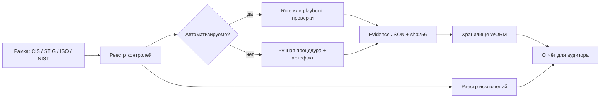

# Комплаенс и доказательства

Соответствие требованиям подтверждается не презентацией, а воспроизводимыми доказательствами: конфигурация, результат проверки, дата, ответственный и неизменяемая копия. Ansible превращает контроль из документа в исполняемую проверку, а её вывод — в артефакт, который можно передать аудитору.

## 1. Зачем это нужно

Любая рамка — CIS Benchmarks, DISA STIG, ISO/IEC 27001, NIST CSF — описывает требования в терминах результата: «доступ по SSH ограничен», «журналы защищены», «уязвимости устраняются в срок». Проверка вручную занимает недели, устаревает к моменту подписания отчёта и не масштабируется на 20 филиалов. Через месяц после аудита никто не может доказать, что состояние не изменилось.

Автоматизация даёт три эффекта. Первый — повторяемость: один и тот же контроль проверяется одинаково на RHEL 9 и Ubuntu 24.04, без зависимости от того, кто именно смотрел. Второй — частота: доказательства собираются еженедельно, а не раз в год, и дрейф виден между аудитами. Третий — связность: каждое утверждение в отчёте имеет ссылку на запуск, хост и файл с выводом команды.

При этом важно не путать автоматизацию с сертификацией. Наличие playbook не означает соответствия; сертификат выдаёт орган по сертификации, а аудитор оценивает систему управления целиком, включая процессы, обучение и реагирование. Автоматизация закрывает техническую часть и делает разговор с аудитором предметным, но не заменяет его.

Измеримость — отдельная ценность. Если контроль автоматизирован, появляются метрики: доля контролей с автоматической проверкой, средний возраст доказательств, число и возраст исключений, доля хостов с несоответствиями и время от обнаружения до устранения. Эти цифры показывают динамику между аудитами и помогают объяснить руководству, где процесс буксует. Без них отчёт остаётся фотографией состояния без контекста.

## 2. Ключевые понятия

| Понятие | Назначение |
|---|---|
| Control | требование, которое нужно выполнить и подтвердить |
| Evidence | артефакт, подтверждающий выполнение контроля |
| Benchmark | набор конфигурационных правил (CIS) |
| STIG | профиль DISA с уровнями CAT I–III |
| SoA | перечень применимых контролей и обоснований (ISO/IEC 27001) |
| Compensating control | альтернативная мера при невозможности выполнить требование |
| Exception | согласованное отклонение со сроком и владельцем |
| Evidence freshness | давность доказательства на момент проверки |
| Audit trail | неизменяемая история запусков и изменений |
| Attestation | подписанное заявление ответственного, а не результат сканирования |

## 3. Схема



На схеме два равноправных пути: автоматизированный контроль и ручная процедура. Ошибка — пытаться автоматизировать всё; часть требований (обучение, договоры с поставщиками) подтверждается документами, и для них нужен такой же реестр и срок хранения.

## 4. Пошаговая реализация

1. Выберите применимые рамки и зафиксируйте версии: CIS Benchmark для конкретной ОС и версии, STIG для конкретного продукта, ISO/IEC 27001:2022, NIST CSF 2.0. Ссылка «на CIS» без версии через год станет неоднозначной.
2. Составьте реестр контролей в YAML или таблице: идентификатор, формулировка, источник, владелец, способ проверки, частота, артефакт. Это основа и для отчёта, и для автоматизации.
3. Для каждого контроля определите механизм: роль проверки, playbook сбора, внешний сканер (OpenSCAP, сканер уязвимостей) или ручная процедура. Если контроль уже закрыт харденинг-ролью, проверка должна читать фактическое состояние, а не доверять факту применения роли.
4. Определите артефакт и его формат. Минимум: идентификатор контроля, хост, фактическое значение, ожидаемое значение, результат, время в UTC, версия проверки. JSON удобнее таблицы: он машинно читаем и легко хешируется.
5. Реализуйте сбор: только чтение состояния, никаких изменений. Команды выполняются с `changed_when: false`, а отсутствие инструмента фиксируется как результат, а не как падение всего прогона.
6. Обеспечьте целостность и хранение: sha256 каждого файла, манифест, отдельное хранилище с ограниченным доступом и retention не меньше требуемого.
7. Постройте отчёт: сводка по филиалам, список несоответствий, исключения, метрики. Отчёт формируется из тех же данных, что и доказательства, — иначе появляется ручная правка.
8. Введите жизненный цикл исключений: заявка, оценка риска, компенсирующий контроль, срок, пересмотр. Просроченное исключение — несоответствие.
9. Проведите внутренний аудит по собственным доказательствам до внешнего: это дешевле и выявляет пробелы в маппинге.

Сроки хранения задаются по типу артефакта, а не единым числом. Сводки проверок достаточно хранить один-два года, сырые журналы — согласно политике и отраслевому требованию, а реестр исключений и историю изменений — не меньше срока действия сертификата. При этом хранилище должно быть доступно только на чтение для аудитора и только на запись для процесса сбора: учётная запись, которая может удалить доказательства, обесценивает весь механизм.

## 5. Полный запускаемый пример

Реестр контролей `compliance/controls.yml`:

```yaml
---
controls:
  - id: AC-01
    title: "SSH: вход root запрещён"
    check: sshd_root_login
    source: ["CIS Control 5", "NIST CSF PR.AA", "ISO A.8.5", "STIG CAT II"]
  - id: CM-01
    title: "ASLR включён"
    check: sysctl_aslr
    source: ["CIS Control 4", "NIST CSF PR.PS", "ISO A.8.9", "STIG CAT II"]
  - id: AU-01
    title: "Правила аудита загружены"
    check: audit_rules
    source: ["CIS Control 8", "NIST CSF DE.CM", "ISO A.8.15", "STIG CAT II"]
  - id: AC-02
    title: "Права на /etc/shadow не шире 0640"
    check: file_permissions
    source: ["CIS Control 5", "NIST CSF PR.AA", "ISO A.8.5", "STIG CAT II"]
  - id: SC-01
    title: "Синхронизация времени активна"
    check: time_sync
    source: ["CIS Control 4", "NIST CSF PR.PS", "ISO A.8.17", "STIG CAT II"]
```

`compliance-evidence.yml`:

```yaml
---
- name: Collect compliance evidence
  hosts: branches
  become: true
  gather_facts: true
  serial: "25%"

  vars:
    evidence_root: evidence/compliance
    sshd_binary: /usr/sbin/sshd

  tasks:
    - name: Read effective sshd configuration
      ansible.builtin.command:
        argv: ["{{ sshd_binary }}", -T]
      register: ev_sshd
      changed_when: false

    - name: Read ASLR sysctl value
      ansible.builtin.command:
        argv: [sysctl, -n, kernel.randomize_va_space]
      register: ev_aslr
      changed_when: false

    - name: Read loaded audit rules
      ansible.builtin.command:
        argv: [auditctl, -l]
      register: ev_audit
      changed_when: false
      failed_when: false   # no auditd on the host is a finding, not a crash

    - name: Read time synchronization state
      ansible.builtin.command:
        argv: [timedatectl, show, -p, NTPSynchronized, --value]
      register: ev_time
      changed_when: false

    - name: Read key file permissions
      ansible.builtin.stat:
        path: "{{ item }}"
      loop:
        - /etc/shadow
        - /etc/ssh/sshd_config
      register: ev_files

    - name: Evaluate controls
      ansible.builtin.set_fact:
        compliance_results:
          AC-01:
            expected: "permitrootlogin no"
            actual: >-
              {{ (ev_sshd.stdout_lines | select('match', '(?i)^permitrootlogin') | list | first | default('absent')) | lower }}
            passed: >-
              {{ (ev_sshd.stdout_lines | select('match', '(?i)^permitrootlogin no') | list | length) == 1 }}
          CM-01:
            expected: "2"
            actual: "{{ ev_aslr.stdout | trim }}"
            passed: "{{ ev_aslr.stdout | trim == '2' }}"
          AU-01:
            expected: "rules present"
            actual: "{{ 'present' if ev_audit.stdout | trim | length > 0 else 'empty' }}"
            passed: "{{ (ev_audit.stdout | trim | length) > 0 }}"
          SC-01:
            expected: "yes"
            actual: "{{ ev_time.stdout | trim }}"
            passed: "{{ ev_time.stdout | trim == 'yes' }}"
          AC-02:
            expected: "shadow 0640 or stricter"
            actual: "{{ ev_files.results[0].stat.mode }}"
            passed: "{{ ev_files.results[0].stat.mode in ['0640', '0600', '0000'] }}"

    - name: Assemble evidence document
      ansible.builtin.set_fact:
        compliance_evidence:
          host: "{{ inventory_hostname }}"
          branch: "{{ branch_code | default('unknown') }}"
          collected_at: "{{ ansible_date_time.iso8601 }}"
          run_id: "{{ ansible_date_time.iso8601_basic_short }}"
          os: "{{ ansible_facts['distribution'] }} {{ ansible_facts['distribution_version'] }}"
          kernel: "{{ ansible_facts['kernel'] }}"
          controls: "{{ compliance_results }}"

    - name: Compute evidence digest
      ansible.builtin.set_fact:
        compliance_digest: "{{ compliance_evidence | to_nice_json | hash('sha256') }}"

    - name: Ensure evidence directory exists on the control node
      ansible.builtin.file:
        path: "{{ evidence_root }}/{{ ansible_date_time.date }}"
        state: directory
        mode: "0750"
      become: false
      delegate_to: localhost

    - name: Write evidence file
      ansible.builtin.copy:
        content: "{{ compliance_evidence | to_nice_json }}\n"
        dest: "{{ evidence_root }}/{{ ansible_date_time.date }}/{{ inventory_hostname }}.json"
        mode: "0640"
      become: false
      delegate_to: localhost

    - name: Append host line to the evidence manifest
      ansible.builtin.lineinfile:
        path: "{{ evidence_root }}/manifest.csv"
        line: "{{ ansible_date_time.iso8601 }},{{ inventory_hostname }},{{ compliance_evidence.run_id }},{{ compliance_evidence.controls | length }},{{ compliance_digest }}"
        create: true
        mode: "0640"
        insertafter: EOF
      become: false
      throttle: 1
      delegate_to: localhost

- name: Build compliance summary
  hosts: localhost
  gather_facts: true
  tasks:
    - name: Ensure reports directory exists
      ansible.builtin.file:
        path: reports
        state: directory
        mode: "0750"

    - name: Render compliance summary
      ansible.builtin.template:
        src: templates/compliance-summary.md.j2
        dest: "reports/compliance-{{ ansible_date_time.date }}.md"
        mode: "0640"
```

`templates/compliance-summary.md.j2`:

```jinja2
# Сводка соответствия, {{ ansible_date_time.date }}

| Хост | Филиал | AC-01 | CM-01 | AU-01 | SC-01 | AC-02 |
|---|---|---|---|---|---|---|


| {{ h }} | {{ hostvars[h].branch_code | default('unknown') }} | {{ 'pass' if r['AC-01'].passed | bool else 'fail' }} | {{ 'pass' if r['CM-01'].passed | bool else 'fail' }} | {{ 'pass' if r['AU-01'].passed | bool else 'fail' }} | {{ 'pass' if r['SC-01'].passed | bool else 'fail' }} | {{ 'pass' if r['AC-02'].passed | bool else 'fail' }} |

```

Обратите внимание на `failed_when: false` у `auditctl`: на хосте без auditd команда возвращает ошибку, и это результат проверки, а не сбой сбора. Такой приём допустим только для read-only команд и только с комментарием в коде — иначе он маскирует реальные проблемы.

Реестр контролей в примере используется для отчётности и сверки: в промышленной роли список проверок строится из поля `check`, а сами проверки лежат в отдельных task-файлах с тем же идентификатором. Такой порядок позволяет добавлять контроль без правки основного playbook и видеть в отчёте ровно те формулировки, которые утверждены владельцем комплаенса.

`hash('sha256')` считается от канонического JSON на control node. Это защищает от случайного изменения файла при передаче, но не от целенаправленной подмены: для защиты от неё нужен WORM-сегмент хранилища и отдельная учётная запись без права удаления.

## 6. Проверка результата

```bash
ansible-playbook -i inventories/prod/hosts.yml compliance-evidence.yml --limit msk-app01
python3 -m json.tool evidence/compliance/2026-11-11/msk-app01.json > /dev/null && echo valid
sha256sum evidence/compliance/2026-11-11/msk-app01.json
tail -3 evidence/compliance/manifest.csv
```

Сверьте digest из манифеста с `sha256sum`: расхождение означает, что файл изменили после записи. Затем проверьте отчёт: число строк должно совпадать с числом хостов, для которых собирались данные, а не с числом хостов в inventory. Разница — это хосты, которые не ответили, и она должна быть явно видна, иначе отчёт создаёт ложное впечатление полного покрытия.

Полезно прогнать выборочную ручную сверку: возьмите три случайных хоста и повторите 2–3 проверки вручную. Если результат расходится, проблема в парсинге вывода (локаль, версия утилиты, формат `sshd -T`), и её нужно исправить до аудита, а не во время.

Расписание выбирайте по скорости изменения состояния. Конфигурационные контроли достаточно собирать раз в неделю, контроли за патчами и исключениями — ежедневно, а перед аудитом запускайте внеочередной полный прогон. Каждый запуск должен быть привязан к версии репозитория и версии коллекций, иначе через полгода невозможно объяснить, какой именно проверкой получен результат.

## 7. Безопасность и blast radius

Сбор доказательств по своей природе read-only, поэтому прямой риск для хостов минимален. Основные риски лежат в данных и в интерпретации.

| Риск | Последствие | Мера |
|---|---|---|
| Доказательства содержат чувствительные данные | утечка топологии и версий | ограниченный доступ, шифрование хранилища |
| Файлы на control node перезаписаны | потеря истории | ежедневные каталоги, WORM, резервная копия |
| `failed_when: false` скрывает сбой | ложное «всё собрано» | только read-only команды, комментарий, ревью |
| Контроль проверяет факт применения роли | ложное соответствие | читать фактическое состояние, а не `stat` роли |
| Просроченные исключения | несоответствие в отчёте | автопроверка `expires` в реестре |
| Отчёт правится вручную | аудитор теряет доверие | отчёт генерируется, версионируется в Git |

Откат здесь не про конфигурацию, а про данные: если доказательства повреждены, восстановите каталог из резервной копии и пересоберите отчёт. `become: false` на задачах, работающих с control node, обязателен — иначе файлы доказательств окажутся в собственности root и станут недоступны сервисной учётке.

## 8. Комплаенс-маппинг

| Рамка | Что покрывает страница |
|---|---|
| CIS Controls v8 | 4 (конфигурация), 5 (учётки), 8 (журналы), 17 (реагирование) |
| CIS Benchmarks | проверки конфигурации ОС через роли и OpenSCAP |
| DISA STIG | CAT I–III как уровни строгости при приоритизации |
| ISO/IEC 27001:2022 | A.5.36, A.8.8, A.8.9, A.8.15, A.8.32 и SoA |
| NIST CSF 2.0 | GV, ID, PR, DE — функции, к которым привязаны контроли |
| Национальные и отраслевые требования | отдельные строки реестра, заполняет владелец комплаенса |

Строка про национальные требования остаётся плейсхолдером намеренно: перечень зависит от юрисдикции и отрасли, и подставлять конкретный документ без подтверждения нельзя. Место для него — в реестре контролей, с владельцем и датой пересмотра.

Уровни STIG полезны как готовая шкала строгости. CAT I — критичные находки, которые нужно закрывать немедленно или оформлять исключение с компенсирующим контролем; CAT II — основная масса требований, закрывается плановой автоматизацией; CAT III — улучшения, которые можно отложить. Такая градация позволяет не спорить о каждом правиле отдельно и честно объяснять, почему часть проверок отключена в конкретном филиале с унаследованным оборудованием.

## 9. Типичные ошибки и troubleshooting

| Симптом | Причина | Проверка | Решение |
|---|---|---|---|
| Контроль «пройден» на всех хостах | проверка смотрит на факт запуска роли | сравнить с ручной проверкой | читать фактическое состояние |
| `sshd -T` даёт другой регистр | версия OpenSSH | вывод команды | нормализовать регистр фильтром `lower` |
| `auditctl` возвращает ошибку | auditd не установлен | `systemctl status auditd` | зафиксировать как finding |
| Manifest и файлы расходятся | параллельная запись | `sha256sum` | `throttle: 1`, порядок в отчёте |
| Отчёт пуст | шаблон не видит hostvars | `--limit` и `groups` | запускать полный прогон или фильтровать явно |
| Доказательства устарели | сбор не в расписании | дата в manifest | ежедневный или еженедельный запуск |
| Аудитор просит сырые логи | хранятся только сводки | политика retention | хранить и сырые артефакты, не только JSON |

## 10. Чек-лист

- [ ] Версии рамок и бенчмарков зафиксированы.
- [ ] Реестр контролей существует и имеет владельцев.
- [ ] Каждый контроль связан с проверкой или ручной процедурой.
- [ ] Проверки read-only и не меняют состояние хоста.
- [ ] Для каждого доказательства считается sha256 и ведётся манифест.
- [ ] Хранилище доказательств защищено от удаления и имеет retention.
- [ ] Отчёт генерируется из данных, а не правится вручную.
- [ ] Исключения имеют срок, владельца и компенсирующий контроль.
- [ ] Просроченные исключения блокируют «зелёный» отчёт.
- [ ] Формулировки не заявляют сертификацию.

## 11. Источники

- [CIS Controls](https://www.cisecurity.org/controls)
- [NIST Cybersecurity Framework](https://www.nist.gov/cyberframework)
- [ISO/IEC 27001](https://www.iso.org/standard/27001)
- [ComplianceAsCode](https://complianceascode.io/)
- [ansible.builtin.lineinfile](https://docs.ansible.com/ansible/latest/collections/ansible/builtin/lineinfile_module.html)

## 12. Связанные страницы

- [Конфигурация и дрейф](../admin/22-config-drift.md)
- [Харденинг Linux](35-linux-hardening.md)
- [Уязвимости и патчи](43-vuln-patching.md)
- [Чек-листы](../ops/61-checklists.md)
- [Governance и процессы](../quality/54-governance.md)
- [Аудит выполнения](../secure-dev/16-audit-logging.md)
