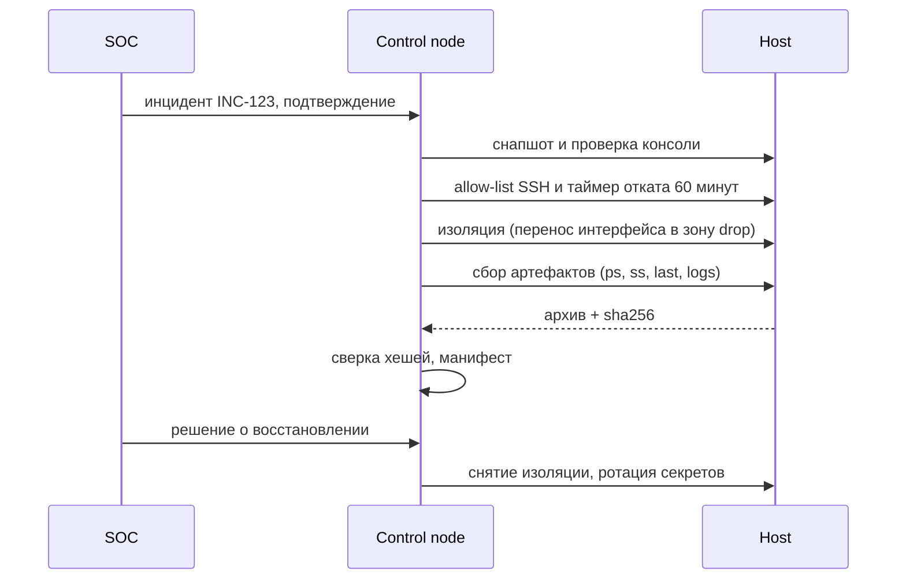

# Реагирование на инциденты

Изоляция хоста и сбор артефактов — две операции, где автоматизация одновременно ускоряет реакцию и повышает риск. Ошибка в firewall отрезает филиал, ошибка в сборе уничтожает доказательства. Поэтому playbook реагирования строится как управляемая процедура: подтверждение человеком, таймер отката, фиксация каждого шага.

## 1. Зачем это нужно

При компрометации хоста счёт идёт на минуты: чем дольше злоумышленник сохраняет сетевой доступ, тем больше данных он успевает вынести и тем глубже закрепляется. Ручная изоляция через консоль ESXi требует, чтобы администратор успел подключиться, нашёл нужную ВМ и не ошибся с портом. Playbook делает это за секунды и одинаково на всей сети, но только при условии, что в нём предусмотрены предохранители.

Второй аспект — доказательства. Порядок сбора важен: сначала энергозависимые данные (процессы, соединения, сессии), затем файлы и журналы, затем образ диска. Если сначала перезагрузить хост «для порядка», процессы и сетевые соединения исчезнут навсегда. Автоматический сбор позволяет зафиксировать состояние по единому списку и с одинаковыми командами, а хеширование — доказать, что артефакты не изменялись после изъятия.

Третий аспект — правовой и организационный. Изоляция и сбор данных на рабочем месте сотрудника могут затрагивать персональные данные и трудовое право; действия должны выполняться по утверждённому регламенту, с указанием основания, ответственного и времени. Playbook фиксирует эти поля в журнале, но не заменяет решение: запуск инициирует дежурный SOC после классификации инцидента.

## 2. Ключевые понятия

| Понятие | Назначение |
|---|---|
| Containment | ограничение распространения, в простом случае — изоляция хоста |
| Isolation | блокировка сетевого трафика хоста с сохранением управления |
| Rollback timer | автоматическое снятие изоляции через заданный интервал |
| Order of volatility | порядок сбора: от энергозависимых данных к диску |
| Artifact | файл, вывод команды или дамп, собранный для расследования |
| Chain of custody | документированная история перемещения и хранения артефактов |
| Hash | sha256 для подтверждения неизменности артефакта |
| Eradication | устранение причины, а не только симптома |
| Recovery | возврат хоста в эксплуатацию с усиленным контролем |
| Tabletop | учение без реального воздействия на продакшн |

## 3. Схема



Схема показывает, что изоляция и сбор идут параллельно по смыслу, но последовательно по выполнению: сначала ограничиваем распространение, затем фиксируем состояние, при этом управляющий доступ сохраняется через узкий allow-list.

## 4. Пошаговая реализация

1. Утвердите регламент: кто имеет право инициировать изоляцию, какие системы затрагиваются, кто подтверждает, где хранятся артефакты. Без этого playbook — просто опасный инструмент.
2. Подготовьте доступ вне полосы: консоль ESXi или IPMI для каждого хоста. Изоляция через firewall может оборвать текущую SSH-сессию, и это должно быть ожидаемым сценарием, а не аварией.
3. Сделайте снапшот ВМ до изменений. Снапшот — не резервная копия, но он позволяет вернуть состояние сети и диска при ошибочной изоляции.
4. Реализуйте изоляцию как смену зоны firewalld на зону с целевым действием `DROP` и единственным разрешением: SSH с адреса control node. Всё остальное, включая исходящие соединения, блокируется.
5. Запустите таймер отката до смены зоны: `systemd-run` с `--on-active` создаёт временный юнит, который снимет изоляцию через заданный интервал, если инженер не подтвердит продление. Это защита от ситуации «изолировали, потеряли сессию и ушли».
6. Соберите артефакты в правильном порядке, каждый — в отдельный файл с правами `0600`. Команды только читают состояние, поэтому `changed_when: false` обязателен.
7. Упакуйте артефакты в архив, посчитайте sha256 на хосте, перенесите на control node через `fetch` и сверьте хеш после переноса.
8. Занесите запись в манифест: инцидент, хост, время UTC, collector, digest, место хранения, кто принял. Манифест — и есть chain of custody в минимальном виде.
9. Восстановите хост: переустановка или откат к известному хорошему состоянию, ротация учётных данных, повторное подключение с усиленным мониторингом. Изоляцию снимайте только после решения об eradication.

Пост-инцидентный харденинг выполняется отдельным планом, а не «заодно» в том же запуске: обновление правил firewall, SSH и аудита на только что восстановленном хосте может снова его сломать. Сначала хост возвращается в строй в наблюдаемом режиме, затем на него применяется роль харденинга из репозитория, и только после успешной проверки снимаются временные послабления. Учения (tabletop и техническая репетиция изоляции на лабораторной ВМ) должны проводиться до инцидента: они выявляют, что таймер не срабатывает, allow-list не покрывает новый control node или скрипт восстановления ссылается на неверный интерфейс.

## 5. Полный запускаемый пример

`ir-isolate.yml`:

```yaml
---
- name: Isolate a compromised host with rollback timer
  hosts: "{{ target_host | default('none') }}"
  become: true
  gather_facts: true
  serial: 1
  max_fail_percentage: 0
  any_errors_fatal: true

  vars:
    ir_case_id: "INC-0000"
    ir_approval_phrase: "ISOLATE"
    ir_quarantine_zone: drop
    ir_mgmt_cidr: "10.10.0.0/24"
    ir_rollback_minutes: 60
    ir_require_approval: true

  tasks:
    - name: Refuse to run without a case identifier
      ansible.builtin.assert:
        that:
          - ir_case_id is match('^INC-[0-9]{4,}$')
        fail_msg: "Set ir_case_id, for example INC-1042"
        quiet: true

    - name: Request explicit human approval
      ansible.builtin.pause:
        prompt: "Type {{ ir_approval_phrase }} to isolate {{ inventory_hostname }} ({{ ir_case_id }})"
      register: ir_approval
      when: ir_require_approval | bool

    - name: Verify the approval phrase
      ansible.builtin.assert:
        that:
          - ir_approval.user_input | default('') == ir_approval_phrase
        fail_msg: "Approval not given, nothing changed"
        quiet: true
      when: ir_require_approval | bool

    - name: Record the current firewalld zone of the primary interface
      ansible.builtin.command:
        argv:
          - firewall-cmd
          - "--get-zone-of-interface={{ ansible_facts['default_ipv4']['interface'] }}"
      register: ir_zone_before
      changed_when: false

    - name: Deploy the network restore script
      ansible.builtin.template:
        src: templates/ir-restore-network.sh.j2
        dest: /usr/local/sbin/ir-restore-network.sh
        owner: root
        group: root
        mode: "0750"

    - name: Reserve SSH from the control node inside the quarantine zone
      ansible.posix.firewalld:
        zone: "{{ ir_quarantine_zone }}"
        rich_rule: >-
          rule family="ipv4" source address="{{ ir_mgmt_cidr }}"
          service name="ssh" accept
        permanent: true
        immediate: true
        state: enabled

    - name: Arm the rollback timer before touching the network
      ansible.builtin.command:
        argv:
          - systemd-run
          - "--on-active={{ ir_rollback_minutes }}m"
          - "--unit=ir-rollback-{{ ir_case_id }}"
          - "--collect"
          - /usr/local/sbin/ir-restore-network.sh
      changed_when: true   # a transient timer is created on every run by design

    - name: Move the primary interface into the quarantine zone
      ansible.posix.firewalld:
        zone: "{{ ir_quarantine_zone }}"
        interface: "{{ ansible_facts['default_ipv4']['interface'] }}"
        permanent: true
        immediate: true
        state: enabled

    - name: Confirm the effective zone
      ansible.builtin.command:
        argv:
          - firewall-cmd
          - "--get-zone-of-interface={{ ansible_facts['default_ipv4']['interface'] }}"
      register: ir_zone_after
      changed_when: false
      failed_when: ir_zone_after.stdout | trim != ir_quarantine_zone

    - name: Append the isolation record to the case log
      ansible.builtin.lineinfile:
        path: "reports/ir/{{ ir_case_id }}/actions.csv"
        line: "{{ ansible_date_time.iso8601 }},{{ inventory_hostname }},isolate,{{ ir_zone_before.stdout | trim }},{{ ir_quarantine_zone }},{{ ir_rollback_minutes }},ir-rollback-{{ ir_case_id }},{{ ir_approval.user_input | default('n/a') }}"
        create: true
        mode: "0640"
        insertafter: EOF
      become: false
      throttle: 1
      delegate_to: localhost
```

`templates/ir-restore-network.sh.j2`:

```bash
#!/bin/bash
# {{ ansible_managed }}
set -euo pipefail
IFACE="{{ ansible_facts['default_ipv4']['interface'] }}"
ORIGIN="{{ ir_zone_before.stdout | trim }}"
firewall-cmd --zone="{{ ir_quarantine_zone }}" --remove-interface="$IFACE" --permanent
firewall-cmd --zone="$ORIGIN" --add-interface="$IFACE" --permanent
firewall-cmd --reload
logger -t ir-rollback "network restored for $IFACE, case {{ ir_case_id }}"
```

Порядок операций критичен: сначала в зоне `drop` появляется разрешение для control node, затем взводится таймер отката, и только потом интерфейс переносится в эту зону. Если таймер ставить после смены зоны, разрыв сессии оставит хост изолированным без автоматического возврата. Если поменять местами разрешение и смену зоны, playbook отрежет собственное соединение и завершится ошибкой на середине. Даже при правильном порядке уже установленная сессия может разорваться после `firewall-cmd --reload`, поэтому консольный доступ обязателен, а таймер отката — не формальность.

Снапшот ВМ выполняется отдельной ролью VMware до запуска этого playbook: смешивать доступ к vCenter и действия на compromised-хосте в одном запуске не стоит, а при отсутствии vCenter снапшот делается вручную. Проверка через `--check` для firewalld — лишь репетиция синтаксиса: модуль не предсказывает разрыв сессий, поэтому первое применение всегда делайте на лабораторном хосте.

Для сред без firewalld используйте nftables: отдельный файл правил с `policy drop` для `input` и `accept` только для management-подсети, проверка синтаксиса через `validate: "nft -c -f %s"`, загрузка handler-ом. Учтите, что включение каталога `/etc/nftables.d` зависит от дистрибутива, а `nft -f` применяет правила атомарно, но без автоматического отката — таймер придётся реализовать отдельным юнитом.

`ir-collect.yml`:

```yaml
---
- name: Collect volatile artifacts before recovery
  hosts: "{{ target_host | default('none') }}"
  become: true
  gather_facts: true
  serial: 1

  vars:
    ir_case_id: "INC-0000"
    ir_evidence_dir: "evidence/ir/{{ ir_case_id }}"
    ir_remote_dir: "/var/tmp/ir-{{ ir_case_id }}"
    ir_auth_log: >-
      {{ '/var/log/auth.log' if ansible_facts['os_family'] == 'Debian' else '/var/log/secure' }}

  tasks:
    - name: Create the remote collection directory
      ansible.builtin.file:
        path: "{{ ir_remote_dir }}"
        state: directory
        owner: root
        group: root
        mode: "0700"

    - name: Capture running processes
      ansible.builtin.command:
        argv: [ps, -eo, "pid,ppid,user,lstart,args"]
      register: ir_ps
      changed_when: false

    - name: Capture network connections
      ansible.builtin.command:
        argv: [ss, -tunap]
      register: ir_ss
      changed_when: false

    - name: Capture interactive sessions
      ansible.builtin.command:
        argv: [last, -Faiw]
      register: ir_last
      changed_when: false

    - name: Capture recent journal entries
      ansible.builtin.command:
        argv: [journalctl, "--since=-24h", --no-pager, -o, short-iso]
      register: ir_journal
      changed_when: false

    - name: Write captured command output
      ansible.builtin.copy:
        content: "{{ item.content }}"
        dest: "{{ ir_remote_dir }}/{{ item.name }}"
        owner: root
        group: root
        mode: "0600"
      loop:
        - { name: "processes.txt", content: "{{ ir_ps.stdout }}" }
        - { name: "connections.txt", content: "{{ ir_ss.stdout }}" }
        - { name: "sessions.txt", content: "{{ ir_last.stdout }}" }
        - { name: "journal.txt", content: "{{ ir_journal.stdout }}" }
      loop_control:
        label: "{{ item.name }}"

    - name: Copy authentication log for the case
      ansible.builtin.copy:
        src: "{{ ir_auth_log }}"
        dest: "{{ ir_remote_dir }}/auth.log"
        remote_src: true
        owner: root
        group: root
        mode: "0600"

    - name: Hash every collected file
      ansible.builtin.command:
        argv:
          - find
          - "{{ ir_remote_dir }}"
          - -type
          - f
          - -exec
          - sha256sum
          - "{}"
          - +
      register: ir_hashes
      changed_when: false

    - name: Archive the evidence
      ansible.builtin.archive:
        path: "{{ ir_remote_dir }}"
        dest: "{{ ir_remote_dir }}.tar.gz"
        format: gz
        mode: "0600"

    - name: Hash the archive
      ansible.builtin.command:
        argv: [sha256sum, "{{ ir_remote_dir }}.tar.gz"]
      register: ir_archive_hash
      changed_when: false

    - name: Ensure local evidence directory exists
      ansible.builtin.file:
        path: "{{ ir_evidence_dir }}/{{ inventory_hostname }}"
        state: directory
        mode: "0700"
      become: false
      delegate_to: localhost

    - name: Fetch the evidence archive
      ansible.builtin.fetch:
        src: "{{ ir_remote_dir }}.tar.gz"
        dest: "{{ ir_evidence_dir }}/{{ inventory_hostname }}/artifacts.tar.gz"
        flat: true
      become: false
      delegate_to: localhost

    - name: Verify the archive digest on the control node
      ansible.builtin.stat:
        path: "{{ ir_evidence_dir }}/{{ inventory_hostname }}/artifacts.tar.gz"
        checksum_algorithm: sha256
      register: ir_local_stat
      become: false
      delegate_to: localhost

    - name: Fail when the digest does not match
      ansible.builtin.assert:
        that:
          - ir_local_stat.stat.checksum == ir_archive_hash.stdout.split()[0]
        fail_msg: "Evidence digest mismatch for {{ inventory_hostname }}"
        quiet: true
      become: false
      delegate_to: localhost

    - name: Write the chain-of-custody manifest
      ansible.builtin.copy:
        content: "{{ ir_hashes.stdout }}\n"
        dest: "{{ ir_evidence_dir }}/{{ inventory_hostname }}/sha256.txt"
        mode: "0600"
      become: false
      delegate_to: localhost

    - name: Append the custody record
      ansible.builtin.lineinfile:
        path: "{{ ir_evidence_dir }}/manifest.csv"
        line: "{{ ir_case_id }},{{ inventory_hostname }},{{ ansible_date_time.iso8601 }},{{ ir_archive_hash.stdout.split()[0] }},artifacts.tar.gz,{{ ansible_user_id }}"
        create: true
        mode: "0640"
        insertafter: EOF
      become: false
      throttle: 1
      delegate_to: localhost
```

Хеши считаются дважды: по файлам внутри каталога и по архиву. Первый список позволяет проверить отдельный артефакт после распаковки, второй — целостность передачи. Не удаляйте `/var/tmp/ir-*` до подписания акта: локальная копия остаётся источником для повторного сбора, если архив повреждён.

!!! warning "Риск"
    `ansible.builtin.pause` не работает в неинтерактивных запусках, включая CI. Не отключайте подтверждение через `ir_require_approval: false` в автоматике: перенесите апрув на уровень оркестратора (workflow с approval node в AAP) и оставьте playbook последним шагом после решения человека.

## 6. Проверка результата

```bash
ansible-playbook -i inventories/prod/hosts.yml ir-isolate.yml -e target_host=msk-app07 -e ir_case_id=INC-1042 --check --diff
ansible-playbook -i inventories/prod/hosts.yml ir-isolate.yml -e target_host=msk-app07 -e ir_case_id=INC-1042
```

На хосте и на control node:

```bash
sudo firewall-cmd --get-zone-of-interface=ens192
sudo firewall-cmd --zone=drop --list-all
systemctl list-timers 'ir-rollback-*'
tar -tzf evidence/ir/INC-1042/msk-app07/artifacts.tar.gz | head
sha256sum evidence/ir/INC-1042/msk-app07/artifacts.tar.gz
```

Проверьте изоляцию с постороннего хоста: `ping` и попытка подключения к прикладному порту должны завершаться таймаутом, а SSH с control node — работать. Убедитесь, что таймер виден в `systemctl list-timers` и что скрипт восстановления содержит исходную зону, а не значение по умолчанию. После срабатывания таймера повторите `--get-zone-of-interface` и убедитесь, что хост вернулся в исходную зону.

Отдельно проверьте, что после снятия изоляции хост не оказался в зоне `public` с открытыми сервисами: возврат должен идти строго в ту зону, которая была зафиксирована до изменений. Если исходная зона определялась динамически и интерфейс переименован после перезагрузки, скрипт вернёт ошибку — это ожидаемо, и разбор должен идти через консоль, а не через повторный запуск playbook.

## 7. Безопасность и blast radius

Изоляция хоста — минимальное вмешательство, но у неё есть границы применимости. Если инцидент связан с учётной записью, которая используется на нескольких серверах, изоляция одного хоста не остановит распространение; тогда требуется блокировка учётной записи и сегментация, а это уже решение уровня сети и каталога. Если заражён гипервизор или общий datastore, изоляция гостевой ВМ бессмысленна — сначала ограничивается сегмент.

| Риск | Последствие | Мера |
|---|---|---|
| Изоляция не того хоста | простой сервиса и потеря доверия | `serial: 1`, `--limit`, подтверждение фразой |
| Разрыв управляющей сессии | хост недоступен, кроме консоли | allow-list до смены зоны, консоль ESXi |
| Таймер не сработал | хост остаётся изолированным | проверка `list-timers`, второй канал оповещения |
| Таймер сработал слишком рано | злоумышленник вернул доступ | интервал по регламенту, продление осознанно |
| Артефакты изменены | доказательства непригодны | hash до и после, права `0600`, WORM |
| Сбор изменил состояние | потеря энергозависимых данных | только read-only команды, `changed_when: false` |
| Персональные данные в артефактах | нарушение регламента | ограниченный доступ, шифрование, срок хранения |
| Восстановление без eradication | повторная компрометация | переустановка, ротация секретов, мониторинг |

Откат изоляции — это не «удалить правило», а возврат интерфейса в исходную зону, зафиксированную до изменений. Скрипт восстановления делает это идемпотентно: повторный запуск не меняет результат. Если хост всё равно недоступен, используйте консоль и `firewall-cmd --panic-off`, но помните, что `--panic-on` блокирует весь трафик, включая управляющий.

## 8. Комплаенс-маппинг

| Требование | Как закрывается |
|---|---|
| NIST SP 800-61 (Respond) | containment, eradication, recovery, lessons learned |
| NIST CSF 2.0 RS.MA, RS.AN, RC.RP | управление инцидентом, анализ, восстановление |
| ISO/IEC 27001:2022 A.5.24–A.5.26 | планирование и документирование реагирования |
| ISO/IEC 27001:2022 A.8.15 | журналы действий и артефакты |
| CIS Control 17 (Incident Response Management) | регламент, роли, учения |
| Отраслевые требования | сроки уведомления и состав отчётности — по регламенту |

## 9. Типичные ошибки и troubleshooting

| Симптом | Причина | Проверка | Решение |
|---|---|---|---|
| `firewalld` недоступен | сервис не установлен или остановлен | `systemctl status firewalld` | установить `firewalld` и `python3-firewall` |
| После изоляции нет SSH | rich rule не применилась | `--zone=drop --list-all` | добавить правило до смены зоны |
| Сессия оборвалась на середине | `reload` при смене зоны | журнал задачи | консоль, таймер отката, повтор |
| Таймер не появился | имя юнита занято | `systemctl list-units 'ir-rollback-*'` | уникальный `ir_case_id` |
| `fetch` не создаёт каталоги | `flat: true` и отсутствующий путь | сообщение задачи | создать каталог заранее |
| Хеши не совпали | изменение файла после подсчёта | `sha256sum` с обеих сторон | пересобрать архив, не править вручную |
| Архив пуст | каталог создан после команд | `tar -tzf` | перезапустить сбор по порядку |

## 10. Чек-лист

- [ ] Регламент реагирования утверждён, роли распределены.
- [ ] Есть консольный доступ к каждому хосту.
- [ ] Изоляция выполняется с `serial: 1` и подтверждением.
- [ ] Allow-list управления добавляется до смены зоны.
- [ ] Таймер отката создан и проверен в `systemctl list-timers`.
- [ ] Сбор артефактов идёт в порядке энергозависимости.
- [ ] Команды сбора read-only, с `changed_when: false`.
- [ ] Считаются хеши файлов и архива, выполняется сверка.
- [ ] Манифест содержит случай, хост, время, digest и collector.
- [ ] Восстановление включает ротацию секретов и повторный мониторинг.
- [ ] Проведено учение на лабораторном хосте.

## 11. Источники

- [NIST SP 800-61 Rev. 2: Computer Security Incident Handling Guide](https://csrc.nist.gov/pubs/sp/800/61/r2/final)
- [ansible.posix.firewalld](https://docs.ansible.com/ansible/latest/collections/ansible/posix/firewalld_module.html)
- [ansible.builtin.fetch](https://docs.ansible.com/ansible/latest/collections/ansible/builtin/fetch_module.html)
- [ansible.builtin.archive](https://docs.ansible.com/ansible/latest/collections/ansible/builtin/archive_module.html)
- [systemd-run(1)](https://www.freedesktop.org/software/systemd/man/latest/systemd-run.html)

## 12. Связанные страницы

- [Межсетевой экран](37-firewall.md)
- [Логирование и мониторинг](42-logging-monitoring.md)
- [Event-Driven Ansible](46-eda.md)
- [Zero trust и JIT-доступ](47-zero-trust.md)
- [Резервное копирование и DR](../admin/29-backup-dr.md)
- [Ядро и системный аудит](38-kernel-audit.md)
