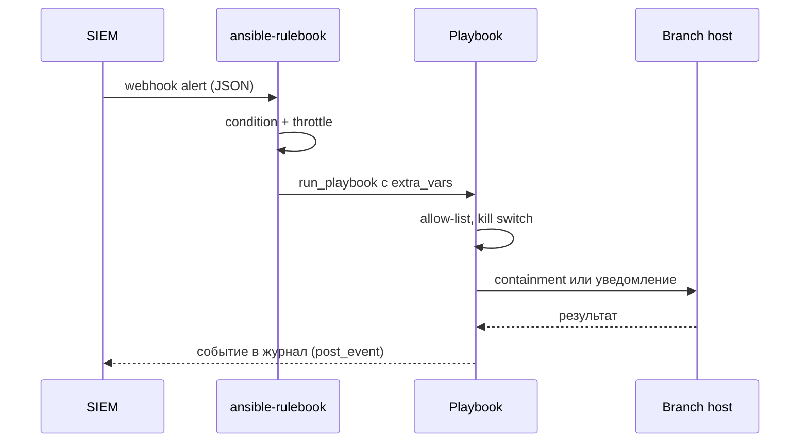

# Event-Driven Ansible

Event-Driven Ansible (EDA) превращает поток событий в действия: SIEM фиксирует обнаружение, правило проверяет условие и запускает playbook. Выигрыш — в минутах реакции, риск — в том, что ошибочное условие тиражируется на весь парк быстрее, чем человек успевает заметить.

## 1. Зачем это нужно

Классическая схема «алерт → почта → дежурный → ручной запуск» добавляет десятки минут на каждый инцидент, а ночью — часы. Для событий с однозначной реакцией (обнаружение вредоносного ПО с высоким уровнем, вход с нетипичного адреса, отключение агента EDR) задержка не даёт ничего, кроме ущерба. EDA сокращает путь до запуска playbook до секунд и делает реакцию одинаковой независимо от нагрузки на дежурного.

Второй сценарий — регулярные, но нерегулярные по времени задачи: новая критичная уязвимость в фиде, изменение конфигурации, превышение порога. Запускать playbook по расписанию расточительно, а реагировать вручную — медленно. Правило по событию оказывается точнее: действие происходит тогда, когда появилось основание.

Главное ограничение: EDA не принимает решений. Он исполняет заранее определённую политику. Если правило написано широко, автоматизация будет тиражировать ошибку с высокой скоростью. Поэтому в этой странице акцент не на «как включить», а на ограничителях: allow-list, режим уведомления, троттлинг, апрув и выключатель.

## 2. Ключевые понятия

| Понятие | Назначение |
|---|---|
| ansible-rulebook | движок, который слушает события и выполняет действия |
| Rulebook | YAML-файл с источниками, правилами и действиями |
| Source plugin | адаптер источника событий (`ansible.eda.webhook`, `ansible.eda.alertmanager`) |
| Rule | условие и действие, привязанные к источнику |
| Condition | Jinja-выражение над событием; определяет срабатывание |
| Action | `run_playbook`, `run_job_template`, `post_event` |
| Throttle | ограничение частоты срабатываний |
| Dry-run | режим, в котором действие только уведомляет |
| Kill switch | быстрый способ остановить автоматику |
| Allow-list | перечень хостов, допустимых для автоматических действий |
| `event.payload` | тело события, пришедшего от источника |

## 3. Схема



Ключевой элемент — два независимых барьера: throttle в правиле (защита от шторма событий) и проверки в playbook (allow-list и выключатель). Если оставить только один, отказ второго приведёт к массовым действиям.

## 4. Пошаговая реализация

1. Опишите каталог событий: источник, поле, порог, ожидаемое действие, владелец. Правило без владельца через месяц никто не сможет ни изменить, ни отключить.
2. Выберите источник. Для SIEM удобен webhook: система отправляет JSON на приёмник в ЦОД. Для Prometheus Alertmanager есть отдельный источник, который разбирает поля алерта сам.
3. Установите `ansible-rulebook` в виртуальное окружение или Execution Environment с зафиксированными версиями. Не смешивайте его зависимости с системным Python control node.
4. Напишите правило с узким условием: конкретный тип события, порог серьёзности, обязательное поле с идентификатором хоста. Условие «любой алерт» недопустимо.
5. Начните с режима уведомления: playbook пишет запись и отправляет сообщение, но ничего не меняет. Так вы увидите реальный поток событий и ложные срабатывания.
6. Добавьте allow-list: действие разрешено только для хостов из группы `branches` и только если имя пришло из доверенного поля события. Любая попытка выйти за список — отказ и запись в журнал.
7. Настройте апрув. Для действий, меняющих доступность, используйте workflow с approval node в AAP; в автономном варианте — очередь заявок и ручной запуск playbook.
8. Ограничьте частоту: `throttle` по хосту, чтобы шторм событий не породил сотни запусков. Дополнительно ограничьте параллелизм на уровне playbook через `serial: 1`.
9. Реализуйте выключатель: файл-маркер, который проверяет playbook, и остановка сервиса `ansible-rulebook`. Проверьте оба способа на учении.
10. Определите поведение при обрыве WAN: приёмник событий держите в ЦОД, а не в филиале; если хост недоступен, действие должно завершиться ошибкой и уведомлением, а не бесконечным повтором.

Ограничение WAN проявляется в трёх местах. Во-первых, источник событий нельзя размещать в филиале: при обрыве канала события просто не дойдут до движка, и никто об этом не узнает. Во-вторых, запуск playbook по хосту в отрезанном филиале обречён на таймаут, поэтому в правиле должен быть разумный лимит времени, а результат — записываться как «не выполнено» с эскалацией. В-третьих, повторные попытки при восстановлении канала могут привести к накопленной очереди событий и шторму действий: throttle и дедупликация по идентификатору хоста и типу события обязательны, иначе после часового обрыва автоматика одновременно получит сотни уведомлений.

## 5. Полный запускаемый пример

`rulebooks/siem-alerts.yml`:

```yaml
---
- name: Respond to SIEM detections
  hosts: all
  sources:
    - ansible.eda.webhook:
        host: 0.0.0.0
        port: 5002
  rules:
    - name: Contain host on confirmed malware detection
      condition: >-
        event.payload.rule.level | default(0) >= 12 and
        event.payload.agent.name is defined and
        event.payload.autoremediate | default(false) | bool
      action:
        run_playbook:
          name: playbooks/eda-respond.yml
          extra_vars:
            target_host: "{{ event.payload.agent.name }}"
            incident_id: "{{ event.payload.id | default('INC-0000') }}"
        throttle:
          once_within: 15 minutes
          group_by_attributes:
            - event.payload.agent.name

    - name: Re-scan a host after a critical vulnerability alert
      condition: >-
        event.payload.rule.id | default('') == 'vuln-critical' and
        event.payload.agent.name is defined
      action:
        run_playbook:
          name: playbooks/eda-rescan.yml
          extra_vars:
            target_host: "{{ event.payload.agent.name }}"
        throttle:
          once_within: 6 hours
          group_by_attributes:
            - event.payload.agent.name
```

`playbooks/eda-respond.yml`:

```yaml
---
- name: Validate and execute an automated response
  hosts: "{{ target_host | default('none') }}"
  become: true
  gather_facts: true
  serial: 1
  max_fail_percentage: 0
  any_errors_fatal: true

  vars:
    eda_mode: notify          # notify | contain
    eda_switch_file: /etc/eda/enabled
    eda_allowed_group: branches

  tasks:
    - name: Refuse hosts outside the allow-list
      ansible.builtin.assert:
        that:
          - inventory_hostname in groups[eda_allowed_group]
        fail_msg: "{{ inventory_hostname }} is not allowed for automated actions"
        quiet: true

    - name: Read the automation kill switch
      ansible.builtin.stat:
        path: "{{ eda_switch_file }}"
      register: eda_switch
      become: false
      delegate_to: localhost

    - name: Record the event even when automation is disabled
      ansible.builtin.lineinfile:
        path: "reports/eda/events.csv"
        line: "{{ ansible_date_time.iso8601 }},{{ incident_id }},{{ inventory_hostname }},{{ eda_mode }},{{ eda_switch.stat.exists }}"
        create: true
        mode: "0640"
        insertafter: EOF
      become: false
      throttle: 1
      delegate_to: localhost

    - name: Contain the host only when automation is enabled
      ansible.builtin.include_role:
        name: ir_isolate
      vars:
        ir_case_id: "{{ incident_id }}"
        ir_rollback_minutes: 60
      when:
        - eda_mode == 'contain'
        - eda_switch.stat.exists | bool

    - name: Notify the SOC channel
      ansible.builtin.uri:
        url: "{{ soc_webhook_url }}"
        method: POST
        body_format: json
        body:
          text: "EDA {{ eda_mode }}: {{ inventory_hostname }}, case {{ incident_id }}"
        status_code: [200, 204]
      when: soc_webhook_url is defined
      no_log: true
```

Команда запуска:

```bash
ansible-rulebook --rulebook rulebooks/siem-alerts.yml -i inventories/prod/hosts.yml --verbose
```

`extra_vars` передаёт в playbook только два поля события: имя хоста и идентификатор инцидента. Это осознанное ограничение: чем меньше данных из внешнего события попадает в playbook, тем меньше поверхность инъекции. Никогда не передавайте в `target_host` произвольное поле без проверки по inventory — именно так внешнее событие превращается в выполнение действий на чужом хосте.

Сервисный юнит для автономного запуска:

```ini
[Unit]
Description=Event-Driven Ansible rulebook
After=network-online.target

[Service]
User=eda
Group=eda
WorkingDirectory=/opt/eda
ExecStart=/opt/eda/venv/bin/ansible-rulebook --rulebook /etc/eda/siem-alerts.yml -i /etc/eda/inventory.yml
Restart=on-failure
RestartSec=10

[Install]
WantedBy=multi-user.target
```

Роль `ir_isolate` — это вынесенная логика изоляции из страницы про реагирование. Один и тот же код используется и при ручном запуске, и при событийном: расхождение между «ручным» и «автоматическим» сценарием — типичная причина того, что автоматика срабатывает не так, как проверяли.

Вариант без AAP работает, но имеет границы. Нет RBAC: любой, кто может изменить rulebook или playbook, влияет на всю автоматику. Нет approval node: подтверждение приходится строить вручную, а `ansible.builtin.pause` в неинтерактивном сервисе бесполезен. Нет аудита запусков платформы: журнал остаётся только в `journalctl` и в файлах, которые легко удалить. Нет HA: падение единственного процесса означает потерю реакции до ручного перезапуска, а секреты лежат на диске и защищены только правами. Компенсация: запуск в Execution Environment под podman с read-only файловой системой, отдельная сервисная учётка, отправка журналов в SIEM, systemd-юнит с `Restart=on-failure` и внешний мониторинг доступности порта. Для 200–1000 хостов такой конфигурации достаточно, пока автоматических действий немного и они обратимы.

Dry-run в EDA — это не флаг движка, а режим политики. Практика: параметр `eda_mode` со значением `notify` по умолчанию, отдельный тестовый rulebook, который указывает на копию inventory с одним лабораторным хостом, и обязательный период наблюдения не менее двух недель. За это время собирается статистика: сколько событий пришло, сколько прошло условие, сколько оказались ложными. Только после этого `contain` включается для конкретного типа события, а не для всех сразу. Апрув в такой схеме остаётся человеческим решением по каждому событию, пока точность правила не подтверждена.

## 6. Проверка результата

```bash
curl -s -X POST http://127.0.0.1:5002/endpoint \
  -H 'Content-Type: application/json' \
  --data @tests/eda-alert.json
sudo journalctl -u eda-rulebook -n 50 --no-pager
tail -5 reports/eda/events.csv
```

Проверьте три вещи: событие прошло условие, throttle не заблокировал повтор, playbook получил ожидаемые `extra_vars`. Затем повторите то же событие через 10 секунд: второй запуск должен быть подавлен троттлингом. Отправьте событие с именем хоста вне allow-list — playbook должен упасть на `assert` и записать отказ, а не выполнить действие.

Отдельно проверьте выключатель: удалите `/etc/eda/enabled`, отправьте событие и убедитесь, что запись появилась, а изоляция не выполнялась. Это единственный способ доказать, что предохранитель работает, не дожидаясь реального инцидента.

## 7. Безопасность и blast radius

| Риск | Последствие | Мера |
|---|---|---|
| Поддельное событие | изоляция чужого хоста | allow-list, подпись или mTLS на приёмнике |
| Широкое условие | массовые действия по ложному алерту | узкие поля, порог, dry-run |
| Шторм событий | сотни параллельных запусков | `throttle`, `serial: 1`, лимит воркеров |
| Инъекция через поле события | выполнение на произвольном хосте | минимум `extra_vars`, проверка по inventory |
| Нет апрува для деструктивных действий | простой сервиса без решения человека | approval node или режим уведомления |
| Секреты в rulebook | утечка при копировании файла | credentials платформы, права `0600` |
| Отключённый агент EDR | слепая зона | отдельное правило с уведомлением SOC |

Откат автоматического действия — это откат самого действия: снятие изоляции по таймеру, возврат конфигурации из Git, повторное применение роли. Для правила, которое оказалось ошибочным, откат — отключение правила в репозитории и перезапуск сервиса. Поэтому rulebook хранится в Git, проходит ревью и версионируется так же, как playbook.

Выключатель должен быть двухуровневым. Мягкий уровень — отсутствие файла `/etc/eda/enabled`: движок продолжает слушать события и вести журнал, но не меняет хосты. Жёсткий — остановка сервиса, когда нужно прекратить и приём событий. Оба уровня проверяются на учении и оба описаны в регламенте, иначе в инциденте дежурный будет искать команду в переписке.

!!! warning "Риск"
    Автоматическая изоляция по одному событию без подтверждения — самый частый способ устроить простой филиала. Начинайте с `eda_mode: notify`, накапливайте статистику ложных срабатываний и переходите к `contain` только для событий с доказанной точностью.

## 8. Комплаенс-маппинг

| Требование | Как закрывается |
|---|---|
| NIST CSF 2.0 DE.AE, RS.MA | корреляция событий и управление реагированием |
| NIST SP 800-61 | автоматизированный containment с документированием |
| ISO/IEC 27001:2022 A.5.24–A.5.26 | процедуры реагирования и распределение ролей |
| ISO/IEC 27001:2022 A.8.16 | мониторинг и автоматические реакции |
| CIS Control 17 | измеряемое время реакции и учения |

## 9. Типичные ошибки и troubleshooting

| Симптом | Причина | Проверка | Решение |
|---|---|---|---|
| Правило не срабатывает | поле в условии отсутствует | `--verbose`, вывод события | добавить `default`, сверить схему |
| Сервис не стартует | коллекция не найдена | `ansible-rulebook` в логе | установить `ansible.eda` в окружение |
| Событие пришло, playbook не запустился | throttle или `condition` | `journalctl -u eda-rulebook` | увеличить интервал, проверить условие |
| Playbook выполняется не на том хосте | имя из события не совпало с inventory | `--limit` вручную | нормализовать имена, allow-list |
| Дубли действий | повторная доставка события | счётчик в журнале | throttle и идемпотентные задачи |
| Нет уведомлений | `soc_webhook_url` не задан | вывод задачи | задать переменную в credentials |
| Правило перестало работать после обновления | изменился формат источника | changelog коллекции | зафиксировать версию, обновлять осознанно |

## 10. Чек-лист

- [ ] Каталог событий с владельцами и порогами существует.
- [ ] Условия узкие, с проверкой наличия полей.
- [ ] `extra_vars` минимальны и проверяются по inventory.
- [ ] Первый режим — уведомление, а не изменение.
- [ ] Настроен throttle по хосту и по типу события.
- [ ] Есть allow-list и отдельный тест на отказ.
- [ ] Апрув определён для деструктивных действий.
- [ ] Выключатель проверен на учении.
- [ ] Приёмник событий размещён в ЦОД, а не в филиале.
- [ ] Rulebook в Git, версия коллекции зафиксирована.
- [ ] Ограничения варианта без AAP известны команде.

## 11. Источники

- [ansible-rulebook documentation](https://ansible.readthedocs.io/projects/rulebook/en/latest/)
- [ansible.eda collection](https://docs.ansible.com/ansible/latest/collections/ansible/eda/index.html)
- [Event-Driven Ansible repository](https://github.com/ansible/event-driven-ansible)
- [Red Hat Ansible Automation Platform documentation](https://docs.redhat.com/en/documentation/red_hat_ansible_automation_platform)

## 12. Связанные страницы

- [Логирование и мониторинг](42-logging-monitoring.md)
- [Уязвимости и патчи](43-vuln-patching.md)
- [Реагирование на инциденты](45-incident-response.md)
- [AAP, AWX, Semaphore](../quality/53-aap-awx.md)
- [Аудит выполнения](../secure-dev/16-audit-logging.md)
