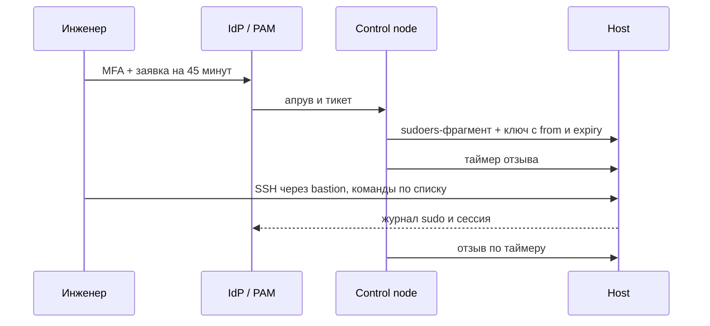

# Zero trust и JIT-доступ

Постоянный административный доступ — самая распространённая привилегия, которая не нужна никому постоянно. Zero trust заменяет «доверенную сеть» проверкой каждого запроса, а JIT-доступ (just-in-time) выдаёт права на время и отзывает их автоматически. Ansible здесь отвечает за выдачу, истечение и доказательства.

## 1. Зачем это нужно

В филиальной сети исторически сложилось так, что администратору выдан постоянный sudo на все хосты, а SSH-ключ лежит в домашнем каталоге без срока действия. Компрометация рабочей станции инженера или утёкший ключ дают злоумышленнику те же права, что и сотруднику, — и обнаружить это можно только по журналам, если они есть. Постоянные привилегии также означают, что увольнение сотрудника требует помнить о десятках хостов, куда он когда-то добавил ключ.

JIT-доступ меняет модель: права выдаются по заявке, на конкретный хост, на конкретные команды, на ограниченное время и только с разрешённого адреса. После истечения срока доступ исчезает без участия человека. Это уменьшает и вероятность компрометации, и объём ручной работы при выводе сотрудника из эксплуатации.

Вторая часть — сегментация. Даже идеально выданный доступ бесполезен, если из филиала можно достучаться до любой подсети. Zero trust предполагает, что сеть не доверенная: доступ к management-сегменту разрешён только с bastion-хоста или через PAM, а рабочие станции пользователей не имеют прямого маршрута к серверам управления. Ansible поддерживает это состояние, проверяя и применяя правила сегментации, но не заменяет проектирование сети.

## 2. Ключевые понятия

| Понятие | Назначение |
|---|---|
| Zero trust | модель без неявного доверия к сети или устройству |
| PDP | точка принятия решения: IdP, PAM, политика |
| PEP | точка исполнения: bastion, firewall, sudo, PAM-агент |
| JIT | выдача прав на время по обоснованному запросу |
| TTL | время жизни права до автоматического отзыва |
| Bastion | промежуточный хост для административного доступа |
| Session recording | запись терминальной сессии для разбора |
| PAM | система управления привилегированным доступом (vaulting, checkout) |
| mTLS | взаимная аутентификация клиента и сервера |
| Microsegmentation | изоляция сегментов независимо от периметра |
| Deprovisioning | полный отзыв доступов при уходе сотрудника |
| Break-glass | аварийный доступ с усиленным контролем |

## 3. Схема



Схема подчёркивает, что решение принимает не control node, а IdP или PAM: Ansible лишь исполняет уже принятое решение и фиксирует результат. Если control node начнёт сам решать, кому дать доступ, он станет самой ценной целью в инфраструктуре.

## 4. Проектирование

| Слой | Контроль | Реализация | Автоматизация | Доказательство |
|---|---|---|---|---|
| Идентификация | MFA, единый IdP | OIDC/SAML, отдельные учётки | нет, платформа | журнал входов IdP |
| Авторизация | заявка и апрув | тикет, PAM checkout | проверка тикета в playbook | тикет + запись выдачи |
| Доступ к хосту | ключ с ограничениями | `from=`, `expiry-time` | `ansible.posix.authorized_key` | содержимое `authorized_keys` |
| Привилегии | минимум команд | sudoers-фрагмент с `validate` | `ansible.builtin.template` | файл и журнал sudo |
| Срок | автоотзыв | systemd timer + реконсиляция | `systemd-run`, периодический playbook | `list-timers`, запись отзыва |
| Сессия | запись | tlog или PAM-модуль | установка и настройка ролью | файлы записи |
| Сеть | сегментация | VLAN, firewall, bastion | `ansible.posix.firewalld`, nftables | правила и схема |
| Вывод | полный отзыв | удаление ключей и sudo | роль deprovisioning | акт и отчёт проверки |

Таблица нужна как чек-лист проектирования: если хотя бы один слой отсутствует, JIT превращается в формальность. Например, ограничение по времени без сегментации оставляет доступ к management-сети с любой рабочей станции в течение срока действия.

## 5. Пошаговая реализация

1. Назначьте PDP. Для большинства организаций это IdP с MFA и PAM для привилегированных учёток. Заявка должна содержать хост, цель, срок и тикет.
2. Инвентаризируйте постоянные привилегии: `sudoers`, группы `wheel`/`sudo`, ключи в `authorized_keys`, сервисные учётки. Всё, что не является break-glass, подлежит переводу на JIT.
3. Уберите постоянный sudo у администраторов. Оставьте одну аварийную учётную запись с паролем в сейфе и включённым аудитом; её использование — отдельное событие.
4. Реализуйте выдачу прав playbook-ом: проверка тикета, подтверждение, sudoers-фрагмент с `visudo -cf`, ключ с `from=` и `expiry-time=`.
5. Ограничьте команды. `NOPASSWD: ALL` сводит смысл JIT к нулю: администратор всё равно получает root. Перечислите конкретные команды или используйте обёртку с журналированием.
6. Запустите таймер отзыва через `systemd-run`. Помните, что временные юниты не переживают перезагрузку, поэтому нужен второй механизм — периодическая реконсиляция.
7. Настройте запись сессий на bastion или через PAM. Запись должна попадать в защищённое хранилище, а не в домашний каталог пользователя.
8. Интегрируйте с PAM: checkout учётной записи, автоматическая смена пароля после сессии, запрет общего пароля. Ansible вызывает API PAM или готовит хост к подключению, но не хранит привилегированные секреты.
9. Опишите deprovisioning как отдельный playbook: удаление ключей по метке, sudo-фрагментов, сессий, членства в группах. Запускайте его по событию увольнения и ежеквартально как сверку.
10. Проверьте сегментацию: с рабочей станции не должно быть маршрута к management-сети, кроме bastion; с bastion — только необходимые порты.

mTLS заслуживает отдельного упоминания. Внутренние API (PAM, vCenter, репозиторий) должны требовать клиентский сертификат, а не только пароль или токен. Ansible в такой схеме не хранит приватные ключи в репозитории: сертификат выдаётся роли через платформу или краткоживущий токен, а проверка цепочки выполняется на стороне сервиса. Для административного доступа mTLS обычно терминируется на reverse proxy перед bastion — это позволяет централизованно отзывать доступ, не меняя конфигурацию каждого хоста.

Сегментация филиала строится вокруг двух сегментов: пользовательского и management. Между ними — default-deny и явные разрешения только на нужные порты. VPN и SD-WAN не отменяют это правило: туннель даёт транспорт, но не доверие. Если филиал подключается по SD-WAN, политика должна применяться на уровне сегментов, а не только на концентраторе, иначе боковое перемещение внутри филиала останется возможным. Проверка выполняется playbook-ом: список маршрутов, правила firewall, доступность management-портов с рабочей станции — и результат сохраняется как доказательство.

Deprovisioning — это не удаление пользователя, а полный отзыв: ключи с меткой JIT, sudo-фрагменты, членство в группах, активные сессии, токены в PAM. Playbook должен быть идемпотентным и запускаться дважды: по событию увольнения и по квартальному расписанию как сверка. Второй запуск ловит то, что не попало в событие — например, ключ, добавленный вручную во время отпуска администратора.

## 6. Полный запускаемый пример

`jit-access.yml`:

```yaml
---
- name: Grant time-limited sudo and SSH access
  hosts: "{{ target_host | default('none') }}"
  become: true
  gather_facts: true
  serial: 1
  max_fail_percentage: 0

  vars:
    jit_user: ""
    jit_ticket: ""
    jit_ttl_minutes: 45
    jit_source_cidr: "10.20.0.0/24"
    jit_public_key_file: "keys/{{ jit_user }}.pub"
    jit_commands:
      - /usr/bin/systemctl status
      - /usr/bin/journalctl
      - /usr/bin/tail

  tasks:
    - name: Refuse to run without a ticket
      ansible.builtin.assert:
        that:
          - jit_ticket is match('^CHG-[0-9]{4,}$')
          - jit_user is match('^[a-z][a-z0-9_-]{0,31}$')
        fail_msg: "Set jit_user and jit_ticket (CHG-1234)"
        quiet: true

    - name: Confirm the account exists
      ansible.builtin.command:
        argv: [getent, passwd, "{{ jit_user }}"]
      changed_when: false

    - name: Request approval from the change owner
      ansible.builtin.pause:
        prompt: "Type {{ jit_ticket }} to grant {{ jit_user }} access to {{ inventory_hostname }}"
      register: jit_approval

    - name: Verify the approval
      ansible.builtin.assert:
        that:
          - jit_approval.user_input | default('') == jit_ticket
        fail_msg: "Approval does not match the ticket, nothing changed"
        quiet: true

    - name: Compute the key expiry date
      ansible.builtin.command:
        argv: [date, -d, "+{{ jit_ttl_minutes }} minutes", +%Y%m%d]
      register: jit_expiry
      changed_when: false

    - name: Deploy the sudoers fragment
      ansible.builtin.template:
        src: templates/jit-sudoers.j2
        dest: "/etc/sudoers.d/90-jit-{{ jit_user }}"
        owner: root
        group: root
        mode: "0440"
        validate: "visudo -cf %s"

    - name: Authorize the public key with source and expiry limits
      ansible.posix.authorized_key:
        user: "{{ jit_user }}"
        key: "{{ lookup('ansible.builtin.file', jit_public_key_file) }}"
        key_options: 'from="{{ jit_source_cidr }}",expiry-time="{{ jit_expiry.stdout | trim }}"'
        comment: "jit-{{ jit_user }}"
        exclusive: false
        state: present

    - name: Deploy the revocation script
      ansible.builtin.template:
        src: templates/jit-revoke.sh.j2
        dest: /usr/local/sbin/jit-revoke.sh
        owner: root
        group: root
        mode: "0750"

    - name: Cancel a stale revocation timer for this user
      ansible.builtin.command:
        argv: [systemctl, stop, "jit-revoke-{{ jit_user }}.{{ item }}"]
      loop: [timer, service]
      register: jit_stale_timer
      changed_when: jit_stale_timer.rc == 0
      # rc 5 means the unit is not loaded, which is normal before the first grant
      failed_when: jit_stale_timer.rc not in [0, 5]

    - name: Arm the revocation timer
      ansible.builtin.command:
        argv:
          - systemd-run
          - "--on-active={{ jit_ttl_minutes }}m"
          - "--unit=jit-revoke-{{ jit_user }}"
          - "--collect"
          - /usr/local/sbin/jit-revoke.sh
          - "{{ jit_user }}"
      register: jit_timer
      changed_when: true

    - name: Write the grant to the audit log
      ansible.builtin.lineinfile:
        path: /var/log/jit-access.log
        line: "{{ ansible_date_time.iso8601 }} grant user={{ jit_user }} host={{ inventory_hostname }} ticket={{ jit_ticket }} ttl={{ jit_ttl_minutes }}m approval={{ jit_approval.user_input }}"
        create: true
        owner: root
        group: root
        mode: "0640"
        insertafter: EOF

    - name: Show the resulting sudo rules
      ansible.builtin.command:
        argv: [sudo, -l, -U, "{{ jit_user }}"]
      register: jit_sudo_list
      changed_when: false

    - name: Print the effective rules
      ansible.builtin.debug:
        var: jit_sudo_list.stdout_lines
```

`templates/jit-sudoers.j2`:

```jinja2
# {{ ansible_managed }} ticket={{ jit_ticket }}
Defaults:{{ jit_user }} timestamp_timeout=0
{{ jit_user }} ALL=(root) NOPASSWD: {{ jit_commands | join(', ') }}
```

`templates/jit-revoke.sh.j2`:

```bash
#!/bin/bash
# {{ ansible_managed }}
set -euo pipefail
USER_NAME="${1:?user name required}"
rm -f "/etc/sudoers.d/90-jit-${USER_NAME}"
if [ -f "/home/${USER_NAME}/.ssh/authorized_keys" ]; then
  sed -i "/jit-${USER_NAME}\$/d" "/home/${USER_NAME}/.ssh/authorized_keys"
fi
loginctl terminate-user "${USER_NAME}" 2>/dev/null || true
logger -t jit "revoked access for ${USER_NAME}"
```

`jit-reconcile.yml` — второй барьер, потому что временный юнит исчезает при перезагрузке:

```yaml
---
- name: Revoke expired JIT grants
  hosts: branches
  become: true
  gather_facts: false
  serial: "25%"

  vars:
    jit_ttl_minutes: 45

  tasks:
    - name: Find JIT sudoers fragments older than the TTL
      ansible.builtin.find:
        paths: /etc/sudoers.d
        patterns: "90-jit-*"
        age: "{{ jit_ttl_minutes }}m"
        file_type: file
      register: jit_stale

    - name: Revoke each expired grant
      ansible.builtin.command:
        argv:
          - /usr/local/sbin/jit-revoke.sh
          - "{{ item.path | basename | regex_replace('^90-jit-', '') }}"
      loop: "{{ jit_stale.files }}"
      loop_control:
        label: "{{ item.path }}"
      changed_when: true
```

Ключ выдаётся с `from=` и `expiry-time=`, но `expiry-time` имеет точность до дня, поэтому основным механизмом остаётся таймер и реконсиляция. Это не дублирование, а разные слои: SSH-ключ деградирует сам по себе, даже если control node недоступен, а таймер закрывает доступ в пределах TTL, не дожидаясь конца суток.

!!! warning "Риск"
    Ошибка в sudoers-фрагменте может лишить администратора sudo, а ошибка в ключе — доступа по SSH. Всегда проверяйте `validate`, держите открытую сессию до подтверждения входа, используйте консоль ESXi как резервный путь и не выдавайте `NOPASSWD: ALL` даже на 15 минут.

## 7. Проверка результата

```bash
ansible-playbook -i inventories/prod/hosts.yml jit-access.yml -e target_host=msk-app03 -e jit_user=ivanov -e jit_ticket=CHG-2211
sudo -l -U ivanov
sudo grep -c "jit-ivanov" /home/ivanov/.ssh/authorized_keys
systemctl list-timers 'jit-revoke-*'
sudo journalctl -t jit -n 20
```

Проверьте, что вход возможен только с разрешённой подсети: попытка с другого адреса должна отклоняться по `from=`. Затем дождитесь срабатывания таймера на лабораторном хосте и убедитесь, что sudoers-файл исчез, ключ удалён, а активная сессия завершена. Отдельно проверьте реконсиляцию: перезагрузите хост с выданным доступом, дождитесь окна периодического запуска и убедитесь, что просроченный доступ отозван.

Раз в квартал проверяйте break-glass: доступ должен работать, но каждое использование — оставлять запись и уведомление. Если аварийный доступ удобнее обычного, им будут пользоваться постоянно, и весь JIT-процесс превратится в декорацию.

## 8. Безопасность и blast radius

| Риск | Последствие | Мера |
|---|---|---|
| Синтаксическая ошибка в sudoers | потеря sudo | `visudo -cf`, открытая сессия, консоль |
| `NOPASSWD: ALL` | JIT теряет смысл | список команд, обёртка |
| Таймер потерян при перезагрузке | доступ живёт дольше TTL | реконсиляция, `expiry-time` |
| Часы хоста ушли | неверный срок действия | NTP, проверка `timedatectl` |
| Ключ без `from=` | доступ с любого адреса | ограничение подсетью bastion |
| Пользователь остаётся в сессии | работа после отзыва | `loginctl terminate-user` |
| Обход bastion | прямой доступ к management | сегментация, firewall |
| Отзыв забыт при увольнении | доступ у бывшего сотрудника | deprovisioning по событию, сверка |

Записи о выдаче и отзыве должны уходить в SIEM, а не оставаться только в локальном файле: корреляция «выдача доступа» и «вход с нетипичного адреса» — один из немногих работающих детектов для привилегированного доступа.

Blast radius JIT-изменений ограничен одним хостом и одним пользователем, если соблюдён `serial: 1`. Основная опасность — не в изменении, а в остаточном доступе: если отзыв не сработал, привилегия остаётся навсегда. Поэтому доказательством считается не факт выдачи, а факт отзыва: запись в журнале, отсутствие файла и закрытая сессия.

## 9. Комплаенс-маппинг

| Требование | Как закрывается |
|---|---|
| NIST SP 800-207 | политика нулевого доверия, PDP/PEP, микросегментация |
| NIST CSF 2.0 PR.AA | идентификация, аутентификация, управление доступом |
| ISO/IEC 27001:2022 A.5.15, A.5.18 | права доступа и их пересмотр |
| ISO/IEC 27001:2022 A.8.2, A.8.5 | привилегированный доступ и аутентификация |
| CIS Control 5, 6 | управление учётными записями и доступом |
| Отраслевые требования | сроки хранения записей сессий — по регламенту |

## 10. Типичные ошибки и troubleshooting

| Симптом | Причина | Проверка | Решение |
|---|---|---|---|
| `visudo` отклоняет файл | ошибка в шаблоне | `visudo -cf` вручную | исправить шаблон, не отключать validate |
| Ключ не работает | неверные `key_options` | `/var/log/secure`, `auth.log` | убрать пробелы, проверить кавычки |
| Вход возможен не с того адреса | `from=` не совпал или отсутствует | `grep from=` | задать подсеть bastion |
| Таймер не сработал | юнит потерян после перезагрузки | `list-timers` | реконсиляция по расписанию |
| `systemd-run: unit already exists` | предыдущая выдача ещё активна | `list-timers` | отменить старый таймер до новой выдачи |
| Доступ остался после TTL | реконсиляция не запускается | `find` по возрасту | включить таймер на control node |
| Сессия не закрылась | нет systemd-logind | `loginctl` | завершать процесс вручную, добавить проверку |
| Sudo просит пароль | `timestamp_timeout=0` | `sudo -l` | это ожидаемое поведение |

## 11. Чек-лист

- [ ] Постоянный sudo у администраторов устранён или обоснован.
- [ ] Каждая выдача привязана к тикету и апруву.
- [ ] Команды в sudoers перечислены явно, без wildcard.
- [ ] Ключ ограничен `from=` и `expiry-time=`.
- [ ] Таймер отзыва создан и проверен.
- [ ] Реконсиляция работает независимо от таймера.
- [ ] Запись сессий настроена и защищена.
- [ ] Сегментация не позволяет обойти bastion.
- [ ] Deprovisioning выполняется по событию и по расписанию.
- [ ] Break-glass описан и покрыт аудитом.

## 12. Источники

- [NIST SP 800-207: Zero Trust Architecture](https://csrc.nist.gov/pubs/sp/800/207/final)
- [sudoers(5)](https://www.sudo.ws/docs/man/sudoers.man/)
- [systemd-run(1)](https://www.freedesktop.org/software/systemd/man/latest/systemd-run.html)
- [ansible.posix.authorized_key](https://docs.ansible.com/ansible/latest/collections/ansible/posix/authorized_key_module.html)
- [OpenSSH manual pages](https://www.openssh.com/manual.html)

## 13. Связанные страницы

- [Доступ и привилегии](../secure-dev/12-access.md)
- [Базовая сеть хоста](../admin/25-network-basics.md)
- [Сеть и облако: харденинг](41-network-cloud-hardening.md)
- [Реагирование на инциденты](45-incident-response.md)
- [SSH, PAM, sudo, MFA](36-auth-ssh-pam.md)
- [Межсетевой экран](37-firewall.md)
