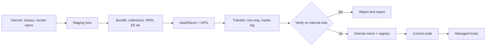

# Air-gapped среды

Изолированный сегмент без выхода в интернет не отменяет необходимости обновлять коллекции, пакеты и Execution Environments. Он меняет способ доставки: содержимое собирается на промежуточном хосте, подписывается, переносится по регламенту и проверяется до применения. Ошибка в этом процессе стоит дороже, чем в обычной сети, потому что альтернативного канала нет.

## 1. Зачем это нужно

Air gap (воздушный зазор) применяется там, где подключение к интернету недопустимо: технологические сегменты, изолированные контуры, площадки с особыми требованиями. Внутри такого контура всё равно работают RHEL или Ubuntu, всё равно выходят CVE и всё равно нужны новые версии коллекций. Без управляемого процесса обновления контур деградирует: пакеты остаются на версиях двухлетней давности, а автоматизация замирает на моменте установки.

Стихийная альтернатива — «принести на флешке» — хуже отсутствия процесса. Никто не знает происхождение архива, не проверена целостность, неясно, кто и когда его копировал. Один заражённый файл, попавший в контур, обходит всю сетевую защиту, потому что периметр был единственной линией обороны. Поэтому процесс строится вокруг подписанных бандлов, контрольных сумм и журнала переноса.

Третий аспект — воспроизводимость. В обычной сети control node ставит коллекции из Galaxy «последней версии», и это считается допустимым. В air gap такая стратегия невозможна: нужно заранее знать полный набор зависимостей, включая транзитивные, собрать их один раз и доставить как единый артефакт. Побочный эффект — тот же набор можно использовать и во внешнем контуре, что делает сборки одинаковыми.

## 2. Ключевые понятия

| Понятие | Назначение |
|---|---|
| Air gap | физическая или логическая изоляция сегмента от внешних сетей |
| Staging host | промежуточный хост с доступом в интернет для сборки бандла |
| Mirror | внутреннее зеркало репозитория пакетов |
| `reposync` | выгрузка пакетов из репозитория dnf на диск |
| `createrepo_c` | создание метаданных локального репозитория |
| Collection bundle | набор tarball-ов коллекций с зависимостями |
| Execution Environment | образ с ansible-core, коллекциями и зависимостями |
| Detached signature | отдельная GPG-подпись файла с контрольными суммами |
| SHA256SUMS | список хешей всех файлов бандла |
| Transfer procedure | регламент переноса: кто, когда, чем, с какой проверкой |
| `ansible-pull` | запуск playbook из локального Git-зеркала на самом хосте |

## 3. Схема



Схема показывает два независимых барьера: подпись на выходе и проверка на входе. Если проверка выполняется тем же человеком, который собирал бандл, контроль ослабевает; в регламенте стоит разделение ролей даже при малой команде.

## 4. Пошаговая реализация

1. Инвентаризируйте зависимости: список коллекций с версиями, Python-пакеты, системные пакеты, базовые образы для Execution Environment. Всё, что не внесено в список, при первой же нехватке придётся «докидывать» вне регламента.
2. Подготовьте staging host с доступом в интернет и без доступа к продакшн-сегменту. Он не должен иметь общих учётных данных с control node.
3. Соберите коллекции командой `ansible-galaxy collection download` по файлу `requirements.yml`. Команда скачивает сами коллекции и их зависимости в локальный каталог, формируя готовый к переносу набор.
4. Соберите пакеты ОС: для RHEL-семейства — `dnf reposync` и `createrepo_c`, для Debian/Ubuntu — `aptly` или аналог. Выгружайте только те репозитории и архитектуры, которые реально используются.
5. Соберите Execution Environment на staging host и сохраните образ в tar через `podman save`. Это единственный компонент, который нельзя «дособрать» внутри контура без базового образа и сети.
6. Посчитайте `SHA256SUMS` по всем файлам бандла и подпишите файл сумм отдельной GPG-подписью. Ключ подписи храните вне staging host: на аппаратном токене или в сейфе.
7. Опишите процедуру переноса: носитель, ответственный, второй проверяющий, запись в журнале, время передачи. Для критичных контуров используйте однонаправленную передачу, чтобы исключить обратный канал.
8. На внутренней стороне проверьте подпись и суммы до распаковки. Только после успешной проверки файлы попадают в каталог распространения.
9. Разложите артефакты: коллекции — в каталог, доступный control node; образ — в локальный registry или в хранилище образов; пакеты — в зеркало с обновлёнными метаданными.
10. Переключите хосты на внутренние репозитории и зафиксируйте версии. Для удалённых площадок используйте `ansible-pull` из внутреннего Git-зеркала, если централизованный запуск недоступен.

Частота обновления задаётся отдельно для каждого типа артефакта: смешивать их в одном «большом переносе раз в год» нельзя, иначе критичный патч ждёт следующего цикла.

| Компонент | Плановый цикл | Внеочередной повод |
|---|---|---|
| Пакеты ОС | ежемесячно | CVE с активной эксплуатацией |
| Коллекции | ежеквартально | исправление безопасности или несовместимость |
| Execution Environment | ежеквартально, вместе с коллекциями | срочный патч базового образа |
| Базовый образ EE | при выходе обновлений | критичная уязвимость в базе |
| Сам ansible-core | при смене минорной версии | критичная уязвимость |

Базовый образ Execution Environment фиксируйте по digest или неизменяемому тегу версии, а не по `latest`: он может измениться на staging host между сборками, и тогда одинаковый `execution-environment.yml` даст разные образы. Тот же принцип применим к готовому образу в целом: в отчёте о сборке сохраняйте digest, чтобы через полгода можно было доказать, какой именно образ работал в контуре.

## 5. Полный запускаемый пример

`requirements.yml`:

```yaml
---
collections:
  - name: ansible.posix
    version: "1.5.4"
  - name: community.general
    version: "8.6.0"
  - name: ansible.eda
    version: "2.6.0"
```

Сборка бандла на staging host:

```bash
sudo dnf install -y dnf-plugins-core createrepo_c
python3 -m pip install --user ansible-core==2.17.* ansible-builder

mkdir -p /srv/bundle/collections /srv/bundle/rpm /srv/bundle/ee

# Collections with dependencies
ansible-galaxy collection download -r requirements.yml -p /srv/bundle/collections

# OS packages for RHEL family
dnf reposync --repoid=rhel-9-baseos --download-path=/srv/bundle/rpm --newest-only
dnf reposync --repoid=rhel-9-appstream --download-path=/srv/bundle/rpm --newest-only
createrepo_c /srv/bundle/rpm/rhel-9-baseos
createrepo_c /srv/bundle/rpm/rhel-9-appstream

# Execution Environment
ansible-builder build \
  --file execution-environment.yml \
  --tag registry.internal/ee/ops:1.0.0 \
  --container-runtime podman
podman save --output /srv/bundle/ee/ee-ops-1.0.0.tar registry.internal/ee/ops:1.0.0

# Checksums and signature
cd /srv/bundle
find . -type f ! -name SHA256SUMS ! -name SHA256SUMS.asc -print0 | sort -z | xargs -0 sha256sum > SHA256SUMS
gpg --detach-sign --armor SHA256SUMS
```

Проверка на внутренней стороне (структура каталогов бандла сохраняется при переносе):

```bash
gpg --verify /mnt/transfer/SHA256SUMS.asc /mnt/transfer/SHA256SUMS
cd /mnt/transfer && sha256sum -c SHA256SUMS

ansible-galaxy collection install /mnt/transfer/collections/*.tar.gz -p /srv/ansible/collections
podman load --input /mnt/transfer/ee/ee-ops-1.0.0.tar
podman tag registry.internal/ee/ops:1.0.0 registry.internal:5000/ee/ops:1.0.0
podman push registry.internal:5000/ee/ops:1.0.0

cp -a /mnt/transfer/rpm/* /srv/mirror/
createrepo_c --update /srv/mirror/rhel-9-baseos
createrepo_c --update /srv/mirror/rhel-9-appstream
```

`execution-environment.yml`:

```yaml
---
version: 3
images:
  base_image:
    name: registry.internal/base/ee-minimal-rhel9:9.4-3
dependencies:
  galaxy: requirements.yml
  python:
    - jmespath
  system:
    - openssh-clients
```

Конфигурация репозитория на управляемых хостах:

```yaml
---
- name: Point hosts to the internal mirror
  hosts: branches
  become: true
  gather_facts: true

  tasks:
    - name: Deploy the internal dnf repository file
      ansible.builtin.template:
        src: templates/internal.repo.j2
        dest: /etc/yum.repos.d/00-internal.repo
        owner: root
        group: root
        mode: "0644"
      when: ansible_facts['os_family'] == 'RedHat'

    - name: Read the effective repository list
      ansible.builtin.command:
        argv: [dnf, repolist, --enabled]
      register: internal_repos
      changed_when: false
      when: ansible_facts['os_family'] == 'RedHat'

    - name: Fail when the internal repository is not enabled
      ansible.builtin.assert:
        that:
          - internal_repos.stdout is search('internal-base')
        fail_msg: "internal-base is not enabled on {{ inventory_hostname }}"
        quiet: true
      when: ansible_facts['os_family'] == 'RedHat'
```

`templates/internal.repo.j2`:

```jinja2
# {{ ansible_managed }}
[internal-base]
name=Internal base mirror
baseurl=http://mirror.internal/rhel-9-baseos
enabled=1
gpgcheck=1
gpgkey=file:///etc/pki/rpm-gpg/RPM-GPG-KEY-internal
metadata_expire=1h
```

Публичные репозитории отключаются не этим playbook-ом, а сборкой шаблона ВМ: в air gap хост изначально не должен иметь рабочего маршрута в интернет. Playbook проверяет результат — включённый внутренний репозиторий и отсутствие необходимости ходить наружу.

`ansible-pull` для площадки без постоянного канала:

```bash
ansible-pull \
  -U https://git.internal/ansible/site.git \
  -C main \
  -d /var/lib/ansible-pull/site \
  -i localhost, \
  playbooks/site.yml
```

Внутри контура `ansible-pull` запускается из systemd-таймера и работает с локальным Git-зеркалом. Это компромисс: хост сам забирает код, поэтому компрометация репозитория означает компрометацию всего парка. Защита — подписанные теги, доступ на чтение по deploy-ключу, запуск от отдельной учётной записи с ограниченным sudo и фиксация `-C` на конкретном теге, а не на плавающей ветке.

!!! warning "Риск"
    Никогда не переносите в контур неподписанный бандл «на всякий случай» и не отключайте проверку подписи ради удобства. Один раз пропущенный контроль превращается в обычную практику, и восстановить доверие к контуру уже нельзя.

## 6. Проверка результата

```bash
ansible-galaxy collection list
ansible-doc -l | wc -l
podman images | grep ee/ops
dnf repolist --all
dnf --disablerepo='*' --enablerepo=internal-base list available | head
apt-cache policy openssh-server
```

Проверьте, что версии коллекций совпадают с `requirements.yml`, а не с тем, что «подтянулось». Убедитесь, что публичные репозитории отключены и установка пакета из них невозможна. Для образа — запустите `ansible-navigator` или `podman run` с тестовым playbook и проверьте, что нужные коллекции доступны внутри образа, а не на хосте.

Отдельно проверьте цикл обновления: соберите бандл с изменённой версией коллекции, перенесите, установите и убедитесь, что старая версия заменена. Если старая версия остаётся рядом, control node может использовать её при неоднозначном разрешении путей.

## 7. Безопасность и blast radius

| Риск | Последствие | Мера |
|---|---|---|
| Неподписанный бандл | заражение изолированного контура | GPG-подпись, проверка на входе |
| Расхождение хешей | повреждённый или подменённый артефакт | `sha256sum -c` до распаковки |
| Двусторонний канал | нарушение изоляции | однонаправленная передача, запрет обратного трафика |
| Устаревшее зеркало | накопление CVE | регламент обновления и отчёт о версиях |
| Компрометация Git-зеркала | выполнение чужого кода на парке | подписанные теги, read-only deploy-ключ |
| `ansible-pull` от root без ограничений | полный контроль над хостом | отдельная учётка, ограниченный sudo |
| Ключ подписи на staging host | подделка бандла | токен или сейф, разделение ролей |
| Носитель без учёта | потеря и утечка | журнал, маркировка, проверка антивирусом |

Blast radius здесь максимальный: бандл применяется ко всему контуру, а не к одному хосту. Поэтому проверка выполняется до установки, а не после, и первая установка делается на одном тестовом хосте. Откат — возврат предыдущего бандла, который хранится до подтверждения работоспособности нового; для пакетов это снапшот ВМ или предыдущая версия зеркала, для образа — предыдущий тег.

Отдельно регламентируйте носитель. Перенос на физическом диске — самый слабый участок схемы: носитель нужно маркировать, регистрировать в журнале, проверять антивирусом до подключения к staging host и стирать после переноса. Для контуров с высокими требованиями используется однонаправленная передача, при которой обратный трафик технически невозможен; это дороже в настройке, но устраняет целый класс сценариев, где заражённый staging host становится точкой входа.

## 8. Комплаенс-маппинг

| Требование | Как закрывается |
|---|---|
| ISO/IEC 27001:2022 A.5.21 | безопасность цепочки поставок ИКТ |
| ISO/IEC 27001:2022 A.8.32 | управление изменениями и версиями |
| NIST CSF 2.0 PR.PS | поддержание и защита платформ |
| CIS Control 2 | инвентаризация ПО и версий |
| CIS Control 7 | управление уязвимостями в изолированном контуре |
| Отраслевые требования | регламент переноса и журнал носителей |

## 9. Типичные ошибки и troubleshooting

| Симптом | Причина | Проверка | Решение |
|---|---|---|---|
| Коллекция не найдена | не скачана зависимость | `ansible-galaxy collection list` | скачать с `-r`, перенести весь каталог |
| Ошибка версии Python | EE и хост используют разные интерпретаторы | `ansible --version` внутри образа | собрать EE с нужной версией |
| `sha256sum -c` падает | файл изменён при переносе | вывод проверки | пересобрать бандл, не править вручную |
| GPG: public key not found | ключ проверки не импортирован | `gpg --list-keys` | импортировать публичный ключ заранее |
| `podman load` не запускает образ | другая архитектура | `podman inspect` | собирать под целевую архитектуру |
| `dnf` не видит пакеты | метаданные не обновлены | `createrepo_c --update` | пересоздать метаданные |
| `ansible-pull` не клонирует | нет доступа к Git или host key | вывод задачи | deploy-ключ, проверка отпечатка вручную |
| Зеркало «замёрзло» | нет регламента обновления | дата метаданных | ежемесячный цикл и внеочередной для CVE |

## 10. Чек-лист

- [ ] Полный список зависимостей зафиксирован в `requirements.yml`.
- [ ] Коллекции скачаны вместе с зависимостями.
- [ ] Пакеты выгружены и метаданные репозитория созданы.
- [ ] Execution Environment собран и сохранён в tar.
- [ ] `SHA256SUMS` посчитан по всем файлам и подписан.
- [ ] Проверка подписи и сумм выполняется на внутренней стороне.
- [ ] Журнал переноса ведётся, роли разделены.
- [ ] Публичные репозитории на хостах отключены.
- [ ] Версии коллекций и пакетов видны в отчёте.
- [ ] Предыдущий бандл хранится для отката.
- [ ] `ansible-pull` закреплён на теге и работает от отдельной учётки.

## 11. Источники

- [Downloading collections](https://docs.ansible.com/ansible/latest/collections_guide/collections_downloading.html)
- [ansible-galaxy CLI](https://docs.ansible.com/ansible/latest/cli/ansible-galaxy.html)
- [ansible-pull CLI](https://docs.ansible.com/ansible/latest/cli/ansible-pull.html)
- [ansible-builder documentation](https://ansible.readthedocs.io/projects/builder/en/latest/)
- [GnuPG manual](https://gnupg.org/documentation/manuals/gnupg/)

## 12. Связанные страницы

- [Безопасность цепочки поставок](../secure-dev/15-supply-chain.md)
- [Распределённые филиалы](../admin/20-branch-fleet.md)
- [AAP, AWX, Semaphore](../quality/53-aap-awx.md)
- [Миграция и наследие](../admin/31-migration.md)
- [Установка и версионирование](../fundamentals/03-install.md)
- [Уязвимости и патчи](43-vuln-patching.md)
